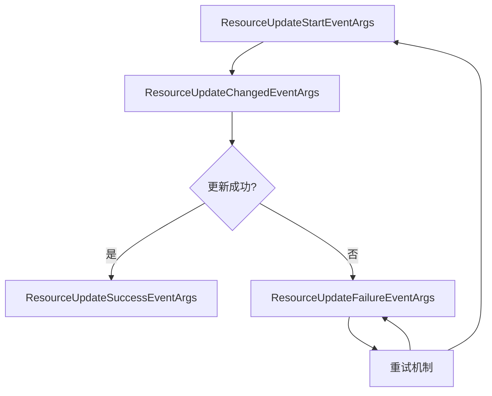
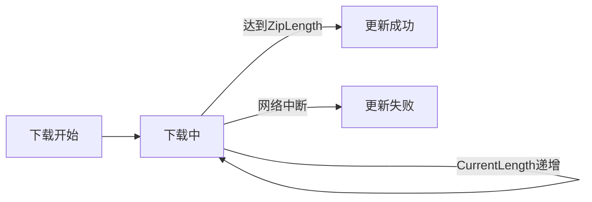
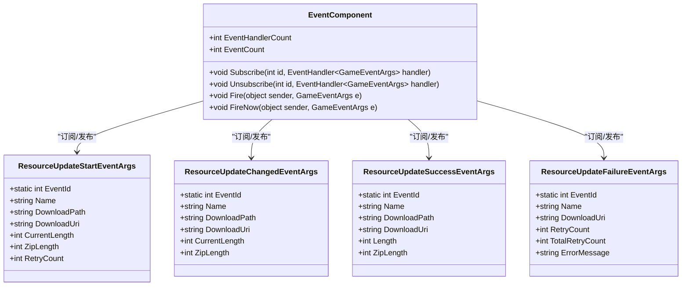
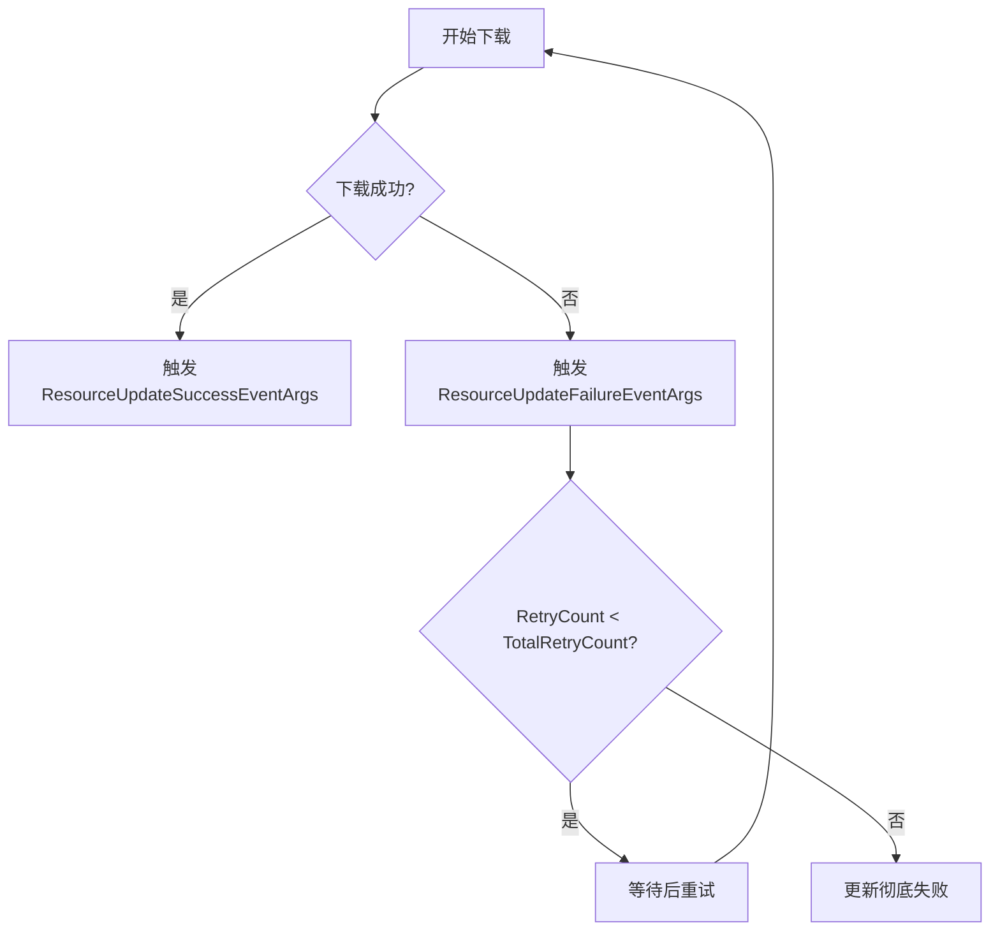

# 资源更新事件

<cite>
**Referenced Files in This Document**   
- [ResourceUpdateStartEventArgs.cs](file://Scripts/Runtime/Resource/ResourceUpdateStartEventArgs.cs)
- [ResourceUpdateChangedEventArgs.cs](file://Scripts/Runtime/Resource/ResourceUpdateChangedEventArgs.cs)
- [ResourceUpdateSuccessEventArgs.cs](file://Scripts/Runtime/Resource/ResourceUpdateSuccessEventArgs.cs)
- [ResourceUpdateFailureEventArgs.cs](file://Scripts/Runtime/Resource/ResourceUpdateFailureEventArgs.cs)
- [EventComponent.cs](file://Scripts/Runtime/Event/EventComponent.cs)
</cite>

## 目录
1. [资源更新事件概述](#资源更新事件概述)
2. [资源更新开始事件](#资源更新开始事件)
3. [资源更新中事件](#资源更新中事件)
4. [资源更新成功事件](#资源更新成功事件)
5. [资源更新失败事件](#资源更新失败事件)
6. [事件系统与监听机制](#事件系统与监听机制)
7. [错误处理与重试策略](#错误处理与重试策略)

## 资源更新事件概述

在Unity游戏框架中，资源更新过程通过一系列事件来通知系统各个组件当前的更新状态。这些事件构成了一个完整的资源更新生命周期，从开始到成功或失败，每个阶段都有对应的事件类型。本文档系统性地描述了资源更新全生命周期中的四个核心事件：`ResourceUpdateStartEventArgs`（更新开始）、`ResourceUpdateChangedEventArgs`（更新中）、`ResourceUpdateSuccessEventArgs`（更新成功）和`ResourceUpdateFailureEventArgs`（更新失败）。这些事件通过事件系统（`EventComponent`）进行分发和监听，为开发者提供了对资源更新过程的全面控制和监控能力。



**Diagram sources**
- [ResourceUpdateStartEventArgs.cs](file://Scripts/Runtime/Resource/ResourceUpdateStartEventArgs.cs)
- [ResourceUpdateChangedEventArgs.cs](file://Scripts/Runtime/Resource/ResourceUpdateChangedEventArgs.cs)
- [ResourceUpdateSuccessEventArgs.cs](file://Scripts/Runtime/Resource/ResourceUpdateSuccessEventArgs.cs)
- [ResourceUpdateFailureEventArgs.cs](file://Scripts/Runtime/Resource/ResourceUpdateFailureEventArgs.cs)

## 资源更新开始事件

`ResourceUpdateStartEventArgs`事件在资源更新过程启动时触发，标志着下载任务的开始。该事件包含了资源更新的初始状态信息，为后续的更新过程提供了上下文。

### 初始状态字段

`ResourceUpdateStartEventArgs`类定义了多个只读属性，这些属性在事件创建时被初始化，并在整个更新过程中保持不变，直到事件被清理。

- **DownloadUri**: 获取资源的下载地址，表示资源将从该URL进行下载。
- **CurrentLength**: 获取当前已下载的大小，初始值为0，表示尚未开始下载任何数据。
- **RetryCount**: 获取已重试下载的次数，初始值为0，表示这是第一次尝试下载。

这些字段的初始状态在`ResourceUpdateStartEventArgs`的构造函数中被明确设置：

```csharp
public ResourceUpdateStartEventArgs()
{
    Name = null;
    DownloadPath = null;
    DownloadUri = null;
    CurrentLength = 0;
    ZipLength = 0;
    RetryCount = 0;
}
```

**Section sources**
- [ResourceUpdateStartEventArgs.cs](file://Scripts/Runtime/Resource/ResourceUpdateStartEventArgs.cs#L25-L33)

## 资源更新中事件

`ResourceUpdateChangedEventArgs`事件在资源更新过程中周期性地触发，用于报告下载进度的实时变化。该事件是监控下载状态和实现进度条功能的关键。

### 下载进度特性

`ResourceUpdateChangedEventArgs`的核心是`CurrentLength`字段，它表示当前已下载的字节数。随着下载的进行，这个值会不断增加，直到等于资源的总大小。

- **CurrentLength**: 获取当前下载大小，该值在下载过程中持续递增，反映了下载的实时进度。
- **ZipLength**: 获取压缩后大小，表示资源在压缩状态下的总大小。

与`ResourceUpdateStartEventArgs`不同，`ResourceUpdateChangedEventArgs`不包含`RetryCount`字段，因为它专注于报告下载过程中的状态变化，而不是重试逻辑。



**Diagram sources**
- [ResourceUpdateChangedEventArgs.cs](file://Scripts/Runtime/Resource/ResourceUpdateChangedEventArgs.cs)

**Section sources**
- [ResourceUpdateChangedEventArgs.cs](file://Scripts/Runtime/Resource/ResourceUpdateChangedEventArgs.cs)

## 资源更新成功事件

`ResourceUpdateSuccessEventArgs`事件在资源成功下载并验证后触发，标志着资源更新过程的顺利完成。该事件包含了资源的最终状态信息。

### 最终值字段

当资源更新成功时，以下字段将包含最终的、完整的值：

- **Length**: 获取资源解压后的大小，表示资源在本地存储中的实际大小。
- **ZipLength**: 获取压缩后大小，与下载过程中的大小一致，用于验证下载完整性。

这些值在`ResourceUpdateSuccessEventArgs`的构造函数中被初始化为0，并在事件创建时由系统填充：

```csharp
public ResourceUpdateSuccessEventArgs()
{
    Name = null;
    DownloadPath = null;
    DownloadUri = null;
    Length = 0;
    ZipLength = 0;
}
```

**Section sources**
- [ResourceUpdateSuccessEventArgs.cs](file://Scripts/Runtime/Resource/ResourceUpdateSuccessEventArgs.cs#L25-L32)

## 资源更新失败事件

`ResourceUpdateFailureEventArgs`事件在资源更新过程中发生错误时触发，提供了关于失败原因的详细信息，是实现错误处理和重试机制的基础。

### 错误信息与重试机制

该事件包含以下关键字段，用于诊断问题和决定后续操作：

- **ErrorMessage**: 获取错误信息，描述了导致更新失败的具体原因，如网络连接超时、文件损坏等。
- **RetryCount**: 获取已重试的次数，表示当前是第几次尝试下载。
- **TotalRetryCount**: 获取设定的总重试次数，表示系统允许的最大重试次数。

`RetryCount`和`TotalRetryCount`的关系决定了重试策略：当`RetryCount`小于`TotalRetryCount`时，系统会自动尝试重新下载；当达到`TotalRetryCount`时，更新过程将彻底失败。

```csharp
public ResourceUpdateFailureEventArgs()
{
    Name = null;
    DownloadUri = null;
    RetryCount = 0;
    TotalRetryCount = 0;
    ErrorMessage = null;
}
```

**Section sources**
- [ResourceUpdateFailureEventArgs.cs](file://Scripts/Runtime/Resource/ResourceUpdateFailureEventArgs.cs#L25-L32)

## 事件系统与监听机制

所有资源更新事件都通过`EventComponent`（事件组件）进行管理和分发。`EventComponent`是Unity游戏框架中的核心组件之一，负责事件的订阅、发布和处理。

### 事件监听器注册

要监听资源更新事件，需要使用`EventComponent`的`Subscribe`方法注册事件处理回调函数。每个事件类型都有一个唯一的事件ID，通过这个ID来订阅特定的事件。

```csharp
// 示例：注册资源更新开始事件的监听器
EventComponent eventComponent = GameEntry.Event;
eventComponent.Subscribe(ResourceUpdateStartEventArgs.EventId, OnResourceUpdateStart);

private void OnResourceUpdateStart(object sender, GameEventArgs e)
{
    ResourceUpdateStartEventArgs ne = (ResourceUpdateStartEventArgs)e;
    // 处理资源更新开始事件
    Debug.Log($"开始下载资源: {ne.Name}, 地址: {ne.DownloadUri}");
}
```

`EventComponent`提供了以下关键方法：

- `Subscribe(int id, EventHandler<GameEventArgs> handler)`: 订阅指定事件ID的事件。
- `Unsubscribe(int id, EventHandler<GameEventArgs> handler)`: 取消订阅指定事件ID的事件。
- `Fire(object sender, GameEventArgs e)`: 抛出事件，线程安全，下一帧分发。
- `FireNow(object sender, GameEventArgs e)`: 立即抛出事件，非线程安全。



**Diagram sources**
- [EventComponent.cs](file://Scripts/Runtime/Event/EventComponent.cs)
- [ResourceUpdateStartEventArgs.cs](file://Scripts/Runtime/Resource/ResourceUpdateStartEventArgs.cs)
- [ResourceUpdateChangedEventArgs.cs](file://Scripts/Runtime/Resource/ResourceUpdateChangedEventArgs.cs)
- [ResourceUpdateSuccessEventArgs.cs](file://Scripts/Runtime/Resource/ResourceUpdateSuccessEventArgs.cs)
- [ResourceUpdateFailureEventArgs.cs](file://Scripts/Runtime/Resource/ResourceUpdateFailureEventArgs.cs)

**Section sources**
- [EventComponent.cs](file://Scripts/Runtime/Event/EventComponent.cs)

## 错误处理与重试策略

资源更新过程中可能遇到各种异常情况，如网络中断、服务器错误、文件损坏等。框架通过`ResourceUpdateFailureEventArgs`事件和内置的重试机制来处理这些错误。

### 实际场景处理

#### 网络异常处理
当发生网络连接超时或中断时，`ErrorMessage`会包含具体的网络错误信息。系统会根据`RetryCount`和`TotalRetryCount`决定是否重试。

```csharp
private void OnResourceUpdateFailure(object sender, GameEventArgs e)
{
    ResourceUpdateFailureEventArgs ne = (ResourceUpdateFailureEventArgs)e;
    if (ne.RetryCount < ne.TotalRetryCount)
    {
        // 网络异常，但仍在重试次数内，等待重试
        Debug.LogWarning($"资源下载失败，即将重试 ({ne.RetryCount}/{ne.TotalRetryCount}): {ne.ErrorMessage}");
    }
    else
    {
        // 达到最大重试次数，更新彻底失败
        Debug.LogError($"资源下载失败，已达到最大重试次数: {ne.ErrorMessage}");
        // 显示错误UI，允许用户手动重试或退出
    }
}
```

#### 文件损坏处理
如果下载的文件校验失败（如CRC校验），系统也会触发`ResourceUpdateFailureEventArgs`事件。此时，重试机制会重新下载文件，以期望获得正确的数据。

### 重试机制工作流程



**Diagram sources**
- [ResourceUpdateFailureEventArgs.cs](file://Scripts/Runtime/Resource/ResourceUpdateFailureEventArgs.cs)

**Section sources**
- [ResourceUpdateFailureEventArgs.cs](file://Scripts/Runtime/Resource/ResourceUpdateFailureEventArgs.cs)