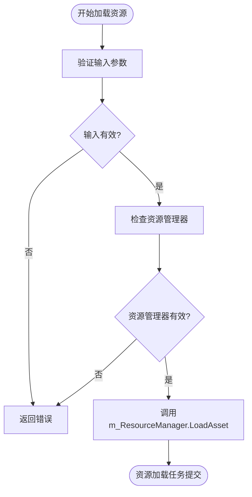
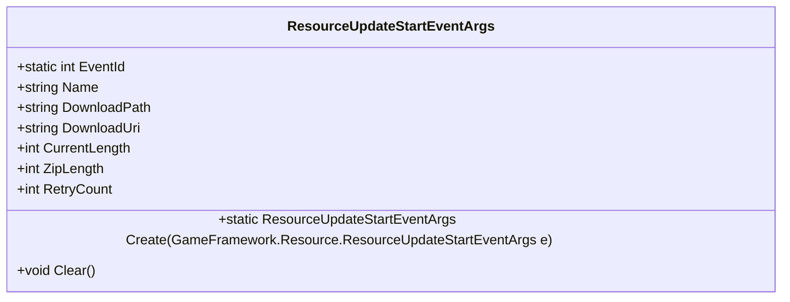
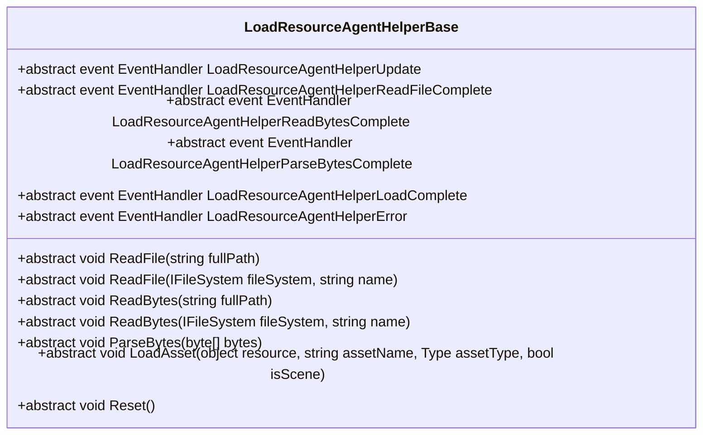
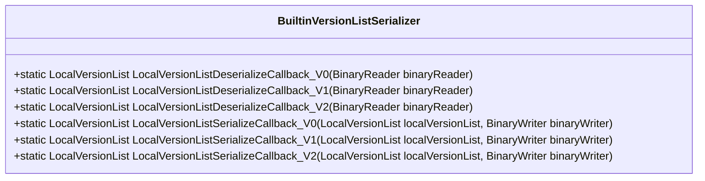

# 资源管理API

<cite>
**Referenced Files in This Document**   
- [ResourceComponent.cs](file://Scripts/Runtime/Resource/ResourceComponent.cs)
- [BuiltinVersionListSerializer.cs](file://Scripts/Runtime/Resource/BuiltinVersionListSerializer.cs)
- [DefaultResourceHelper.cs](file://Scripts/Runtime/Resource/DefaultResourceHelper.cs)
- [LoadResourceAgentHelperBase.cs](file://Scripts/Runtime/Resource/LoadResourceAgentHelperBase.cs)
- [ResourceUpdateStartEventArgs.cs](file://Scripts/Runtime/Resource/ResourceUpdateStartEventArgs.cs)
</cite>

## 目录
1. [简介](#简介)
2. [核心组件](#核心组件)
3. [异步资源加载方法](#异步资源加载方法)
4. [资源更新事件](#资源更新事件)
5. [扩展点与自定义行为](#扩展点与自定义行为)
6. [版本序列化职责](#版本序列化职责)
7. [完整生命周期调用链示例](#完整生命周期调用链示例)
8. [常见错误排查](#常见错误排查)
9. [结论](#结论)

## 简介

资源管理API是Unity游戏框架中的核心组件之一，负责管理游戏资源的加载、更新和释放。`ResourceComponent`类作为资源管理的核心，提供了丰富的异步资源加载方法和事件机制，支持开发者灵活地控制资源的生命周期。本文档详细记录了`ResourceComponent`类的异步资源加载方法、资源更新相关事件、扩展点的使用以及版本序列化的职责，旨在为开发者提供全面的API参考。

## 核心组件

`ResourceComponent`类是资源管理的核心，负责协调资源的加载、更新和释放。它通过`IResourceManager`接口与底层资源管理系统进行交互，并提供了丰富的API供开发者使用。`ResourceComponent`类还负责管理资源加载代理辅助器，确保资源加载任务的高效执行。

**Section sources**
- [ResourceComponent.cs](file://Scripts/Runtime/Resource/ResourceComponent.cs#L20-L1365)

## 异步资源加载方法

`ResourceComponent`类提供了多个异步资源加载方法，支持不同的参数组合，以满足各种资源加载需求。这些方法包括`LoadAsset`和`LoadScene`，分别用于加载普通资源和场景资源。

### LoadAsset方法

`LoadAsset`方法用于异步加载资源，支持以下参数：

- **资源名称**：要加载资源的名称，必须以"Assets/"开头。
- **加载回调**：加载资源回调函数集，包含加载成功、失败和更新的回调函数。
- **优先级**：加载资源的优先级，优先级高的资源会优先加载。
- **用户数据**：用户自定义数据，可以在回调函数中使用。

`LoadAsset`方法的重载版本允许开发者根据需要选择不同的参数组合。例如，可以只指定资源名称和加载回调，或者指定资源名称、资源类型、优先级和加载回调。

**Diagram sources**
- [ResourceComponent.cs](file://Scripts/Runtime/Resource/ResourceComponent.cs#L955-L970)

### LoadScene方法

`LoadScene`方法用于异步加载场景资源，其参数与`LoadAsset`方法类似。`LoadScene`方法会调用`SceneManager.LoadSceneAsync`来异步加载场景，并在加载完成后触发相应的回调函数。

**Section sources**
- [ResourceComponent.cs](file://Scripts/Runtime/Resource/ResourceComponent.cs#L873-L970)

## 资源更新事件

资源更新事件用于通知开发者资源更新的进度和状态。`ResourceComponent`类定义了多个资源更新事件，包括`ResourceUpdateStartEventArgs`、`ResourceUpdateChangedEventArgs`、`ResourceUpdateSuccessEventArgs`和`ResourceUpdateFailureEventArgs`。

### ResourceUpdateStartEventArgs

`ResourceUpdateStartEventArgs`事件在资源更新开始时触发，包含以下数据字段：

- **Name**：资源名称。
- **DownloadPath**：资源下载后存放路径。
- **DownloadUri**：下载地址。
- **CurrentLength**：当前下载大小。
- **ZipLength**：压缩后大小。
- **RetryCount**：已重试下载次数。

**Diagram sources**
- [ResourceUpdateStartEventArgs.cs](file://Scripts/Runtime/Resource/ResourceUpdateStartEventArgs.cs#L15-L129)

**Section sources**
- [ResourceUpdateStartEventArgs.cs](file://Scripts/Runtime/Resource/ResourceUpdateStartEventArgs.cs#L15-L129)

## 扩展点与自定义行为

`ResourceComponent`类提供了两个扩展点，允许开发者自定义资源加载行为：`DefaultResourceHelper`和`LoadResourceAgentHelperBase`。

### DefaultResourceHelper

`DefaultResourceHelper`是默认的资源辅助器，负责实现资源加载的具体逻辑。开发者可以通过继承`DefaultResourceHelper`类并重写其方法来自定义资源加载行为。例如，可以重写`LoadBytes`方法以使用自定义的网络请求库加载资源。

### LoadResourceAgentHelperBase

`LoadResourceAgentHelperBase`是加载资源代理辅助器的基类，负责管理资源加载代理。开发者可以通过继承`LoadResourceAgentHelperBase`类并实现其抽象方法来自定义资源加载代理的行为。例如，可以实现`LoadAsset`方法以支持特定的资源格式。

**Diagram sources**
- [LoadResourceAgentHelperBase.cs](file://Scripts/Runtime/Resource/LoadResourceAgentHelperBase.cs#L17-L94)

**Section sources**
- [LoadResourceAgentHelperBase.cs](file://Scripts/Runtime/Resource/LoadResourceAgentHelperBase.cs#L17-L94)

## 版本序列化职责

`BuiltinVersionListSerializer`类负责版本资源列表的序列化和反序列化。它提供了多个反序列化回调函数，用于处理不同版本的版本资源列表。例如，`LocalVersionListDeserializeCallback_V0`用于反序列化本地版本资源列表（版本0），`LocalVersionListDeserializeCallback_V1`用于反序列化本地版本资源列表（版本1）。

**Diagram sources**
- [BuiltinVersionListSerializer.cs](file://Scripts/Runtime/Resource/BuiltinVersionListSerializer.cs#L15-L102)

**Section sources**
- [BuiltinVersionListSerializer.cs](file://Scripts/Runtime/Resource/BuiltinVersionListSerializer.cs#L15-L102)

## 完整生命周期调用链示例

以下是一个从资源加载、更新监听到资源应用的完整生命周期调用链示例：

1. 调用`ResourceComponent.LoadAsset`方法加载资源。
2. `ResourceComponent`将加载任务提交给`IResourceManager`。
3. `IResourceManager`通过`LoadResourceAgentHelperBase`加载资源。
4. 资源加载完成后，触发`LoadAssetCallbacks`中的成功回调。
5. 如果需要更新资源，调用`ResourceComponent.UpdateResources`方法。
6. `ResourceComponent`触发`ResourceUpdateStartEventArgs`事件，通知资源更新开始。
7. 资源更新完成后，触发`ResourceUpdateSuccessEventArgs`事件。
8. 调用`ResourceComponent.ApplyResources`方法应用更新的资源。

**Section sources**
- [ResourceComponent.cs](file://Scripts/Runtime/Resource/ResourceComponent.cs#L20-L1365)

## 常见错误排查

在使用资源管理API时，可能会遇到以下常见错误：

- **资源路径错误**：确保资源名称以"Assets/"开头，并且路径正确。
- **依赖缺失**：确保所有依赖的资源都已正确加载。
- **资源加载失败**：检查网络连接和资源服务器状态，确保资源可访问。

**Section sources**
- [ResourceComponent.cs](file://Scripts/Runtime/Resource/ResourceComponent.cs#L955-L970)

## 结论

`ResourceComponent`类提供了强大的资源管理功能，支持异步资源加载、资源更新和自定义行为。通过合理使用`ResourceComponent`类的API，开发者可以高效地管理游戏资源，提升游戏性能和用户体验。本文档详细记录了`ResourceComponent`类的API，旨在为开发者提供全面的参考。