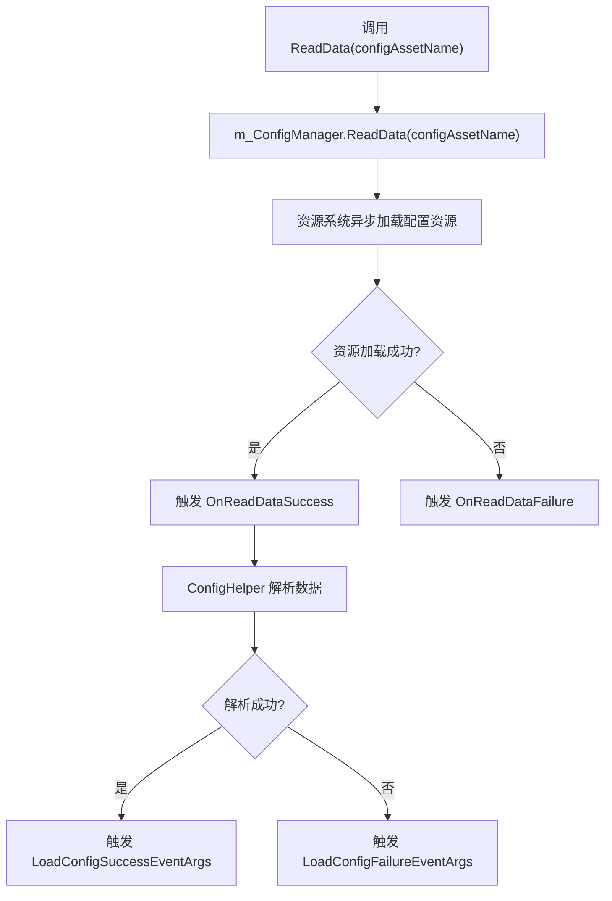
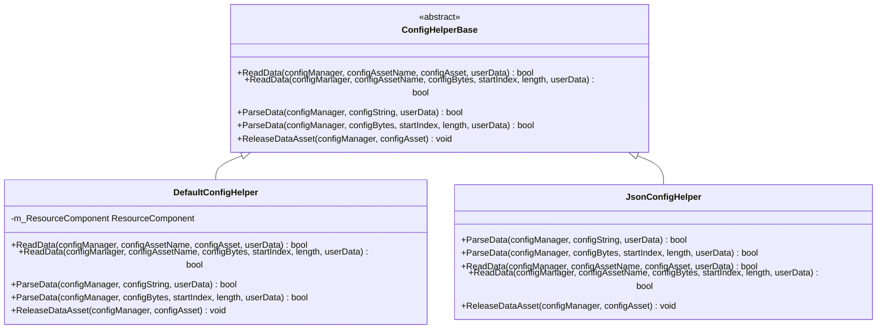

# 配置管理API

<cite>
**Referenced Files in This Document**   
- [ConfigComponent.cs](file://Scripts/Runtime/Config/ConfigComponent.cs)
- [ConfigHelperBase.cs](file://Scripts/Runtime/Config/ConfigHelperBase.cs)
- [DefaultConfigHelper.cs](file://Scripts/Runtime/Config/DefaultConfigHelper.cs)
- [LoadConfigSuccessEventArgs.cs](file://Scripts/Runtime/Config/LoadConfigSuccessEventArgs.cs)
- [LoadConfigFailureEventArgs.cs](file://Scripts/Runtime/Config/LoadConfigFailureEventArgs.cs)
- [LoadConfigUpdateEventArgs.cs](file://Scripts/Runtime/Config/LoadConfigUpdateEventArgs.cs)
- [LoadConfigDependencyAssetEventArgs.cs](file://Scripts/Runtime/Config/LoadConfigDependencyAssetEventArgs.cs)
</cite>

## 目录
1. [简介](#简介)
2. [核心组件](#核心组件)
3. [异步加载流程](#异步加载流程)
4. [配置事件系统](#配置事件系统)
5. [配置辅助器扩展](#配置辅助器扩展)
6. [使用示例](#使用示例)
7. [实现对比](#实现对比)

## 简介

配置管理API提供了一套完整的机制，用于在运行时异步加载和解析全局配置文件。该系统设计为可扩展，允许开发者自定义配置的序列化与反序列化逻辑。核心功能包括异步加载、事件通知、错误处理以及灵活的配置数据解析。本文档详细说明了`ConfigComponent`的`LoadConfig`方法（通过`ReadData`实现）的异步过程、参数配置、错误处理机制，以及相关的事件系统和扩展点。

## 核心组件

配置管理API由几个关键组件构成，它们协同工作以实现配置的加载和管理。

### ConfigComponent

`ConfigComponent`是配置管理的核心组件，负责协调配置的加载、解析和事件分发。它封装了底层的`IConfigManager`，提供了简洁的API供游戏逻辑调用。

**Section sources**
- [ConfigComponent.cs](file://Scripts/Runtime/Config/ConfigComponent.cs#L157-L191)

### ConfigHelperBase

`ConfigHelperBase`是一个抽象基类，定义了配置加载和解析的扩展点。开发者可以通过继承此类来实现自定义的配置处理逻辑，例如使用不同的序列化格式（如JSON或XML）。

**Section sources**
- [ConfigHelperBase.cs](file://Scripts/Runtime/Config/ConfigHelperBase.cs#L16-L66)

### DefaultConfigHelper

`DefaultConfigHelper`是`ConfigHelperBase`的默认实现，提供了对文本和二进制配置文件的原生支持。它能够处理以`.txt`或`.bytes`为扩展名的配置资源。

**Section sources**
- [DefaultConfigHelper.cs](file://Scripts/Runtime/Config/DefaultConfigHelper.cs#L19-L179)

## 异步加载流程

`ConfigComponent`通过`ReadData`系列方法提供异步加载配置的功能。加载过程是完全异步的，不会阻塞主线程。

### 加载方法

`ConfigComponent`提供了多个重载的`ReadData`方法，允许调用者指定配置资源名称、优先级和用户自定义数据。



**Diagram sources**
- [ConfigComponent.cs](file://Scripts/Runtime/Config/ConfigComponent.cs#L157-L191)

**Section sources**
- [ConfigComponent.cs](file://Scripts/Runtime/Config/ConfigComponent.cs#L157-L191)

### 参数配置

`ReadData`方法支持以下参数：

- **configAssetName**: 配置资源的名称，用于标识要加载的配置文件。
- **priority**: 加载优先级，用于资源系统调度。
- **userData**: 用户自定义数据，将在整个加载和解析过程中传递，并最终包含在事件参数中。

这些参数允许开发者灵活地控制加载过程，并在事件回调中获取上下文信息。

## 配置事件系统

配置管理API通过事件系统通知外部加载过程的各个阶段。所有事件都继承自`GameEventArgs`，并可通过事件组件进行订阅。

### 事件类定义

#### LoadConfigSuccessEventArgs

该事件在配置成功加载并解析后触发。

**字段说明：**
- `ConfigAssetName`: 成功加载的配置资源名称。
- `Duration`: 加载过程的持续时间（秒）。
- `UserData`: 调用`ReadData`时传入的用户自定义数据。

**Section sources**
- [LoadConfigSuccessEventArgs.cs](file://Scripts/Runtime/Config/LoadConfigSuccessEventArgs.cs#L15-L93)

#### LoadConfigFailureEventArgs

该事件在配置加载或解析失败时触发。

**字段说明：**
- `ConfigAssetName`: 尝试加载的配置资源名称。
- `ErrorMessage`: 详细的错误信息，描述失败原因。
- `UserData`: 调用`ReadData`时传入的用户自定义数据。

**Section sources**
- [LoadConfigFailureEventArgs.cs](file://Scripts/Runtime/Config/LoadConfigFailureEventArgs.cs#L15-L93)

#### LoadConfigUpdateEventArgs

该事件在配置加载过程中定期触发，用于报告加载进度。

**字段说明：**
- `ConfigAssetName`: 正在加载的配置资源名称。
- `Progress`: 当前加载进度（0.0到1.0）。
- `UserData`: 调用`ReadData`时传入的用户自定义数据。

**Section sources**
- [LoadConfigUpdateEventArgs.cs](file://Scripts/Runtime/Config/LoadConfigUpdateEventArgs.cs#L15-L93)

#### LoadConfigDependencyAssetEventArgs

该事件在加载配置时，其依赖的资源被加载时触发。

**字段说明：**
- `ConfigAssetName`: 主配置资源名称。
- `DependencyAssetName`: 正在加载的依赖资源名称。
- `LoadedCount`: 已加载的依赖资源数量。
- `TotalCount`: 总共需要加载的依赖资源数量。
- `UserData`: 调用`ReadData`时传入的用户自定义数据。

**Section sources**
- [LoadConfigDependencyAssetEventArgs.cs](file://Scripts/Runtime/Config/LoadConfigDependencyAssetEventArgs.cs#L15-L117)

## 配置辅助器扩展

`ConfigHelperBase`为配置的序列化与反序列化提供了扩展点，允许开发者实现自定义的配置格式。

### 扩展接口

`ConfigHelperBase`定义了以下抽象方法，必须由子类实现：

- `ReadData`: 从资源或字节数组中读取配置数据。
- `ParseData`: 解析配置字符串或字节数组为内部数据结构。
- `ReleaseDataAsset`: 释放已加载的配置资源。

### 自定义实现示例

开发者可以创建自己的`ConfigHelper`来支持JSON或XML格式：

```csharp
public class JsonConfigHelper : ConfigHelperBase
{
    public override bool ParseData(IConfigManager configManager, string configString, object userData)
    {
        // 使用JSON库解析configString
        var jsonData = JsonConvert.DeserializeObject<Dictionary<string, string>>(configString);
        foreach (var kvp in jsonData)
        {
            configManager.AddConfig(kvp.Key, kvp.Value);
        }
        return true;
    }

    // 实现其他必需的抽象方法...
}
```

## 使用示例

以下示例展示了如何使用配置管理API加载游戏设置并应用到游戏逻辑中。

```csharp
// 1. 获取配置组件
ConfigComponent configComponent = GameEntry.GetComponent<ConfigComponent>();

// 2. 订阅配置加载事件
EventComponent eventComponent = GameEntry.GetComponent<EventComponent>();
eventComponent.Subscribe<LoadConfigSuccessEventArgs>(OnConfigLoadSuccess);
eventComponent.Subscribe<LoadConfigFailureEventArgs>(OnConfigLoadFailure);

// 3. 异步加载配置
configComponent.ReadData("GameSettings", userData: "GameInitialization");

// 事件处理函数
private void OnConfigLoadSuccess(object sender, LoadConfigSuccessEventArgs e)
{
    // 配置加载成功，读取具体设置
    float musicVolume = configComponent.GetFloat("MusicVolume", 0.8f);
    int graphicsQuality = configComponent.GetInt("GraphicsQuality", 2);
    
    // 应用到游戏逻辑
    AudioListener.volume = musicVolume;
    QualitySettings.SetQualityLevel(graphicsQuality);
    
    Debug.Log($"配置加载成功，资源: {e.ConfigAssetName}, 耗时: {e.Duration:F2}s");
}

private void OnConfigLoadFailure(object sender, LoadConfigFailureEventArgs e)
{
    Debug.LogError($"配置加载失败，资源: {e.ConfigAssetName}, 错误: {e.ErrorMessage}");
}
```

## 实现对比

### DefaultConfigHelper 默认实现

`DefaultConfigHelper`是为简单文本和二进制配置设计的默认实现。

**特点：**
- 支持制表符分隔的文本文件（`.txt`）。
- 支持二进制序列化格式（`.bytes`）。
- 文本格式解析：忽略以`#`开头的注释行，按制表符分割，期望每行有4列，使用第2列作为配置名，第4列作为配置值。
- 二进制格式解析：使用`BinaryReader`读取字符串对（配置名和配置值）。



**Diagram sources**
- [ConfigHelperBase.cs](file://Scripts/Runtime/Config/ConfigHelperBase.cs#L16-L66)
- [DefaultConfigHelper.cs](file://Scripts/Runtime/Config/DefaultConfigHelper.cs#L19-L179)

### 其他可能的实现方式

除了`DefaultConfigHelper`，开发者可以实现其他类型的配置辅助器：

- **JsonConfigHelper**: 使用JSON.NET或其他JSON库解析JSON格式的配置文件。
- **XmlConfigHelper**: 使用`XmlSerializer`解析XML格式的配置文件。
- **YamlConfigHelper**: 使用YAML库解析YAML格式的配置文件，适合复杂嵌套结构。
- **DatabaseConfigHelper**: 从数据库中读取配置，适用于需要动态更新的场景。

这些自定义实现提供了更大的灵活性，可以根据项目需求选择最适合的配置格式。