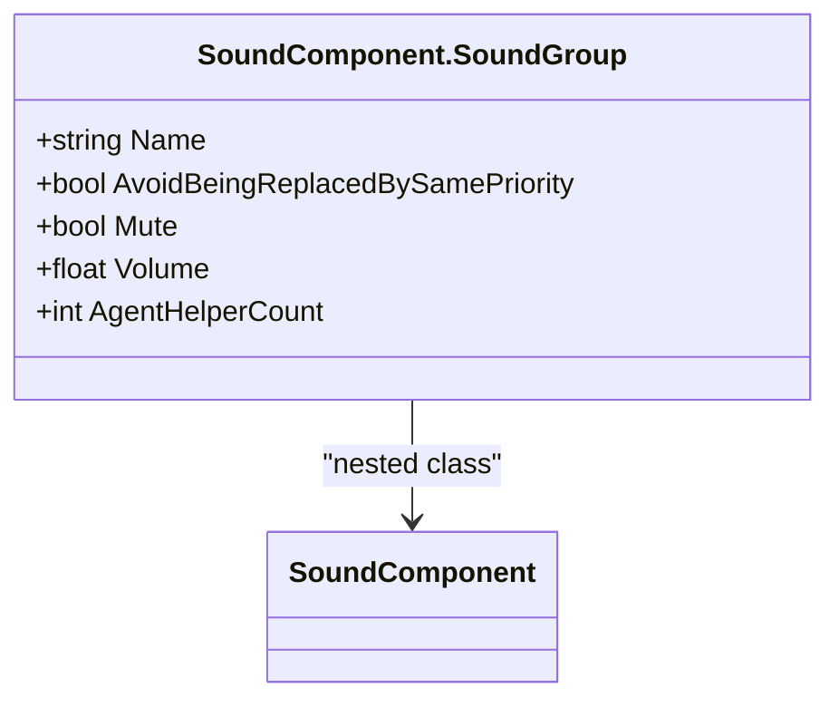
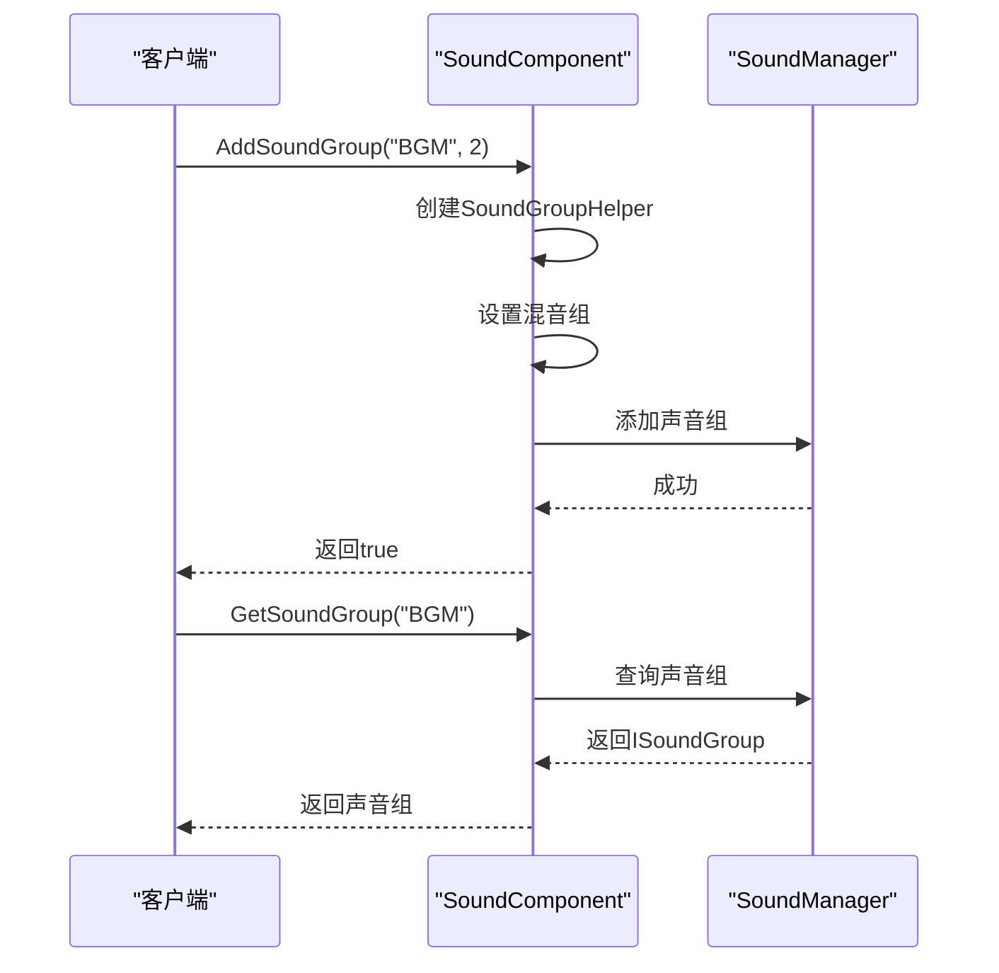
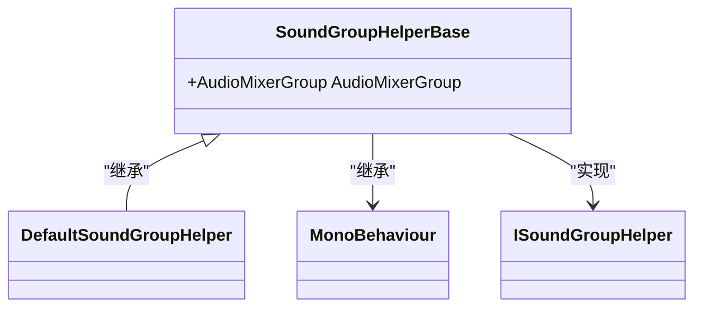
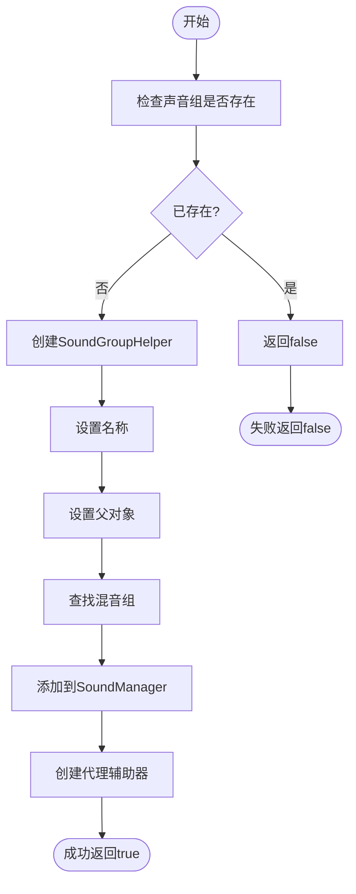
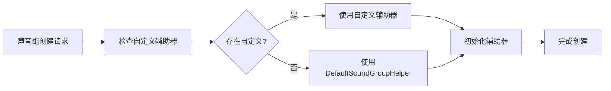

# 声音分组与音量管理

<cite>
**Referenced Files in This Document**   
- [SoundComponent.SoundGroup.cs](file://Scripts/Runtime/Sound/SoundComponent.SoundGroup.cs)
- [SoundGroupHelperBase.cs](file://Scripts/Runtime/Sound/SoundGroupHelperBase.cs)
- [DefaultSoundGroupHelper.cs](file://Scripts/Runtime/Sound/DefaultSoundGroupHelper.cs)
- [SoundComponent.cs](file://Scripts/Runtime/Sound/SoundComponent.cs)
</cite>

## 目录
1. [声音分组设计](#声音分组设计)
2. [声音组管理](#声音组管理)
3. [声音组辅助器](#声音组辅助器)
4. [API调用示例](#api调用示例)
5. [扩展机制](#扩展机制)

## 声音分组设计

声音分组（Sound Group）是声音管理系统中的核心概念，用于对不同类型的声音进行分类管理。通过声音分组，开发者可以实现对BGM、SFX、UI音效等不同类型声音的独立控制。

`SoundComponent.SoundGroup` 内部类定义了声音组的基本属性，包括名称、静音状态、音量和代理辅助器数量等。每个声音组可以独立设置其音量和静音状态，从而实现对组内所有声音的统一控制。



**Diagram sources**
- [SoundComponent.SoundGroup.cs](file://Scripts/Runtime/Sound/SoundComponent.SoundGroup.cs#L12-L72)

**Section sources**
- [SoundComponent.SoundGroup.cs](file://Scripts/Runtime/Sound/SoundComponent.SoundGroup.cs#L12-L72)

## 声音组管理

声音组管理通过 `SoundComponent` 提供的API实现，支持创建、查询和控制声音组。系统在初始化时会根据配置自动创建预定义的声音组，并允许在运行时动态添加新的声音组。

### 核心管理功能

- **创建声音组**: 通过 `AddSoundGroup` 方法创建新的声音组
- **查询声音组**: 通过 `GetSoundGroup` 和 `GetAllSoundGroups` 方法获取声音组信息
- **状态控制**: 统一控制组内所有声音的音量和静音状态



**Diagram sources**
- [SoundComponent.cs](file://Scripts/Runtime/Sound/SoundComponent.cs#L243-L303)
- [SoundComponent.cs](file://Scripts/Runtime/Sound/SoundComponent.cs#L209-L246)

**Section sources**
- [SoundComponent.cs](file://Scripts/Runtime/Sound/SoundComponent.cs#L243-L303)
- [SoundComponent.cs](file://Scripts/Runtime/Sound/SoundComponent.cs#L209-L246)

## 声音组辅助器

声音组辅助器（Sound Group Helper）是声音组的运行时实现，负责管理声音组的具体行为和与Unity音频系统的集成。

### 基类设计

`SoundGroupHelperBase` 是所有声音组辅助器的基类，定义了基本的结构和接口。它继承自 `MonoBehaviour` 并实现了 `ISoundGroupHelper` 接口，主要功能是关联Unity的 `AudioMixerGroup`。



**Diagram sources**
- [SoundGroupHelperBase.cs](file://Scripts/Runtime/Sound/SoundGroupHelperBase.cs#L16-L35)
- [DefaultSoundGroupHelper.cs](file://Scripts/Runtime/Sound/DefaultSoundGroupHelper.cs#L12-L14)

**Section sources**
- [SoundGroupHelperBase.cs](file://Scripts/Runtime/Sound/SoundGroupHelperBase.cs#L16-L35)
- [DefaultSoundGroupHelper.cs](file://Scripts/Runtime/Sound/DefaultSoundGroupHelper.cs#L12-L14)

## API调用示例

### 创建声音组



**Diagram sources**
- [SoundComponent.cs](file://Scripts/Runtime/Sound/SoundComponent.cs#L243-L303)

**Section sources**
- [SoundComponent.cs](file://Scripts/Runtime/Sound/SoundComponent.cs#L243-L303)

### 控制声音组

```csharp
// 创建BGM声音组
soundComponent.AddSoundGroup("BGM", 2);

// 创建SFX声音组
soundComponent.AddSoundGroup("SFX", 3);

// 获取BGM声音组并设置音量
ISoundGroup bgmGroup = soundComponent.GetSoundGroup("BGM");
// 通过SoundManager API设置音量（示例）
// bgmGroup.SetVolume(0.8f);

// 暂停所有SFX
ISoundGroup sfxGroup = soundComponent.GetSoundGroup("SFX");
// sfxGroup.SetMute(true);
```

## 扩展机制

### 自定义分组行为

通过继承 `SoundGroupHelperBase`，开发者可以创建自定义的声音组辅助器，实现特定的音频处理逻辑。

```csharp
public class CustomSoundGroupHelper : SoundGroupHelperBase
{
    [SerializeField]
    private float m_DistanceThreshold = 10f;
    
    private void Update()
    {
        // 实现动态音量衰减逻辑
        ApplyDistanceAttenuation();
    }
    
    private void ApplyDistanceAttenuation()
    {
        // 根据距离调整音量
        // 自定义实现...
    }
}
```

### 默认分组策略

`DefaultSoundGroupHelper` 实现了默认的声音组行为，主要职责是：

1. 作为 `SoundGroupHelperBase` 的具体实现
2. 提供基本的声音组功能
3. 与Unity音频系统集成

当开发者需要自定义行为时，可以通过以下方式替换默认实现：

1. 创建继承自 `SoundGroupHelperBase` 的新类
2. 在 `SoundComponent` 中配置自定义辅助器类型
3. 实现特定的音频处理逻辑



**Diagram sources**
- [SoundComponent.cs](file://Scripts/Runtime/Sound/SoundComponent.cs#L257-L303)
- [DefaultSoundGroupHelper.cs](file://Scripts/Runtime/Sound/DefaultSoundGroupHelper.cs#L12-L14)

**Section sources**
- [SoundComponent.cs](file://Scripts/Runtime/Sound/SoundComponent.cs#L257-L303)
- [DefaultSoundGroupHelper.cs](file://Scripts/Runtime/Sound/DefaultSoundGroupHelper.cs#L12-L14)