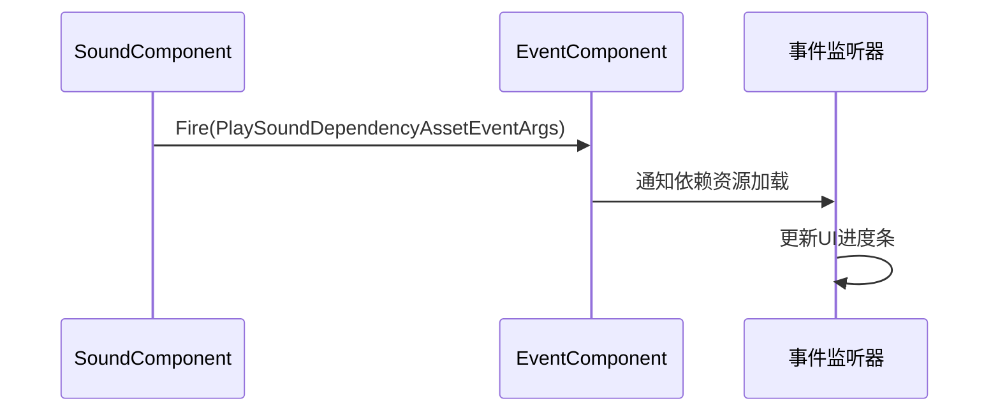
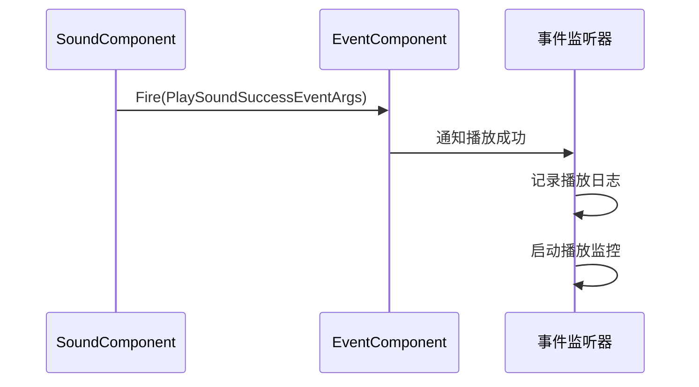
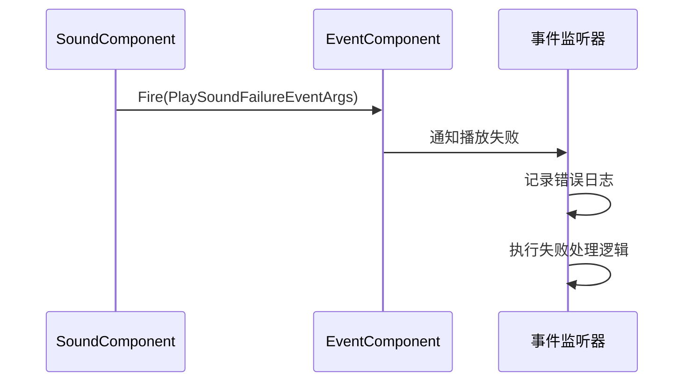
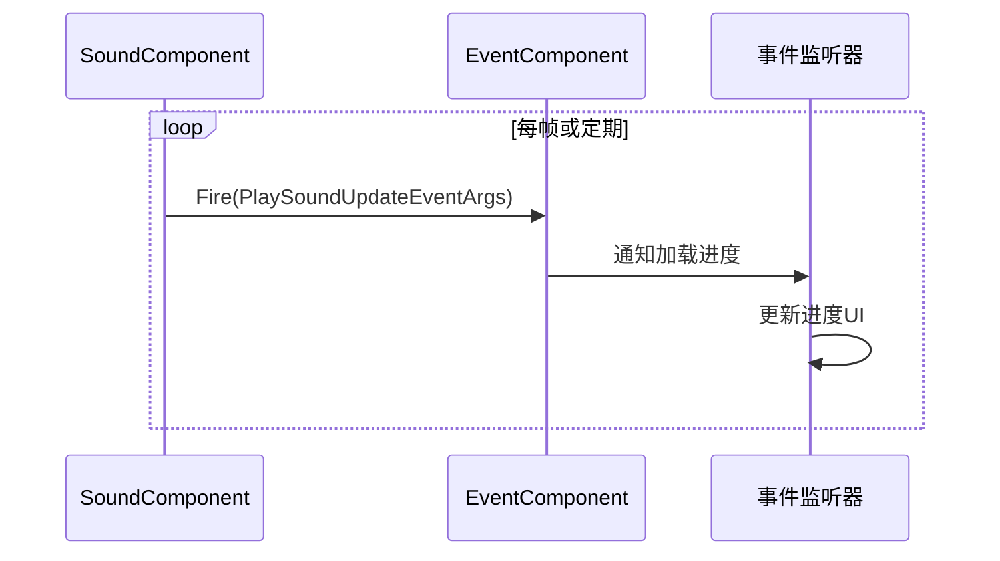

# 声音播放与控制

<cite>
**Referenced Files in This Document**   
- [SoundComponent.cs](file://Scripts/Runtime/Sound/SoundComponent.cs)
- [PlaySoundInfo.cs](file://Scripts/Runtime/Sound/PlaySoundInfo.cs)
- [PlaySoundDependencyAssetEventArgs.cs](file://Scripts/Runtime/Sound/PlaySoundDependencyAssetEventArgs.cs)
- [PlaySoundSuccessEventArgs.cs](file://Scripts/Runtime/Sound/PlaySoundSuccessEventArgs.cs)
- [PlaySoundFailureEventArgs.cs](file://Scripts/Runtime/Sound/PlaySoundFailureEventArgs.cs)
- [PlaySoundUpdateEventArgs.cs](file://Scripts/Runtime/Sound/PlaySoundUpdateEventArgs.cs)
- [DefaultSoundAgentHelper.cs](file://Scripts/Runtime/Sound/DefaultSoundAgentHelper.cs)
- [DefaultSoundHelper.cs](file://Scripts/Runtime/Sound/DefaultSoundHelper.cs)
- [DefaultSoundGroupHelper.cs](file://Scripts/Runtime/Sound/DefaultSoundGroupHelper.cs)
</cite>

## 目录
1. [简介](#简介)
2. [核心组件](#核心组件)
3. [播放参数详解](#播放参数详解)
4. [事件系统](#事件系统)
5. [代码示例](#代码示例)
6. [最佳实践](#最佳实践)

## 简介
本文档详细说明了Unity游戏框架中声音播放与控制的API，重点聚焦于`SoundComponent`组件的`PlaySound`方法。文档涵盖了声音播放的完整生命周期，包括参数配置、事件通知机制和状态反馈。通过本API，开发者可以精确控制声音的播放行为，实现从简单的UI音效到复杂的背景音乐系统的各种音频需求。

## 核心组件

`SoundComponent`是声音系统的核心管理组件，负责协调声音资源的加载、播放和生命周期管理。它通过`ISoundManager`接口与底层声音系统交互，并提供了丰富的`PlaySound`重载方法，支持多种播放场景。

`PlaySoundInfo`类用于封装播放时的上下文信息，包括绑定实体、世界位置和用户自定义数据。该类实现了对象池模式，通过`ReferencePool`进行实例的获取和释放，有效避免了频繁的内存分配。

**Section sources**
- [SoundComponent.cs](file://Scripts/Runtime/Sound/SoundComponent.cs#L339-L472)
- [PlaySoundInfo.cs](file://Scripts/Runtime/Sound/PlaySoundInfo.cs#L12-L64)

## 播放参数详解

### 声音组名称
声音组（Sound Group）用于对不同类型的声音进行分类管理，如背景音乐、音效、语音等。每个声音组可以独立设置音量、静音状态和优先级策略。通过将声音分配到不同的组，可以实现精细的音频控制。

### 优先级
优先级参数决定了声音加载的优先顺序。当系统资源紧张时，高优先级的声音会优先加载。此外，优先级还影响同组内声音的替换策略，确保重要声音不会被低优先级声音打断。

### 音量与变调
音量控制声音的响度，范围通常为0.0到1.0。变调（Pitch）参数用于改变声音的播放速度，从而影响音高。正数使声音变高，负数使声音变低，1.0为正常速度。

### 循环播放
循环播放参数控制声音是否在结束时自动重新开始。对于背景音乐或环境音效，通常设置为循环播放；而对于UI音效或角色语音，则通常为单次播放。

### 播放位置
播放位置参数支持两种模式：绑定实体和世界坐标。绑定实体模式下，声音会跟随指定的游戏实体移动；世界坐标模式下，声音在场景中的固定位置播放，适用于环境音效。

**Section sources**
- [SoundComponent.cs](file://Scripts/Runtime/Sound/SoundComponent.cs#L339-L472)
- [DefaultSoundAgentHelper.cs](file://Scripts/Runtime/Sound/DefaultSoundAgentHelper.cs#L100-L150)

## 事件系统

### 异步加载依赖资源事件
当播放声音需要加载依赖资源时，会触发`PlaySoundDependencyAssetEventArgs`事件。该事件提供了详细的加载进度信息，包括当前已加载数量、总数和被加载的依赖资源名称。开发者可以利用此事件实现加载进度条或资源预加载提示。



**Diagram sources**
- [PlaySoundDependencyAssetEventArgs.cs](file://Scripts/Runtime/Sound/PlaySoundDependencyAssetEventArgs.cs#L16-L167)

### 播放成功事件
`PlaySoundSuccessEventArgs`在声音成功加载并开始播放时触发。该事件包含声音代理（ISoundAgent）、播放持续时间和序列编号等信息。开发者可以利用此事件获取声音代理以进行后续控制，如暂停、停止或调整音量。



**Diagram sources**
- [PlaySoundSuccessEventArgs.cs](file://Scripts/Runtime/Sound/PlaySoundSuccessEventArgs.cs#L16-L132)

### 播放失败事件
`PlaySoundFailureEventArgs`在声音播放失败时触发。该事件包含错误码和错误信息，帮助开发者诊断问题原因。常见的失败原因包括资源不存在、加载超时或优先级过低被忽略。



**Diagram sources**
- [PlaySoundFailureEventArgs.cs](file://Scripts/Runtime/Sound/PlaySoundFailureEventArgs.cs#L16-L156)

### 播放进度更新事件
`PlaySoundUpdateEventArgs`在声音加载过程中定期触发，提供加载进度的实时反馈。该事件的进度值范围为0.0到1.0，开发者可以利用此事件实现平滑的加载动画或进度指示器。



**Diagram sources**
- [PlaySoundUpdateEventArgs.cs](file://Scripts/Runtime/Sound/PlaySoundUpdateEventArgs.cs#L16-L143)

## 代码示例

### 事件监听实现
```csharp
// 订阅声音播放事件
EventComponent.Subscribe<PlaySoundSuccessEventArgs>(OnPlaySoundSuccess);
EventComponent.Subscribe<PlaySoundFailureEventArgs>(OnPlaySoundFailure);
EventComponent.Subscribe<PlaySoundUpdateEventArgs>(OnPlaySoundUpdate);

private void OnPlaySoundSuccess(object sender, PlaySoundSuccessEventArgs e)
{
    // 处理播放成功
    Debug.Log($"声音播放成功: {e.SoundAssetName}");
    // 可以获取声音代理进行进一步控制
    var soundAgent = e.SoundAgent;
}

private void OnPlaySoundFailure(object sender, PlaySoundFailureEventArgs e)
{
    // 处理播放失败
    Debug.LogError($"声音播放失败: {e.SoundAssetName}, 错误: {e.ErrorMessage}");
}

private void OnPlaySoundUpdate(object sender, PlaySoundUpdateEventArgs e)
{
    // 处理加载进度更新
    UpdateLoadingProgress(e.Progress);
}
```

### 精准声音控制
```csharp
// 播放UI音效（短促，不循环）
var uiSoundParams = new PlaySoundParams();
uiSoundParams.Loop = false;
uiSoundParams.Priority = 100;
SoundComponent.PlaySound("ButtonClick", "UI", uiSoundParams, userData: "button_click");

// 播放背景音乐（循环，低优先级）
var musicParams = new PlaySoundParams();
musicParams.Loop = true;
musicParams.Priority = 10;
musicParams.Volume = 0.5f;
SoundComponent.PlaySound("BackgroundMusic", "Music", musicParams, 
    userData: new MusicData { TrackName = "Level1" });
```

**Section sources**
- [SoundComponent.cs](file://Scripts/Runtime/Sound/SoundComponent.cs#L339-L472)
- [PlaySoundInfo.cs](file://Scripts/Runtime/Sound/PlaySoundInfo.cs#L49-L56)

## 最佳实践

### UI音效与背景音乐的区别配置
UI音效应配置为高优先级、不循环播放，以确保用户交互的即时反馈。背景音乐应配置为低优先级、循环播放，并适当降低音量，避免干扰其他重要音效。

### 资源管理
利用`PlaySoundInfo`的对象池机制，避免频繁创建和销毁对象。在播放完成后及时释放相关资源，防止内存泄漏。

### 错误处理
始终监听播放失败事件，对不同类型的错误采取相应的处理策略。对于可恢复的错误（如网络超时），可以实现自动重试机制。

### 性能优化
合理设置声音代理辅助器的数量，避免过多的音频源影响性能。利用声音组的静音和音量控制，实现高效的批量音频管理。

**Section sources**
- [DefaultSoundAgentHelper.cs](file://Scripts/Runtime/Sound/DefaultSoundAgentHelper.cs#L100-L200)
- [DefaultSoundHelper.cs](file://Scripts/Runtime/Sound/DefaultSoundHelper.cs#L10-L20)