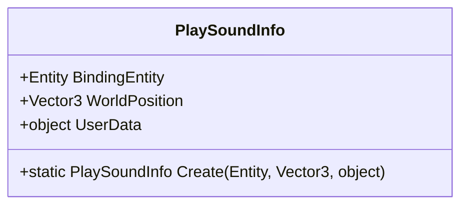
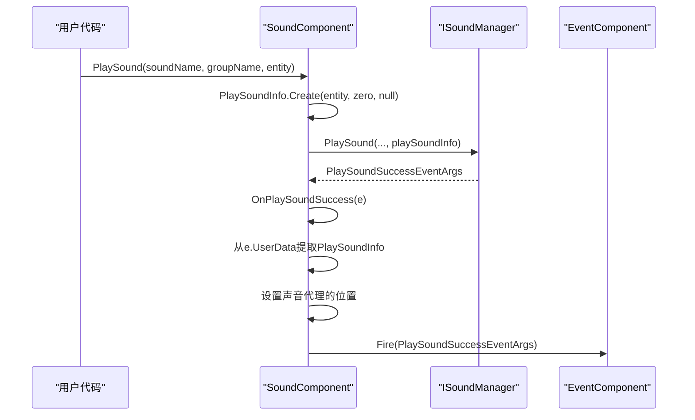
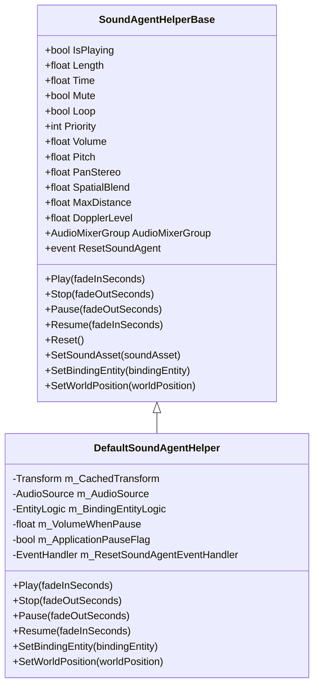

<cite>
**Referenced Files in This Document**   
- [SoundComponent.cs](file://Scripts/Runtime/Sound/SoundComponent.cs)
- [PlaySoundInfo.cs](file://Scripts/Runtime/Sound/PlaySoundInfo.cs)
- [PlaySoundSuccessEventArgs.cs](file://Scripts/Runtime/Sound/PlaySoundSuccessEventArgs.cs)
- [SoundHelperBase.cs](file://Scripts/Runtime/Sound/SoundHelperBase.cs)
- [SoundAgentHelperBase.cs](file://Scripts/Runtime/Sound/SoundAgentHelperBase.cs)
- [DefaultSoundHelper.cs](file://Scripts/Runtime/Sound/DefaultSoundHelper.cs)
- [DefaultSoundAgentHelper.cs](file://Scripts/Runtime/Sound/DefaultSoundAgentHelper.cs)
</cite>

# 音频系统API

## 目录
1. [简介](#简介)
2. [核心组件](#核心组件)
3. [声音播放控制](#声音播放控制)
4. [播放事件系统](#播放事件系统)
5. [扩展点与自定义逻辑](#扩展点与自定义逻辑)
6. [示例代码](#示例代码)

## 简介
本API文档详细介绍了Unity游戏框架中的音频系统，以`SoundComponent`为核心，全面阐述了声音播放的配置、控制、事件处理以及扩展机制。系统支持音效和音乐的播放，提供灵活的参数配置，包括播放位置、音量、优先级等，并通过事件系统通知播放状态，同时允许开发者通过扩展点自定义音频加载与播放逻辑。

## 核心组件

### SoundComponent
`SoundComponent`是音频系统的核心管理组件，负责协调声音的加载、播放和资源管理。它提供了多个重载的`PlaySound`方法，允许开发者以不同的参数组合来播放声音。

**Section sources**
- [SoundComponent.cs](file://Scripts/Runtime/Sound/SoundComponent.cs#L339-L472)

### PlaySoundInfo
`PlaySoundInfo`是一个内部类，用于封装与声音播放相关的附加信息，如绑定的实体、世界坐标和用户自定义数据。它通过对象池（ReferencePool）进行管理，以提高性能。

**Section sources**
- [PlaySoundInfo.cs](file://Scripts/Runtime/Sound/PlaySoundInfo.cs#L12-L64)



**Diagram sources**
- [PlaySoundInfo.cs](file://Scripts/Runtime/Sound/PlaySoundInfo.cs#L12-L64)

## 声音播放控制

### PlaySound方法
`SoundComponent`提供了丰富的`PlaySound`方法重载，以满足不同的播放需求。这些方法最终都会调用一个统一的内部方法，通过`PlaySoundInfo`对象传递附加信息。

#### 方法签名
- `PlaySound(string soundAssetName, string soundGroupName)`
- `PlaySound(string soundAssetName, string soundGroupName, int priority)`
- `PlaySound(string soundAssetName, string soundGroupName, PlaySoundParams playSoundParams)`
- `PlaySound(string soundAssetName, string soundGroupName, Entity bindingEntity)`
- `PlaySound(string soundAssetName, string soundGroupName, Vector3 worldPosition)`
- `PlaySound(string soundAssetName, string soundGroupName, object userData)`
- 以及更多组合参数的重载

#### 参数说明
- **soundAssetName**: 声音资源的名称。
- **soundGroupName**: 声音所属的组名，用于分类管理（如"Music"、"Effect"）。
- **priority**: 播放优先级，高优先级的声音可以替换低优先级的正在播放的声音。
- **playSoundParams**: `PlaySoundParams`对象，包含音量、音调、循环等播放参数。
- **bindingEntity**: 将声音绑定到一个实体上，声音会跟随实体移动。
- **worldPosition**: 在世界坐标中的特定位置播放声音，实现3D音效。
- **userData**: 用户自定义数据，可在事件回调中获取。

**Section sources**
- [SoundComponent.cs](file://Scripts/Runtime/Sound/SoundComponent.cs#L339-L472)

### PlaySoundInfo的作用
`PlaySoundInfo`在播放控制中扮演着关键角色。当调用`PlaySound`方法时，如果指定了`bindingEntity`或`worldPosition`，系统会创建一个`PlaySoundInfo`对象，并将其作为`userData`传递给底层的声音管理器。在声音成功加载后，`OnPlaySoundSuccess`回调会从`userData`中提取`PlaySoundInfo`，并根据其内容设置声音代理（SoundAgent）的属性。



**Diagram sources**
- [SoundComponent.cs](file://Scripts/Runtime/Sound/SoundComponent.cs#L612-L629)
- [PlaySoundInfo.cs](file://Scripts/Runtime/Sound/PlaySoundInfo.cs#L49-L56)

## 播放事件系统

### PlaySoundSuccessEventArgs
当声音成功播放时，系统会触发`PlaySoundSuccessEventArgs`事件。该事件包含了播放成功后的详细信息。

#### 触发条件
- 声音资源成功加载。
- 声音代理（SoundAgent）成功开始播放。

#### 数据字段
- **SerialId**: 声音的唯一序列编号。
- **SoundAssetName**: 声音资源的名称。
- **SoundAgent**: 用于播放声音的代理对象。
- **Duration**: 加载声音所花费的时间。
- **BindingEntity**: 声音绑定的实体（如果有的话）。
- **UserData**: 用户在播放时传入的自定义数据。

**Section sources**
- [PlaySoundSuccessEventArgs.cs](file://Scripts/Runtime/Sound/PlaySoundSuccessEventArgs.cs#L16-L132)

### 其他播放事件
系统还提供了其他播放相关的事件：
- `PlaySoundFailureEventArgs`: 播放失败时触发。
- `PlaySoundUpdateEventArgs`: 播放进度更新时触发（如果启用了该事件）。
- `PlaySoundDependencyAssetEventArgs`: 加载依赖资源时触发（如果启用了该事件）。

## 扩展点与自定义逻辑

### SoundHelperBase
`SoundHelperBase`是声音辅助器的基类，继承自`MonoBehaviour`并实现`ISoundHelper`接口。开发者可以通过继承此类来提供自定义的声音资源释放逻辑。

#### 扩展方法
- `ReleaseSoundAsset(object soundAsset)`: 抽象方法，必须由子类实现。用于定义如何释放特定类型的声音资源。

#### 使用场景
例如，`DefaultSoundHelper`实现了该方法，通过`ResourceComponent`来卸载资源。

**Section sources**
- [SoundHelperBase.cs](file://Scripts/Runtime/Sound/SoundHelperBase.cs#L15-L22)
- [DefaultSoundHelper.cs](file://Scripts/Runtime/Sound/DefaultSoundHelper.cs#L20-L25)

### SoundAgentHelperBase
`SoundAgentHelperBase`是声音代理辅助器的基类，同样继承自`MonoBehaviour`并实现`ISoundAgentHelper`接口。它是实现自定义播放逻辑的核心扩展点。

#### 扩展方法
该基类定义了大量抽象属性和方法，涵盖了声音播放的各个方面：
- **状态查询**: `IsPlaying`, `Length`
- **播放控制**: `Play(fadeInSeconds)`, `Stop(fadeOutSeconds)`, `Pause(fadeOutSeconds)`, `Resume(fadeInSeconds)`
- **参数设置**: `Volume`, `Pitch`, `Mute`, `Loop`, `Priority`, `PanStereo`, `SpatialBlend`, `MaxDistance`, `DopplerLevel`
- **位置设置**: `SetBindingEntity(Entity)`, `SetWorldPosition(Vector3)`
- **资源设置**: `SetSoundAsset(object)`

#### 使用场景
`DefaultSoundAgentHelper`是其默认实现，使用Unity的`AudioSource`组件来实现所有功能，包括淡入淡出效果。



**Diagram sources**
- [SoundAgentHelperBase.cs](file://Scripts/Runtime/Sound/SoundAgentHelperBase.cs#L17-L186)
- [DefaultSoundAgentHelper.cs](file://Scripts/Runtime/Sound/DefaultSoundAgentHelper.cs#L36-L434)

## 示例代码

以下示例展示了如何使用音频系统API。

### 播放背景音乐
```csharp
// 播放名为"BackgroundMusic"的音乐，属于"Music"组
int musicId = GameEntry.Sound.PlaySound("BackgroundMusic", "Music");
```

### 播放UI音效
```csharp
// 播放UI按钮点击音效，位于世界坐标原点
GameEntry.Sound.PlaySound("ButtonClick", "Effect", Vector3.zero);
```

### 控制音量
```csharp
// 假设你有一个声音代理的引用
// soundAgentHelper.Volume = 0.5f; // 设置音量为50%
```

### 实现声音的淡入淡出效果
```csharp
// 停止声音并实现2秒的淡出效果
// soundAgentHelper.Stop(2.0f);

// 恢复播放并实现1秒的淡入效果
// soundAgentHelper.Resume(1.0f);
```

**Section sources**
- [SoundComponent.cs](file://Scripts/Runtime/Sound/SoundComponent.cs#L339-L472)
- [DefaultSoundAgentHelper.cs](file://Scripts/Runtime/Sound/DefaultSoundAgentHelper.cs#L235-L302)