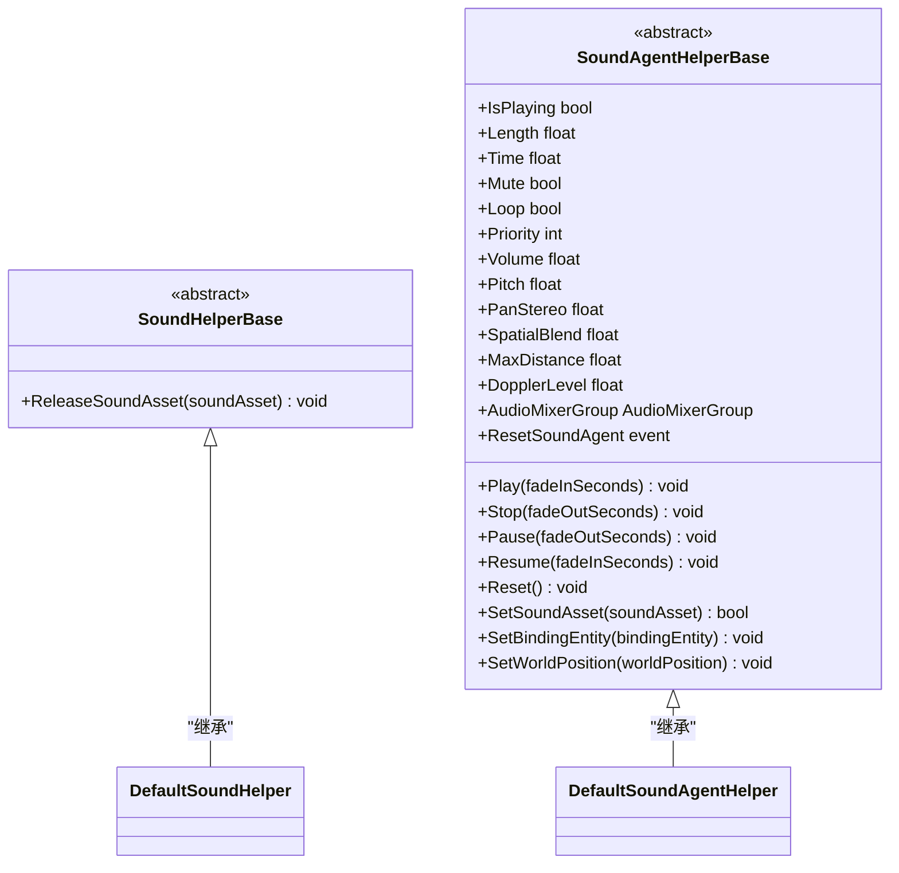
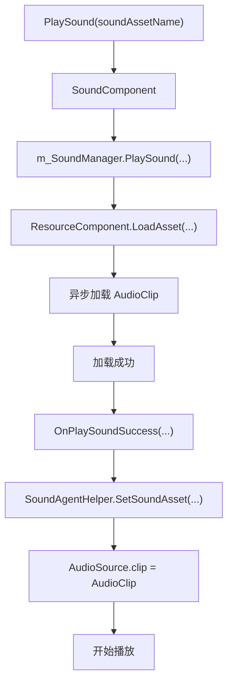
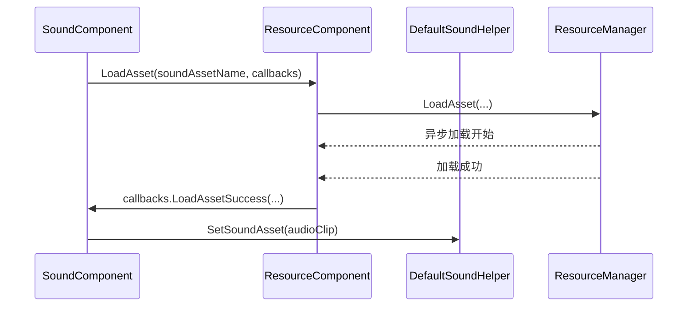

# 音频资源加载机制

<cite>
**本文档引用的文件**   
- [SoundHelperBase.cs](file://Scripts/Runtime/Sound/SoundHelperBase.cs)
- [SoundAgentHelperBase.cs](file://Scripts/Runtime/Sound/SoundAgentHelperBase.cs)
- [DefaultSoundHelper.cs](file://Scripts/Runtime/Sound/DefaultSoundHelper.cs)
- [DefaultSoundAgentHelper.cs](file://Scripts/Runtime/Sound/DefaultSoundAgentHelper.cs)
- [ResourceComponent.cs](file://Scripts/Runtime/Resource/ResourceComponent.cs)
- [SoundComponent.cs](file://Scripts/Runtime/Sound/SoundComponent.cs)
</cite>

## 目录
1. [简介](#简介)
2. [核心组件分析](#核心组件分析)
3. [音频加载流程架构](#音频加载流程架构)
4. [DefaultSoundHelper 与 ResourceComponent 的异步加载机制](#defaultsoundhelper-与-resourcecomponent-的异步加载机制)
5. [DefaultSoundAgentHelper 与 AudioSource 的播放代理机制](#defaultsoundagenthelper-与-audiosource-的播放代理机制)
6. [自定义加载逻辑的实现方式](#自定义加载逻辑的实现方式)
7. [SoundAgentHelperBase 在音频解码与流式加载中的作用](#soundagenthelperbase-在音频解码与流式加载中的作用)
8. [集成第三方音频中间件的示例](#集成第三方音频中间件的示例)

## 简介
本文档深入解析 Unity 游戏框架中音频资源的加载与播放机制。以 `SoundHelperBase` 和 `SoundAgentHelperBase` 为核心扩展点，详细说明 `DefaultSoundHelper` 如何通过 `ResourceComponent` 实现异步资源加载，以及 `DefaultSoundAgentHelper` 如何利用 Unity 的 `AudioSource` 进行播放代理。同时，文档化了替换为 AssetBundle 加载或内存池复用等自定义加载逻辑的实现方式，并解释了 `SoundAgentHelperBase` 在音频解码和流式加载中的关键作用。

## 核心组件分析

### SoundHelperBase 与 SoundAgentHelperBase
`SoundHelperBase` 和 `SoundAgentHelperBase` 是音频系统的核心抽象基类，为音频资源管理和播放代理提供了可扩展的接口。



**Diagram sources**
- [SoundHelperBase.cs](file://Scripts/Runtime/Sound/SoundHelperBase.cs#L15-L22)
- [SoundAgentHelperBase.cs](file://Scripts/Runtime/Sound/SoundAgentHelperBase.cs#L17-L186)

**Section sources**
- [SoundHelperBase.cs](file://Scripts/Runtime/Sound/SoundHelperBase.cs#L1-L24)
- [SoundAgentHelperBase.cs](file://Scripts/Runtime/Sound/SoundAgentHelperBase.cs#L1-L188)

## 音频加载流程架构



**Diagram sources**
- [SoundComponent.cs](file://Scripts/Runtime/Sound/SoundComponent.cs#L455-L472)
- [ResourceComponent.cs](file://Scripts/Runtime/Resource/ResourceComponent.cs#L955-L970)
- [DefaultSoundAgentHelper.cs](file://Scripts/Runtime/Sound/DefaultSoundAgentHelper.cs#L320-L330)

**Section sources**
- [SoundComponent.cs](file://Scripts/Runtime/Sound/SoundComponent.cs#L1-L693)
- [ResourceComponent.cs](file://Scripts/Runtime/Resource/ResourceComponent.cs#L1-L1368)

## DefaultSoundHelper 与 ResourceComponent 的异步加载机制

`DefaultSoundHelper` 作为 `SoundHelperBase` 的默认实现，负责与 `ResourceComponent` 交互，完成音频资源的加载与释放。它在 `Start` 方法中获取 `ResourceComponent` 的引用，并通过其提供的 `LoadAsset` 和 `UnloadAsset` 方法实现资源管理。

当音频播放请求发出时，`SoundComponent` 内部的 `m_SoundManager` 会调用 `ResourceComponent` 的 `LoadAsset` 方法，该方法最终会委托给底层的资源管理器进行异步加载。加载完成后，通过回调通知 `SoundComponent`，进而触发播放流程。



**Diagram sources**
- [DefaultSoundHelper.cs](file://Scripts/Runtime/Sound/DefaultSoundHelper.cs#L12-L34)
- [ResourceComponent.cs](file://Scripts/Runtime/Resource/ResourceComponent.cs#L955-L970)
- [ResourceComponent.cs](file://Scripts/Runtime/Resource/ResourceComponent.cs#L976-L979)

**Section sources**
- [DefaultSoundHelper.cs](file://Scripts/Runtime/Sound/DefaultSoundHelper.cs#L1-L36)
- [ResourceComponent.cs](file://Scripts/Runtime/Resource/ResourceComponent.cs#L873-L970)

## DefaultSoundAgentHelper 与 AudioSource 的播放代理机制

`DefaultSoundAgentHelper` 是 `SoundAgentHelperBase` 的具体实现，它内部持有一个 `AudioSource` 组件，作为播放音频的代理。它通过重写基类的抽象属性和方法，将所有操作转发给 `m_AudioSource`。

在 `Awake` 方法中，它会自动获取或添加 `AudioSource` 组件，并进行初始化。当 `SetSoundAsset` 方法被调用时，它会将传入的 `AudioClip` 对象赋值给 `m_AudioSource.clip`，从而完成音频资源的绑定。播放、暂停、停止等控制命令也通过调用 `m_AudioSource` 的相应方法来实现。

**Section sources**
- [DefaultSoundAgentHelper.cs](file://Scripts/Runtime/Sound/DefaultSoundAgentHelper.cs#L19-L432)

## 自定义加载逻辑的实现方式

框架允许通过继承 `SoundHelperBase` 和 `SoundAgentHelperBase` 来实现自定义的加载逻辑。

### 替换为 AssetBundle 加载
可以通过重写 `DefaultSoundHelper` 的 `LoadAsset` 流程（需自定义 `ResourceComponent` 或扩展其功能），在 `LoadAsset` 回调中从 AssetBundle 加载 `AudioClip`，然后传递给 `SoundAgentHelper`。

### 内存池复用策略
`DefaultSoundAgentHelper` 本身已经体现了对象池的思想。`SoundComponent` 在启动时会为每个声音组预创建多个 `SoundAgentHelper` 实例（由 `AgentHelperCount` 决定），这些实例在播放完成后会被重置并返回池中，等待下一次使用，避免了频繁的创建和销毁开销。

## SoundAgentHelperBase 在音频解码、流式加载中的作用

`SoundAgentHelperBase` 作为一个抽象层，为实现高级音频功能提供了可能性。通过继承此类，可以创建专门处理特定音频格式解码或实现流式加载的代理助手。

例如，可以创建一个 `StreamingSoundAgentHelper`，它不直接加载整个 `AudioClip`，而是启动一个后台线程或协程，从网络或文件流中分段读取音频数据，并使用 `AudioSource` 的 `SetData` 方法动态填充音频缓冲区，从而实现边下载边播放的流式体验。`SoundAgentHelperBase` 定义的 `Play`, `Pause`, `Stop` 等接口为这种复杂的流控逻辑提供了统一的外部调用契约。

## 集成第三方音频中间件的示例

要集成如 FMOD 或 Wwise 等第三方音频中间件，需要创建自定义的 `SoundHelperBase` 和 `SoundAgentHelperBase` 实现。

```csharp
// 示例：集成第三方音频中间件
public class FmodSoundHelper : SoundHelperBase
{
    public override void ReleaseSoundAsset(object soundAsset)
    {
        // 调用 FMOD API 释放资源
        FmodManager.UnloadSound(soundAsset as FmodSound);
    }
}

public class FmodSoundAgentHelper : SoundAgentHelperBase
{
    private FmodSound m_FmodSound;

    public override bool SetSoundAsset(object soundAsset)
    {
        m_FmodSound = soundAsset as FmodSound;
        return m_FmodSound != null;
    }

    public override void Play(float fadeInSeconds)
    {
        // 调用 FMOD API 播放声音
        FmodManager.PlaySound(m_FmodSound, fadeInSeconds);
    }

    // ... 重写其他方法以调用 FMOD API
}
```

然后，在 `SoundComponent` 的 Inspector 中，将 `Sound Helper` 和 `Sound Agent Helper` 的类型设置为自定义的 `FmodSoundHelper` 和 `FmodSoundAgentHelper`，即可无缝切换到 FMOD 音频系统。

**Section sources**
- [SoundHelperBase.cs](file://Scripts/Runtime/Sound/SoundHelperBase.cs#L15-L22)
- [SoundAgentHelperBase.cs](file://Scripts/Runtime/Sound/SoundAgentHelperBase.cs#L17-L186)