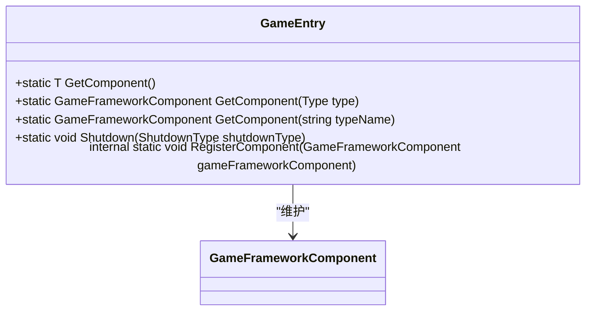
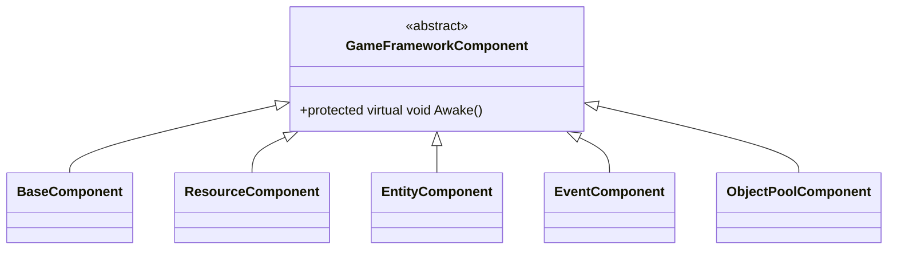
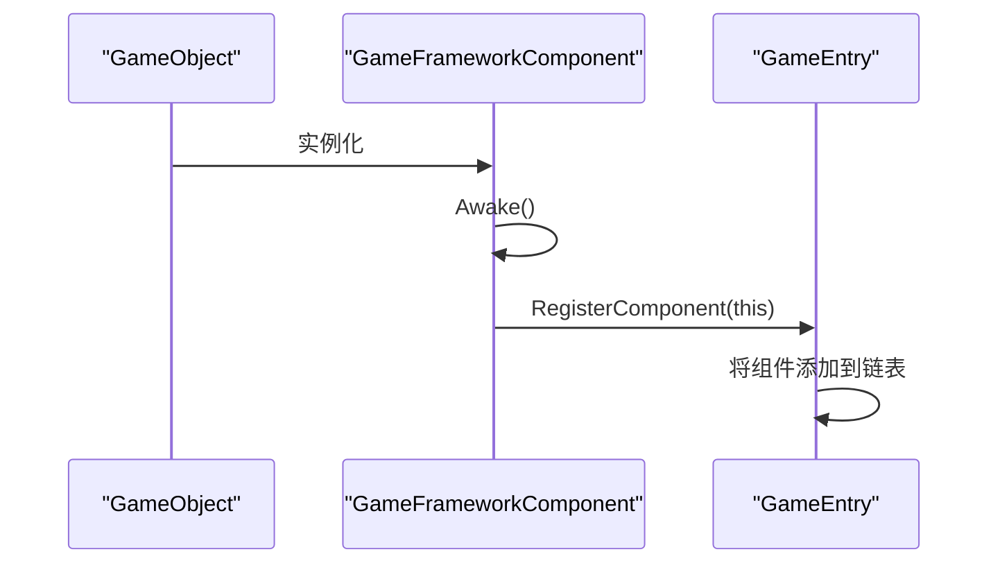
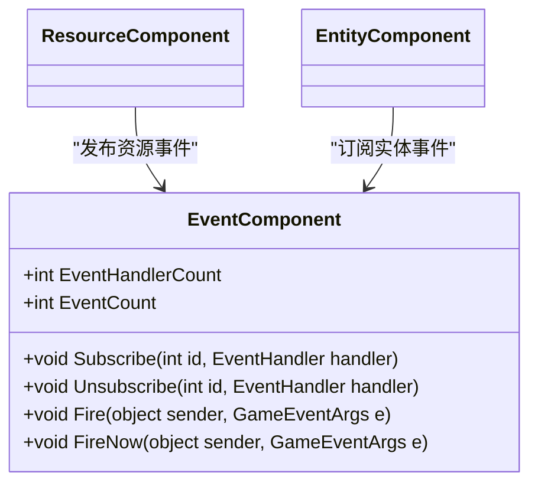
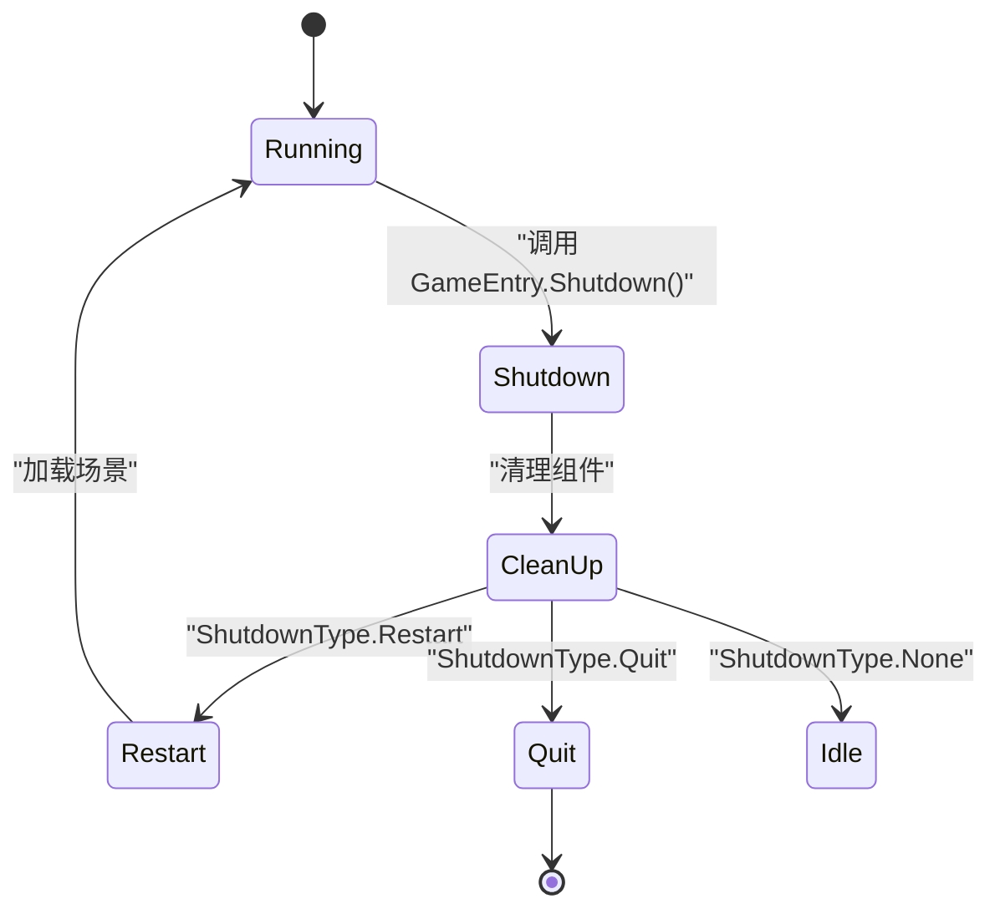

<cite>
**Referenced Files in This Document**   
- [GameEntry.cs](file://Scripts/Runtime/Base/GameEntry.cs)
- [GameFrameworkComponent.cs](file://Scripts/Runtime/Base/GameFrameworkComponent.cs)
- [ShutdownType.cs](file://Scripts/Runtime/Base/ShutdownType.cs)
- [ResourceComponent.cs](file://Scripts/Runtime/Resource/ResourceComponent.cs)
- [EntityComponent.cs](file://Scripts/Runtime/Entity/EntityComponent.cs)
- [EventComponent.cs](file://Scripts/Runtime/Event/EventComponent.cs)
- [ObjectPoolComponent.cs](file://Scripts/Runtime/ObjectPool/ObjectPoolComponent.cs)
</cite>

# 技术架构

## Table of Contents
1. [架构概述](#架构概述)
2. [核心组件设计](#核心组件设计)
3. [组件关系与通信](#组件关系与通信)
4. [生命周期管理](#生命周期管理)
5. [最佳实践](#最佳实践)

## 架构概述

UnityGameFramework采用基于组件的架构设计，以`GameEntry`为核心入口点，通过静态注册中心模式管理所有游戏框架组件。该架构的核心思想是将游戏功能分解为独立的、可复用的组件，通过`GameFrameworkComponent`抽象基类和`GameEntry`注册中心实现组件的自动发现、集中管理和统一调度。

框架采用多种设计模式，包括单例模式（`GameEntry`）、组件模式（各功能模块）、观察者模式（`EventComponent`）和对象池模式（`ObjectPoolComponent`）。这种设计有效降低了模块间的耦合度，提高了代码的可维护性和可扩展性。

## 核心组件设计

### GameEntry - 静态注册中心

`GameEntry`作为整个框架的入口点和静态注册中心，采用单例模式实现，通过静态泛型方法`GetComponent<T>()`提供对所有游戏框架组件的安全访问。其核心功能是维护一个`GameFrameworkComponent`实例的链表，实现组件的注册和查找。

**Diagram sources**
- [GameEntry.cs](file://Scripts/Runtime/Base/GameEntry.cs#L18-L145)

**Section sources**
- [GameEntry.cs](file://Scripts/Runtime/Base/GameEntry.cs#L18-L145)

### GameFrameworkComponent - 组件基类

`GameFrameworkComponent`是所有游戏框架组件的抽象基类，继承自`MonoBehaviour`。它通过重写`Awake`生命周期方法，实现了组件的自动注册机制。当任何继承自`GameFrameworkComponent`的组件被创建时，其`Awake`方法会自动调用`GameEntry.RegisterComponent(this)`，将自身注册到`GameEntry`的组件列表中。

**Diagram sources**
- [GameFrameworkComponent.cs](file://Scripts/Runtime/Base/GameFrameworkComponent.cs#L14-L23)
- [GameEntry.cs](file://Scripts/Runtime/Base/GameEntry.cs#L18-L145)

**Section sources**
- [GameFrameworkComponent.cs](file://Scripts/Runtime/Base/GameFrameworkComponent.cs#L14-L23)

## 组件关系与通信

### 组件继承与初始化

框架中的核心功能模块如`ResourceComponent`、`EntityComponent`、`EventComponent`和`ObjectPoolComponent`都继承自`GameFrameworkComponent`。它们在`Awake`阶段自动注册到`GameEntry`，并在`Start`阶段完成各自的初始化工作，如获取依赖组件、设置管理器等。

**Diagram sources**
- [GameFrameworkComponent.cs](file://Scripts/Runtime/Base/GameFrameworkComponent.cs#L14-L23)
- [GameEntry.cs](file://Scripts/Runtime/Base/GameEntry.cs#L18-L145)

### 事件驱动通信

框架采用观察者模式实现组件间的松耦合通信。`EventComponent`作为事件中心，提供`Subscribe`、`Unsubscribe`和`Fire`等方法。各组件通过订阅特定事件ID来接收消息，通过`Fire`方法发布事件，避免了组件间的直接引用。

**Diagram sources**
- [EventComponent.cs](file://Scripts/Runtime/Event/EventComponent.cs#L17-L133)
- [ResourceComponent.cs](file://Scripts/Runtime/Resource/ResourceComponent.cs#L20-L1365)

**Section sources**
- [EventComponent.cs](file://Scripts/Runtime/Event/EventComponent.cs#L17-L133)

## 生命周期管理

### 框架关闭与重启

`ShutdownType`枚举定义了框架关闭的三种模式：`None`（仅关闭框架）、`Restart`（重启游戏）和`Quit`（退出游戏）。`GameEntry.Shutdown()`方法根据传入的类型执行相应的操作，如清理组件、重新加载场景或退出应用。

**Diagram sources**
- [GameEntry.cs](file://Scripts/Runtime/Base/GameEntry.cs#L117-L145)
- [ShutdownType.cs](file://Scripts/Runtime/Base/ShutdownType.cs#L12-L28)

**Section sources**
- [GameEntry.cs](file://Scripts/Runtime/Base/GameEntry.cs#L117-L145)
- [ShutdownType.cs](file://Scripts/Runtime/Base/ShutdownType.cs#L12-L28)

## 最佳实践

### 自定义组件开发

开发者在创建自定义组件时，应继承`GameFrameworkComponent`类。组件将自动在`Awake`阶段注册到`GameEntry`，可通过`GameEntry.GetComponent<T>()`安全地访问其他组件。建议通过事件系统进行跨组件通信，而非直接引用，以保持低耦合。

### 线程安全事件处理

`EventComponent`提供了两种事件分发模式：`Fire`（线程安全，延迟一帧）和`FireNow`（非线程安全，立即执行）。在多线程环境下（如网络回调），应使用`Fire`方法确保事件处理在主线程中执行，避免Unity的线程限制问题。