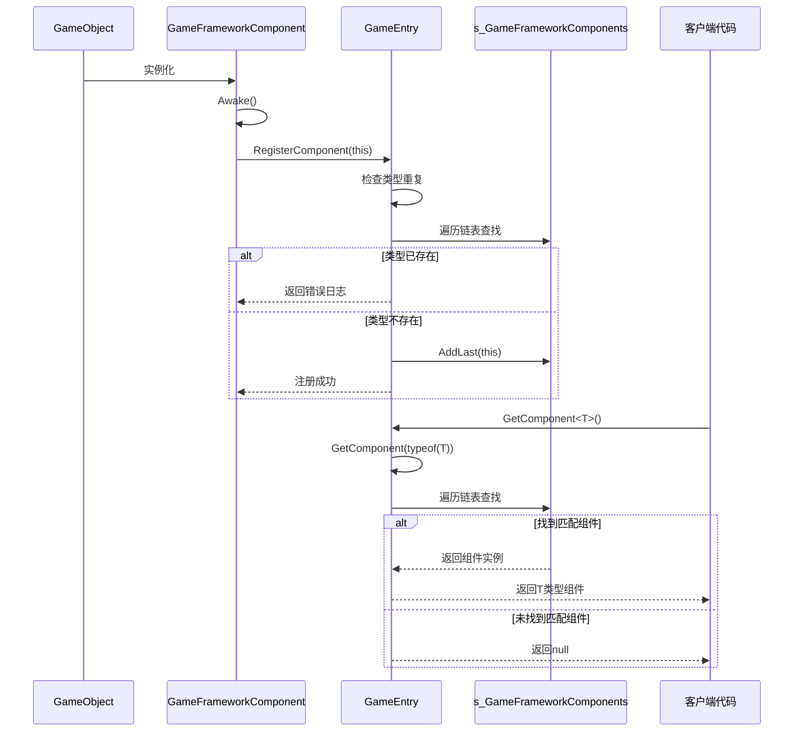

# 核心架构设计

<cite>
**本文档引用文件**   
- [GameEntry.cs](file://Scripts/Runtime/Base/GameEntry.cs)
- [GameFrameworkComponent.cs](file://Scripts/Runtime/Base/GameFrameworkComponent.cs)
- [BaseComponent.cs](file://Scripts/Runtime/Base/BaseComponent.cs)
</cite>

## 目录
1. [引言](#引言)
2. [静态注册中心机制](#静态注册中心机制)
3. [组件自动注册流程](#组件自动注册流程)
4. [组件获取机制与性能分析](#组件获取机制与性能分析)
5. [组件注册与获取时序图](#组件注册与获取时序图)
6. [设计模式优势与线程安全考量](#设计模式优势与线程安全考量)
7. [结论](#结论)

## 引言
UnityGameFramework采用以`GameEntry`为核心的全局访问点设计，构建了一个集中式的组件管理系统。该系统通过静态注册中心机制实现所有`GameFrameworkComponent`派生组件的统一管理，为框架提供了低耦合、高内聚的模块化架构基础。本设计文档将深入剖析该架构的核心实现原理。

**Section sources**
- [GameEntry.cs](file://Scripts/Runtime/Base/GameEntry.cs#L18-L145)

## 静态注册中心机制
`GameEntry`类作为游戏框架的全局入口点，内部维护一个静态的`GameFrameworkLinkedList<GameFrameworkComponent>`链表（`s_GameFrameworkComponents`），作为所有游戏框架组件的注册中心。该链表在`GameEntry`类加载时即被初始化，确保其生命周期贯穿整个应用程序运行期。

该注册中心的核心职责包括：
- **组件注册**：通过`RegisterComponent`方法将新创建的组件实例添加到链表末尾
- **组件查找**：提供多种重载的`GetComponent`方法，支持通过类型、类型名等方式查找已注册组件
- **组件注销**：在框架关闭时通过`Shutdown`方法清空链表并销毁组件

这种设计实现了组件的集中化管理，避免了传统Unity开发中频繁使用`GameObject.Find`或`GetComponent`带来的性能开销和引用混乱问题。

**Section sources**
- [GameEntry.cs](file://Scripts/Runtime/Base/GameEntry.cs#L20-L20)

## 组件自动注册流程
所有继承自`GameFrameworkComponent`的组件都通过其`Awake`生命周期方法实现自动注册。`GameFrameworkComponent`基类重写了`Awake`方法，在组件实例化时自动调用`GameEntry.RegisterComponent(this)`，将自身注册到全局注册中心。

```csharp
protected virtual void Awake()
{
    GameEntry.RegisterComponent(this);
}
```

`RegisterComponent`方法在注册前会进行类型重复性检查，遍历`s_GameFrameworkComponents`链表，确保同一类型的组件不会被重复注册。若检测到重复类型，将记录错误日志并终止注册流程。此机制保证了组件系统的唯一性约束，防止因意外重复添加导致的逻辑错误。

**Section sources**
- [GameFrameworkComponent.cs](file://Scripts/Runtime/Base/GameFrameworkComponent.cs#L14-L23)
- [GameEntry.cs](file://Scripts/Runtime/Base/GameEntry.cs#L117-L146)

## 组件获取机制与性能分析
`GameEntry`提供了三种重载的`GetComponent`方法，支持不同场景下的组件查找需求：

### GetComponent<T>() 泛型方法
```csharp
public static T GetComponent<T>() where T : GameFrameworkComponent
{
    return (T)GetComponent(typeof(T));
}
```
该方法为最常用的访问方式，通过泛型类型参数调用`GetComponent(Type)`方法。具有类型安全、语法简洁的优点，编译器可进行类型检查。

### GetComponent(Type) 类型方法
```csharp
public static GameFrameworkComponent GetComponent(Type type)
{
    LinkedListNode<GameFrameworkComponent> current = s_GameFrameworkComponents.First;
    while (current != null)
    {
        if (current.Value.GetType() == type)
        {
            return current.Value;
        }
        current = current.Next;
    }
    return null;
}
```
直接通过`Type`对象进行精确匹配查找。时间复杂度为O(n)，在组件数量较多时可能存在性能瓶颈，但避免了字符串比较的开销。

### GetComponent(string) 字符串方法
```csharp
public static GameFrameworkComponent GetComponent(string typeName)
{
    LinkedListNode<GameFrameworkComponent> current = s_GameFrameworkComponents.First;
    while (current != null)
    {
        Type type = current.Value.GetType();
        if (type.FullName == typeName || type.Name == typeName)
        {
            return current.Value;
        }
        current = current.Next;
    }
    return null;
}
```
支持通过完整类型名或简短类型名进行查找，提供了更大的灵活性，但字符串比较的开销高于类型直接比较。

**Section sources**
- [GameEntry.cs](file://Scripts/Runtime/Base/GameEntry.cs#L37-L78)

## 组件注册与获取时序图


**Diagram sources**
- [GameFrameworkComponent.cs](file://Scripts/Runtime/Base/GameFrameworkComponent.cs#L14-L23)
- [GameEntry.cs](file://Scripts/Runtime/Base/GameEntry.cs#L117-L146)
- [GameEntry.cs](file://Scripts/Runtime/Base/GameEntry.cs#L37-L78)

## 设计模式优势与线程安全考量
### 架构优势
1. **降低耦合度**：组件间通过`GameEntry`进行间接通信，避免了直接依赖，符合依赖倒置原则
2. **提升模块化**：各功能组件（如ResourceComponent、SceneComponent等）职责单一，易于维护和扩展
3. **集中化管理**：统一的注册与查找机制简化了组件生命周期管理
4. **启动顺序可控**：通过`Awake`自动注册，确保组件在`Start`之前完成注册，为后续依赖注入提供基础

### 线程安全问题与规避策略
`s_GameFrameworkComponents`链表的操作（遍历、添加）在当前设计中并非线程安全。然而，该框架巧妙地规避了多线程竞争问题：
- **Unity主线程执行**：所有`Awake`、`Start`、`Update`等生命周期方法均在Unity主线程执行
- **注册时机集中**：组件注册主要发生在场景加载初期，此时通常无其他线程并发访问注册中心
- **运行时只读访问**：框架运行期间，`GetComponent`操作仅为读取操作，不会修改链表结构

因此，在遵循Unity标准开发模式的前提下，该设计在实际应用中具有良好的线程安全性。若需在多线程环境下使用，建议在访问注册中心时添加适当的同步机制。

**Section sources**
- [GameEntry.cs](file://Scripts/Runtime/Base/GameEntry.cs#L20-L20)
- [GameFrameworkComponent.cs](file://Scripts/Runtime/Base/GameFrameworkComponent.cs#L14-L23)

## 结论
UnityGameFramework通过`GameEntry`静态注册中心与`GameFrameworkComponent`自动注册机制，构建了一个高效、可靠、易于扩展的组件管理体系。该设计充分利用了Unity的生命周期管理特性，实现了组件的自动发现与集中管理，显著提升了框架的模块化程度和代码可维护性。尽管存在潜在的线程安全风险，但通过限定在Unity主线程执行，该设计在实际应用中表现稳定可靠，是Unity框架开发中的优秀实践范例。