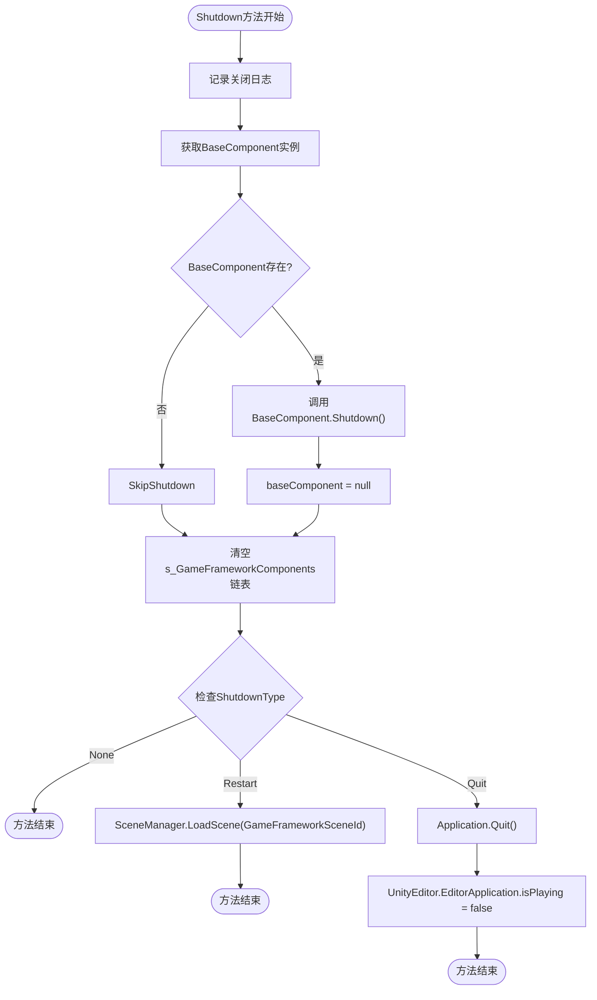
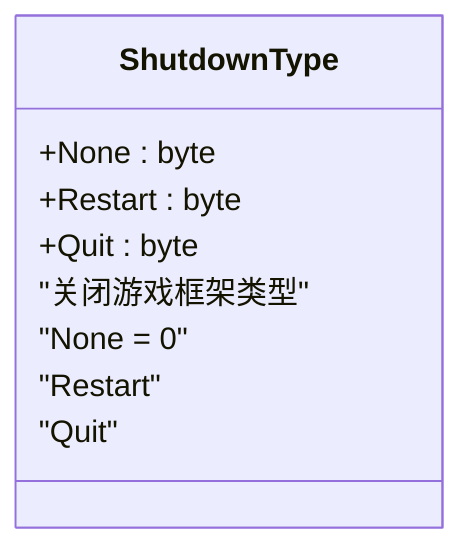
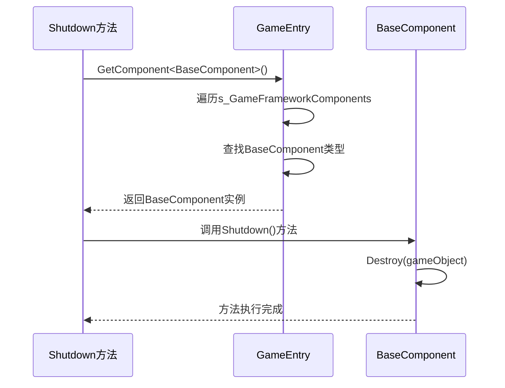
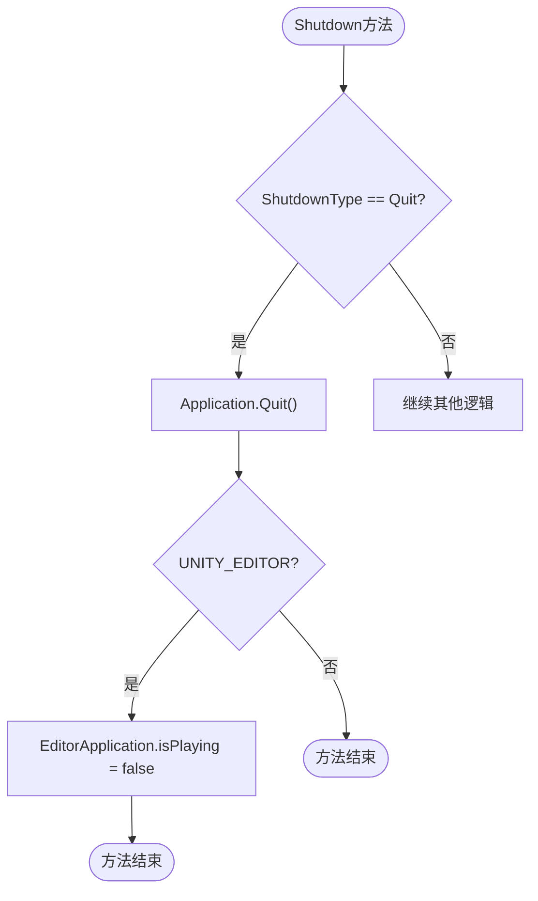
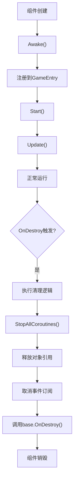

# 生命周期管理

<cite>
**Referenced Files in This Document**   
- [GameEntry.cs](file://Scripts/Runtime/Base/GameEntry.cs)
- [ShutdownType.cs](file://Scripts/Runtime/Base/ShutdownType.cs)
- [BaseComponent.cs](file://Scripts/Runtime/Base/BaseComponent.cs)
- [GameFrameworkComponent.cs](file://Scripts/Runtime/Base/GameFrameworkComponent.cs)
</cite>

## 目录
1. [简介](#简介)
2. [核心组件分析](#核心组件分析)
3. [Shutdown方法实现逻辑](#shutdown方法实现逻辑)
4. [ShutdownType枚举控制机制](#shutdowntype枚举控制机制)
5. [资源释放过程](#资源释放过程)
6. [游戏重启技术细节](#游戏重启技术细节)
7. [平台差异化处理](#平台差异化处理)
8. [自定义组件最佳实践](#自定义组件最佳实践)

## 简介
本文档详细描述UnityGameFramework中生命周期管理的核心机制，重点分析`Shutdown(ShutdownType)`方法的实现逻辑。文档涵盖框架关闭行为的控制机制、基础组件的获取与关闭、资源释放流程、游戏重启技术细节以及平台差异化处理策略。同时提供自定义组件在生命周期结束时正确释放资源的最佳实践建议。

## 核心组件分析

UnityGameFramework的生命周期管理主要由以下几个核心组件构成：

- `GameEntry`：游戏入口类，提供静态方法管理整个框架的生命周期
- `ShutdownType`：枚举类型，定义框架关闭的不同模式
- `BaseComponent`：基础组件，负责框架核心功能的初始化和关闭
- `GameFrameworkComponent`：所有框架组件的抽象基类

这些组件协同工作，实现了框架的统一生命周期管理。

**Section sources**
- [GameEntry.cs](file://Scripts/Runtime/Base/GameEntry.cs#L1-L147)
- [ShutdownType.cs](file://Scripts/Runtime/Base/ShutdownType.cs#L1-L30)
- [BaseComponent.cs](file://Scripts/Runtime/Base/BaseComponent.cs#L1-L397)
- [GameFrameworkComponent.cs](file://Scripts/Runtime/Base/GameFrameworkComponent.cs#L1-L25)

## Shutdown方法实现逻辑

`Shutdown(ShutdownType)`方法是UnityGameFramework生命周期管理的核心入口，负责有序地关闭整个游戏框架。该方法的执行流程如下：

1. 记录关闭日志，输出当前关闭类型
2. 获取`BaseComponent`实例并调用其`Shutdown()`方法
3. 清空`s_GameFrameworkComponents`链表，释放所有注册的框架组件
4. 根据`ShutdownType`参数执行相应的后续操作



**Diagram sources **
- [GameEntry.cs](file://Scripts/Runtime/Base/GameEntry.cs#L84-L115)

**Section sources**
- [GameEntry.cs](file://Scripts/Runtime/Base/GameEntry.cs#L84-L115)

## ShutdownType枚举控制机制

`ShutdownType`枚举定义了三种不同的框架关闭模式，通过参数化控制游戏框架的关闭行为：



**Diagram sources **
- [ShutdownType.cs](file://Scripts/Runtime/Base/ShutdownType.cs#L12-L28)

### None模式
当`ShutdownType.None`时，框架仅执行内部组件的关闭和资源清理，但不终止应用程序或重新加载场景。这种模式适用于框架的热重载或模块化重启场景。

### Restart模式
当`ShutdownType.Restart`时，框架在完成内部关闭流程后，会通过`SceneManager.LoadScene(GameFrameworkSceneId)`重新加载游戏框架所在的场景，实现游戏的重启。

### Quit模式
当`ShutdownType.Quit`时，框架在完成内部关闭流程后，会调用`Application.Quit()`退出应用程序，并在编辑器环境下额外设置`UnityEditor.EditorApplication.isPlaying = false`。

**Section sources**
- [ShutdownType.cs](file://Scripts/Runtime/Base/ShutdownType.cs#L12-L28)

## 资源释放过程

在`Shutdown`过程中，框架通过以下步骤实现资源的有序释放：

### 基础组件获取与关闭
框架首先通过`GetComponent<BaseComponent>()`方法获取`BaseComponent`实例。该方法在`GameEntry`类中实现，通过遍历`s_GameFrameworkComponents`链表查找指定类型的组件。



**Diagram sources **
- [GameEntry.cs](file://Scripts/Runtime/Base/GameEntry.cs#L63-L78)
- [BaseComponent.cs](file://Scripts/Runtime/Base/BaseComponent.cs#L282-L285)

### 组件链表清空
在`BaseComponent`关闭后，`Shutdown`方法会调用`s_GameFrameworkComponents.Clear()`清空存储所有框架组件的链表。这个链表在`GameEntry`类中定义，用于管理所有注册的游戏框架组件。

```mermaid
classDiagram
class GameEntry {
-s_GameFrameworkComponents : GameFrameworkLinkedList<GameFrameworkComponent>
+GetComponent<T>()
+GetComponent(Type)
+GetComponent(string)
+Shutdown(ShutdownType)
+RegisterComponent(GameFrameworkComponent)
}
class GameFrameworkLinkedList<T> {
+First : LinkedListNode<T>
+AddLast(T)
+Clear()
}
class GameFrameworkComponent {
+Awake()
}
GameEntry --> GameFrameworkLinkedList<T> : "包含"
GameFrameworkLinkedList<T> --> GameFrameworkComponent : "存储"
GameEntry --> GameFrameworkComponent : "注册"
```

**Diagram sources **
- [GameEntry.cs](file://Scripts/Runtime/Base/GameEntry.cs#L42-L56)
- [GameFrameworkComponent.cs](file://Scripts/Runtime/Base/GameFrameworkComponent.cs#L14-L23)

**Section sources**
- [GameEntry.cs](file://Scripts/Runtime/Base/GameEntry.cs#L42-L56)
- [GameFrameworkComponent.cs](file://Scripts/Runtime/Base/GameFrameworkComponent.cs#L14-L23)

## 游戏重启技术细节

当`ShutdownType`为`Restart`时，框架会执行游戏重启操作。这一过程的核心是`SceneManager.LoadScene(GameFrameworkSceneId)`调用。

`GameFrameworkSceneId`是一个内部常量，值为0，表示游戏框架所在的场景编号。通过重新加载该场景，游戏实现了完整的重启流程，包括：

1. 场景中所有GameObject的销毁
2. 新场景的加载和初始化
3. 游戏状态的重置
4. 框架组件的重新注册

这种设计确保了游戏能够从一个干净的状态重新开始，避免了状态残留导致的问题。

**Section sources**
- [GameEntry.cs](file://Scripts/Runtime/Base/GameEntry.cs#L84-L115)

## 平台差异化处理

框架在处理应用程序退出时，考虑了编辑器环境与运行时环境的差异：

### 运行时环境
在构建后的应用程序中，调用`Application.Quit()`即可正常退出应用程序。这是Unity标准的退出方法，适用于所有支持的平台。

### 编辑器环境
在Unity编辑器中，`Application.Quit()`不会终止编辑器进程。因此，框架额外添加了`UnityEditor.EditorApplication.isPlaying = false`的调用，确保编辑器能够正确退出播放模式。

这种条件编译处理（通过`#if UNITY_EDITOR`预处理器指令）确保了代码在不同环境下的正确行为，体现了良好的跨平台设计原则。



**Diagram sources **
- [GameEntry.cs](file://Scripts/Runtime/Base/GameEntry.cs#L84-L115)

**Section sources**
- [GameEntry.cs](file://Scripts/Runtime/Base/GameEntry.cs#L84-L115)

## 自定义组件最佳实践

在开发自定义组件时，遵循正确的生命周期管理实践对于避免内存泄漏至关重要。

### 重写OnDestroy方法
对于继承自`GameFrameworkComponent`的自定义组件，应在`OnDestroy`方法中执行必要的清理工作：

```csharp
protected override void OnDestroy()
{
    // 执行自定义清理逻辑
    CleanupResources();
    
    // 调用基类OnDestroy
    base.OnDestroy();
}
```

### 避免内存泄漏的建议
1. **及时释放引用**：在`Shutdown`或`OnDestroy`时，将大型对象引用设置为null
2. **取消事件订阅**：确保取消所有事件订阅，避免对象被意外持有
3. **停止协程**：调用`StopAllCoroutines()`停止所有正在运行的协程
4. **清理定时器**：清除所有注册的定时器和延迟调用
5. **释放非托管资源**：对于文件句柄、网络连接等非托管资源，确保正确释放

### 资源管理示例


**Section sources**
- [BaseComponent.cs](file://Scripts/Runtime/Base/BaseComponent.cs#L282-L285)
- [GameFrameworkComponent.cs](file://Scripts/Runtime/Base/GameFrameworkComponent.cs#L14-L23)