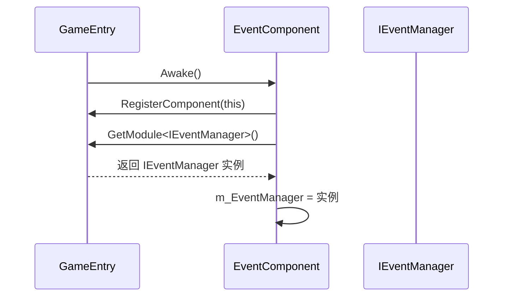
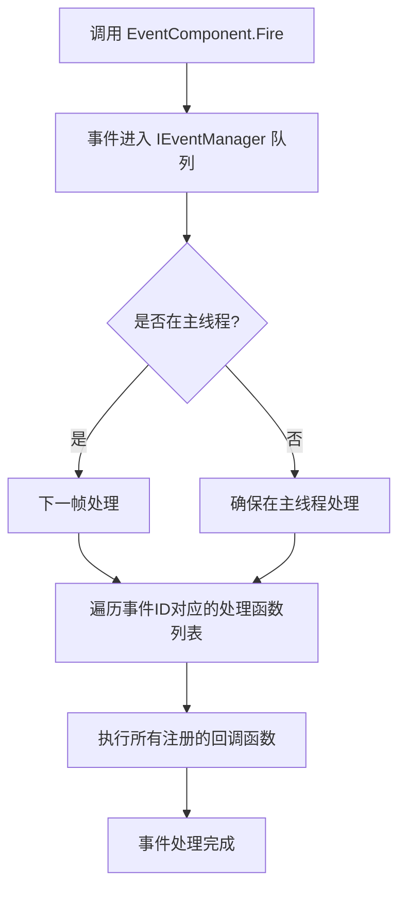

# 组件通信机制

<cite>
**Referenced Files in This Document**   
- [EventComponent.cs](file://Scripts/Runtime/Event/EventComponent.cs)
- [GameEntry.cs](file://Scripts/Runtime/Base/GameEntry.cs)
- [GameFrameworkComponent.cs](file://Scripts/Runtime/Base/GameFrameworkComponent.cs)
</cite>

## 目录
1. [引言](#引言)
2. [核心设计理念](#核心设计理念)
3. [事件系统工作流程](#事件系统工作流程)
4. [代码实践](#代码实践)
5. [优势分析](#优势分析)
6. [最佳实践与注意事项](#最佳实践与注意事项)
7. [结论](#结论)

## 引言

在Unity游戏框架中，组件间的通信是构建复杂、可扩展应用的核心。直接的组件引用（如`GetComponent<T>()`）虽然直观，但会导致模块间高度耦合，不利于代码的维护、测试和热更新。为解决此问题，本框架采用基于事件的通信机制，通过`EventComponent`实现模块间的松耦合交互。本文档将详细阐述这一设计模式的原理、实现和最佳实践。

## 核心设计理念

### 低耦合通信原则

本框架的核心设计理念是**低耦合**。组件应尽可能独立，减少对其他具体组件的直接依赖。直接引用（如`GetComponent<OtherComponent>()`）会创建硬编码的依赖关系，一旦被引用的组件重命名、移动或重构，所有引用它的代码都必须修改，这极大地增加了维护成本。

### 事件驱动架构

为实现低耦合，框架推荐使用**事件驱动架构**。在这种模式下：
- **发布者（Publisher）**：当某个状态改变或事件发生时（如玩家死亡、任务完成），它不关心谁需要知道，只需发布一个事件。
- **订阅者（Subscriber）**：对特定事件感兴趣的组件会提前注册监听器，当事件发生时自动被通知。

这种“发布-订阅”模式将发布者和订阅者解耦，它们之间没有直接的引用关系，从而实现了高度的模块独立性。

**Section sources**
- [EventComponent.cs](file://Scripts/Runtime/Event/EventComponent.cs#L17-L133)

## 事件系统工作流程

事件系统的工作流程是一个清晰的、分阶段的过程，确保了通信的可靠性和线程安全性。

### 1. 系统初始化

在游戏启动时，`GameEntry`类负责注册所有`GameFrameworkComponent`的子类组件。`EventComponent`作为其中之一，在其`Awake`方法中通过`GameFrameworkEntry.GetModule<IEventManager>()`获取底层的事件管理器实例，并将其存储在`m_EventManager`字段中，为后续的事件操作做好准备。



**Diagram sources**
- [EventComponent.cs](file://Scripts/Runtime/Event/EventComponent.cs#L55-L65)
- [GameEntry.cs](file://Scripts/Runtime/Base/GameEntry.cs#L120-L147)

### 2. 事件订阅 (Subscribe)

组件在初始化或需要监听事件时，调用`EventComponent.Subscribe`方法。该方法接受一个事件ID和一个事件处理函数（`EventHandler<GameEventArgs>`）作为参数，并将其委托给底层的`IEventManager`进行注册。

### 3. 事件触发 (Fire)

当特定条件满足时，任何组件都可以调用`EventComponent.Fire`方法来触发一个事件。该方法同样将调用转发给`IEventManager`。

### 4. 事件分发与执行

`IEventManager`是事件系统的核心，它内部维护着一个事件队列和一个事件ID到处理函数列表的映射表。
- **Fire (延迟分发)**：`Fire`方法是线程安全的。它将事件放入一个队列中，并保证事件处理函数在下一帧的主线程中被调用。这适用于从工作线程（如网络回调）中触发事件。
- **FireNow (立即分发)**：`FireNow`方法不是线程安全的，它会立即遍历所有订阅了该事件ID的处理函数并执行它们。这适用于在主线程中触发的、需要立即响应的事件。



**Diagram sources**
- [EventComponent.cs](file://Scripts/Runtime/Event/EventComponent.cs#L119-L122)
- [EventComponent.cs](file://Scripts/Runtime/Event/EventComponent.cs#L90-L93)

## 代码实践

### 定义事件类

首先，需要定义一个继承自`GameEventArgs`的事件类，用于携带事件相关的数据。

```csharp
public class PlayerDeathEventArgs : GameEventArgs
{
    public static readonly int EventId = typeof(PlayerDeathEventArgs).GetHashCode();
    public override int Id => EventId;
    public PlayerController Player { get; private set; }

    public PlayerDeathEventArgs(PlayerController player)
    {
        Player = player;
    }
}
```

### 注册事件监听器

在需要响应事件的组件中，通常在`Start`或`OnEnable`方法中进行订阅。

```csharp
private void Start()
{
    EventComponent eventComponent = GameEntry.GetComponent<EventComponent>();
    eventComponent.Subscribe(PlayerDeathEventArgs.EventId, OnPlayerDeath);
}

private void OnPlayerDeath(object sender, GameEventArgs e)
{
    PlayerDeathEventArgs args = (PlayerDeathEventArgs)e;
    // 处理玩家死亡逻辑，例如更新UI、播放音效
}
```

### 触发事件

在事件发生的源头，调用`Fire`方法来通知所有监听者。

```csharp
// 在玩家控制器中，当玩家生命值为0时
private void Die()
{
    EventComponent eventComponent = GameEntry.GetComponent<EventComponent>();
    eventComponent.Fire(this, new PlayerDeathEventArgs(this));
}
```

**Section sources**
- [EventComponent.cs](file://Scripts/Runtime/Event/EventComponent.cs#L90-L93)
- [EventComponent.cs](file://Scripts/Runtime/Event/EventComponent.cs#L119-L122)

## 优势分析

### 提高代码可维护性

通过事件通信，组件间的依赖关系从“硬引用”变为“软约定”（事件ID）。修改或替换一个组件不会影响到其他组件的代码，只要它们遵循相同的事件契约，极大地提高了代码的可维护性和可重构性。

### 支持热更新

在支持热更新的框架中，直接的`GetComponent`调用可能会因为类型信息在热更后发生变化而导致失败。而基于事件ID（通常是整数）的通信方式，不依赖于具体的类型，只要事件ID保持不变，新旧代码之间就能正常通信，为热更新提供了坚实的基础。

### 支持模块独立测试

低耦合使得单元测试变得简单。可以轻松地为一个组件创建模拟（Mock）的`EventComponent`，验证它是否在正确的时候触发了正确的事件，而无需启动整个游戏或依赖其他真实组件。

## 最佳实践与注意事项

### 避免事件泄露

事件泄露是使用事件系统最常见的问题。如果在组件销毁时（`OnDestroy`或`OnDisable`）没有取消订阅，事件处理函数的引用会一直存在于`IEventManager`中，导致该组件无法被垃圾回收，造成内存泄漏。

**正确做法：**

```csharp
private void OnDisable()
{
    EventComponent eventComponent = GameEntry.GetComponent<EventComponent>();
    eventComponent.Unsubscribe(PlayerDeathEventArgs.EventId, OnPlayerDeath);
}
```

### 合理选择 Fire 与 FireNow

- 使用 `Fire` 进行跨线程通信或确保事件在下一帧统一处理。
- 使用 `FireNow` 进行主线程内的同步、高性能要求的通信。

### 使用有意义的事件ID

虽然可以使用任意整数作为事件ID，但推荐使用`typeof(YourEventClass).GetHashCode()`来生成，这能保证ID的唯一性，并且与事件类名关联，便于调试。

## 结论

通过`EventComponent`实现的事件驱动通信机制，是Unity游戏框架实现模块化、高内聚、低耦合设计的关键。它通过解耦组件间的直接依赖，不仅提升了代码的可维护性和可测试性，也为热更新等高级功能提供了支持。开发者应优先采用此模式进行组件间通信，并严格遵守订阅/取消订阅的生命周期管理，以构建健壮、灵活的游戏应用。