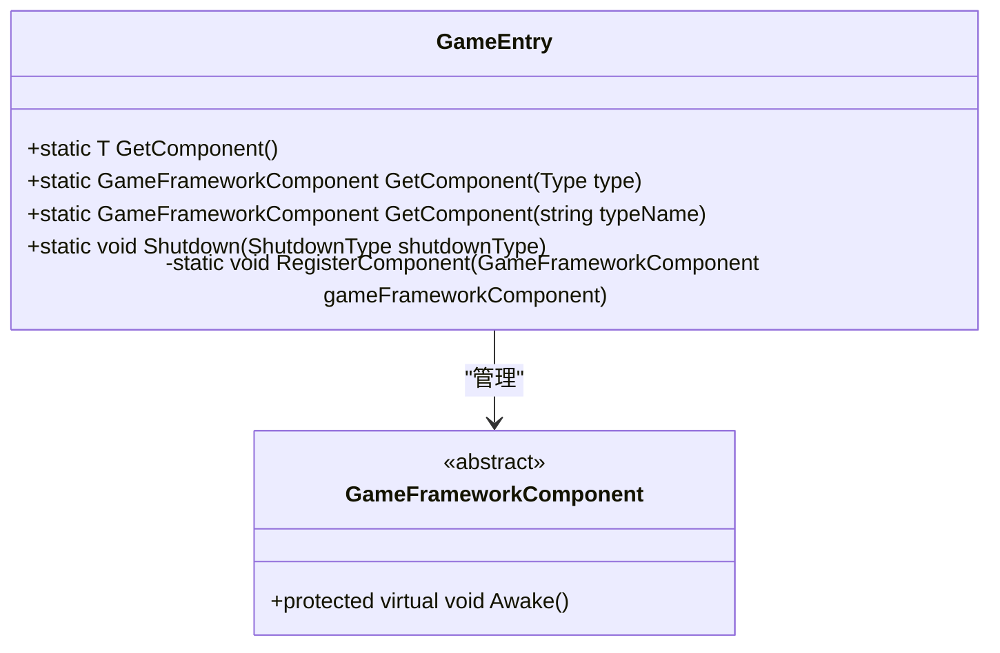
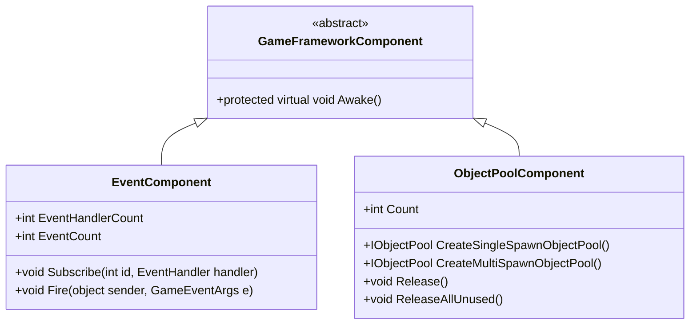
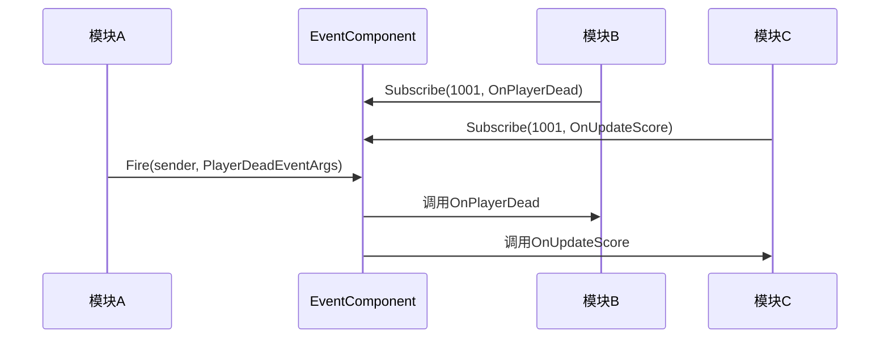
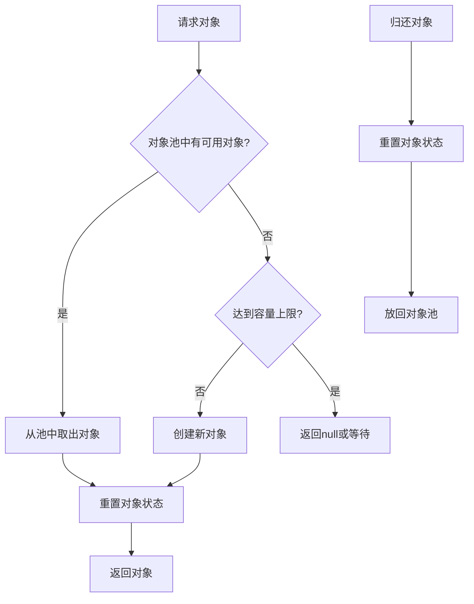

# 设计模式集成

<cite>
**Referenced Files in This Document**   
- [GameEntry.cs](file://Scripts/Runtime/Base/GameEntry.cs)
- [GameFrameworkComponent.cs](file://Scripts/Runtime/Base/GameFrameworkComponent.cs)
- [EventComponent.cs](file://Scripts/Runtime/Event/EventComponent.cs)
- [ObjectPoolComponent.cs](file://Scripts/Runtime/ObjectPool/ObjectPoolComponent.cs)
</cite>

## 目录
1. [单例模式：GameEntry](#单例模式gameentry)
2. [组件模式：GameFrameworkComponent](#组件模式gameframeworkcomponent)
3. [观察者模式：EventComponent](#观察者模式eventcomponent)
4. [对象池模式：ObjectPoolComponent](#对象池模式objectpoolcomponent)
5. [模式集成与应用](#模式集成与应用)

## 单例模式：GameEntry

`GameEntry` 类是游戏框架的入口点，通过静态类和私有构造函数的组合，实现了单例模式的变体。该类不直接创建实例，而是通过静态方法提供全局访问点，确保在整个游戏生命周期中，核心组件的访问是统一且唯一的。

`GameEntry` 维护了一个 `GameFrameworkComponent` 类型的链表，用于注册和管理所有游戏框架组件。通过 `GetComponent<T>()` 方法，开发者可以方便地获取任意已注册的组件实例，这正是单例模式的核心优势——提供全局唯一的访问接口。

**Diagram sources**
- [GameEntry.cs](file://Scripts/Runtime/Base/GameEntry.cs#L18-L145)
- [GameFrameworkComponent.cs](file://Scripts/Runtime/Base/GameFrameworkComponent.cs#L14-L23)

**Section sources**
- [GameEntry.cs](file://Scripts/Runtime/Base/GameEntry.cs#L18-L145)

## 组件模式：GameFrameworkComponent

`GameFrameworkComponent` 是所有游戏框架组件的基类，它继承自 `MonoBehaviour`，并实现了组件模式。通过继承 `MonoBehaviour`，这些组件可以无缝集成到 Unity 的游戏对象系统中，利用其生命周期管理、事件系统和场景管理功能。

组件模式的核心在于将功能分解为独立的、可复用的组件。`GameFrameworkComponent` 通过 `Awake` 方法，在组件初始化时自动向 `GameEntry` 注册自身，实现了组件的集中管理和统一访问。这种设计使得框架的各个功能模块（如事件、对象池、资源管理等）可以独立开发和维护，同时又能通过 `GameEntry` 进行协调和调用。

**Diagram sources**
- [GameFrameworkComponent.cs](file://Scripts/Runtime/Base/GameFrameworkComponent.cs#L14-L23)
- [EventComponent.cs](file://Scripts/Runtime/Event/EventComponent.cs#L17-L133)
- [ObjectPoolComponent.cs](file://Scripts/Runtime/ObjectPool/ObjectPoolComponent.cs#L18-L1031)

**Section sources**
- [GameFrameworkComponent.cs](file://Scripts/Runtime/Base/GameFrameworkComponent.cs#L14-L23)

## 观察者模式：EventComponent

`EventComponent` 是观察者模式的典型实现，它提供了一个事件系统，用于在游戏的不同模块之间进行松耦合的通信。该组件通过 `IEventManager` 接口与底层事件管理器交互，实现了事件的注册、分发和监听。

### 事件注册与监听
开发者可以通过 `Subscribe` 方法注册事件监听器。该方法接受一个事件类型编号 `id` 和一个事件处理回调函数 `handler`。当特定事件被触发时，所有订阅了该事件的监听器都会被调用。

### 事件分发
`Fire` 方法用于抛出事件。这是一个线程安全的操作，即使在非主线程中调用，事件也会在下一帧于主线程中被分发。`FireNow` 方法则用于立即分发事件，但不保证线程安全。

**Diagram sources**
- [EventComponent.cs](file://Scripts/Runtime/Event/EventComponent.cs#L90-L93)
- [EventComponent.cs](file://Scripts/Runtime/Event/EventComponent.cs#L119-L122)

**Section sources**
- [EventComponent.cs](file://Scripts/Runtime/Event/EventComponent.cs#L17-L133)

## 对象池模式：ObjectPoolComponent

`ObjectPoolComponent` 实现了对象池模式，旨在解决频繁创建和销毁游戏对象（如子弹、敌人、特效等）所带来的性能开销。通过预先创建并维护一组对象，当需要时从池中“借用”（Spawn），使用完毕后“归还”（Unspawn），从而避免了昂贵的 `Instantiate` 和 `Destroy` 操作。

### 对象池创建
该组件提供了 `CreateSingleSpawnObjectPool` 和 `CreateMultiSpawnObjectPool` 系列方法，用于创建不同类型的对象池。单次获取对象池确保一个对象在同一时间只能被一个使用者持有，而允许多次获取的对象池则允许一个对象被多个使用者同时持有。

### 对象生命周期管理
虽然 `ObjectPoolComponent` 本身没有直接暴露 `Spawn` 和 `Unspawn` 方法，但它通过 `IObjectPoolManager` 管理的对象池来实现这些功能。开发者需要先获取一个具体的对象池实例，然后调用该实例的 `Spawn` 和 `Unspawn` 方法来管理对象。

**Section sources**
- [ObjectPoolComponent.cs](file://Scripts/Runtime/ObjectPool/ObjectPoolComponent.cs#L18-L1031)

## 模式集成与应用

这些设计模式在游戏框架中协同工作，构建了一个高效、可扩展的架构。`GameEntry` 作为单例，提供了全局访问点；`GameFrameworkComponent` 作为基类，实现了组件的集中管理；`EventComponent` 提供了模块间的通信机制；`ObjectPoolComponent` 则优化了资源的使用。

开发者在自定义逻辑中，可以轻松地应用这些模式。例如，通过 `EventComponent.Subscribe` 注册事件监听器来响应游戏事件，或通过 `ObjectPoolComponent.CreateSingleSpawnObjectPool` 创建对象池，并使用其 `Spawn`/`Unspawn` 方法来管理动态对象的生命周期，从而显著提升游戏性能。