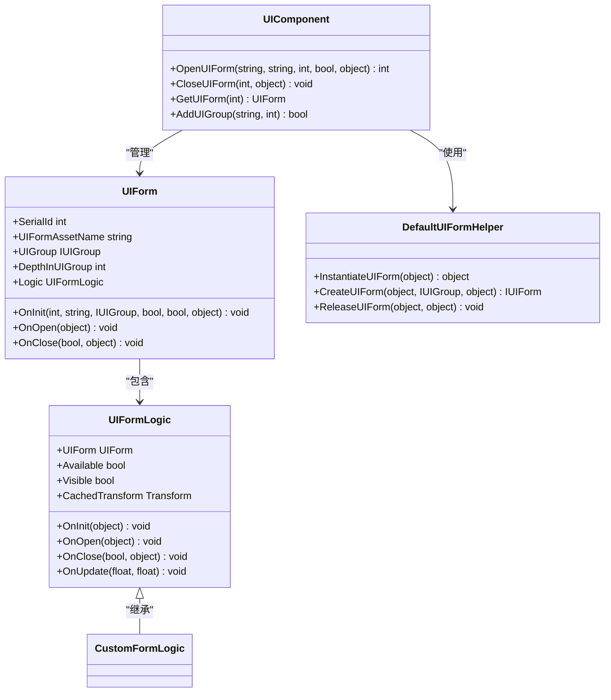
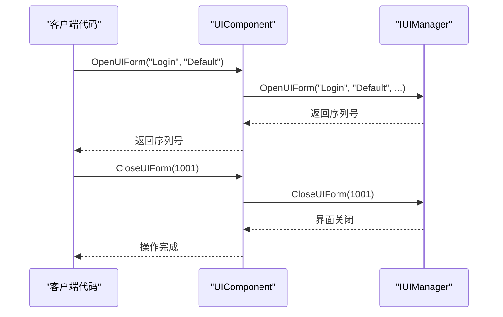
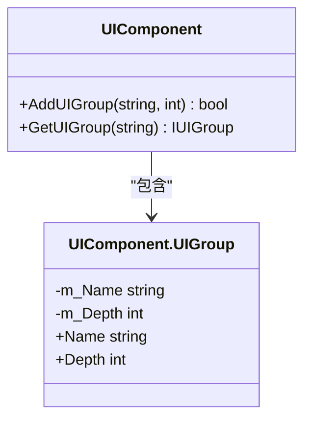
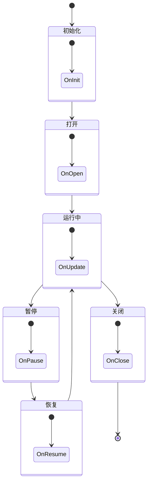
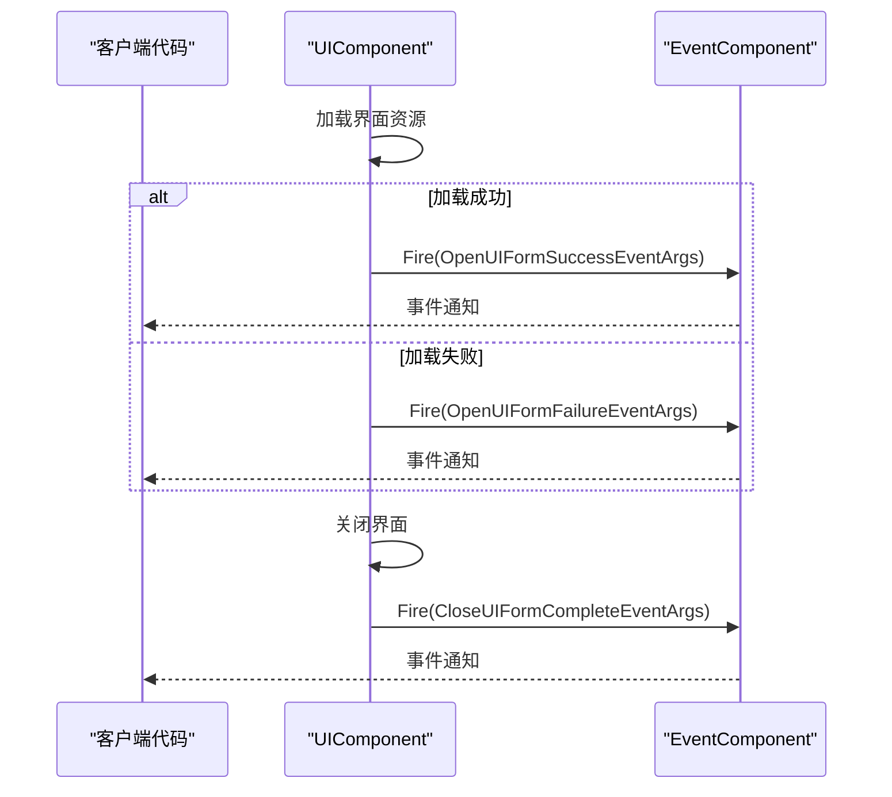
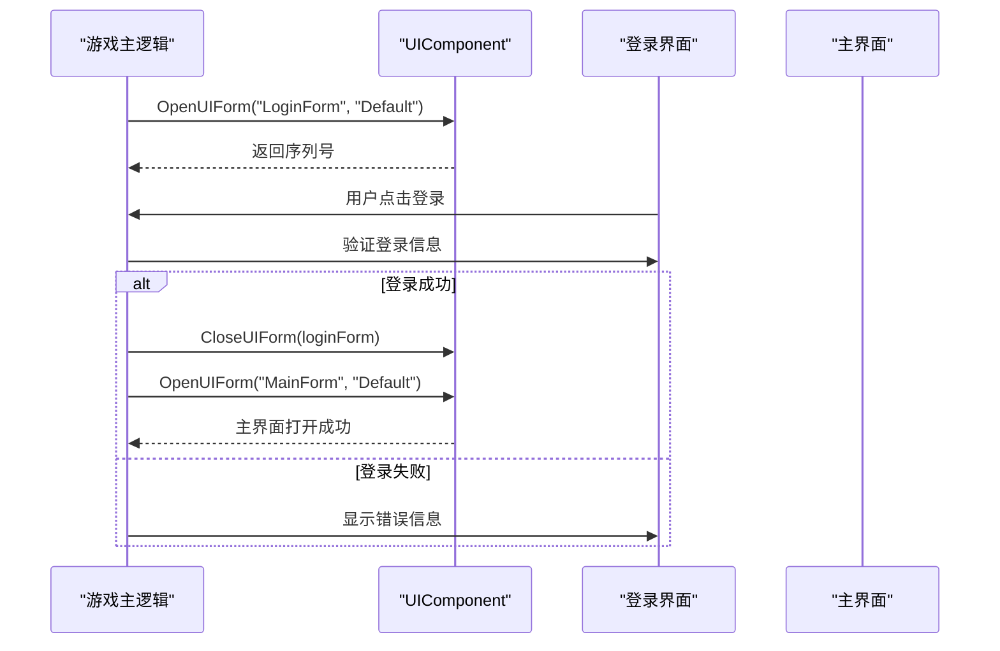
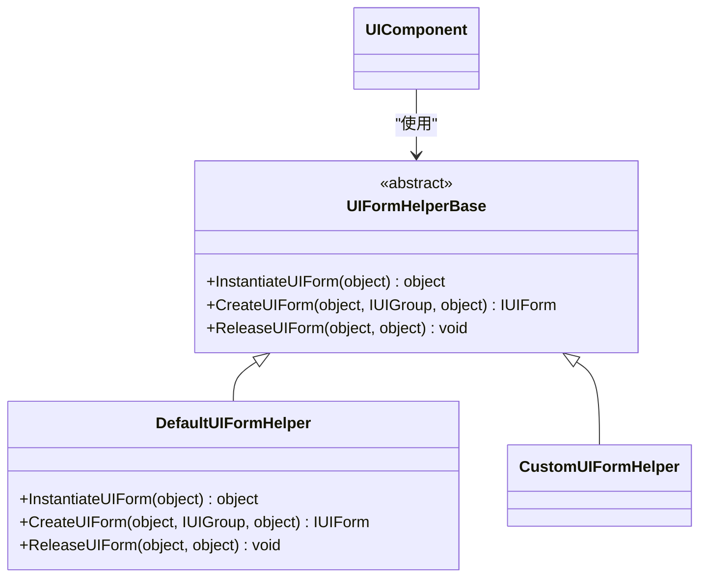

# UI系统

<cite>
**Referenced Files in This Document**   
- [UIComponent.cs](file://Scripts/Runtime/UI/UIComponent.cs)
- [UIForm.cs](file://Scripts/Runtime/UI/UIForm.cs)
- [UIFormLogic.cs](file://Scripts/Runtime/UI/UIFormLogic.cs)
- [DefaultUIFormHelper.cs](file://Scripts/Runtime/UI/DefaultUIFormHelper.cs)
- [OpenUIFormSuccessEventArgs.cs](file://Scripts/Runtime/UI/OpenUIFormSuccessEventArgs.cs)
- [OpenUIFormFailureEventArgs.cs](file://Scripts/Runtime/UI/OpenUIFormFailureEventArgs.cs)
- [CloseUIFormCompleteEventArgs.cs](file://Scripts/Runtime/UI/CloseUIFormCompleteEventArgs.cs)
</cite>

## 目录
1. [简介](#简介)
2. [核心组件](#核心组件)
3. [UI组件与界面管理](#ui组件与界面管理)
4. [界面组与渲染层级](#界面组与渲染层级)
5. [界面生命周期与逻辑脚本](#界面生命周期与逻辑脚本)
6. [异步加载与事件系统](#异步加载与事件系统)
7. [典型使用示例](#典型使用示例)
8. [DefaultUIFormHelper扩展点](#defaultuiformhelper扩展点)

## 简介
本文档详细阐述了Unity游戏框架中的UI系统模块。该系统提供了一套完整的界面管理解决方案，包括界面的打开、关闭、层级管理、生命周期控制以及事件通知机制。通过本系统，开发者可以高效地管理游戏中的用户界面，实现复杂的UI交互逻辑。

## 核心组件

UI系统由多个核心组件构成，它们协同工作以实现完整的界面管理功能。

**Diagram sources**
- [UIComponent.cs](file://Scripts/Runtime/UI/UIComponent.cs#L34-L730)
- [UIForm.cs](file://Scripts/Runtime/UI/UIForm.cs#L16-L303)
- [UIFormLogic.cs](file://Scripts/Runtime/UI/UIFormLogic.cs#L14-L205)
- [DefaultUIFormHelper.cs](file://Scripts/Runtime/UI/DefaultUIFormHelper.cs#L15-L72)

**Section sources**
- [UIComponent.cs](file://Scripts/Runtime/UI/UIComponent.cs#L34-L730)
- [UIForm.cs](file://Scripts/Runtime/UI/UIForm.cs#L16-L303)
- [UIFormLogic.cs](file://Scripts/Runtime/UI/UIFormLogic.cs#L14-L205)
- [DefaultUIFormHelper.cs](file://Scripts/Runtime/UI/DefaultUIFormHelper.cs#L15-L72)

## UI组件与界面管理

`UIComponent`是UI系统的核心管理组件，负责所有界面的创建、销毁和生命周期管理。它提供了`OpenUIForm`和`CloseUIForm`系列方法来控制界面的显示与隐藏。

**Diagram sources**
- [UIComponent.cs](file://Scripts/Runtime/UI/UIComponent.cs#L492-L584)
- [UIComponent.cs](file://Scripts/Runtime/UI/UIComponent.cs#L590-L622)

**Section sources**
- [UIComponent.cs](file://Scripts/Runtime/UI/UIComponent.cs#L492-L622)

## 界面组与渲染层级

UI系统通过`UIGroup`（界面组）来管理界面的渲染层级。每个界面组都有一个`Depth`属性，该属性决定了界面组在渲染顺序中的优先级，深度值越大，渲染层级越高。

**Diagram sources**
- [UIComponent.cs](file://Scripts/Runtime/UI/UIComponent.UIGroup.cs#L12-L39)

**Section sources**
- [UIComponent.cs](file://Scripts/Runtime/UI/UIComponent.UIGroup.cs#L12-L39)

## 界面生命周期与逻辑脚本

每个UI界面（`UIForm`）都有一个与之关联的逻辑脚本（`UIFormLogic`），用于处理界面的业务逻辑。`UIFormLogic`定义了完整的生命周期方法，包括初始化、打开、关闭、暂停、恢复等。

**Diagram sources**
- [UIForm.cs](file://Scripts/Runtime/UI/UIForm.cs#L16-L303)
- [UIFormLogic.cs](file://Scripts/Runtime/UI/UIFormLogic.cs#L14-L205)

**Section sources**
- [UIForm.cs](file://Scripts/Runtime/UI/UIForm.cs#L16-L303)
- [UIFormLogic.cs](file://Scripts/Runtime/UI/UIFormLogic.cs#L14-L205)

## 异步加载与事件系统

UI系统采用异步方式加载界面资源，通过事件系统通知操作结果。当界面成功打开时，会触发`OpenUIFormSuccessEventArgs`事件；打开失败时，触发`OpenUIFormFailureEventArgs`事件；界面关闭完成时，触发`CloseUIFormCompleteEventArgs`事件。

**Diagram sources**
- [OpenUIFormSuccessEventArgs.cs](file://Scripts/Runtime/UI/OpenUIFormSuccessEventArgs.cs#L15-L93)
- [OpenUIFormFailureEventArgs.cs](file://Scripts/Runtime/UI/OpenUIFormFailureEventArgs.cs#L15-L129)
- [CloseUIFormCompleteEventArgs.cs](file://Scripts/Runtime/UI/CloseUIFormCompleteEventArgs.cs#L16-L106)
- [UIComponent.cs](file://Scripts/Runtime/UI/UIComponent.cs#L700-L727)

**Section sources**
- [OpenUIFormSuccessEventArgs.cs](file://Scripts/Runtime/UI/OpenUIFormSuccessEventArgs.cs#L15-L93)
- [OpenUIFormFailureEventArgs.cs](file://Scripts/Runtime/UI/OpenUIFormFailureEventArgs.cs#L15-L129)
- [CloseUIFormCompleteEventArgs.cs](file://Scripts/Runtime/UI/CloseUIFormCompleteEventArgs.cs#L16-L106)
- [UIComponent.cs](file://Scripts/Runtime/UI/UIComponent.cs#L700-L727)

## 典型使用示例

以下是一个典型的UI操作流程示例：打开登录界面，用户登录成功后关闭登录界面并打开主界面。

**Section sources**
- [UIComponent.cs](file://Scripts/Runtime/UI/UIComponent.cs#L492-L622)

## DefaultUIFormHelper扩展点

`DefaultUIFormHelper`是UI系统的一个重要扩展点，它定义了界面实例化、创建和释放的具体行为。开发者可以通过继承`UIFormHelperBase`并重写相应方法来自定义UI的创建流程。

**Diagram sources**
- [DefaultUIFormHelper.cs](file://Scripts/Runtime/UI/DefaultUIFormHelper.cs#L15-L72)

**Section sources**
- [DefaultUIFormHelper.cs](file://Scripts/Runtime/UI/DefaultUIFormHelper.cs#L15-L72)