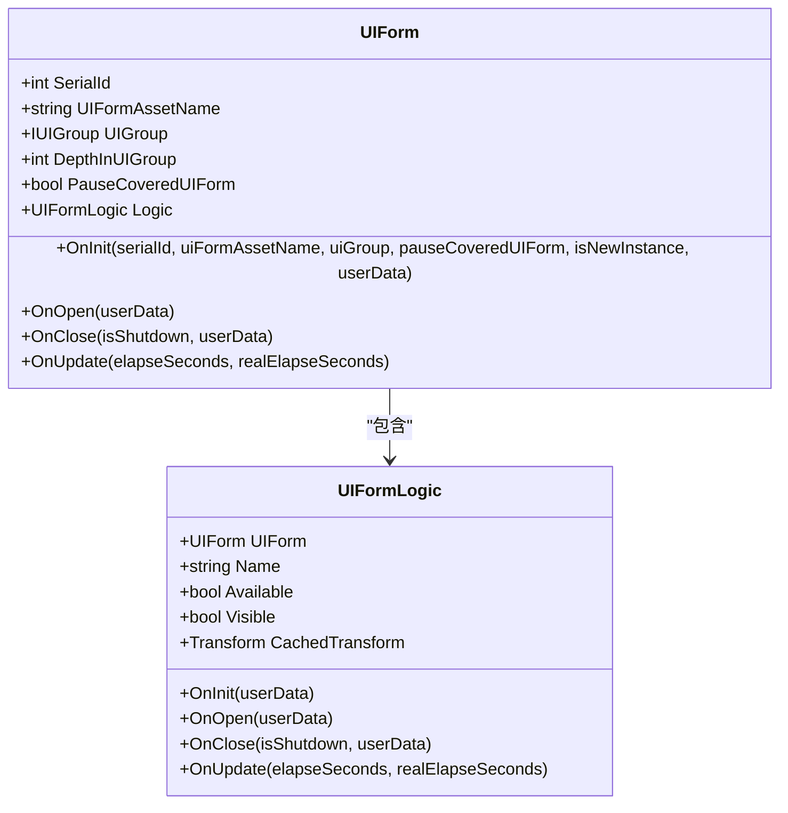
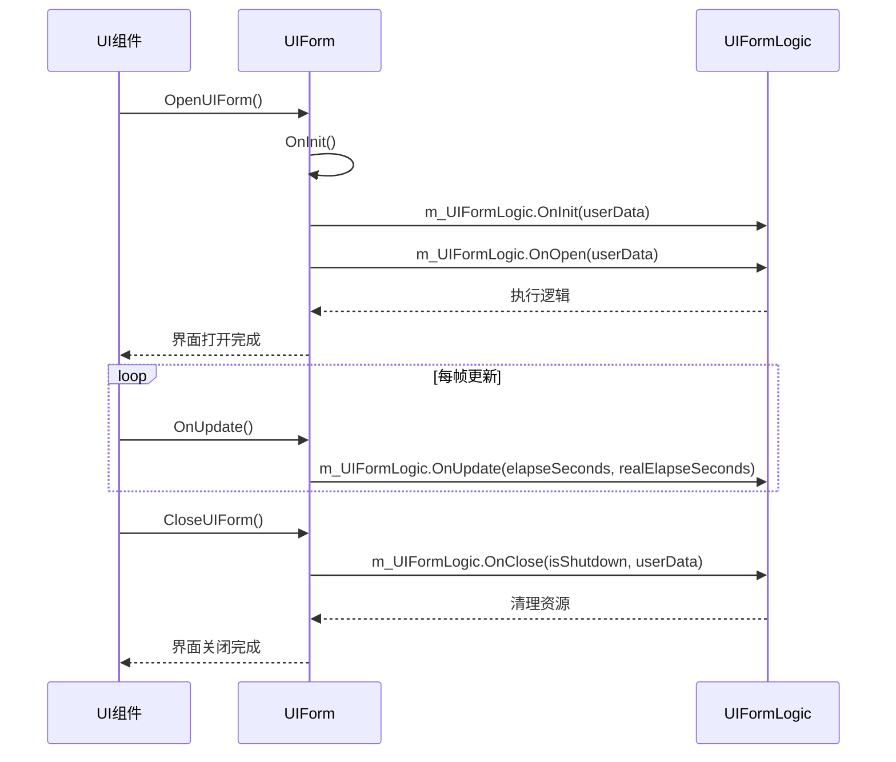

# 核心概念与架构

<cite>
**本文档中引用的文件**  
- [UIForm.cs](file://Scripts/Runtime/UI/UIForm.cs)
- [UIFormLogic.cs](file://Scripts/Runtime/UI/UIFormLogic.cs)
- [UIComponent.cs](file://Scripts/Runtime/UI/UIComponent.cs)
</cite>

## 目录
1. [引言](#引言)
2. [UIForm 与 UIFormLogic 的职责分离](#uiform-与-uiformlogic-的职责分离)
3. [UIForm：界面元数据与生命周期中枢](#uiform界面元数据与生命周期中枢)
4. [UIFormLogic：可编程扩展点](#uiformlogic可编程扩展点)
5. [组件系统关联机制](#组件系统关联机制)
6. [完整界面流程解析](#完整界面流程解析)
7. [异常处理与系统稳定性](#异常处理与系统稳定性)
8. [总结](#总结)

## 引言
在 Unity 游戏框架中，UI 系统的设计强调表现与逻辑的解耦。`UIForm` 和 `UIFormLogic` 是实现这一设计的核心组件。`UIForm` 作为由框架管理的界面实体，负责维护界面的元数据并转发生命周期事件；而 `UIFormLogic` 作为可编程的扩展点，允许开发者通过重写虚方法介入界面的各个生命周期阶段。本文将深入解析两者的协作机制、职责划分以及在实际流程中的交互方式。

## UIForm 与 UIFormLogic 的职责分离

在界面系统中，`UIForm` 与 `UIFormLogic` 采用职责分离的设计模式，分别承担框架管理与业务逻辑的职责：

- **UIForm**：作为框架层的界面容器，负责管理界面的唯一标识、资源路径、层级关系等元数据，并作为生命周期事件的统一入口。
- **UIFormLogic**：作为开发者可继承的逻辑基类，提供一系列受保护的虚方法（如 `OnInit`、`OnOpen`、`OnClose`、`OnUpdate`），供开发者实现具体的界面行为。

这种分离使得界面的表现结构与业务逻辑完全解耦，提升了代码的可维护性与复用性。

**Section sources**
- [UIForm.cs](file://Scripts/Runtime/UI/UIForm.cs#L16-L303)
- [UIFormLogic.cs](file://Scripts/Runtime/UI/UIFormLogic.cs#L14-L205)

## UIForm：界面元数据与生命周期中枢

`UIForm` 类继承自 `MonoBehaviour`，是 Unity 中实际挂载在 GameObject 上的组件。它主要承担以下职责：

### 元数据维护
`UIForm` 维护了界面的关键元数据，包括：
- **SerialId**：界面的唯一序列编号，用于区分不同实例。
- **UIFormAssetName**：界面资源名称，标识加载的预制体或资源路径。
- **UIGroup**：所属的界面组，用于管理界面的分组与层级。
- **DepthInUIGroup**：在界面组中的深度，决定渲染顺序。
- **PauseCoveredUIForm**：是否在当前界面打开时暂停被覆盖的界面。

这些属性均为只读，由框架在初始化时设置，确保外部无法随意修改。

### 生命周期事件转发
`UIForm` 作为生命周期事件的中枢，接收来自 `UIComponent` 的事件调用，并将其转发至其关联的 `UIFormLogic` 实例。例如：
- `OnInit`：初始化界面，获取 `UIFormLogic` 组件并调用其 `OnInit` 方法。
- `OnOpen`：界面打开时调用逻辑层的 `OnOpen`。
- `OnClose`：界面关闭时通知逻辑层进行清理。
- `OnUpdate`：每帧轮询，驱动逻辑更新。

所有对 `UIFormLogic` 的调用均被 `try-catch` 包裹，确保异常不会导致整个 UI 系统崩溃。



**Diagram sources**
- [UIForm.cs](file://Scripts/Runtime/UI/UIForm.cs#L16-L303)
- [UIFormLogic.cs](file://Scripts/Runtime/UI/UIFormLogic.cs#L14-L205)

**Section sources**
- [UIForm.cs](file://Scripts/Runtime/UI/UIForm.cs#L16-L303)

## UIFormLogic：可编程扩展点

`UIFormLogic` 是一个抽象类，开发者需继承此类以实现具体的界面逻辑。它通过受保护的虚方法提供多个生命周期钩子：

| 方法 | 触发时机 | 说明 |
|------|--------|------|
| `OnInit` | 界面初始化时 | 用于初始化逻辑层，获取组件引用 |
| `OnOpen` | 界面打开时 | 执行打开动画、数据绑定等操作 |
| `OnClose` | 界面关闭时 | 清理资源、保存状态 |
| `OnPause` / `OnResume` | 界面暂停/恢复时 | 处理被覆盖时的逻辑 |
| `OnCover` / `OnReveal` | 被其他界面遮挡/恢复时 | 控制界面可见性 |
| `OnRefocus` | 界面重新激活时 | 响应用户重新聚焦 |
| `OnUpdate` | 每帧调用 | 驱动界面动态行为 |

这些方法默认为空实现，开发者可根据需要重写。例如，`OnOpen` 默认设置界面为可见，`OnClose` 则重置图层并隐藏界面。



**Diagram sources**
- [UIForm.cs](file://Scripts/Runtime/UI/UIForm.cs#L111-L139)
- [UIFormLogic.cs](file://Scripts/Runtime/UI/UIFormLogic.cs#L101-L110)

**Section sources**
- [UIFormLogic.cs](file://Scripts/Runtime/UI/UIFormLogic.cs#L14-L205)

## 组件系统关联机制

`UIForm` 与 `UIFormLogic` 通过 Unity 的组件系统进行关联。具体流程如下：

1. 当 `UIForm` 被实例化后，在 `OnInit` 方法中调用 `GetComponent<UIFormLogic>()` 获取挂载在同一 GameObject 上的 `UIFormLogic` 组件。
2. 若未找到 `UIFormLogic` 组件，则记录错误并返回。
3. 成功获取后，将其引用保存在 `m_UIFormLogic` 字段中，后续所有生命周期事件均通过该引用转发。

这种设计依赖于 Unity 的组件架构，确保了逻辑与表现的物理分离，同时又能高效通信。

**Section sources**
- [UIForm.cs](file://Scripts/Runtime/UI/UIForm.cs#L111-L139)

## 完整界面流程解析

从资源加载到界面关闭的完整流程如下：

1. **资源加载与实例化**  
   通过 `UIComponent.OpenUIForm()` 方法加载指定资源并实例化为 GameObject。

2. **初始化（OnInit）**  
   框架调用 `UIForm.OnInit()`，设置元数据并查找 `UIFormLogic` 组件。若存在，则调用其 `OnInit(userData)`。

3. **打开（OnOpen）**  
   界面显示时，`UIForm.OnOpen()` 被调用，进而触发 `UIFormLogic.OnOpen(userData)`，开发者可在此初始化界面元素。

4. **更新（OnUpdate）**  
   每帧调用 `UIForm.OnUpdate()`，转发至 `UIFormLogic.OnUpdate()`，实现动态逻辑。

5. **关闭（OnClose）**  
   调用 `UIComponent.CloseUIForm()` 后，`UIForm.OnClose()` 触发，执行 `UIFormLogic.OnClose()` 进行资源释放。

该流程由 `UIComponent` 统一调度，确保一致性与可控性。

**Section sources**
- [UIComponent.cs](file://Scripts/Runtime/UI/UIComponent.cs#L492-L584)
- [UIForm.cs](file://Scripts/Runtime/UI/UIForm.cs#L164-L191)

## 异常处理与系统稳定性

为保障 UI 系统的稳定性，所有对 `UIFormLogic` 方法的调用均被 `try-catch` 包裹。例如：

```csharp
try
{
    m_UIFormLogic.OnOpen(userData);
}
catch (Exception exception)
{
    Log.Error("UI form '[{0}]{1}' OnOpen with exception '{2}'.", m_SerialId.ToString(), m_UIFormAssetName, exception.ToString());
}
```

此机制确保即使某个界面逻辑抛出异常，也不会导致整个游戏崩溃，仅影响该界面本身。日志记录便于后续排查问题，提升系统的健壮性。

**Section sources**
- [UIForm.cs](file://Scripts/Runtime/UI/UIForm.cs#L164-L174)

## 总结

`UIForm` 与 `UIFormLogic` 的职责分离设计，实现了界面表现与业务逻辑的彻底解耦。`UIForm` 作为框架管理的实体，负责元数据维护与生命周期事件转发；`UIFormLogic` 作为可扩展基类，提供丰富的生命周期钩子供开发者介入。两者通过组件系统关联，结合 `try-catch` 异常处理机制，构建了一个稳定、灵活、易于维护的 UI 架构体系。该设计模式适用于大型项目中复杂界面系统的开发与管理。

**Section sources**
- [UIForm.cs](file://Scripts/Runtime/UI/UIForm.cs#L16-L303)
- [UIFormLogic.cs](file://Scripts/Runtime/UI/UIFormLogic.cs#L14-L205)
- [UIComponent.cs](file://Scripts/Runtime/UI/UIComponent.cs#L492-L584)