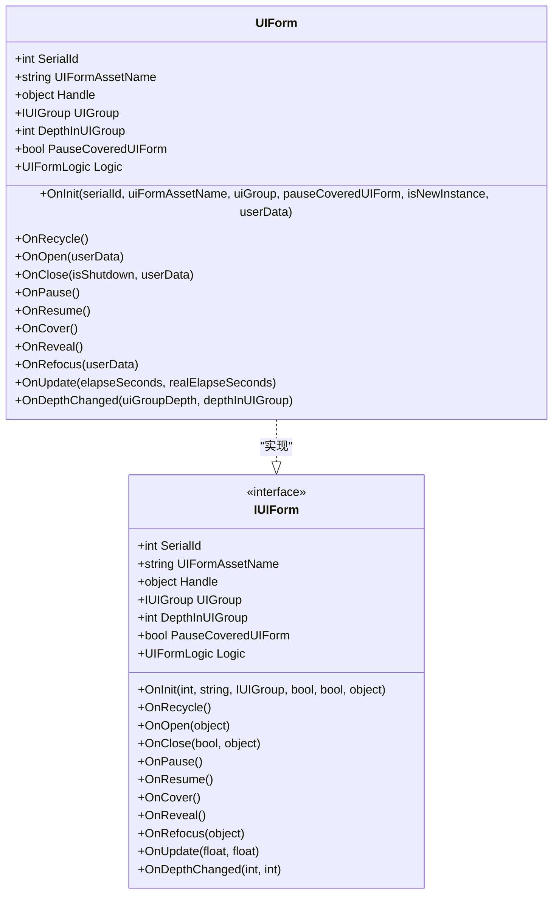
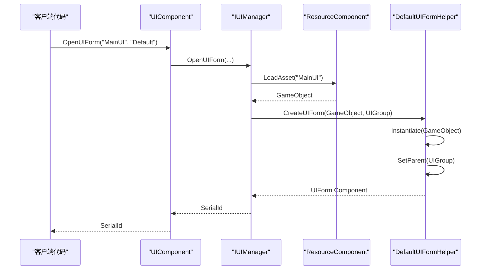
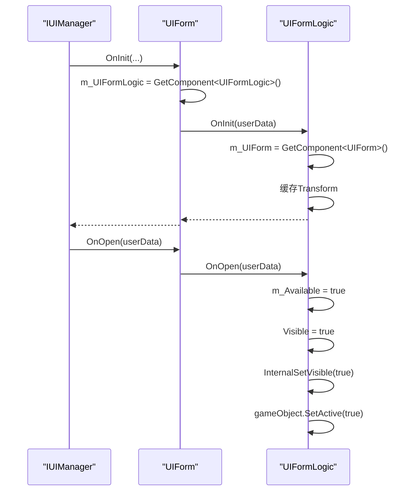
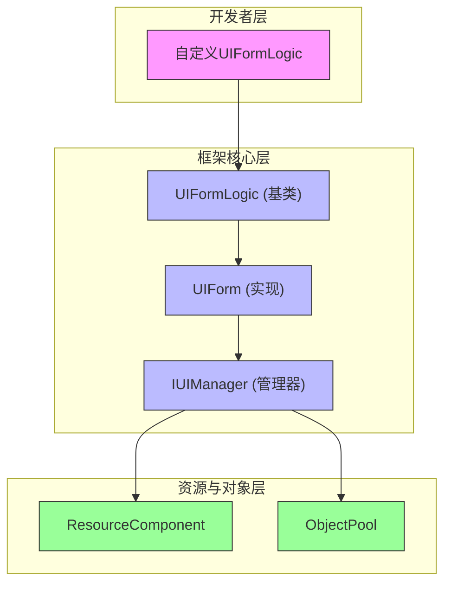

# 界面与生命周期

<cite>
**Referenced Files in This Document**   
- [UIForm.cs](file://Scripts/Runtime/UI/UIForm.cs)
- [UIFormLogic.cs](file://Scripts/Runtime/UI/UIFormLogic.cs)
- [UIComponent.cs](file://Scripts/Runtime/UI/UIComponent.cs)
- [DefaultUIFormHelper.cs](file://Scripts/Runtime/UI/DefaultUIFormHelper.cs)
</cite>

## 目录
1. [引言](#引言)
2. [核心组件分析](#核心组件分析)
3. [UIForm与UIFormLogic的协作关系](#uiform与uiformlogic的协作关系)
4. [界面生命周期流程](#界面生命周期流程)
5. [自定义UIFormLogic示例](#自定义uiformlogic示例)
6. [架构概览](#架构概览)

## 引言

在Unity游戏框架中，界面管理是用户交互的核心部分。本文档深入解析`UIForm`和`UIFormLogic`在界面生命周期管理中的角色与协作关系。`UIForm`作为`IUIForm`接口的具体实现，负责管理界面的元数据（如序列编号、资源名称）和状态（如界面深度），并作为生命周期事件的转发器。`UIFormLogic`则作为用户可继承的基类，通过`OnInit`、`OnOpen`、`OnClose`、`OnUpdate`等受保护的虚方法，为开发者提供介入界面各个生命周期阶段的钩子。本文将详细描述从UI组件加载资源并创建UIForm实例，到调用其初始化方法，再到通过UIFormLogic真正显示界面的完整流程。

## 核心组件分析

### UIForm类分析

`UIForm`类是框架中界面的具体实现，它实现了`IUIForm`接口，负责管理界面实例的核心元数据和状态。

**Section sources**
- [UIForm.cs](file://Scripts/Runtime/UI/UIForm.cs#L16-L303)

#### UIForm元数据与状态管理

`UIForm`类通过私有字段维护界面的关键信息，包括序列编号（SerialId）、界面资源名称（UIFormAssetName）、所属界面组（UIGroup）、在界面组中的深度（DepthInUIGroup）以及是否暂停被覆盖界面（PauseCoveredUIForm）等。这些信息通过只读属性暴露给外部，确保了数据的封装性和安全性。



**Diagram sources**
- [UIForm.cs](file://Scripts/Runtime/UI/UIForm.cs#L16-L303)

### UIFormLogic类分析

`UIFormLogic`是一个抽象基类，设计为供开发者继承以实现具体的界面逻辑。它通过一系列受保护的虚方法（protected internal virtual）为开发者提供了介入界面生命周期的钩子。

**Section sources**
- [UIFormLogic.cs](file://Scripts/Runtime/UI/UIFormLogic.cs#L14-L205)

#### UIFormLogic生命周期钩子

`UIFormLogic`定义了完整的生命周期方法，开发者可以通过重写这些方法来定制界面的行为。这些方法包括`OnInit`（初始化）、`OnOpen`（打开）、`OnClose`（关闭）、`OnUpdate`（更新）、`OnPause`（暂停）等。每个方法都提供了默认实现，确保了即使不重写也能有基本的行为。

```mermaid
classDiagram
class UIFormLogic {
+UIForm UIForm
+string Name
+bool Available
+bool Visible
+Transform CachedTransform
+OnInit(userData)
+OnRecycle()
+OnOpen(userData)
+OnClose(isShutdown, userData)
+OnPause()
+OnResume()
+OnCover()
+OnReveal()
+OnRefocus(userData)
+OnUpdate(elapseSeconds, realElapseSeconds)
+OnDepthChanged(uiGroupDepth, depthInUIGroup)
+InternalSetVisible(visible)
}
class UIForm {
+UIFormLogic Logic
}
UIFormLogic <|-- "CustomLogic" : "继承"
UIForm --> UIFormLogic : "包含"
```

**Diagram sources**
- [UIFormLogic.cs](file://Scripts/Runtime/UI/UIFormLogic.cs#L14-L205)

## UIForm与UIFormLogic的协作关系

`UIForm`和`UIFormLogic`之间是一种典型的"组合"关系，`UIForm`作为容器和管理者，而`UIFormLogic`作为行为和逻辑的提供者。这种设计模式将界面的元数据管理与具体逻辑实现分离，提高了代码的可维护性和可扩展性。

当一个`UIForm`实例被创建时，它会通过`GetComponent<UIFormLogic>()`方法查找并引用其子对象上的`UIFormLogic`组件。在`UIForm`的各个生命周期方法（如`OnOpen`、`OnClose`）被调用时，它会将调用转发给其内部的`UIFormLogic`实例的对应方法。

这种协作模式确保了`UIForm`可以专注于其核心职责——管理界面实例的状态和元数据，而将具体的业务逻辑交由`UIFormLogic`处理。开发者无需修改`UIForm`的代码，只需继承`UIFormLogic`并重写相应的方法即可实现自定义的界面行为。

**Section sources**
- [UIForm.cs](file://Scripts/Runtime/UI/UIForm.cs#L111-L139)
- [UIFormLogic.cs](file://Scripts/Runtime/UI/UIFormLogic.cs#L101-L110)

## 界面生命周期流程

从资源加载到界面显示，整个流程涉及多个组件的协同工作。以下是完整的生命周期流程：

### 资源加载与实例创建

流程始于`UIComponent`，它是整个UI系统的入口。当调用`OpenUIForm`方法时，`UIComponent`会协调`IUIManager`和`IResourceManager`来加载指定的界面资源。



**Diagram sources**
- [UIComponent.cs](file://Scripts/Runtime/UI/UIComponent.cs#L581-L584)
- [DefaultUIFormHelper.cs](file://Scripts/Runtime/UI/DefaultUIFormHelper.cs#L36-L50)

### 初始化与打开流程

一旦`UIForm`实例被创建，`IUIManager`会调用其`OnInit`方法进行初始化。在此方法中，`UIForm`会获取其关联的`UIFormLogic`组件，并调用`UIFormLogic.OnInit`方法。随后，当界面准备就绪时，`IUIManager`会调用`UIForm.OnOpen`，进而触发`UIFormLogic.OnOpen`，最终显示界面。



**Diagram sources**
- [UIForm.cs](file://Scripts/Runtime/UI/UIForm.cs#L111-L139)
- [UIFormLogic.cs](file://Scripts/Runtime/UI/UIFormLogic.cs#L123-L127)

## 自定义UIFormLogic示例

以下是一个继承自`UIFormLogic`的自定义逻辑类示例，展示了如何在不同生命周期阶段介入并实现具体功能：

```csharp
public class CustomUILogic : UIFormLogic
{
    private DataModel m_DataModel;
    private Text m_TitleText;
    private Image m_IconImage;

    protected internal override void OnInit(object userData)
    {
        base.OnInit(userData);
        
        // 初始化UI组件引用
        m_TitleText = transform.Find("Title").GetComponent<Text>();
        m_IconImage = transform.Find("Icon").GetComponent<Image>();
        
        // 从userData中获取数据模型
        m_DataModel = userData as DataModel;
        
        Log.Info("CustomUILogic 初始化完成。");
    }

    protected internal override void OnOpen(object userData)
    {
        base.OnOpen(userData);
        
        // 使用数据模型初始化UI
        if (m_DataModel != null)
        {
            m_TitleText.text = m_DataModel.Title;
            m_IconImage.sprite = m_DataModel.Icon;
        }
        
        Log.Info("CustomUILogic 界面已打开。");
    }

    protected internal override void OnUpdate(float elapseSeconds, float realElapseSeconds)
    {
        base.OnUpdate(elapseSeconds, realElapseSeconds);
        
        // 在每帧更新中刷新UI
        if (m_DataModel != null && m_DataModel.NeedRefresh)
        {
            m_TitleText.text = m_DataModel.Title;
            m_DataModel.NeedRefresh = false;
        }
    }

    protected internal override void OnClose(bool isShutdown, object userData)
    {
        // 清理资源
        m_DataModel = null;
        m_TitleText = null;
        m_IconImage = null;
        
        Log.Info("CustomUILogic 资源已清理。");
        
        base.OnClose(isShutdown, userData);
    }
}
```

**Section sources**
- [UIFormLogic.cs](file://Scripts/Runtime/UI/UIFormLogic.cs#L14-L205)

## 架构概览

整个UI系统采用分层架构，`UIComponent`作为高层组件暴露简洁的API，`IUIManager`作为核心管理器处理复杂的逻辑，`UIForm`作为具体实现管理实例，而`UIFormLogic`则为开发者提供扩展点。



**Diagram sources**
- [UIComponent.cs](file://Scripts/Runtime/UI/UIComponent.cs#L25-L25)
- [UIForm.cs](file://Scripts/Runtime/UI/UIForm.cs#L16-L303)
- [UIFormLogic.cs](file://Scripts/Runtime/UI/UIFormLogic.cs#L14-L205)