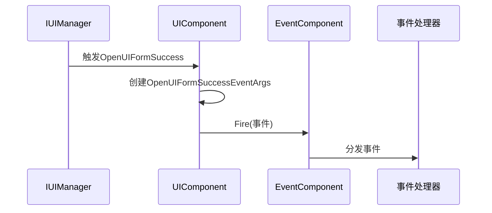

# 界面事件系统

<cite>
**Referenced Files in This Document**   
- [OpenUIFormSuccessEventArgs.cs](file://Scripts/Runtime/UI/OpenUIFormSuccessEventArgs.cs)
- [OpenUIFormFailureEventArgs.cs](file://Scripts/Runtime/UI/OpenUIFormFailureEventArgs.cs)
- [CloseUIFormCompleteEventArgs.cs](file://Scripts/Runtime/UI/CloseUIFormCompleteEventArgs.cs)
- [UIComponent.cs](file://Scripts/Runtime/UI/UIComponent.cs)
- [EventComponent.cs](file://Scripts/Runtime/Event/EventComponent.cs)
</cite>

## Table of Contents
1. [核心事件类结构分析](#核心事件类结构分析)
2. [事件触发与传播机制](#事件触发与传播机制)
3. [事件订阅与处理模式](#事件订阅与处理模式)
4. [事件处理代码示例](#事件处理代码示例)

## 核心事件类结构分析

### OpenUIFormSuccessEventArgs 结构与用途

`OpenUIFormSuccessEventArgs` 类用于表示界面打开成功的事件，封装了界面成功加载后的关键信息。

**字段含义：**
- **UIForm**: 获取打开成功的界面实例，类型为 `UIForm`，允许事件处理程序直接访问新打开的界面对象进行初始化或配置。
- **Duration**: 获取界面加载的持续时间（以秒为单位），可用于性能监控和加载优化分析。
- **UserData**: 获取用户自定义数据，允许在打开界面时传递上下文信息，并在成功回调中获取这些数据。

该事件通过静态 `Create` 方法从底层框架事件 `GameFramework.UI.OpenUIFormSuccessEventArgs` 创建，实现了事件的适配和转换。事件实例通过引用池 `ReferencePool` 进行管理，确保内存使用的高效性。

**Section sources**
- [OpenUIFormSuccessEventArgs.cs](file://Scripts/Runtime/UI/OpenUIFormSuccessEventArgs.cs#L15-L93)

### OpenUIFormFailureEventArgs 结构与用途

`OpenUIFormFailureEventArgs` 类用于表示界面打开失败的事件，提供了失败原因的详细诊断信息。

**字段含义：**
- **SerialId**: 获取界面的序列编号，用于唯一标识本次打开操作。
- **UIFormAssetName**: 获取界面资源名称，指示尝试加载的界面资源标识。
- **UIGroupName**: 获取目标界面组名称，表明界面应归属的界面组。
- **PauseCoveredUIForm**: 获取是否暂停被覆盖界面的布尔值，反映打开界面时的覆盖策略。
- **ErrorMessage**: 获取错误信息，提供具体的失败原因描述，是调试和用户提示的关键依据。
- **UserData**: 获取用户自定义数据，与打开请求时传递的数据一致。

此事件类同样通过 `Create` 方法创建，并在 `UIComponent` 中根据配置决定是否触发，为开发者提供了灵活的错误处理机制。

**Section sources**
- [OpenUIFormFailureEventArgs.cs](file://Scripts/Runtime/UI/OpenUIFormFailureEventArgs.cs#L15-L129)

### CloseUIFormCompleteEventArgs 结构与用途

`CloseUIFormCompleteEventArgs` 类用于表示界面关闭完成的事件，标志着界面资源释放的最终阶段。

**字段含义：**
- **SerialId**: 获取界面的序列编号，用于识别被关闭的界面实例。
- **UIFormAssetName**: 获取界面资源名称，便于根据资源名进行后续逻辑处理。
- **UIGroup**: 获取界面所属的界面组，类型为 `IUIGroup`，可用于界面组级别的状态更新。
- **UserData**: 获取用户自定义数据，常用于传递关闭原因或清理参数。

该事件在界面完全关闭并从内存中卸载后触发，是执行清理工作和状态同步的理想时机。

**Section sources**
- [CloseUIFormCompleteEventArgs.cs](file://Scripts/Runtime/UI/CloseUIFormCompleteEventArgs.cs#L16-L106)

## 事件触发与传播机制

### 事件传播流程

界面事件的传播遵循一个清晰的分层架构：底层的 `IUIManager` 触发原始事件，`UIComponent` 作为中介层监听这些事件，并将其转换为框架级的 `GameEventArgs`，最后通过 `m_EventComponent` 进行全局广播。



**Diagram sources**
- [UIComponent.cs](file://Scripts/Runtime/UI/UIComponent.cs#L700-L703)
- [EventComponent.cs](file://Scripts/Runtime/Event/EventComponent.cs#L124-L133)

### UIComponent 中的事件转发

`UIComponent` 在 `Awake` 方法中订阅了 `IUIManager` 的各种界面事件。当底层事件发生时，`UIComponent` 的私有处理方法（如 `OnOpenUIFormSuccess`）会被调用。

关键代码路径：
1. `UIComponent.Awake()` 订阅 `m_UIManager.OpenUIFormSuccess` 事件。
2. 当界面成功打开时，`OnOpenUIFormSuccess` 方法被触发。
3. 该方法调用 `OpenUIFormSuccessEventArgs.Create(e)` 创建框架级事件。
4. 最后通过 `m_EventComponent.Fire(this, eventArgs)` 将事件转发到全局事件系统。

这种设计实现了关注点分离，`UIComponent` 负责事件的适配和转发，而具体的业务逻辑则由独立的事件处理器处理。

**Section sources**
- [UIComponent.cs](file://Scripts/Runtime/UI/UIComponent.cs#L65-L75)
- [UIComponent.cs](file://Scripts/Runtime/UI/UIComponent.cs#L700-L703)

## 事件订阅与处理模式

### 事件订阅机制

事件的订阅通过 `EventComponent` 提供的 `Subscribe` 方法完成。开发者需要指定事件的类型编号（由 `EventId` 静态字段提供）和事件处理回调函数。

通用订阅模式：
```csharp
// 订阅界面打开成功事件
GameEntry.Event.Subscribe(OpenUIFormSuccessEventArgs.EventId, OnOpenUIFormSuccess);

// 订阅界面打开失败事件
GameEntry.Event.Subscribe(OpenUIFormFailureEventArgs.EventId, OnOpenUIFormFailure);

// 订阅界面关闭完成事件
GameEntry.Event.Subscribe(CloseUIFormCompleteEventArgs.EventId, OnCloseUIFormComplete);
```

### 常见操作模式

在事件处理程序中，常见的操作模式包括：

1.  **状态更新**: 根据事件更新游戏状态机或UI状态。
2.  **资源管理**: 在关闭完成事件中执行额外的资源清理。
3.  **用户反馈**: 在失败事件中显示错误提示。
4.  **数据记录**: 记录加载时间用于性能分析。

**Section sources**
- [EventComponent.cs](file://Scripts/Runtime/Event/EventComponent.cs#L107-L114)

## 事件处理代码示例

以下是一个完整的事件处理代码示例，展示了如何优雅地处理界面打开成功、失败和关闭完成的场景。

```csharp
public class UIManager : MonoBehaviour
{
    private void Start()
    {
        // 订阅事件
        GameEntry.Event.Subscribe(OpenUIFormSuccessEventArgs.EventId, OnOpenUIFormSuccess);
        GameEntry.Event.Subscribe(OpenUIFormFailureEventArgs.EventId, OnOpenUIFormFailure);
        GameEntry.Event.Subscribe(CloseUIFormCompleteEventArgs.EventId, OnCloseUIFormComplete);
    }

    private void OnDestroy()
    {
        // 取消订阅，防止内存泄漏
        GameEntry.Event.Unsubscribe(OpenUIFormSuccessEventArgs.EventId, OnOpenUIFormSuccess);
        GameEntry.Event.Unsubscribe(OpenUIFormFailureEventArgs.EventId, OnOpenUIFormFailure);
        GameEntry.Event.Unsubscribe(CloseUIFormCompleteEventArgs.EventId, OnCloseUIFormComplete);
    }

    private void OnOpenUIFormSuccess(object sender, GameEventArgs e)
    {
        OpenUIFormSuccessEventArgs ne = (OpenUIFormSuccessEventArgs)e;
        UIForm openedForm = ne.UIForm;
        float loadDuration = ne.Duration;
        object userData = ne.UserData;

        // 记录性能日志
        Debug.Log($"界面 {openedForm.Name} 打开成功，耗时: {loadDuration:F2}s");

        // 执行初始化逻辑
        if (userData is Action onInitialized)
        {
            onInitialized();
        }
    }

    private void OnOpenUIFormFailure(object sender, GameEventArgs e)
    {
        OpenUIFormFailureEventArgs ne = (OpenUIFormFailureEventArgs)e;
        string assetName = ne.UIFormAssetName;
        string errorMessage = ne.ErrorMessage;
        object userData = ne.UserData;

        // 显示错误信息给用户
        Debug.LogError($"打开界面 {assetName} 失败: {errorMessage}");

        // 执行失败回调
        if (userData is Action<string> onFailure)
        {
            onFailure(errorMessage);
        }
    }

    private void OnCloseUIFormComplete(object sender, GameEventArgs e)
    {
        CloseUIFormCompleteEventArgs ne = (CloseUIFormCompleteEventArgs)e;
        int serialId = ne.SerialId;
        string assetName = ne.UIFormAssetName;
        object userData = ne.UserData;

        // 记录关闭日志
        Debug.Log($"界面 {assetName} (ID: {serialId}) 已完全关闭");

        // 执行清理逻辑
        if (userData is Action onCleaned)
        {
            onCleaned();
        }
    }
}
```

此示例展示了完整的事件生命周期管理，包括订阅、处理和取消订阅，确保了代码的健壮性和可维护性。