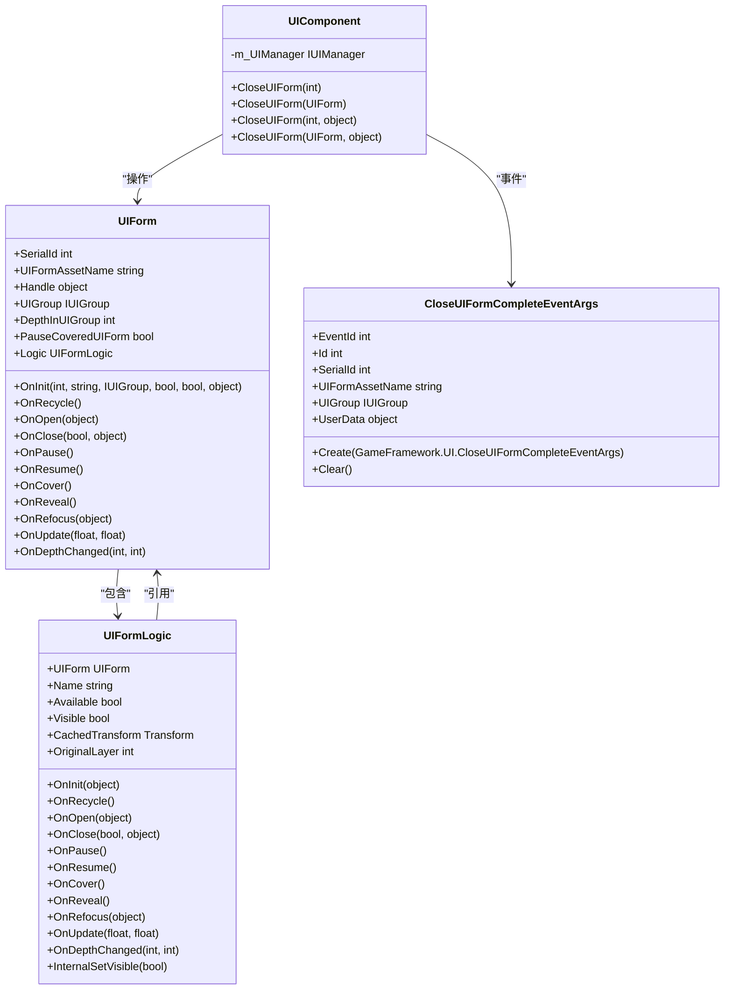
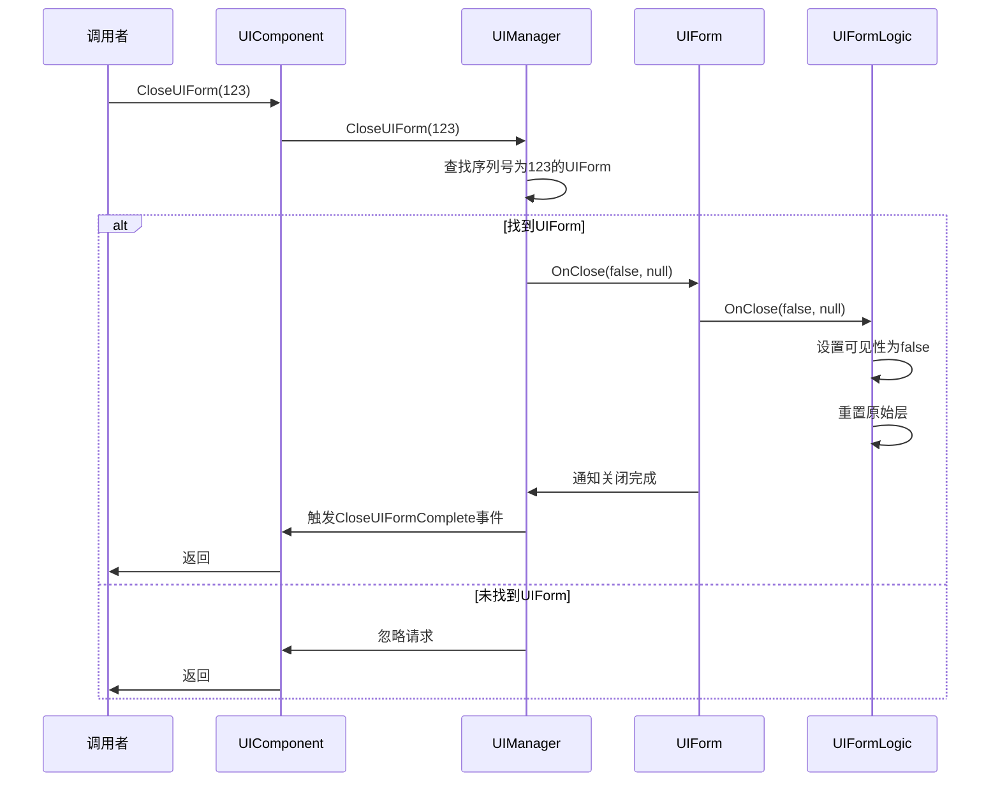
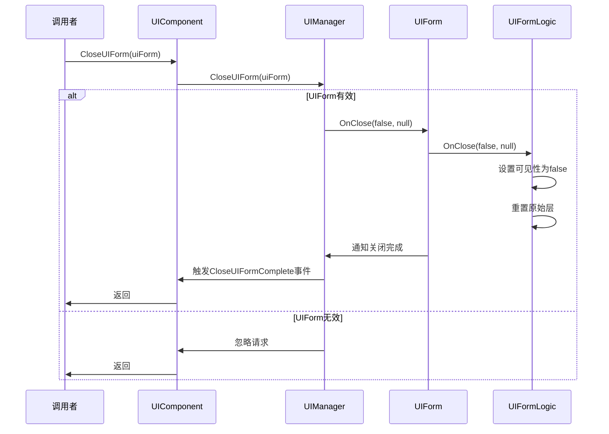
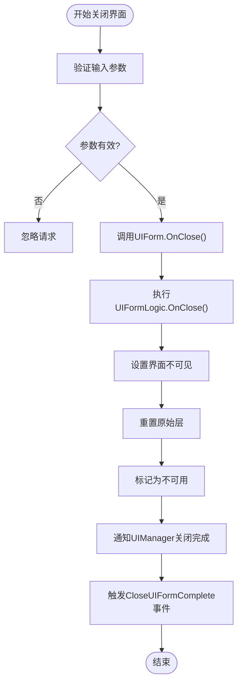
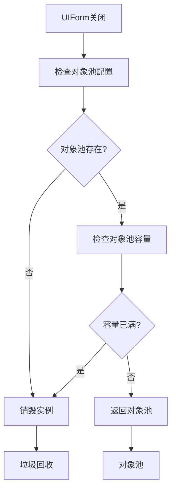
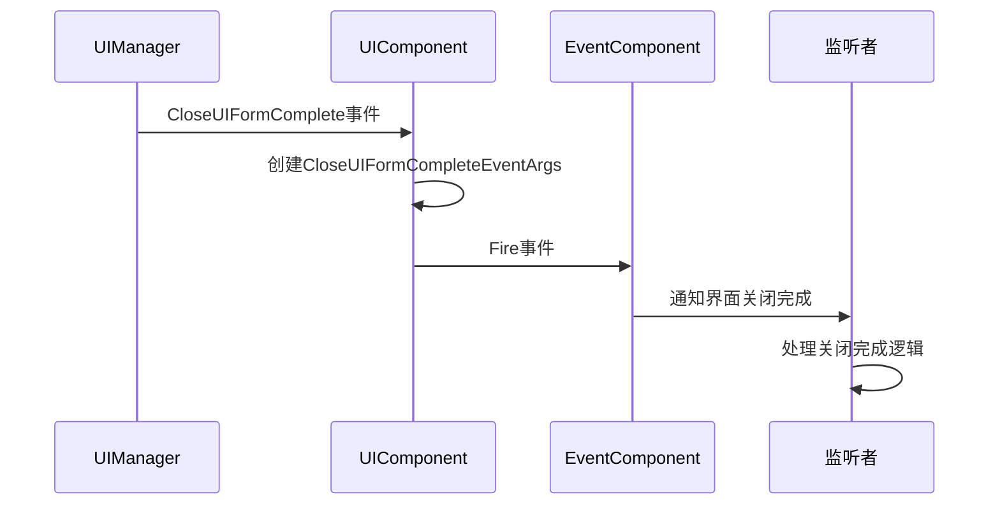
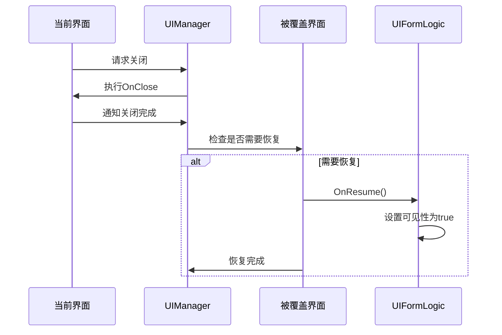
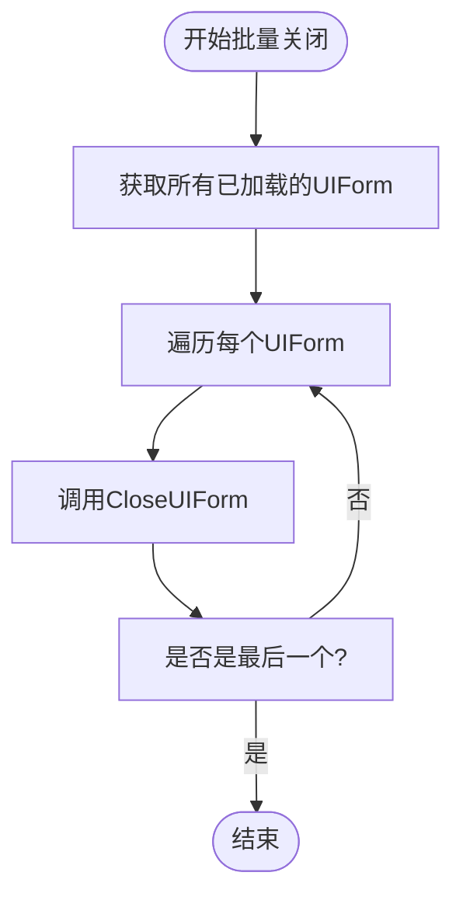
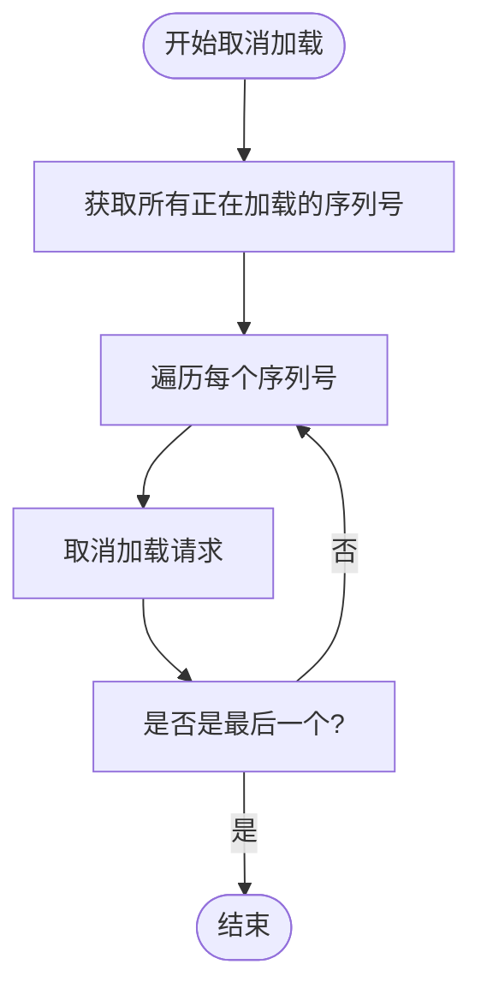

# 界面关闭

<cite>
**Referenced Files in This Document**   
- [UIComponent.cs](file://Scripts/Runtime/UI/UIComponent.cs)
- [UIForm.cs](file://Scripts/Runtime/UI/UIForm.cs)
- [CloseUIFormCompleteEventArgs.cs](file://Scripts/Runtime/UI/CloseUIFormCompleteEventArgs.cs)
- [UIFormLogic.cs](file://Scripts/Runtime/UI/UIFormLogic.cs)
- [OpenUIFormSuccessEventArgs.cs](file://Scripts/Runtime/UI/OpenUIFormSuccessEventArgs.cs)
</cite>

## 目录
1. [简介](#简介)
2. [核心实现](#核心实现)
3. [关闭方式与应用场景](#关闭方式与应用场景)
4. [内部处理流程](#内部处理流程)
5. [生命周期回调机制](#生命周期回调机制)
6. [批量关闭操作](#批量关闭操作)
7. [代码示例](#代码示例)

## 简介
本文档深入解析Unity游戏框架中`CloseUIForm`方法的实现细节，涵盖基于序列号(serialId)和UIForm实例两种关闭方式的区别与应用场景。详细说明关闭操作的内部处理流程，包括界面对象的状态变更、资源回收机制以及对象池的管理策略。解释userData参数在关闭过程中的作用，以及如何用于传递关闭原因或附加信息。描述界面关闭时的生命周期回调机制，以及如何确保被覆盖界面的正确恢复。

## 核心实现

`CloseUIForm`方法是Unity游戏框架中用于管理用户界面生命周期的核心功能之一。该方法通过`UIComponent`组件提供，作为与底层`IUIManager`接口的桥梁，实现了对界面的精细化控制。

`UIComponent`作为游戏框架的组件之一，负责封装所有与UI相关的操作。其核心职责是将高层应用逻辑与底层UI管理系统解耦，提供简洁易用的API。当调用`CloseUIForm`时，`UIComponent`会将请求转发给`m_UIManager`，由其执行具体的关闭逻辑。



**Diagram sources**
- [UIComponent.cs](file://Scripts/Runtime/UI/UIComponent.cs#L590-L622)
- [UIForm.cs](file://Scripts/Runtime/UI/UIForm.cs#L16-L303)
- [UIFormLogic.cs](file://Scripts/Runtime/UI/UIFormLogic.cs#L16-L207)
- [CloseUIFormCompleteEventArgs.cs](file://Scripts/Runtime/UI/CloseUIFormCompleteEventArgs.cs#L16-L106)

**Section sources**
- [UIComponent.cs](file://Scripts/Runtime/UI/UIComponent.cs#L590-L622)
- [UIForm.cs](file://Scripts/Runtime/UI/UIForm.cs#L16-L303)

## 关闭方式与应用场景

### 基于序列号的关闭方式

`CloseUIForm`提供了两种主要的关闭方式：基于序列号(serialId)和基于UIForm实例。基于序列号的方式通过`CloseUIForm(int serialId)`方法实现，适用于只知道界面标识符而无法直接访问UIForm实例的场景。



**Diagram sources**
- [UIComponent.cs](file://Scripts/Runtime/UI/UIComponent.cs#L590-L593)
- [UIForm.cs](file://Scripts/Runtime/UI/UIForm.cs#L181-L191)
- [UIFormLogic.cs](file://Scripts/Runtime/UI/UIFormLogic.cs#L134-L139)

**Section sources**
- [UIComponent.cs](file://Scripts/Runtime/UI/UIComponent.cs#L590-L593)

### 基于UIForm实例的关闭方式

基于UIForm实例的关闭方式通过`CloseUIForm(UIForm uiForm)`方法实现，允许直接操作特定的界面实例。这种方式提供了更高的精确度和灵活性，特别适用于需要对特定界面进行精细控制的场景。



**Diagram sources**
- [UIComponent.cs](file://Scripts/Runtime/UI/UIComponent.cs#L609-L612)
- [UIForm.cs](file://Scripts/Runtime/UI/UIForm.cs#L181-L191)
- [UIFormLogic.cs](file://Scripts/Runtime/UI/UIFormLogic.cs#L134-L139)

**Section sources**
- [UIComponent.cs](file://Scripts/Runtime/UI/UIComponent.cs#L609-L612)

## 内部处理流程

### 状态变更与资源回收

当调用`CloseUIForm`方法时，系统会启动一系列的内部处理流程。首先，`UIManager`会验证传入的参数（无论是序列号还是UIForm实例），然后调用目标UIForm的`OnClose`方法。



**Diagram sources**
- [UIForm.cs](file://Scripts/Runtime/UI/UIForm.cs#L181-L191)
- [UIFormLogic.cs](file://Scripts/Runtime/UI/UIFormLogic.cs#L134-L139)

**Section sources**
- [UIForm.cs](file://Scripts/Runtime/UI/UIForm.cs#L181-L191)
- [UIFormLogic.cs](file://Scripts/Runtime/UI/UIFormLogic.cs#L134-L139)

### 对象池管理策略

在界面关闭后，系统会根据对象池的配置决定是否立即销毁界面实例或将其回收到对象池中。这种策略可以显著提高性能，特别是在频繁打开和关闭相同类型界面的场景中。



**Diagram sources**
- [UIComponent.cs](file://Scripts/Runtime/UI/UIComponent.cs#L349-L352)
- [UIForm.cs](file://Scripts/Runtime/UI/UIForm.cs#L106-L113)

**Section sources**
- [UIForm.cs](file://Scripts/Runtime/UI/UIForm.cs#L106-L113)

## 生命周期回调机制

### 关闭完成事件

当界面成功关闭后，系统会触发`CloseUIFormComplete`事件，通知所有监听者。这个事件通过`CloseUIFormCompleteEventArgs`类传递相关信息，包括界面序列号、资源名称、所属界面组以及用户自定义数据。



**Diagram sources**
- [UIComponent.cs](file://Scripts/Runtime/UI/UIComponent.cs#L724-L727)
- [CloseUIFormCompleteEventArgs.cs](file://Scripts/Runtime/UI/CloseUIFormCompleteEventArgs.cs#L86-L94)

**Section sources**
- [UIComponent.cs](file://Scripts/Runtime/UI/UIComponent.cs#L724-L727)
- [CloseUIFormCompleteEventArgs.cs](file://Scripts/Runtime/UI/CloseUIFormCompleteEventArgs.cs#L16-L106)

### 被覆盖界面的恢复

当一个界面被关闭时，如果之前有被它覆盖的界面，系统会自动恢复这些被覆盖的界面。这一过程通过`OnResume`生命周期方法实现，确保用户体验的连贯性。



**Diagram sources**
- [UIForm.cs](file://Scripts/Runtime/UI/UIForm.cs#L209-L216)
- [UIFormLogic.cs](file://Scripts/Runtime/UI/UIFormLogic.cs#L144-L149)

**Section sources**
- [UIForm.cs](file://Scripts/Runtime/UI/UIForm.cs#L209-L216)
- [UIFormLogic.cs](file://Scripts/Runtime/UI/UIFormLogic.cs#L144-L149)

## 批量关闭操作

### 关闭所有已加载界面

`CloseAllLoadedUIForms`方法提供了批量关闭所有已加载界面的能力。这个操作在游戏场景切换、应用退出或需要重置UI状态时非常有用。



**Diagram sources**
- [UIComponent.cs](file://Scripts/Runtime/UI/UIComponent.cs#L627-L630)
- [UIComponent.cs](file://Scripts/Runtime/UI/UIComponent.cs#L406-L416)

**Section sources**
- [UIComponent.cs](file://Scripts/Runtime/UI/UIComponent.cs#L627-L630)

### 关闭所有正在加载界面

`CloseAllLoadingUIForms`方法用于取消所有正在进行的界面加载操作。这在用户快速导航或网络状况不佳时特别有用，可以避免资源浪费和界面混乱。



**Diagram sources**
- [UIComponent.cs](file://Scripts/Runtime/UI/UIComponent.cs#L644-L647)
- [UIComponent.cs](file://Scripts/Runtime/UI/UIComponent.cs#L442-L445)

**Section sources**
- [UIComponent.cs](file://Scripts/Runtime/UI/UIComponent.cs#L644-L647)

## 代码示例

### 安全关闭单个界面

```csharp
// 基于序列号关闭界面
public void CloseFormBySerialId(int serialId)
{
    UIComponent.CloseUIForm(serialId);
}

// 基于UIForm实例关闭界面
public void CloseFormByInstance(UIForm uiForm)
{
    if (uiForm != null && UIComponent.IsValidUIForm(uiForm))
    {
        UIComponent.CloseUIForm(uiForm);
    }
}
```

**Section sources**
- [UIComponent.cs](file://Scripts/Runtime/UI/UIComponent.cs#L590-L612)

### 传递关闭原因

```csharp
// 使用userData传递关闭原因
public void CloseFormWithReason(UIForm uiForm, string reason)
{
    UIComponent.CloseUIForm(uiForm, reason);
}

// 在事件监听中获取关闭原因
private void OnCloseUIFormComplete(object sender, CloseUIFormCompleteEventArgs e)
{
    string reason = e.UserData as string;
    Debug.Log($"界面 {e.UIFormAssetName} 已关闭，原因: {reason}");
}
```

**Section sources**
- [UIComponent.cs](file://Scripts/Runtime/UI/UIComponent.cs#L600-L622)
- [CloseUIFormCompleteEventArgs.cs](file://Scripts/Runtime/UI/CloseUIFormCompleteEventArgs.cs#L63-L70)

### 批量关闭操作

```csharp
// 关闭所有已加载界面
public void ResetAllUI()
{
    UIComponent.CloseAllLoadedUIForms();
}

// 取消所有界面加载
public void CancelAllLoading()
{
    UIComponent.CloseAllLoadingUIForms();
}
```

**Section sources**
- [UIComponent.cs](file://Scripts/Runtime/UI/UIComponent.cs#L627-L647)