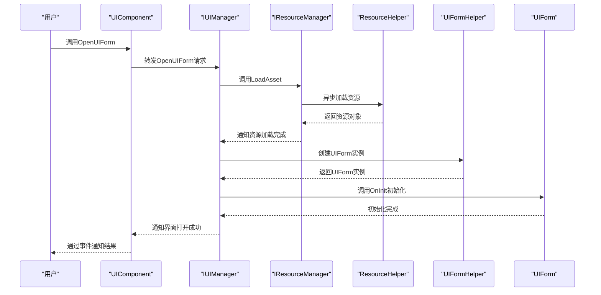
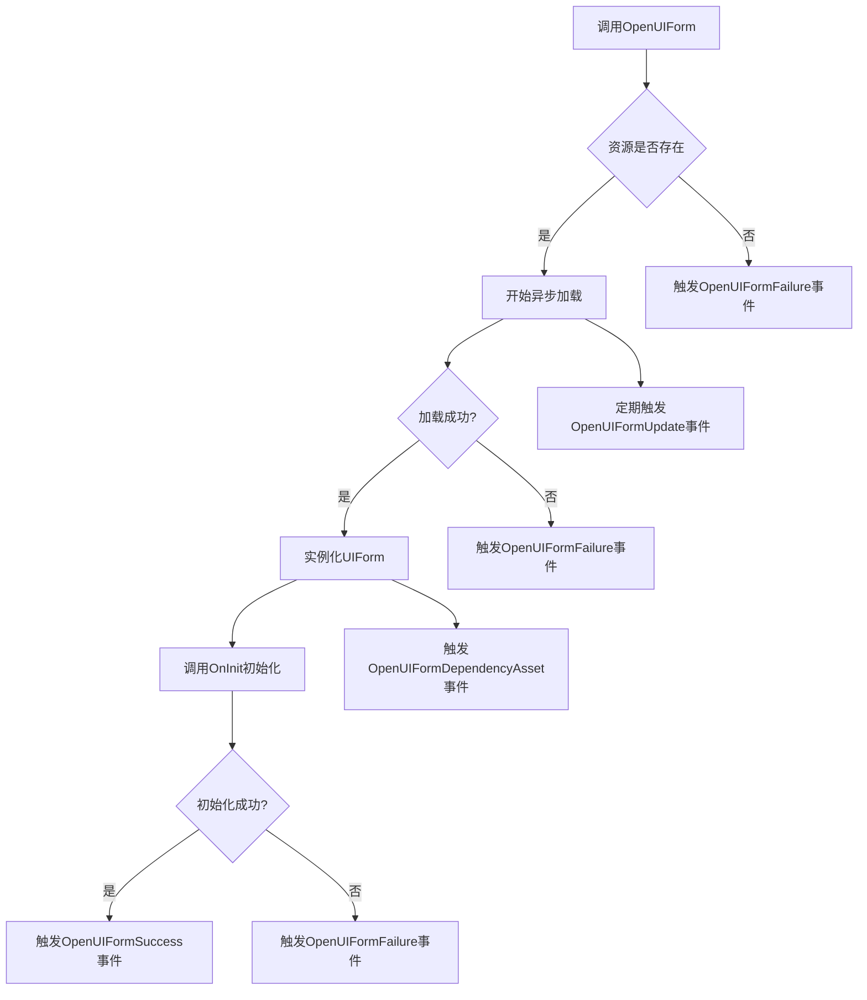

<cite>
**Referenced Files in This Document**   
- [UIComponent.cs](file://Scripts/Runtime/UI/UIComponent.cs)
- [UIForm.cs](file://Scripts/Runtime/UI/UIForm.cs)
- [ResourceComponent.cs](file://Scripts/Runtime/Resource/ResourceComponent.cs)
- [OpenUIFormDependencyAssetEventArgs.cs](file://Scripts/Runtime/UI/OpenUIFormDependencyAssetEventArgs.cs)
- [OpenUIFormSuccessEventArgs.cs](file://Scripts/Runtime/UI/OpenUIFormSuccessEventArgs.cs)
- [OpenUIFormFailureEventArgs.cs](file://Scripts/Runtime/UI/OpenUIFormFailureEventArgs.cs)
- [OpenUIFormUpdateEventArgs.cs](file://Scripts/Runtime/UI/OpenUIFormUpdateEventArgs.cs)
</cite>

## 目录
1. [OpenUIForm系列方法实现机制](#openuiform系列方法实现机制)
2. [界面资源异步加载完整流程](#界面资源异步加载完整流程)
3. [参数作用与调用关系](#参数作用与调用关系)
4. [代码示例与适用场景](#代码示例与适用场景)
5. [错误处理与事件系统](#错误处理与事件系统)

## OpenUIForm系列方法实现机制

`UIComponent`类提供了多个`OpenUIForm`方法的重载，这些重载方法通过参数默认值的链式调用机制，最终统一调用到最完整的参数版本。这种设计模式简化了API的使用，同时保持了功能的完整性。

所有重载方法最终都会调用`OpenUIForm(string uiFormAssetName, string uiGroupName, int priority, bool pauseCoveredUIForm, object userData)`这个完整版本的方法。该方法通过`m_UIManager.OpenUIForm`接口将请求转发给界面管理器进行处理。

**Section sources**
- [UIComponent.cs](file://Scripts/Runtime/UI/UIComponent.cs#L492-L584)

## 界面资源异步加载完整流程

从调用`OpenUIForm`开始，到资源管理器加载资源，再到实例化`UIForm`对象的完整流程如下：

1. **调用入口**：用户调用`UIComponent.OpenUIForm`系列方法
2. **请求转发**：`UIComponent`通过`m_UIManager`将请求转发给`IUIManager`实现
3. **资源加载**：`IUIManager`调用`IResourceManager`的`LoadAsset`方法异步加载界面资源
4. **实例化**：资源加载完成后，通过`UIFormHelper`创建`UIForm`实例
5. **初始化**：调用`UIForm.OnInit`方法进行初始化
6. **事件通知**：通过事件系统通知调用方加载结果

资源加载过程由`ResourceComponent`负责管理，它通过`LoadResourceAgentHelper`代理异步加载资源，并在加载完成后触发相应的回调。



**Diagram sources**
- [UIComponent.cs](file://Scripts/Runtime/UI/UIComponent.cs#L581-L584)
- [ResourceComponent.cs](file://Scripts/Runtime/Resource/ResourceComponent.cs#L955-L970)
- [UIForm.cs](file://Scripts/Runtime/UI/UIForm.cs#L111-L139)

**Section sources**
- [UIComponent.cs](file://Scripts/Runtime/UI/UIComponent.cs#L581-L584)
- [ResourceComponent.cs](file://Scripts/Runtime/Resource/ResourceComponent.cs#L955-L970)
- [UIForm.cs](file://Scripts/Runtime/UI/UIForm.cs#L111-L139)

## 参数作用与调用关系

### priority参数
`priority`参数用于控制资源加载的优先级。在资源加载队列中，高优先级的资源会优先被处理。默认优先级为0，数值越大优先级越高。这个参数直接影响`LoadResourceAgent`的调度顺序。

### pauseCoveredUIForm参数
`pauseCoveredUIForm`参数控制界面覆盖行为。当新界面覆盖旧界面时，如果该参数为`true`，被覆盖的界面会进入暂停状态，其`OnPause`方法会被调用；如果为`false`，被覆盖的界面保持运行状态。

### userData参数
`userData`参数用于在加载流程中传递用户自定义数据。这个数据会贯穿整个加载过程，从`OpenUIForm`调用开始，经过资源加载，最终传递给`UIForm.OnInit`和`UIForm.OnOpen`方法，可用于初始化界面的特定状态。

所有参数在调用链中保持传递，确保从请求发起点到最终实例化都能获取到完整的上下文信息。

**Section sources**
- [UIComponent.cs](file://Scripts/Runtime/UI/UIComponent.cs#L492-L584)
- [UIForm.cs](file://Scripts/Runtime/UI/UIForm.cs#L111-L139)

## 代码示例与适用场景

### 基本用法
```csharp
// 最简单的调用方式，使用默认优先级和设置
int serialId = UIComponent.OpenUIForm("Assets/UI/Forms/MainMenu.prefab", "Default");
```

### 高优先级加载
```csharp
// 当需要立即显示重要界面时，使用高优先级
int serialId = UIComponent.OpenUIForm("Assets/UI/Forms/Loading.prefab", "Default", 100);
```

### 控制覆盖行为
```csharp
// 打开新界面时不停止背景音乐界面
int serialId = UIComponent.OpenUIForm("Assets/UI/Forms/Settings.prefab", "Default", false);
```

### 传递初始化数据
```csharp
// 传递用户数据用于界面初始化
var userData = new GameData { Level = 5, Score = 1000 };
int serialId = UIComponent.OpenUIForm("Assets/UI/Forms/GameHUD.prefab", "Default", userData);
```

### 组合参数使用
```csharp
// 同时指定优先级、覆盖行为和用户数据
var userData = new MissionData { MissionId = "M001" };
int serialId = UIComponent.OpenUIForm("Assets/UI/Forms/MissionBriefing.prefab", "Default", 50, true, userData);
```

不同重载方法适用于不同场景：简单场景使用参数最少的重载，复杂场景使用完整参数的重载以获得精确控制。

**Section sources**
- [UIComponent.cs](file://Scripts/Runtime/UI/UIComponent.cs#L492-L584)

## 错误处理与事件系统

### 错误类型
加载过程中可能发生的错误包括：
- 资源不存在或路径错误
- 资源加载超时
- 资源解密失败
- 实例化失败（如缺少必要的组件）

### 事件系统
通过事件系统获取加载结果：
- `OpenUIFormSuccessEventArgs`：加载成功事件，包含加载的`UIForm`实例和耗时
- `OpenUIFormFailureEventArgs`：加载失败事件，包含错误信息
- `OpenUIFormUpdateEventArgs`：加载进度更新事件，包含进度百分比
- `OpenUIFormDependencyAssetEventArgs`：依赖资源加载事件，用于显示加载细节

`UIComponent`通过订阅`IUIManager`的事件，并将其转换为`GameFramework`事件系统可识别的事件类型，实现了事件的传递和处理。



**Diagram sources**
- [OpenUIFormSuccessEventArgs.cs](file://Scripts/Runtime/UI/OpenUIFormSuccessEventArgs.cs#L15-L93)
- [OpenUIFormFailureEventArgs.cs](file://Scripts/Runtime/UI/OpenUIFormFailureEventArgs.cs#L15-L129)
- [OpenUIFormUpdateEventArgs.cs](file://Scripts/Runtime/UI/OpenUIFormUpdateEventArgs.cs#L15-L129)
- [OpenUIFormDependencyAssetEventArgs.cs](file://Scripts/Runtime/UI/OpenUIFormDependencyAssetEventArgs.cs#L15-L153)

**Section sources**
- [OpenUIFormSuccessEventArgs.cs](file://Scripts/Runtime/UI/OpenUIFormSuccessEventArgs.cs#L15-L93)
- [OpenUIFormFailureEventArgs.cs](file://Scripts/Runtime/UI/OpenUIFormFailureEventArgs.cs#L15-L129)
- [OpenUIFormUpdateEventArgs.cs](file://Scripts/Runtime/UI/OpenUIFormUpdateEventArgs.cs#L15-L129)
- [OpenUIFormDependencyAssetEventArgs.cs](file://Scripts/Runtime/UI/OpenUIFormDependencyAssetEventArgs.cs#L15-L153)