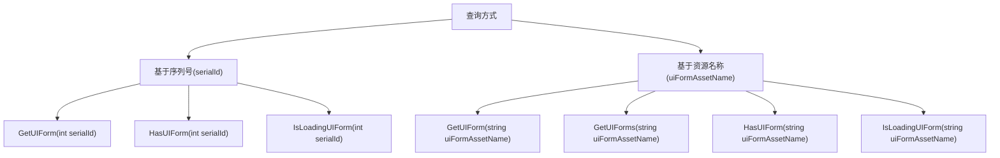
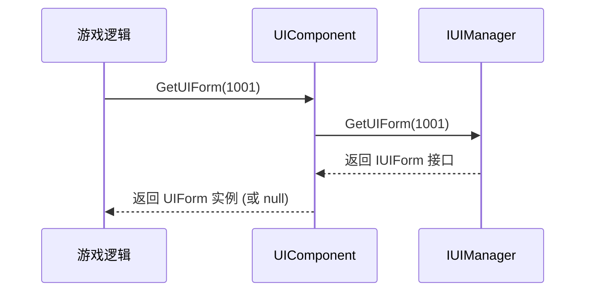
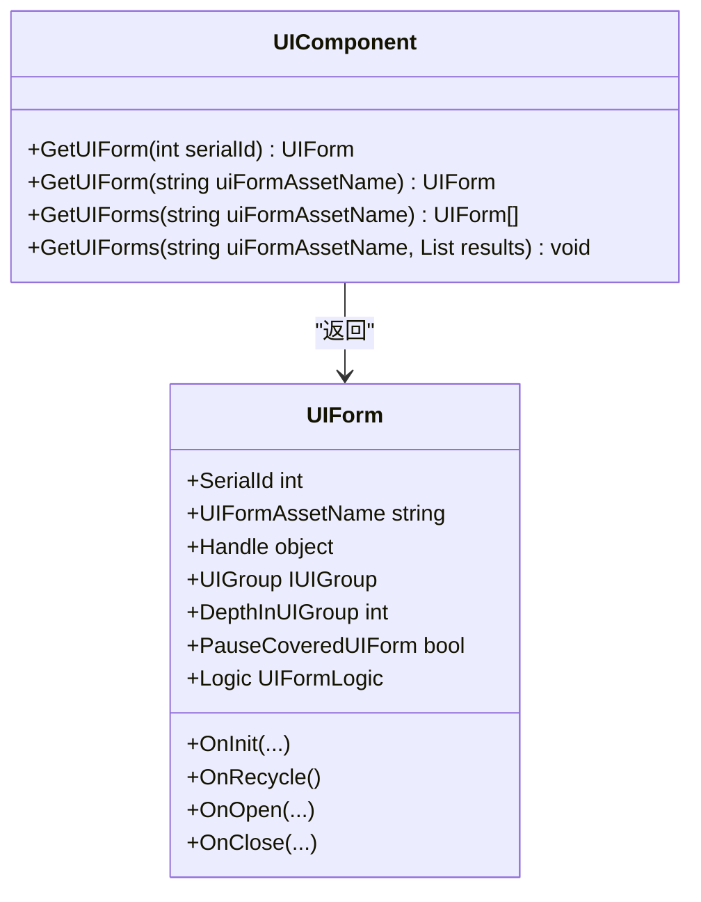
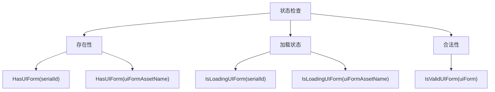

# 界面查询

<cite>
**本文档中引用的文件**  
- [UIComponent.cs](file://Scripts/Runtime/UI/UIComponent.cs)
- [UIForm.cs](file://Scripts/Runtime/UI/UIForm.cs)
</cite>

## 目录
1. [简介](#简介)
2. [核心查询功能](#核心查询功能)
3. [序列号查询](#序列号查询)
4. [资源名称查询](#资源名称查询)
5. [辅助状态检查方法](#辅助状态检查方法)
6. [性能特征与最佳实践](#性能特征与最佳实践)
7. [实际应用示例](#实际应用示例)

## 简介
`UIComponent` 组件提供了全面的界面查询功能，使开发者能够通过序列号（serialId）或资源名称（uiFormAssetName）精确查找和管理游戏中的界面实例。该系统支持单个界面查询、批量查询以及多种状态检查功能，为游戏界面的动态管理和状态验证提供了坚实的基础。

**Section sources**
- [UIComponent.cs](file://Scripts/Runtime/UI/UIComponent.cs#L329-L484)

## 核心查询功能
`UIComponent` 提供了两种主要的界面查询方式：基于唯一序列号的精确查询和基于资源名称的批量查询。这些方法封装了底层 `IUIManager` 的复杂性，为上层游戏逻辑提供了简洁、安全的接口。



**Diagram sources**
- [UIComponent.cs](file://Scripts/Runtime/UI/UIComponent.cs#L329-L484)

**Section sources**
- [UIComponent.cs](file://Scripts/Runtime/UI/UIComponent.cs#L329-L484)

## 序列号查询
### 唯一性与生成机制
每个通过 `OpenUIForm` 方法成功打开的界面都会被分配一个全局唯一的整数序列号（serialId）。这个序列号由 `IUIManager` 内部维护，确保在整个游戏运行期间不会重复，是精确标识和查找特定界面实例的最可靠方式。

### 精确查找
通过 `GetUIForm(int serialId)` 方法，可以使用序列号直接获取对应的 `UIForm` 实例。如果指定的序列号不存在或对应的界面已被关闭，则返回 `null`。此方法的时间复杂度为 O(1)，性能极高。



**Diagram sources**
- [UIComponent.cs](file://Scripts/Runtime/UI/UIComponent.cs#L349-L358)

**Section sources**
- [UIComponent.cs](file://Scripts/Runtime/UI/UIComponent.cs#L349-L358)

## 资源名称查询
### 单个实例查询
`GetUIForm(string uiFormAssetName)` 方法用于获取指定资源名称的第一个已加载界面实例。当多个界面使用相同的资源时，此方法返回的是最先加载的那个实例。

### 批量实例查询
当需要获取所有使用相同资源的界面实例时，应使用 `GetUIForms` 方法。该方法提供了两种重载：
- `GetUIForms(string uiFormAssetName)`：返回一个 `UIForm[]` 数组。
- `GetUIForms(string uiFormAssetName, List<UIForm> results)`：将结果填充到提供的 `List<UIForm>` 中，避免了数组分配的开销，更适合性能敏感的场景。



**Diagram sources**
- [UIComponent.cs](file://Scripts/Runtime/UI/UIComponent.cs#L349-L384)
- [UIForm.cs](file://Scripts/Runtime/UI/UIForm.cs#L20-L55)

**Section sources**
- [UIComponent.cs](file://Scripts/Runtime/UI/UIComponent.cs#L349-L384)
- [UIForm.cs](file://Scripts/Runtime/UI/UIForm.cs#L20-L55)

## 辅助状态检查方法
除了查询界面实例，`UIComponent` 还提供了一系列方法来检查界面的状态，这对于编写健壮的游戏逻辑至关重要。

### 存在性检查
- `HasUIForm(int serialId)`：检查具有指定序列号的界面是否已加载。
- `HasUIForm(string uiFormAssetName)`：检查是否存在已加载的、使用指定资源名称的界面。

### 加载状态检查
- `IsLoadingUIForm(int serialId)`：检查具有指定序列号的界面是否正在异步加载过程中。
- `IsLoadingUIForm(string uiFormAssetName)`：检查是否有使用指定资源名称的界面正在加载。

### 合法性验证
- `IsValidUIForm(UIForm uiForm)`：检查传入的 `UIForm` 实例是否仍然有效（即未被销毁或回收）。在持有界面引用的长时间逻辑中，调用此方法可以避免空引用异常。



**Diagram sources**
- [UIComponent.cs](file://Scripts/Runtime/UI/UIComponent.cs#L329-L484)

**Section sources**
- [UIComponent.cs](file://Scripts/Runtime/UI/UIComponent.cs#L329-L484)

## 性能特征与最佳实践
### 性能特征
所有查询和状态检查方法都通过 `IUIManager` 的内部数据结构（通常是哈希表）实现，因此具有 O(1) 的平均时间复杂度，查询速度非常快。

### 最佳实践
1. **优先使用序列号**：当需要精确操作某个特定界面时，优先使用 `serialId` 进行查询，因为它保证了唯一性。
2. **避免频繁查询**：对于需要频繁访问的界面，建议在打开时将其引用缓存起来，而不是在每次使用时都进行查询。
3. **选择合适的批量查询方法**：在性能关键的循环中，使用 `GetUIForms(string, List<UIForm>)` 重载以避免不必要的内存分配。
4. **状态检查前置**：在操作界面实例前，使用 `IsValidUIForm` 或 `HasUIForm` 进行检查，可以有效防止运行时错误。

**Section sources**
- [UIComponent.cs](file://Scripts/Runtime/UI/UIComponent.cs#L329-L484)

## 实际应用示例
以下代码示例展示了如何在游戏逻辑中安全地查询和验证界面状态：

```csharp
// 打开一个界面并缓存其序列号
int mainMenuSerialId = UI.OpenUIForm("Assets/UI/Prefabs/MainMenu.prefab", "Default");

// 在游戏的某个逻辑点，安全地检查和操作该界面
if (UI.HasUIForm(mainMenuSerialId))
{
    UIForm mainMenu = UI.GetUIForm(mainMenuSerialId);
    if (UI.IsValidUIForm(mainMenu))
    {
        // 安全地操作界面
        // mainMenu.Logic.DoSomething();
    }
}

// 检查某个资源的界面是否正在加载
if (UI.IsLoadingUIForm("Assets/UI/Prefabs/LoadingScreen.prefab"))
{
    // 显示加载进度
}

// 获取所有打开的弹窗
UIForm[] popups = UI.GetUIForms("Assets/UI/Prefabs/Popup.prefab");
foreach (UIForm popup in popups)
{
    if (UI.IsValidUIForm(popup))
    {
        // 处理每个弹窗
    }
}
```

**Section sources**
- [UIComponent.cs](file://Scripts/Runtime/UI/UIComponent.cs#L329-L484)