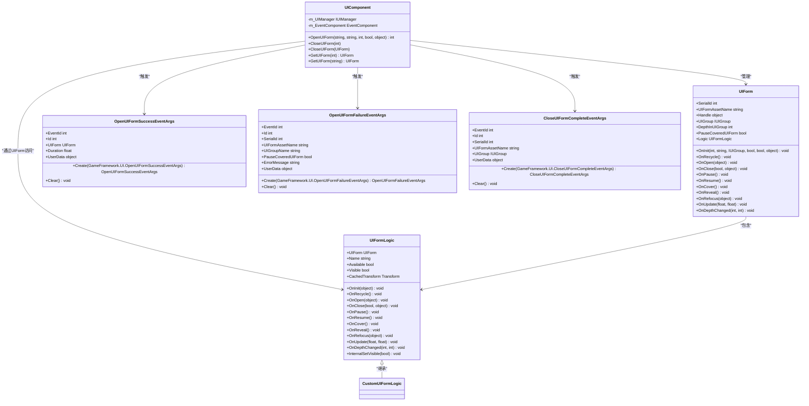
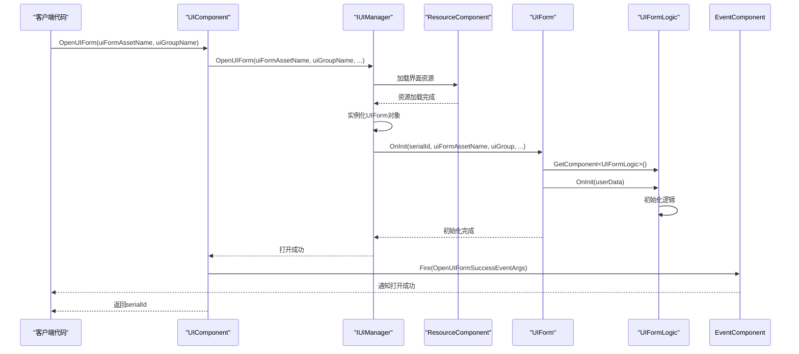
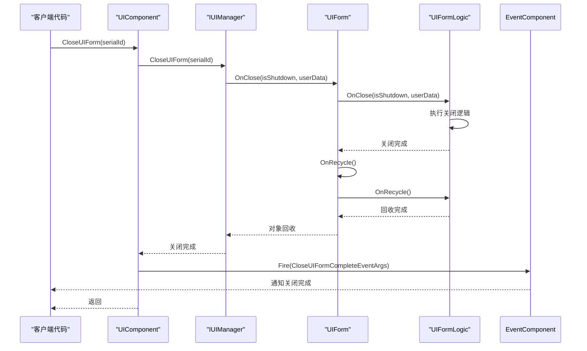
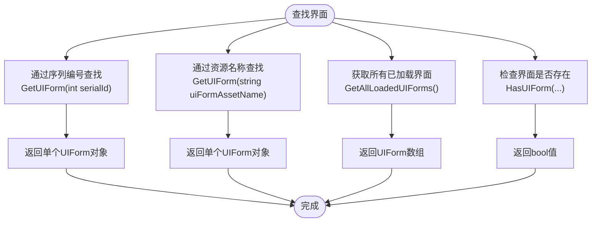
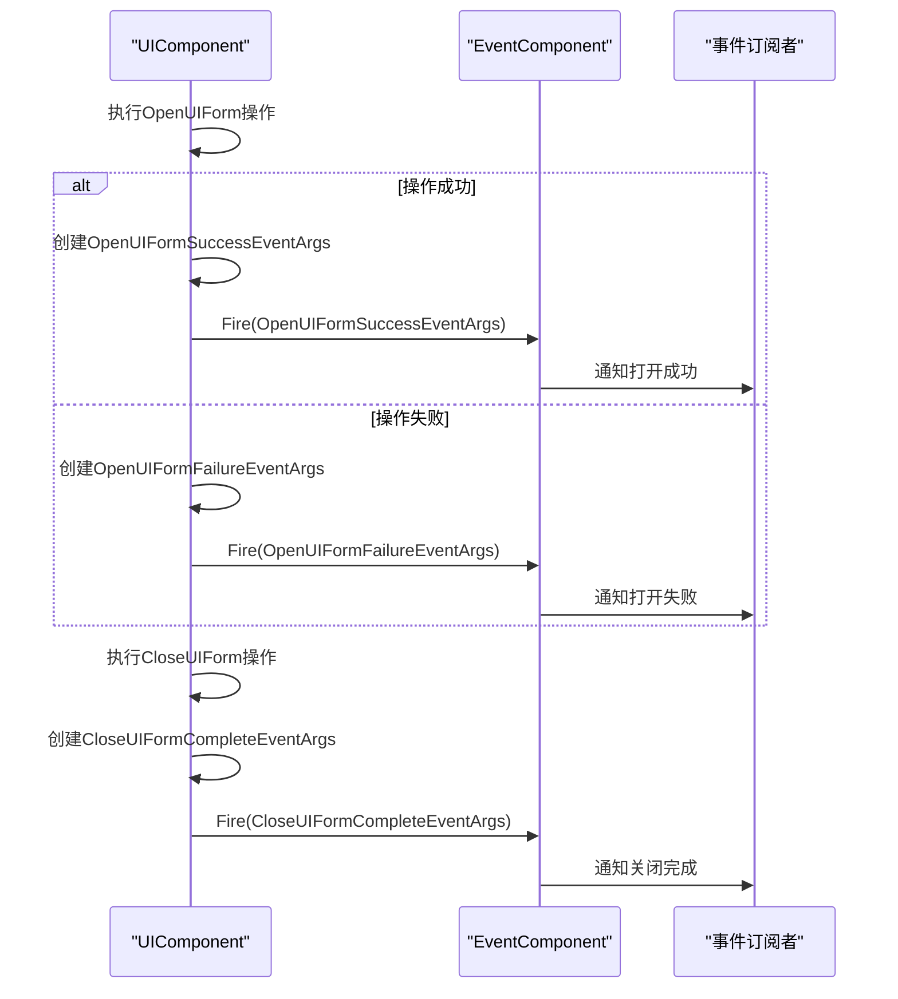
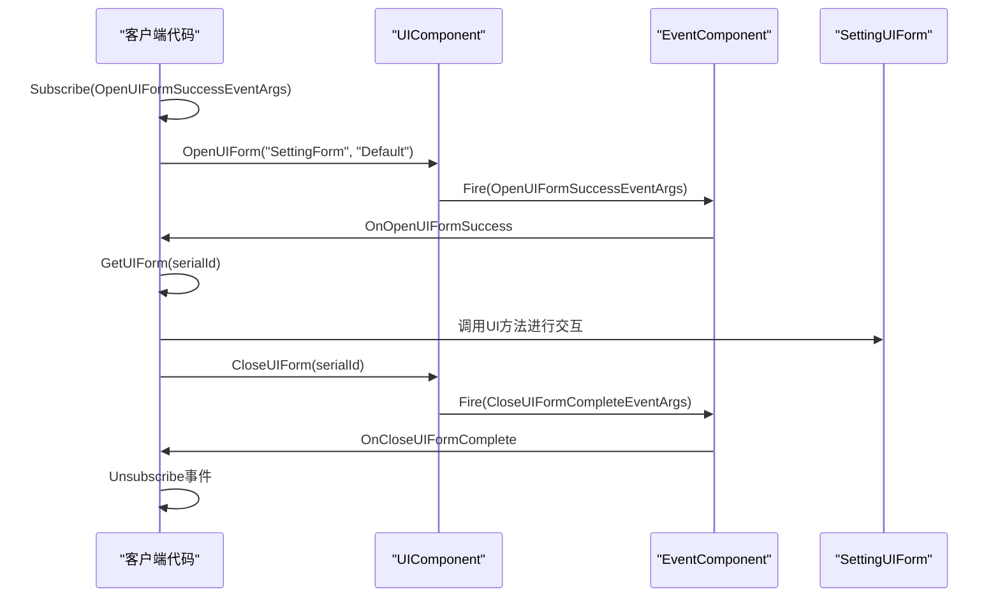

# 界面管理

<cite>
**Referenced Files in This Document**   
- [UIComponent.cs](file://Scripts/Runtime/UI/UIComponent.cs)
- [UIForm.cs](file://Scripts/Runtime/UI/UIForm.cs)
- [UIFormLogic.cs](file://Scripts/Runtime/UI/UIFormLogic.cs)
- [OpenUIFormSuccessEventArgs.cs](file://Scripts/Runtime/UI/OpenUIFormSuccessEventArgs.cs)
- [OpenUIFormFailureEventArgs.cs](file://Scripts/Runtime/UI/OpenUIFormFailureEventArgs.cs)
- [CloseUIFormCompleteEventArgs.cs](file://Scripts/Runtime/UI/CloseUIFormCompleteEventArgs.cs)
- [EventComponent.cs](file://Scripts/Runtime/Event/EventComponent.cs)
</cite>

## 目录
1. [简介](#简介)
2. [核心组件](#核心组件)
3. [UIComponent生命周期管理](#uicomponent生命周期管理)
4. [界面序列编号与查找](#界面序列编号与查找)
5. [事件系统集成](#事件系统集成)
6. [完整代码示例](#完整代码示例)
7. [结论](#结论)

## 简介
`UIComponent` 是 Unity 游戏框架中的核心界面管理器，负责控制所有界面的整个生命周期。它提供了异步加载、实例化、查找和回收界面的完整功能。通过与事件系统的深度集成，`UIComponent` 能够在界面操作的关键节点通知外部系统，实现松耦合的架构设计。本文档将详细阐述 `UIComponent` 如何作为核心管理器控制界面的整个生命周期。

## 核心组件

`UIComponent` 作为界面管理的核心，与其他关键组件协同工作，共同构建了完整的界面管理系统。

**Section sources**
- [UIComponent.cs](file://Scripts/Runtime/UI/UIComponent.cs#L16-L730)
- [UIForm.cs](file://Scripts/Runtime/UI/UIForm.cs#L16-L303)
- [UIFormLogic.cs](file://Scripts/Runtime/UI/UIFormLogic.cs#L14-L205)

### 组件关系图

**Diagram sources**
- [UIComponent.cs](file://Scripts/Runtime/UI/UIComponent.cs#L16-L730)
- [UIForm.cs](file://Scripts/Runtime/UI/UIForm.cs#L16-L303)
- [UIFormLogic.cs](file://Scripts/Runtime/UI/UIFormLogic.cs#L14-L205)
- [OpenUIFormSuccessEventArgs.cs](file://Scripts/Runtime/UI/OpenUIFormSuccessEventArgs.cs#L15-L93)
- [OpenUIFormFailureEventArgs.cs](file://Scripts/Runtime/UI/OpenUIFormFailureEventArgs.cs#L15-L129)
- [CloseUIFormCompleteEventArgs.cs](file://Scripts/Runtime/UI/CloseUIFormCompleteEventArgs.cs#L16-L106)

## UIComponent生命周期管理

`UIComponent` 通过 `OpenUIForm` 系列方法异步加载界面资源并实例化 `UIForm` 对象，同时通过 `CloseUIForm` 方法安全地关闭和回收界面。

### 界面打开流程

**Diagram sources**
- [UIComponent.cs](file://Scripts/Runtime/UI/UIComponent.cs#L581-L584)
- [UIForm.cs](file://Scripts/Runtime/UI/UIForm.cs#L94-L100)
- [UIFormLogic.cs](file://Scripts/Runtime/UI/UIFormLogic.cs#L101-L110)

### 界面关闭流程

**Diagram sources**
- [UIComponent.cs](file://Scripts/Runtime/UI/UIComponent.cs#L590-L593)
- [UIForm.cs](file://Scripts/Runtime/UI/UIForm.cs#L134-L140)
- [UIFormLogic.cs](file://Scripts/Runtime/UI/UIFormLogic.cs#L134-L139)

**Section sources**
- [UIComponent.cs](file://Scripts/Runtime/UI/UIComponent.cs#L581-L622)
- [UIForm.cs](file://Scripts/Runtime/UI/UIForm.cs#L134-L140)
- [UIFormLogic.cs](file://Scripts/Runtime/UI/UIFormLogic.cs#L134-L139)

## 界面序列编号与查找

界面序列编号（SerialId）是 `UIComponent` 管理界面的核心标识，它在界面查找（GetUIForm）中发挥着关键作用。

### SerialId的作用
- **唯一标识**：每个打开的界面都会被分配一个唯一的序列编号，用于在整个生命周期中标识该界面实例。
- **查找依据**：通过 `GetUIForm(int serialId)` 方法，可以使用序列编号快速定位和获取特定的界面对象。
- **状态管理**：序列编号与界面的加载状态相关联，可用于判断界面是否正在加载或已加载。

### 查找方法
`UIComponent` 提供了多种查找界面的方法：

**Diagram sources**
- [UIComponent.cs](file://Scripts/Runtime/UI/UIComponent.cs#L349-L362)
- [UIForm.cs](file://Scripts/Runtime/UI/UIForm.cs#L28-L34)

**Section sources**
- [UIComponent.cs](file://Scripts/Runtime/UI/UIComponent.cs#L329-L436)
- [UIForm.cs](file://Scripts/Runtime/UI/UIForm.cs#L28-L34)

## 事件系统集成

`UIComponent` 与事件系统（EventComponent）深度集成，通过 `OpenUIFormSuccessEventArgs`、`OpenUIFormFailureEventArgs` 等事件通知外部操作结果。

### 事件通知机制

**Diagram sources**
- [UIComponent.cs](file://Scripts/Runtime/UI/UIComponent.cs#L150-L180)
- [EventComponent.cs](file://Scripts/Runtime/Event/EventComponent.cs#L119-L122)

### 事件类型说明
| 事件类型 | 作用 | 触发时机 |
|--------|------|---------|
| `OpenUIFormSuccessEventArgs` | 通知界面打开成功 | 界面资源加载完成并成功实例化后 |
| `OpenUIFormFailureEventArgs` | 通知界面打开失败 | 界面资源加载失败或实例化失败时 |
| `CloseUIFormCompleteEventArgs` | 通知界面关闭完成 | 界面成功关闭并回收后 |
| `OpenUIFormUpdateEventArgs` | 通知界面打开进度更新 | 界面加载过程中定期更新进度 |
| `OpenUIFormDependencyAssetEventArgs` | 通知依赖资源加载 | 加载界面所需依赖资源时 |

**Section sources**
- [UIComponent.cs](file://Scripts/Runtime/UI/UIComponent.cs#L150-L180)
- [OpenUIFormSuccessEventArgs.cs](file://Scripts/Runtime/UI/OpenUIFormSuccessEventArgs.cs#L15-L93)
- [OpenUIFormFailureEventArgs.cs](file://Scripts/Runtime/UI/OpenUIFormFailureEventArgs.cs#L15-L129)
- [CloseUIFormCompleteEventArgs.cs](file://Scripts/Runtime/UI/CloseUIFormCompleteEventArgs.cs#L16-L106)
- [EventComponent.cs](file://Scripts/Runtime/Event/EventComponent.cs#L119-L122)

## 完整代码示例

以下是一个完整的代码示例，展示了从调用 `OpenUIForm` 打开一个设置界面，监听打开成功事件，获取 `UIForm` 实例进行交互，最后调用 `CloseUIForm` 关闭界面的全过程。

**Diagram sources**
- [UIComponent.cs](file://Scripts/Runtime/UI/UIComponent.cs#L581-L622)
- [EventComponent.cs](file://Scripts/Runtime/Event/EventComponent.cs#L90-L103)

**Section sources**
- [UIComponent.cs](file://Scripts/Runtime/UI/UIComponent.cs#L581-L622)
- [EventComponent.cs](file://Scripts/Runtime/Event/EventComponent.cs#L90-L103)

## 结论

`UIComponent` 作为界面管理的核心组件，通过 `OpenUIForm` 系列方法实现了界面资源的异步加载和实例化，确保了游戏运行的流畅性。通过 `CloseUIForm` 方法，能够安全地关闭和回收界面，有效管理内存资源。界面序列编号（SerialId）作为唯一标识，在界面查找和状态管理中发挥着关键作用。与事件系统的深度集成使得 `UIComponent` 能够在界面操作的关键节点通知外部系统，实现了松耦合的架构设计。整个界面管理系统设计合理，功能完整，为游戏开发提供了强大的界面管理能力。