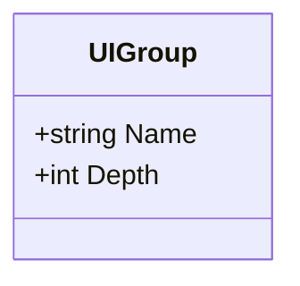
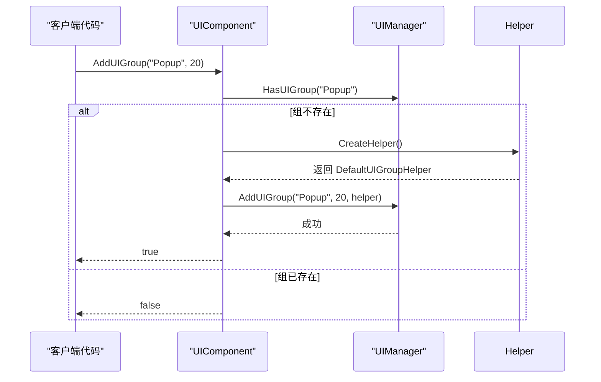
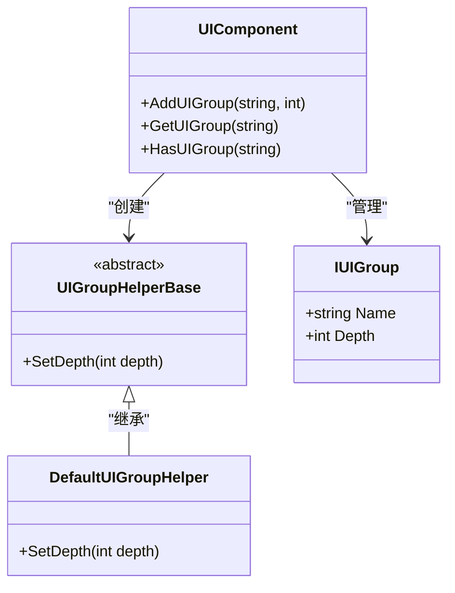

# 界面组

<cite>
**本文档中引用的文件**  
- [UIComponent.UIGroup.cs](file://Scripts/Runtime/UI/UIComponent.UIGroup.cs)
- [UIComponent.cs](file://Scripts/Runtime/UI/UIComponent.cs)
- [UIGroupHelperBase.cs](file://Scripts/Runtime/UI/UIGroupHelperBase.cs)
- [DefaultUIGroupHelper.cs](file://Scripts/Runtime/UI/DefaultUIGroupHelper.cs)
</cite>

## 目录
1. [简介](#简介)
2. [核心属性详解](#核心属性详解)
3. [界面组的创建与管理](#界面组的创建与管理)
4. [实际应用示例](#实际应用示例)
5. [查询与状态检查](#查询与状态检查)
6. [架构与依赖关系](#架构与依赖关系)

## 简介
`UIGroup` 类是 Unity 游戏框架中用于组织和管理用户界面（UI）元素的核心组件之一。它通过逻辑分组和渲染层级控制，实现对复杂 UI 结构的有效管理。每个 `UIGroup` 实例代表一个独立的 UI 容器，其内部包含一组具有相同渲染深度的界面元素。该机制确保了不同层级的 UI 能够按照预期顺序正确显示，避免遮挡或层级混乱问题。

**Section sources**
- [UIComponent.UIGroup.cs](file://Scripts/Runtime/UI/UIComponent.UIGroup.cs#L1-L40)

## 核心属性详解

### Name 属性
`Name` 属性用于标识界面组的逻辑名称，是区分不同 UI 组的关键字段。该名称在运行时作为唯一键使用，支持通过名称快速查找、添加或删除指定的界面组。命名应具有语义性，便于开发者理解其用途，例如 `"HUD"`、`"Popup"` 或 `"MainMenu"`。

### Depth 属性
`Depth` 属性定义了该界面组在渲染层级中的基础深度值，直接影响组内所有 UI 元素的显示顺序。渲染系统通常根据深度值从低到高进行绘制，深度值较大的组会覆盖在深度值较小的组之上。因此，合理设置 `Depth` 可确保关键 UI（如弹窗）始终位于其他界面之上。



**Diagram sources**
- [UIComponent.UIGroup.cs](file://Scripts/Runtime/UI/UIComponent.UIGroup.cs#L15-L35)

**Section sources**
- [UIComponent.UIGroup.cs](file://Scripts/Runtime/UI/UIComponent.UIGroup.cs#L15-L35)

## 界面组的创建与管理

### 动态创建界面组
通过 `AddUIGroup` 方法可在运行时动态创建新的界面组。该方法提供两个重载版本：

- `AddUIGroup(string uiGroupName)`：使用默认深度（0）创建界面组。
- `AddUIGroup(string uiGroupName, int depth)`：指定名称和深度创建界面组。

创建过程中，系统首先检查同名组是否已存在，若不存在则实例化一个 `UIGroupHelperBase` 辅助对象，并将其挂载至 UI 实例根节点下，最终注册到 `UIManager` 中完成初始化。



**Diagram sources**
- [UIComponent.cs](file://Scripts/Runtime/UI/UIComponent.cs#L295-L322)

**Section sources**
- [UIComponent.cs](file://Scripts/Runtime/UI/UIComponent.cs#L290-L322)

## 实际应用示例

在实际项目中，可通过预设不同的 `Depth` 值来组织 UI 层级结构。典型示例如下：

| 界面类型 | 组名称 | 深度值 | 说明 |
|--------|------|------|------|
| HUD | `"HUD"` | 10 | 始终显示的基础信息层，如血条、计时器 |
| 弹窗 | `"Popup"` | 20 | 暂时性提示或交互窗口，需覆盖 HUD |
| 全屏界面 | `"Fullscreen"` | 30 | 主菜单、设置界面等全屏覆盖层 |

通过以下代码可实现上述结构的初始化：

```csharp
uiComponent.AddUIGroup("HUD", 10);
uiComponent.AddUIGroup("Popup", 20);
uiComponent.AddUIGroup("Fullscreen", 30);
```

当打开新 UI 时，指定其所属组即可自动继承该组的渲染深度，确保正确的显示顺序。

**Section sources**
- [UIComponent.cs](file://Scripts/Runtime/UI/UIComponent.cs#L290-L322)

## 查询与状态检查

### GetUIGroup 方法
`GetUIGroup(string uiGroupName)` 方法用于获取指定名称的界面组实例。若组存在，则返回对应的 `IUIGroup` 接口对象；否则返回 `null`。此方法常用于运行时动态调整某组的属性或执行操作。

### HasUIGroup 方法
`HasUIGroup(string uiGroupName)` 方法用于判断指定名称的界面组是否已存在，返回布尔值。该方法在创建新组前进行冲突检测，防止重复添加。

```mermaid
flowchart TD
Start([开始]) --> CheckExist["HasUIGroup(\"Popup\")"]
CheckExist --> Exists{"是否存在?"}
Exists --> |是| GetGroup["GetUIGroup(\"Popup\")"]
Exists --> |否| Create["AddUIGroup(\"Popup\", 20)"]
GetGroup --> End([返回组实例])
Create --> End
```

**Diagram sources**
- [UIComponent.cs](file://Scripts/Runtime/UI/UIComponent.cs#L252-L255)
- [UIComponent.cs](file://Scripts/Runtime/UI/UIComponent.cs#L257-L260)

**Section sources**
- [UIComponent.cs](file://Scripts/Runtime/UI/UIComponent.cs#L252-L260)

## 架构与依赖关系

`UIGroup` 的功能实现依赖于多个核心类协同工作：

- `UIGroupHelperBase`：抽象基类，定义界面组辅助器的基本行为，特别是 `SetDepth(int depth)` 抽象方法，用于实际设置渲染深度。
- `DefaultUIGroupHelper`：默认实现类，继承自 `UIGroupHelperBase`，目前为空实现，可由用户扩展以支持特定渲染逻辑。
- `UIManager`：底层管理器，负责维护所有界面组的生命周期、层级排序及渲染调度。



**Diagram sources**
- [UIGroupHelperBase.cs](file://Scripts/Runtime/UI/UIGroupHelperBase.cs#L1-L23)
- [DefaultUIGroupHelper.cs](file://Scripts/Runtime/UI/DefaultUIGroupHelper.cs#L1-L22)
- [UIComponent.cs](file://Scripts/Runtime/UI/UIComponent.cs#L252-L322)

**Section sources**
- [UIGroupHelperBase.cs](file://Scripts/Runtime/UI/UIGroupHelperBase.cs#L1-L23)
- [DefaultUIGroupHelper.cs](file://Scripts/Runtime/UI/DefaultUIGroupHelper.cs#L1-L22)
- [UIComponent.cs](file://Scripts/Runtime/UI/UIComponent.cs#L252-L322)