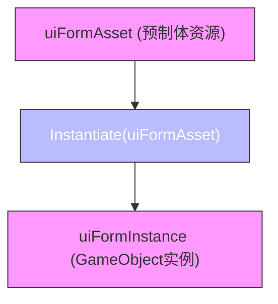
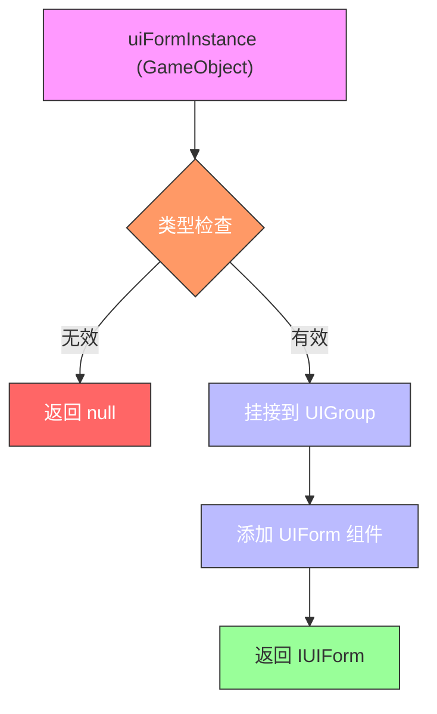
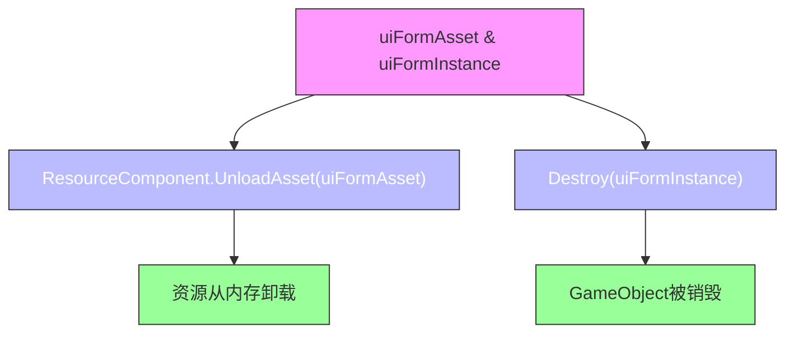

# 界面辅助器

<cite>
**Referenced Files in This Document**   
- [DefaultUIFormHelper.cs](file://Scripts/Runtime/UI/DefaultUIFormHelper.cs)
- [UIFormHelperBase.cs](file://Scripts/Runtime/UI/UIFormHelperBase.cs)
- [ResourceComponent.cs](file://Scripts/Runtime/Resource/ResourceComponent.cs)
- [UIForm.cs](file://Scripts/Runtime/UI/UIForm.cs)
- [UIComponent.cs](file://Scripts/Runtime/UI/UIComponent.cs)
- [DefaultUIGroupHelper.cs](file://Scripts/Runtime/UI/DefaultUIGroupHelper.cs)
</cite>

## Table of Contents
1. [引言](#引言)
2. [核心职责与架构角色](#核心职责与架构角色)
3. [核心方法详解](#核心方法详解)
4. [与资源系统的集成](#与资源系统的集成)
5. [作为框架扩展点的意义](#作为框架扩展点的意义)
6. [总结](#总结)

## 引言

在Unity游戏框架中，`DefaultUIFormHelper` 作为 `UIFormHelperBase` 的默认实现，扮演着连接UI系统与资源系统的关键角色。它通过定义三个核心方法——`InstantiateUIForm`、`CreateUIForm` 和 `ReleaseUIForm`——实现了从资源加载、实例化、挂接到最终释放的完整生命周期管理。本文档将详细阐述 `DefaultUIFormHelper` 如何在UI系统与资源系统之间架起桥梁，并强调其作为框架关键扩展点的重要性。

## 核心职责与架构角色

`DefaultUIFormHelper` 的核心职责是作为UI系统与资源系统之间的适配层。它不直接管理UI的逻辑或状态，而是专注于处理UI资源的底层操作，确保UI系统能够以一种统一、高效的方式与资源系统交互。

- **UIFormHelperBase**: 作为抽象基类，`UIFormHelperBase` 定义了所有UI辅助器必须实现的接口。它继承自 `MonoBehaviour` 并实现了 `IUIFormHelper` 接口，强制要求派生类提供实例化、创建和释放UI表单的抽象方法。这为框架提供了统一的扩展点。
- **DefaultUIFormHelper**: 作为 `UIFormHelperBase` 的具体实现，`DefaultUIFormHelper` 提供了开箱即用的、基于Unity原生机制的标准实现。它被 `UIComponent` 在启动时创建并注入到 `IUIManager` 中，成为整个UI系统操作资源的默认代理。

**Section sources**
- [UIFormHelperBase.cs](file://Scripts/Runtime/UI/UIFormHelperBase.cs#L15-L39)
- [DefaultUIFormHelper.cs](file://Scripts/Runtime/UI/DefaultUIFormHelper.cs#L15-L72)
- [UIComponent.cs](file://Scripts/Runtime/UI/UIComponent.cs#L150-L175)

## 核心方法详解

`DefaultUIFormHelper` 的功能通过其三个核心方法来实现，这三个方法共同构成了UI表单从诞生到消亡的完整流程。

### InstantiateUIForm: 实例化界面

`InstantiateUIForm` 方法负责将从资源系统加载的预制体资源（`uiFormAsset`）实例化为一个 `GameObject`。

- **功能**: 该方法直接调用Unity的 `UnityEngine.Object.Instantiate` 方法，传入从 `ResourceComponent` 加载的预制体对象。
- **输入**: `uiFormAsset` 是一个 `object` 类型的参数，代表已加载到内存中的预制体资源。
- **输出**: 返回一个 `object` 类型的实例，即新创建的 `GameObject`。
- **作用**: 这是UI创建流程的第一步，将静态的资源数据转换为一个动态的、可操作的游戏对象实例。

**Diagram sources**
- [DefaultUIFormHelper.cs](file://Scripts/Runtime/UI/DefaultUIFormHelper.cs#L22-L26)

**Section sources**
- [DefaultUIFormHelper.cs](file://Scripts/Runtime/UI/DefaultUIFormHelper.cs#L20-L27)

### CreateUIForm: 创建可管理的UI表单

`CreateUIForm` 方法负责将一个普通的 `GameObject` 实例（`uiFormInstance`）转换为一个由UI系统管理的 `IUIForm` 对象。

- **功能**: 该方法首先进行类型检查，确保 `uiFormInstance` 是一个有效的 `GameObject`。然后，它将这个实例的 `Transform` 挂接到指定 `UIGroup` 的 `Transform` 下，并重置其缩放。最后，它通过 `GetOrAddComponent<UIForm>()` 为该 `GameObject` 添加 `UIForm` 组件，并返回这个 `UIForm` 组件。
- **输入**: `uiFormInstance` 是实例化后的 `GameObject`，`uiGroup` 是目标界面组，`userData` 是用户自定义数据。
- **输出**: 返回一个 `IUIForm` 接口，这是UI系统管理该界面的句柄。
- **作用**: 这是UI创建流程的第二步，它完成了从一个普通游戏对象到一个具有生命周期管理能力的UI表单的转变。`UIForm` 组件是UI系统与具体UI逻辑（`UIFormLogic`）之间的桥梁。

**Diagram sources**
- [DefaultUIFormHelper.cs](file://Scripts/Runtime/UI/DefaultUIFormHelper.cs#L36-L50)
- [UIForm.cs](file://Scripts/Runtime/UI/UIForm.cs#L16-L303)

**Section sources**
- [DefaultUIFormHelper.cs](file://Scripts/Runtime/UI/DefaultUIFormHelper.cs#L34-L50)

### ReleaseUIForm: 释放界面资源

`ReleaseUIForm` 方法负责在界面关闭后，清理其占用的资源。

- **功能**: 该方法首先调用 `ResourceComponent` 的 `UnloadAsset` 方法，将 `uiFormAsset`（预制体资源）从内存中卸载，释放其占用的资源。然后，它调用 `UnityEngine.Object.Destroy` 方法，销毁 `uiFormInstance`（`GameObject` 实例）。
- **输入**: `uiFormAsset` 是要释放的预制体资源，`uiFormInstance` 是要销毁的 `GameObject` 实例。
- **输出**: 无。
- **作用**: 这是UI生命周期的最后一步，确保了内存的及时回收，防止内存泄漏。它将UI系统的销毁请求，正确地传递给了资源系统和Unity引擎。

**Diagram sources**
- [DefaultUIFormHelper.cs](file://Scripts/Runtime/UI/DefaultUIFormHelper.cs#L52-L58)
- [ResourceComponent.cs](file://Scripts/Runtime/Resource/ResourceComponent.cs#L1088-L1093)

**Section sources**
- [DefaultUIFormHelper.cs](file://Scripts/Runtime/UI/DefaultUIFormHelper.cs#L52-L58)

## 与资源系统的集成

`DefaultUIFormHelper` 与 `ResourceComponent` 的集成是其功能实现的基础。`ResourceComponent` 是框架中负责所有资源加载、卸载和管理的核心组件。

- **依赖获取**: `DefaultUIFormHelper` 在其 `Start()` 方法中，通过 `GameEntry.GetComponent<ResourceComponent>()` 获取对 `ResourceComponent` 的引用，并将其存储在 `m_ResourceComponent` 字段中。
- **资源卸载**: 在 `ReleaseUIForm` 方法中，`DefaultUIFormHelper` 直接调用 `m_ResourceComponent.UnloadAsset(uiFormAsset)` 来卸载资源。这表明 `DefaultUIFormHelper` 依赖于 `ResourceComponent` 来执行底层的资源管理操作。
- **生命周期协同**: `UIComponent` 负责协调整个UI的打开流程。它首先通过 `ResourceComponent` 异步加载预制体资源，加载成功后，将资源传递给 `DefaultUIFormHelper` 的 `InstantiateUIForm` 方法进行实例化，再通过 `CreateUIForm` 方法完成挂接和组件添加。当UI关闭时，`UIComponent` 会调用 `DefaultUIFormHelper` 的 `ReleaseUIForm` 方法来完成清理。

**Section sources**
- [DefaultUIFormHelper.cs](file://Scripts/Runtime/UI/DefaultUIFormHelper.cs#L60-L72)
- [ResourceComponent.cs](file://Scripts/Runtime/Resource/ResourceComponent.cs#L1088-L1093)
- [UIComponent.cs](file://Scripts/Runtime/UI/UIComponent.cs#L150-L175)

## 作为框架扩展点的意义

`DefaultUIFormHelper` 不仅仅是一个默认实现，更重要的是，它通过继承 `UIFormHelperBase`，为开发者提供了一个强大的框架扩展点。

- **继承与重写**: 开发者可以创建一个继承自 `UIFormHelperBase` 的新类，并重写 `InstantiateUIForm`、`CreateUIForm` 和 `ReleaseUIForm` 这三个方法。
- **自定义实例化逻辑**: 例如，可以重写 `InstantiateUIForm` 来使用对象池（Object Pool）技术，避免频繁的 `Instantiate` 和 `Destroy` 操作，从而提升性能。
- **自定义挂接规则**: 可以重写 `CreateUIForm` 来实现更复杂的挂接逻辑，比如根据UI类型自动分配到不同的Canvas，或应用特定的初始化脚本。
- **自定义资源管理策略**: 可以重写 `ReleaseUIForm` 来实现更精细的资源管理，比如将 `GameObject` 实例归还到对象池而不是直接销毁，或者在卸载资源前执行一些异步清理任务。

通过这种方式，框架的灵活性和可扩展性得到了极大的增强，开发者可以根据项目的具体需求，定制UI资源的管理方式，而无需修改框架的核心代码。

**Section sources**
- [UIFormHelperBase.cs](file://Scripts/Runtime/UI/UIFormHelperBase.cs#L15-L39)
- [DefaultUIFormHelper.cs](file://Scripts/Runtime/UI/DefaultUIFormHelper.cs#L15-L72)

## 总结

`DefaultUIFormHelper` 是Unity游戏框架中一个精巧的设计，它作为 `UIFormHelperBase` 的默认实现，完美地充当了UI系统与资源系统之间的桥梁。通过 `InstantiateUIForm`、`CreateUIForm` 和 `ReleaseUIForm` 三个核心方法，它清晰地划分了UI生命周期的各个阶段，并与 `ResourceComponent` 紧密协作，确保了资源的正确加载和释放。更重要的是，其基于继承的架构设计，使其成为一个关键的框架扩展点，允许开发者通过继承和重写来自定义UI的实例化、挂接和资源管理策略，从而满足各种复杂项目的需求。