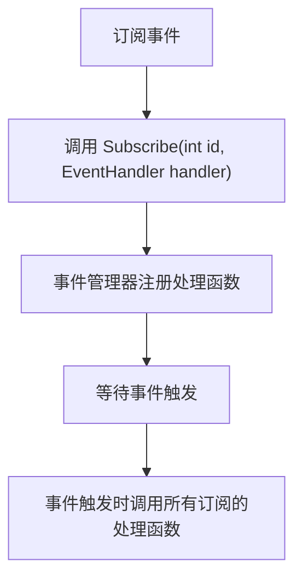
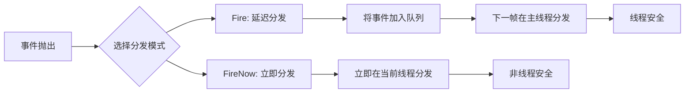
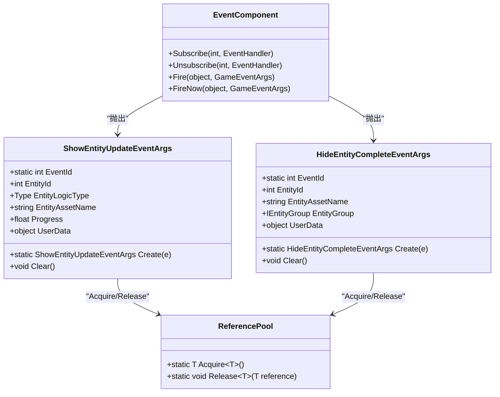
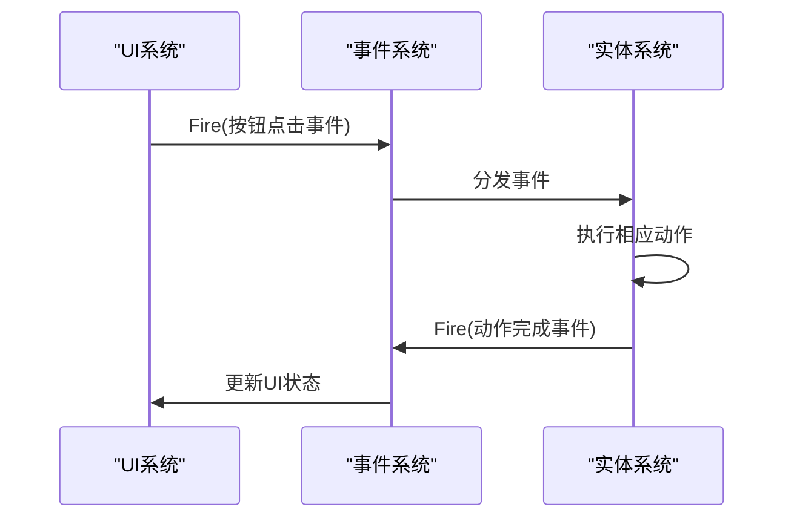
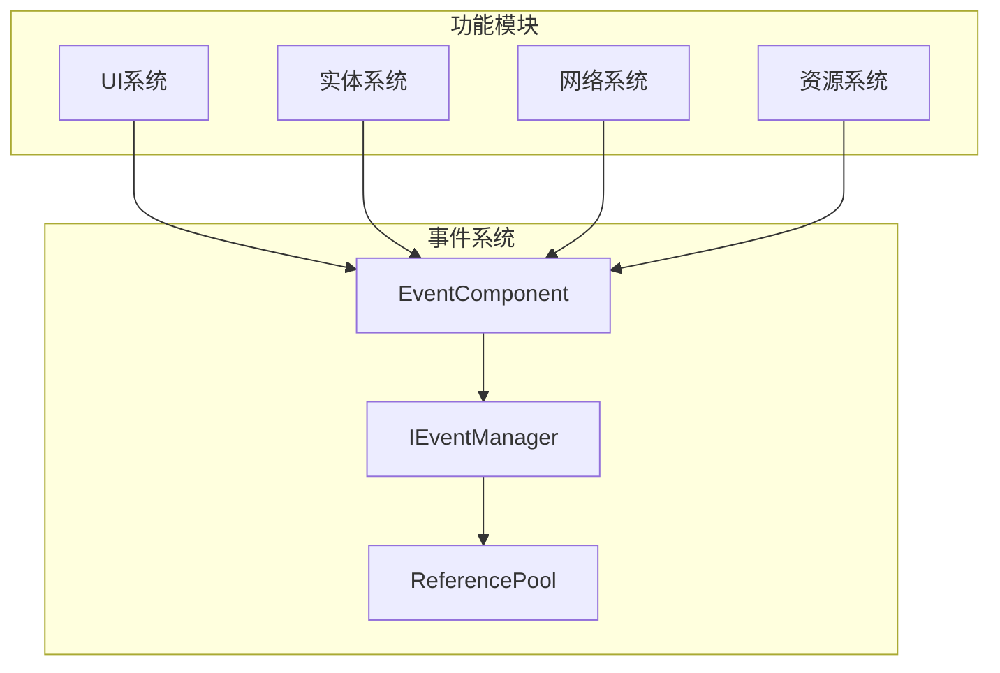

# 事件系统

<cite>
**Referenced Files in This Document**   
- [EventComponent.cs](file://Scripts/Runtime/Event/EventComponent.cs)
- [GameFrameworkComponent.cs](file://Scripts/Runtime/Base/GameFrameworkComponent.cs)
- [EntityComponent.cs](file://Scripts/Runtime/Entity/EntityComponent.cs)
- [ShowEntityUpdateEventArgs.cs](file://Scripts/Runtime/Entity/ShowEntityUpdateEventArgs.cs)
- [HideEntityCompleteEventArgs.cs](file://Scripts/Runtime/Entity/HideEntityCompleteEventArgs.cs)
</cite>

## Table of Contents
1. [简介](#简介)
2. [核心组件](#核心组件)
3. [事件订阅与取消订阅](#事件订阅与取消订阅)
4. [事件抛出机制](#事件抛出机制)
5. [事件池与引用池](#事件池与引用池)
6. [典型使用示例](#典型使用示例)
7. [架构概览](#架构概览)

## 简介

事件系统是Unity游戏框架中的核心通信机制，采用观察者模式实现游戏逻辑模块间的解耦。该系统允许不同系统（如UI、实体、网络等）通过事件ID进行松耦合通信，提高了代码的可维护性和扩展性。事件组件（EventComponent）作为系统的入口，提供了订阅、取消订阅和抛出事件的统一接口。

## 核心组件

事件系统的核心是`EventComponent`类，它继承自`GameFrameworkComponent`，作为Unity组件挂载在游戏对象上。该组件通过`IEventManager`接口与底层事件管理器交互，实现了线程安全的事件分发机制。

**Section sources**
- [EventComponent.cs](file://Scripts/Runtime/Event/EventComponent.cs#L1-L135)
- [GameFrameworkComponent.cs](file://Scripts/Runtime/Base/GameFrameworkComponent.cs#L1-L25)

## 事件订阅与取消订阅

事件系统通过`Subscribe`和`Unsubscribe`方法实现事件处理函数的注册与注销。开发者可以通过事件ID来订阅特定类型的事件，当该事件被触发时，所有订阅了该ID的处理函数将被调用。

**Diagram sources**
- [EventComponent.cs](file://Scripts/Runtime/Event/EventComponent.cs#L90-L93)

### 订阅方法

`Subscribe`方法用于注册事件处理函数，需要指定事件ID和对应的处理函数。事件ID通常是一个整数常量，用于唯一标识一类事件。

### 取消订阅方法

`Unsubscribe`方法用于注销事件处理函数，必须提供与订阅时相同的事件ID和处理函数引用，以确保正确移除监听。

**Section sources**
- [EventComponent.cs](file://Scripts/Runtime/Event/EventComponent.cs#L90-L103)

## 事件抛出机制

事件系统提供了两种事件抛出方式：`Fire`（延迟分发）和`FireNow`（立即分发），以满足不同场景的需求。

**Diagram sources**
- [EventComponent.cs](file://Scripts/Runtime/Event/EventComponent.cs#L119-L132)

### Fire（延迟分发）

`Fire`方法用于线程安全的事件抛出。即使在非主线程中调用，也能保证事件处理函数在主线程中执行。该方法将事件加入内部队列，并在下一帧进行分发，适用于从异步操作（如网络请求、资源加载）中抛出事件。

### FireNow（立即分发）

`FireNow`方法用于立即分发事件，事件会立刻在当前线程中触发所有订阅的处理函数。由于不是线程安全的，应仅在主线程中使用，适用于需要即时响应的场景。

**Section sources**
- [EventComponent.cs](file://Scripts/Runtime/Event/EventComponent.cs#L119-L132)

## 事件池与引用池

为避免频繁创建和销毁事件对象导致的GC问题，事件系统采用了对象池（EventPool）和引用池（ReferencePool）的复用机制。

**Diagram sources**
- [ShowEntityUpdateEventArgs.cs](file://Scripts/Runtime/Entity/ShowEntityUpdateEventArgs.cs#L1-L133)
- [HideEntityCompleteEventArgs.cs](file://Scripts/Runtime/Entity/HideEntityCompleteEventArgs.cs#L1-L108)

### 事件对象复用

自定义事件类（如`ShowEntityUpdateEventArgs`）通过继承`GameEventArgs`并实现`Create`和`Clear`方法，与引用池集成。`Create`方法从池中获取实例并初始化，`Clear`方法在事件处理完成后重置状态并返回池中。

### 引用池机制

`ReferencePool`是框架提供的通用对象池，用于管理可复用的对象实例。通过`Acquire`方法获取对象，`Release`方法归还对象，有效减少了内存分配和垃圾回收的压力。

**Section sources**
- [ShowEntityUpdateEventArgs.cs](file://Scripts/Runtime/Entity/ShowEntityUpdateEventArgs.cs#L1-L133)
- [HideEntityCompleteEventArgs.cs](file://Scripts/Runtime/Entity/HideEntityCompleteEventArgs.cs#L1-L108)

## 典型使用示例

以下是一个典型的UI按钮点击触发实体系统动作的完整流程示例。

**Diagram sources**
- [EntityComponent.cs](file://Scripts/Runtime/Entity/EntityComponent.cs#L91-L132)
- [EntityComponent.cs](file://Scripts/Runtime/Entity/EntityComponent.cs#L1130-L1145)

### 示例代码流程

1. **UI按钮点击**：UI系统检测到按钮点击，通过`EventComponent.Fire`抛出一个自定义的按钮点击事件。
2. **事件订阅**：实体系统在初始化时通过`EventComponent.Subscribe`订阅该事件ID。
3. **事件处理**：当事件被分发时，实体系统的处理函数被调用，执行相应的游戏逻辑（如移动实体、播放动画等）。
4. **状态更新**：实体系统完成动作后，可能抛出另一个事件通知UI系统更新界面状态。

这种模式实现了UI与游戏逻辑的完全解耦，使得各模块可以独立开发和测试。

**Section sources**
- [EntityComponent.cs](file://Scripts/Runtime/Entity/EntityComponent.cs#L91-L132)
- [EntityComponent.cs](file://Scripts/Runtime/Entity/EntityComponent.cs#L1130-L1145)

## 架构概览

事件系统作为游戏框架的通信中枢，连接了各个功能模块，形成了松耦合的架构。

**Diagram sources**
- [EventComponent.cs](file://Scripts/Runtime/Event/EventComponent.cs#L1-L135)
- [EntityComponent.cs](file://Scripts/Runtime/Entity/EntityComponent.cs#L1-L799)