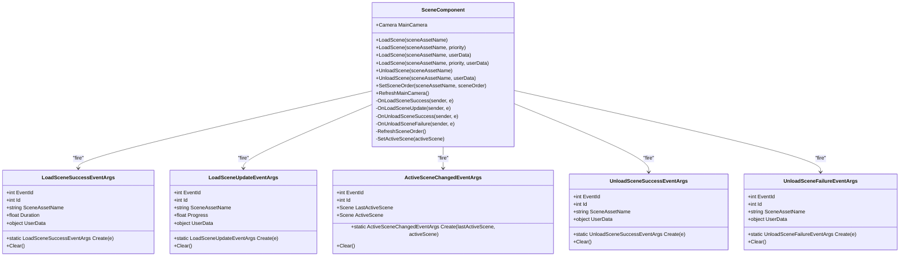
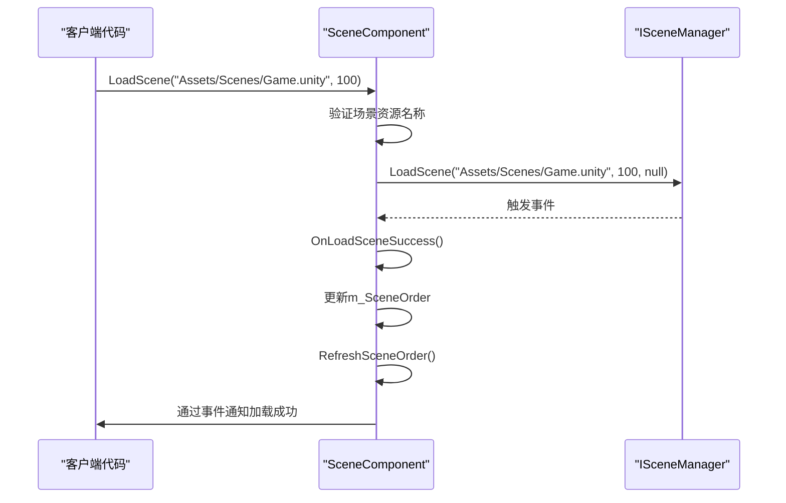
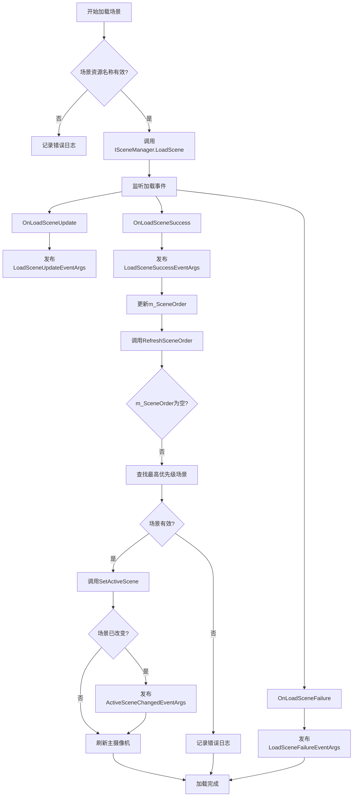
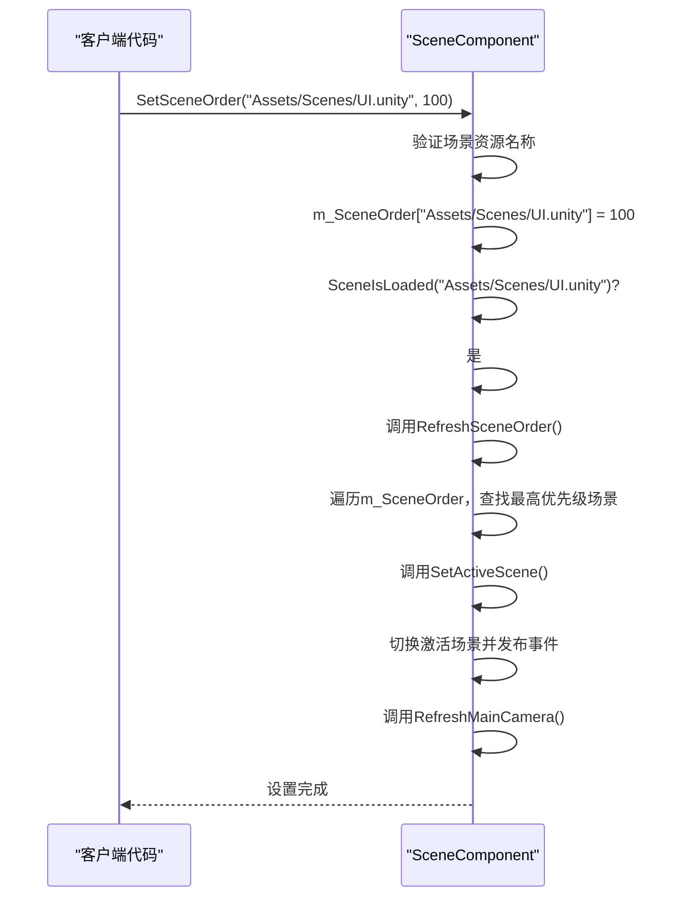

# 场景管理

<cite>
**Referenced Files in This Document**   
- [SceneComponent.cs](file://Scripts/Runtime/Scene/SceneComponent.cs)
- [LoadSceneSuccessEventArgs.cs](file://Scripts/Runtime/Scene/LoadSceneSuccessEventArgs.cs)
- [LoadSceneUpdateEventArgs.cs](file://Scripts/Runtime/Scene/LoadSceneUpdateEventArgs.cs)
- [ActiveSceneChangedEventArgs.cs](file://Scripts/Runtime/Scene/ActiveSceneChangedEventArgs.cs)
- [UnloadSceneSuccessEventArgs.cs](file://Scripts/Runtime/Scene/UnloadSceneSuccessEventArgs.cs)
- [UnloadSceneFailureEventArgs.cs](file://Scripts/Runtime/Scene/UnloadSceneFailureEventArgs.cs)
</cite>

## 目录
1. [简介](#简介)
2. [核心组件分析](#核心组件分析)
3. [场景加载与卸载API](#场景加载与卸载api)
4. [事件系统](#事件系统)
5. [场景顺序与主摄像机管理](#场景顺序与主摄像机管理)
6. [典型使用流程](#典型使用流程)
7. [场景依赖资源处理](#场景依赖资源处理)

## 简介
`SceneComponent` 是 Unity 游戏框架中的核心组件之一，负责封装 Unity 原生的 `SceneManager`，提供更安全、更易用的场景管理功能。该组件通过事件驱动的方式，为开发者提供了异步场景加载、卸载、进度监听、场景顺序管理以及主摄像机管理等高级功能。本文档将深入分析 `SceneComponent` 的设计与实现，帮助开发者更好地理解和使用场景管理模块。

## 核心组件分析

`SceneComponent` 作为 `GameFrameworkComponent` 的子类，通过依赖注入的方式获取 `ISceneManager` 模块，实现了对场景生命周期的全面控制。该组件维护了场景加载顺序的有序字典 `m_SceneOrder` 和当前场景主摄像机引用 `m_MainCamera`。

**Diagram sources**
- [SceneComponent.cs](file://Scripts/Runtime/Scene/SceneComponent.cs#L20-L475)
- [LoadSceneSuccessEventArgs.cs](file://Scripts/Runtime/Scene/LoadSceneSuccessEventArgs.cs#L15-L93)
- [LoadSceneUpdateEventArgs.cs](file://Scripts/Runtime/Scene/LoadSceneUpdateEventArgs.cs#L15-L93)
- [ActiveSceneChangedEventArgs.cs](file://Scripts/Runtime/Scene/ActiveSceneChangedEventArgs.cs#L16-L83)
- [UnloadSceneSuccessEventArgs.cs](file://Scripts/Runtime/Scene/UnloadSceneSuccessEventArgs.cs#L15-L81)
- [UnloadSceneFailureEventArgs.cs](file://Scripts/Runtime/Scene/UnloadSceneFailureEventArgs.cs#L15-L81)

**Section sources**
- [SceneComponent.cs](file://Scripts/Runtime/Scene/SceneComponent.cs#L20-L475)

## 场景加载与卸载API

`SceneComponent` 提供了多个重载的 `LoadScene` 和 `UnloadScene` 方法，以满足不同的使用场景。

### 场景加载
`LoadScene` 方法支持四种调用方式：
1. `LoadScene(string sceneAssetName)`：使用默认优先级加载场景
2. `LoadScene(string sceneAssetName, int priority)`：指定优先级加载场景
3. `LoadScene(string sceneAssetName, object userData)`：携带用户自定义数据加载场景
4. `LoadScene(string sceneAssetName, int priority, object userData)`：同时指定优先级和用户数据

所有重载方法最终都会调用内部的 `LoadScene(string sceneAssetName, int priority, object userData)` 方法，该方法会对场景资源名称进行有效性验证（必须以 "Assets/" 开头，以 ".unity" 结尾），然后委托给底层的 `ISceneManager` 执行实际的异步加载操作。

### 场景卸载
`UnloadScene` 方法提供了两种调用方式：
1. `UnloadScene(string sceneAssetName)`：卸载指定场景
2. `UnloadScene(string sceneAssetName, object userData)`：携带用户自定义数据卸载场景

卸载操作同样会进行场景资源名称的有效性验证，并在成功卸载后从 `m_SceneOrder` 字典中移除该场景的记录。

**Diagram sources**
- [SceneComponent.cs](file://Scripts/Runtime/Scene/SceneComponent.cs#L253-L299)

**Section sources**
- [SceneComponent.cs](file://Scripts/Runtime/Scene/SceneComponent.cs#L253-L299)

## 事件系统

`SceneComponent` 采用事件驱动的架构，通过 `EventComponent` 发布各种场景状态变更事件，使其他系统能够监听并响应场景的加载、更新和卸载过程。

### 加载成功事件
`LoadSceneSuccessEventArgs` 事件在场景成功加载后触发。该事件包含了场景资源名称、加载耗时和用户自定义数据。`SceneComponent` 在收到底层 `ISceneManager` 的加载成功通知后，会创建并发布此事件，同时调用 `RefreshSceneOrder()` 更新场景激活状态。

### 加载进度事件
`LoadSceneUpdateEventArgs` 事件在场景加载过程中定期触发，用于报告加载进度。当 `m_EnableLoadSceneUpdateEvent` 为 `true` 时，`SceneComponent` 会监听底层的加载更新事件，并将其转发为 `LoadSceneUpdateEventArgs`。该事件包含了场景资源名称、当前加载进度（0.0f 到 1.0f）和用户自定义数据。

### 激活场景变更事件
`ActiveSceneChangedEventArgs` 事件在当前激活场景发生改变时触发。当 `RefreshSceneOrder()` 方法根据 `m_SceneOrder` 字典确定了新的最高优先级场景后，会调用 `SetActiveScene()` 方法，如果新场景与当前激活场景不同，则会触发此事件。事件中包含了上一个激活场景和当前激活场景的信息。

### 卸载事件
`UnloadSceneSuccessEventArgs` 和 `UnloadSceneFailureEventArgs` 分别在场景成功卸载和卸载失败时触发。这些事件包含了场景资源名称和用户自定义数据，允许监听者对卸载结果做出相应处理。

**Diagram sources**
- [SceneComponent.cs](file://Scripts/Runtime/Scene/SceneComponent.cs#L436-L456)
- [SceneComponent.cs](file://Scripts/Runtime/Scene/SceneComponent.cs#L376-L434)

**Section sources**
- [LoadSceneSuccessEventArgs.cs](file://Scripts/Runtime/Scene/LoadSceneSuccessEventArgs.cs#L15-L93)
- [LoadSceneUpdateEventArgs.cs](file://Scripts/Runtime/Scene/LoadSceneUpdateEventArgs.cs#L15-L93)
- [ActiveSceneChangedEventArgs.cs](file://Scripts/Runtime/Scene/ActiveSceneChangedEventArgs.cs#L16-L83)
- [UnloadSceneSuccessEventArgs.cs](file://Scripts/Runtime/Scene/UnloadSceneSuccessEventArgs.cs#L15-L81)
- [UnloadSceneFailureEventArgs.cs](file://Scripts/Runtime/Scene/UnloadSceneFailureEventArgs.cs#L15-L81)

## 场景顺序与主摄像机管理

`SceneComponent` 通过 `SetSceneOrder` 方法和 `m_SceneOrder` 字典来管理多个场景的优先级和激活状态。

### 场景顺序管理
`SetSceneOrder(string sceneAssetName, int sceneOrder)` 方法允许开发者为已加载或正在加载的场景设置一个整数优先级。优先级数值越大，表示场景的层级越高。当调用此方法时：
- 如果场景正在加载，其优先级会被记录在 `m_SceneOrder` 中，待加载完成后生效。
- 如果场景已经加载，除了更新 `m_SceneOrder` 外，还会立即调用 `RefreshSceneOrder()` 来重新评估当前应激活的场景。

`RefreshSceneOrder()` 方法会遍历 `m_SceneOrder` 字典，忽略所有正在加载的场景，找出已加载场景中优先级最高的那个，并将其设置为当前激活场景。如果没有任何场景被加载，则会激活框架的默认场景（`m_GameFrameworkScene`）。

### 主摄像机管理
`SceneComponent` 维护了一个 `m_MainCamera` 字段，用于存储当前场景的主摄像机。`RefreshMainCamera()` 方法通过 `Camera.main` 静态属性来获取当前场景的主摄像机，并更新 `m_MainCamera` 字段。这个方法在 `SetActiveScene()` 切换场景后被自动调用，确保 `MainCamera` 属性始终指向正确的摄像机。

**Diagram sources**
- [SceneComponent.cs](file://Scripts/Runtime/Scene/SceneComponent.cs#L338-L374)

**Section sources**
- [SceneComponent.cs](file://Scripts/Runtime/Scene/SceneComponent.cs#L338-L374)

## 典型使用流程

以下是一个从当前场景异步加载一个新场景，并在加载完成后将其设置为最高优先级场景的完整代码流程示例：

1. **调用加载方法**：客户端代码调用 `SceneComponent.LoadScene()` 方法，传入目标场景的资源路径和优先级。
2. **验证与委托**：`SceneComponent` 验证场景路径的有效性，并将加载请求委托给 `ISceneManager`。
3. **监听加载进度**：`ISceneManager` 在加载过程中会触发 `LoadSceneUpdate` 事件，`SceneComponent` 将其转换为 `LoadSceneUpdateEventArgs` 并通过 `EventComponent` 发布，UI 系统可以监听此事件来更新加载进度条。
4. **处理加载成功**：当 `ISceneManager` 报告加载成功时，`SceneComponent` 的 `OnLoadSceneSuccess` 回调被触发。它会创建 `LoadSceneSuccessEventArgs` 事件并发布，同时将新场景以默认优先级（0）添加到 `m_SceneOrder` 字典中。
5. **刷新场景顺序**：`OnLoadSceneSuccess` 随后调用 `RefreshSceneOrder()`。该方法会检查 `m_SceneOrder` 中所有已加载场景的优先级。
6. **设置场景优先级**：客户端代码在收到 `LoadSceneSuccessEventArgs` 后，调用 `SetSceneOrder()` 方法，将新加载的场景优先级设置为 100。
7. **重新评估激活场景**：由于 `SetSceneOrder()` 发现场景已加载，它会立即再次调用 `RefreshSceneOrder()`。这次，新场景因其高优先级被选中。
8. **切换激活场景**：`RefreshSceneOrder()` 调用 `SetActiveScene()` 将新场景设置为当前激活场景。如果场景发生改变，则发布 `ActiveSceneChangedEventArgs` 事件。
9. **更新主摄像机**：`SetActiveScene()` 最后调用 `RefreshMainCamera()`，确保 `MainCamera` 属性指向新场景的主摄像机。

此流程确保了场景加载的异步性、状态的可监听性以及场景层级管理的灵活性。

## 场景依赖资源处理

`SceneComponent` 通过 `m_EnableLoadSceneDependencyAssetEvent` 序列化字段来控制是否转发场景依赖资源的加载事件。当此字段为 `true`（默认值）时，`SceneComponent` 会在 `Awake()` 方法中订阅 `ISceneManager` 的 `LoadSceneDependencyAsset` 事件。

当场景加载过程中需要加载其依赖的资源（如预制件、纹理、音频等）时，`ISceneManager` 会触发 `LoadSceneDependencyAsset` 事件。`SceneComponent` 的 `OnLoadSceneDependencyAsset` 私有方法会监听到此事件，并将其转换为框架内部的 `LoadSceneDependencyAssetEventArgs` 事件，通过 `EventComponent` 发布出去。

这使得开发者可以监听到场景加载过程中每一个依赖资源的加载细节，对于实现更精细的加载进度显示或资源预加载策略非常有用。例如，可以统计所有依赖资源的总数和已加载数，从而提供比单纯场景加载进度更精确的加载指示。