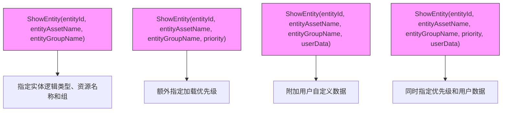
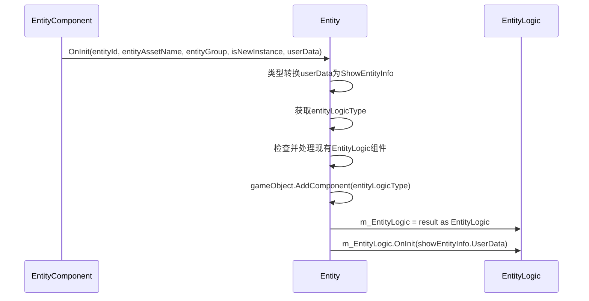
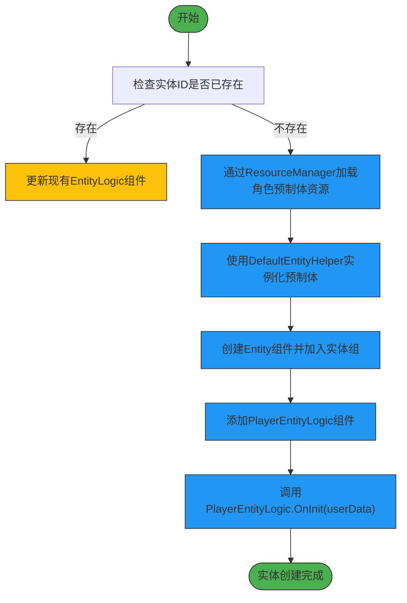
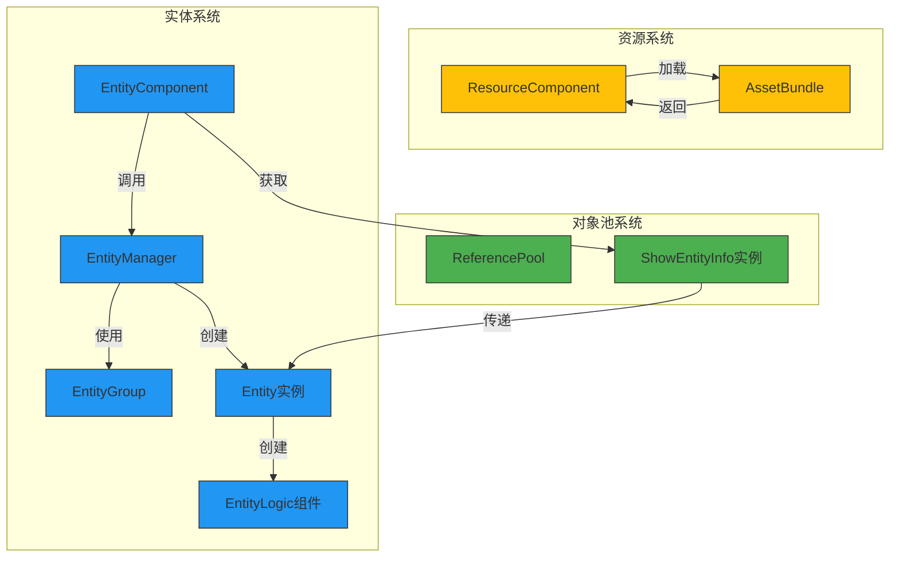

# 实体创建与显示

<cite>
**Referenced Files in This Document**   
- [EntityComponent.cs](file://Scripts/Runtime/Entity/EntityComponent.cs)
- [ShowEntityInfo.cs](file://Scripts/Runtime/Entity/ShowEntityInfo.cs)
- [Entity.cs](file://Scripts/Runtime/Entity/Entity.cs)
- [EntityLogic.cs](file://Scripts/Runtime/Entity/EntityLogic.cs)
- [DefaultEntityHelper.cs](file://Scripts/Runtime/Entity/DefaultEntityHelper.cs)
- [ReferencePoolComponent.cs](file://Scripts/Runtime/ReferencePool/ReferencePoolComponent.cs)
</cite>

## 目录
1. [核心功能概述](#核心功能概述)
2. [ShowEntity重载方法详解](#showentity重载方法详解)
3. [ShowEntityInfo对象池复用机制](#showentityinfo对象池复用机制)
4. [实体逻辑组件初始化流程](#实体逻辑组件初始化流程)
5. [完整示例：角色实体创建](#完整示例角色实体创建)
6. [内部流程解析](#内部流程解析)

## 核心功能概述

本文档详细阐述了Unity游戏框架中实体创建与显示的核心机制。系统通过`EntityComponent`提供的`ShowEntity`系列方法，实现了从资源系统加载预制体并实例化为游戏世界中实体的完整流程。该流程涉及泛型类型指定、资源加载、对象池管理、生命周期初始化等多个关键环节，构成了游戏实体系统的基础。

**Section sources**
- [EntityComponent.cs](file://Scripts/Runtime/Entity/EntityComponent.cs#L393-L494)

## ShowEntity重载方法详解

`EntityComponent`类提供了多个`ShowEntity`方法的重载版本，允许开发者以灵活的方式创建实体。这些方法通过泛型参数`T`指定实体逻辑类型，确保类型安全。



所有泛型重载方法最终都会调用非泛型的`ShowEntity`方法，将`typeof(T)`作为`entityLogicType`参数传递。这种设计模式既保证了API的易用性，又避免了代码重复。

**Diagram sources**
- [EntityComponent.cs](file://Scripts/Runtime/Entity/EntityComponent.cs#L393-L494)

**Section sources**
- [EntityComponent.cs](file://Scripts/Runtime/Entity/EntityComponent.cs#L393-L494)

## ShowEntityInfo对象池复用机制

`ShowEntityInfo`类实现了`IReference`接口，用于封装实体逻辑类型和用户数据，并通过对象池（`ReferencePool`）进行高效复用。

```mermaid
classDiagram
class ShowEntityInfo {
-Type m_EntityLogicType
-object m_UserData
+Type EntityLogicType
+object UserData
+static ShowEntityInfo Create(Type, object)
+void Clear()
}
ShowEntityInfo ..|> IReference : 实现
note right of ShowEntityInfo
通过对象池管理实例
避免频繁GC
Create()方法从池中获取实例
Clear()方法重置状态供下次使用
end
```

当调用`ShowEntityInfo.Create(entityLogicType, userData)`时，系统会从`ReferencePool`中获取一个`ShowEntityInfo`实例，设置其属性后返回，从而避免了频繁的内存分配和垃圾回收。

**Diagram sources**
- [ShowEntityInfo.cs](file://Scripts/Runtime/Entity/ShowEntityInfo.cs#L12-L52)

**Section sources**
- [ShowEntityInfo.cs](file://Scripts/Runtime/Entity/ShowEntityInfo.cs#L12-L52)

## 实体逻辑组件初始化流程

`Entity`类的`OnInit`方法在实体初始化时被调用，负责根据`ShowEntityInfo`创建对应的`EntityLogic`组件。



该流程首先从`userData`中提取`ShowEntityInfo`，获取`EntityLogic`类型，然后在实体GameObject上添加对应的组件，并调用其`OnInit`方法完成初始化。

**Diagram sources**
- [Entity.cs](file://Scripts/Runtime/Entity/Entity.cs#L87-L136)
- [EntityLogic.cs](file://Scripts/Runtime/Entity/EntityLogic.cs#L55-L65)

**Section sources**
- [Entity.cs](file://Scripts/Runtime/Entity/Entity.cs#L87-L136)

## 完整示例：角色实体创建

以下是一个使用`ShowEntity`方法从资源系统加载角色预制体并实例化的完整示例：



此示例展示了从调用`ShowEntity<PlayerEntityLogic>`到最终`PlayerEntityLogic`组件完成初始化的完整路径。

**Diagram sources**
- [EntityComponent.cs](file://Scripts/Runtime/Entity/EntityComponent.cs#L485-L494)
- [DefaultEntityHelper.cs](file://Scripts/Runtime/Entity/DefaultEntityHelper.cs#L15-L35)
- [Entity.cs](file://Scripts/Runtime/Entity/Entity.cs#L87-L136)

## 内部流程解析

实体创建过程涉及多个系统的协同工作，包括资源管理、对象池管理和实体管理。



整个流程始于`EntityComponent.ShowEntity`调用，经由`EntityManager`协调，通过`ResourceComponent`加载资源，利用`ReferencePool`管理`ShowEntityInfo`实例，最终在指定的`EntityGroup`中创建实体实例并初始化其逻辑组件。

**Diagram sources**
- [EntityComponent.cs](file://Scripts/Runtime/Entity/EntityComponent.cs#L485-L494)
- [ShowEntityInfo.cs](file://Scripts/Runtime/Entity/ShowEntityInfo.cs#L39-L45)
- [DefaultEntityHelper.cs](file://Scripts/Runtime/Entity/DefaultEntityHelper.cs#L15-L45)
- [ReferencePoolComponent.cs](file://Scripts/Runtime/ReferencePool/ReferencePoolComponent.cs#L12-L25)

**Section sources**
- [EntityComponent.cs](file://Scripts/Runtime/Entity/EntityComponent.cs#L485-L494)
- [ShowEntityInfo.cs](file://Scripts/Runtime/Entity/ShowEntityInfo.cs#L39-L45)