# 实体挂接与层级管理

<cite>
**Referenced Files in This Document**   
- [EntityComponent.cs](file://Scripts/Runtime/Entity/EntityComponent.cs)
- [AttachEntityInfo.cs](file://Scripts/Runtime/Entity/AttachEntityInfo.cs)
- [EntityLogic.cs](file://Scripts/Runtime/Entity/EntityLogic.cs)
- [Entity.cs](file://Scripts/Runtime/Entity/Entity.cs)
</cite>

## Table of Contents
1. [实体挂接方法重载](#实体挂接方法重载)
2. [挂接信息封装](#挂接信息封装)
3. [挂接与解挂逻辑](#挂接与解挂逻辑)
4. [实际用例：武器挂接](#实际用例：武器挂接)
5. [解挂方法与回调流程](#解挂方法与回调流程)

## 实体挂接方法重载

实体组件提供了多种`AttachEntity`方法的重载形式，以满足不同的挂接需求。这些重载方法允许开发者通过不同的参数组合来实现子实体与父实体的层级关系建立。

### 通过ID进行挂接
最基础的挂接方式是通过实体ID进行挂接，开发者可以指定子实体和父实体的ID来建立层级关系。

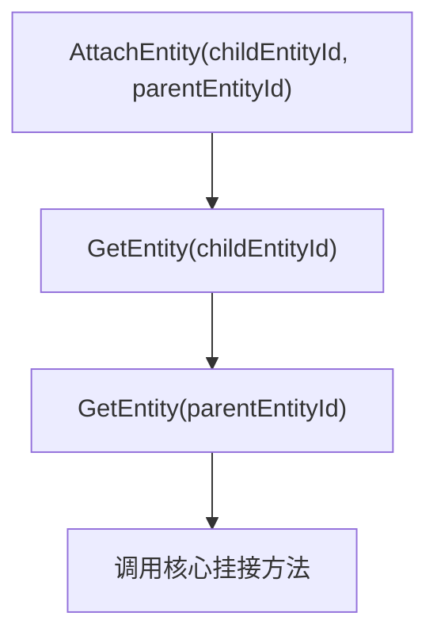

**Section sources**
- [EntityComponent.cs](file://Scripts/Runtime/Entity/EntityComponent.cs#L690-L693)

### 通过实体引用进行挂接
除了使用ID，还可以直接使用实体引用来进行挂接，这种方式更加直观和类型安全。

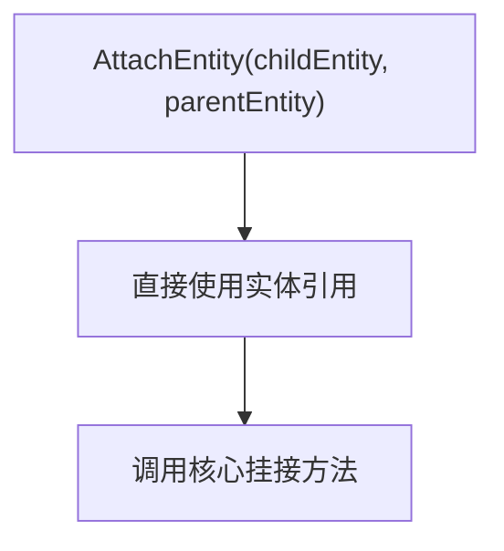

**Section sources**
- [EntityComponent.cs](file://Scripts/Runtime/Entity/EntityComponent.cs#L720-L723)

### 通过Transform路径进行挂接
当需要将子实体挂接到父实体的特定子节点时，可以使用Transform路径进行挂接。

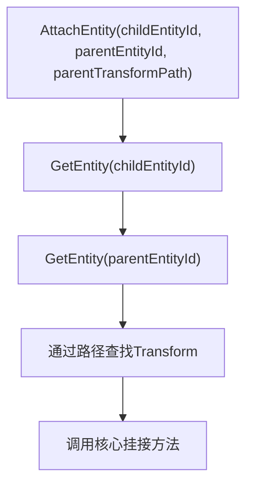

**Section sources**
- [EntityComponent.cs](file://Scripts/Runtime/Entity/EntityComponent.cs#L731-L734)

### 通过直接Transform进行挂接
对于需要精确控制挂接位置的场景，可以直接指定Transform进行挂接。

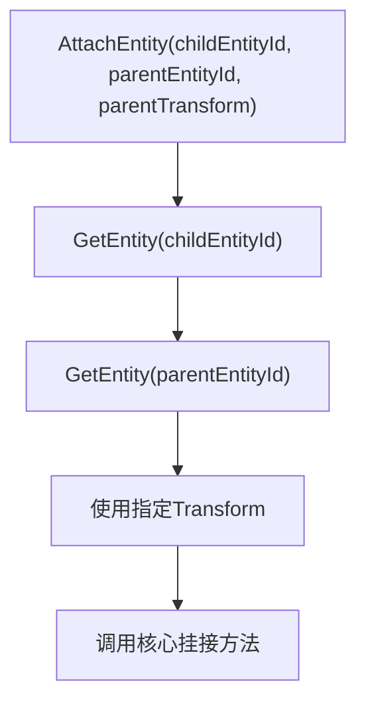

**Section sources**
- [EntityComponent.cs](file://Scripts/Runtime/Entity/EntityComponent.cs#L775-L778)

## 挂接信息封装

`AttachEntityInfo`类用于封装挂接操作所需的信息，包括父级Transform和用户自定义数据。

### AttachEntityInfo结构
该类实现了`IReference`接口，支持对象池管理，提高了内存使用效率。

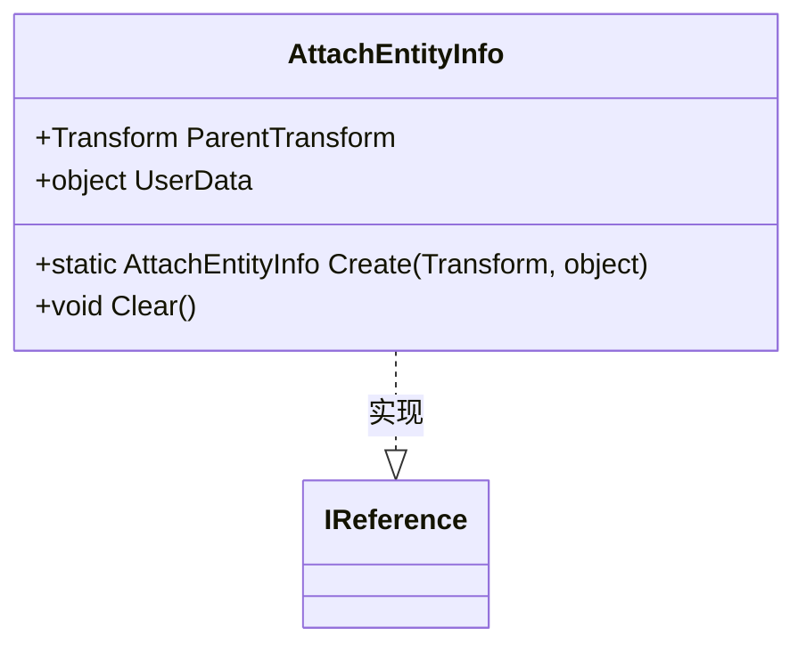

**Diagram sources**
- [AttachEntityInfo.cs](file://Scripts/Runtime/Entity/AttachEntityInfo.cs#L12-L52)

### 信息创建与回收
`AttachEntityInfo`通过静态`Create`方法创建实例，并从对象池中获取，使用完毕后通过`ReferencePool.Release`方法回收。

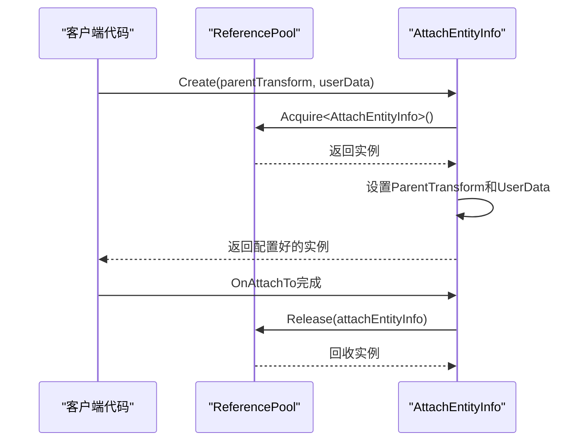

**Diagram sources**
- [AttachEntityInfo.cs](file://Scripts/Runtime/Entity/AttachEntityInfo.cs#L39-L45)
- [Entity.cs](file://Scripts/Runtime/Entity/Entity.cs#L244-L254)

**Section sources**
- [AttachEntityInfo.cs](file://Scripts/Runtime/Entity/AttachEntityInfo.cs#L12-L52)

## 挂接与解挂逻辑

实体挂接与解挂的核心逻辑在`EntityLogic`基类中实现，通过`OnAttachTo`和`OnDetachFrom`方法处理层级关系的变化。

### 挂接逻辑实现
当子实体被挂接到父实体时，`OnAttachTo`方法会被调用，将子实体的Transform挂接到指定的父级Transform。

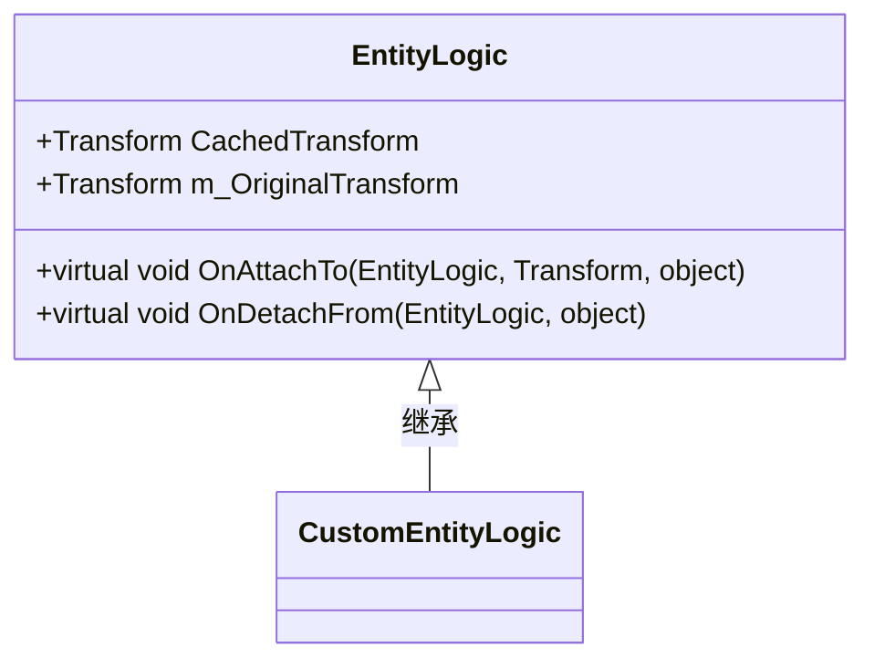

**Diagram sources**
- [EntityLogic.cs](file://Scripts/Runtime/Entity/EntityLogic.cs#L168-L181)

### 挂接流程
挂接操作的完整流程涉及多个组件的协作。

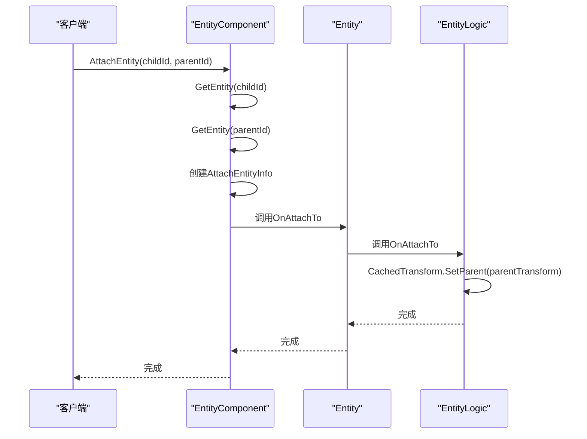

**Diagram sources**
- [EntityComponent.cs](file://Scripts/Runtime/Entity/EntityComponent.cs#L690-L693)
- [Entity.cs](file://Scripts/Runtime/Entity/Entity.cs#L234-L244)
- [EntityLogic.cs](file://Scripts/Runtime/Entity/EntityLogic.cs#L168-L171)

### 解挂逻辑实现
当子实体从父实体解挂时，`OnDetachFrom`方法会被调用，将子实体的Transform恢复到原始的父级。

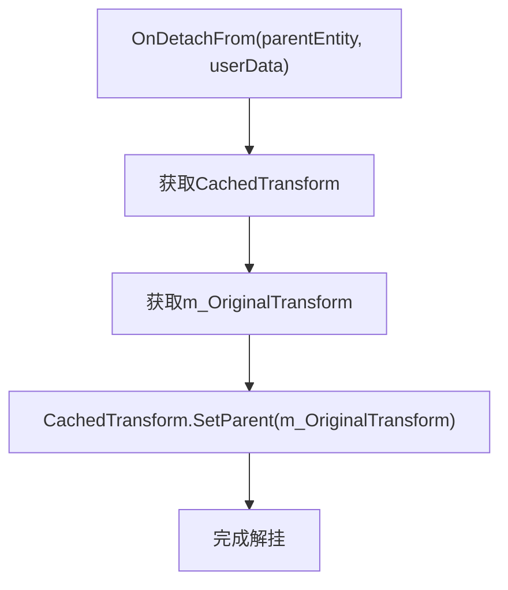

**Section sources**
- [EntityLogic.cs](file://Scripts/Runtime/Entity/EntityLogic.cs#L178-L181)

## 实际用例：武器挂接

将武器实体挂接到角色模型的手部骨骼位置是一个典型的使用场景。

### 挂接流程
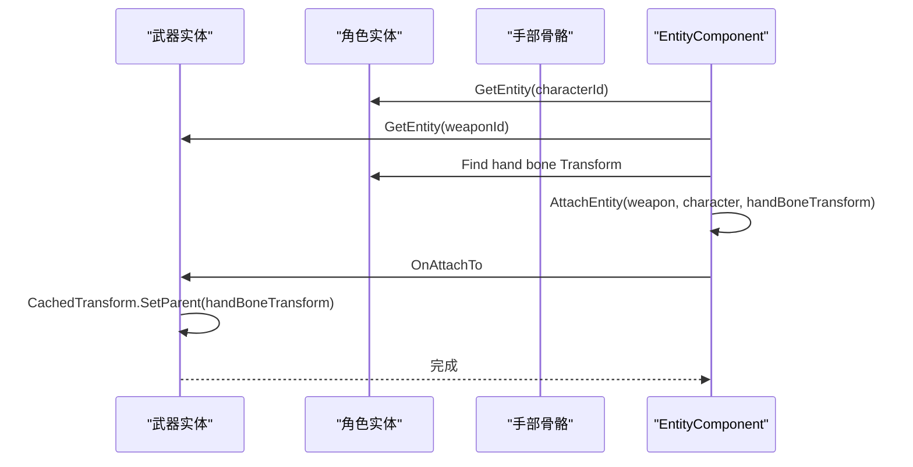

**Section sources**
- [EntityComponent.cs](file://Scripts/Runtime/Entity/EntityComponent.cs#L775-L778)
- [EntityLogic.cs](file://Scripts/Runtime/Entity/EntityLogic.cs#L168-L171)

### 代码实现示例
虽然不展示具体代码内容，但实现过程涉及以下关键步骤：
1. 获取角色实体和武器实体的引用
2. 在角色模型中查找手部骨骼的Transform
3. 调用`AttachEntity`方法，将武器挂接到手部骨骼
4. 传递必要的用户数据，如挂接位置偏移等

## 解挂方法与回调流程

`DetachEntity`方法提供了多种重载形式，用于解除实体的挂接关系，并触发相应的回调。

### 解挂方法重载
与挂接方法类似，解挂方法也提供了基于ID和实体引用的多种重载形式。

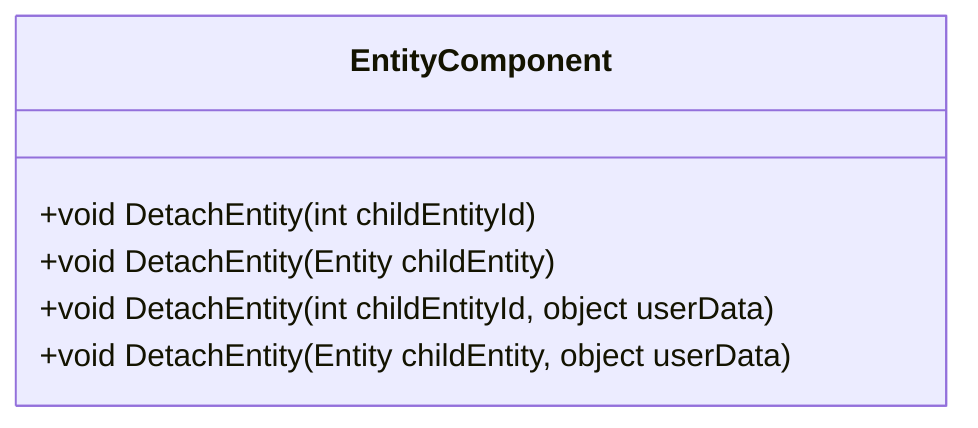

**Section sources**
- [EntityComponent.cs](file://Scripts/Runtime/Entity/EntityComponent.cs#L1001-L1033)

### 解挂回调流程
解挂操作会触发一系列回调方法，确保所有相关逻辑都能正确执行。

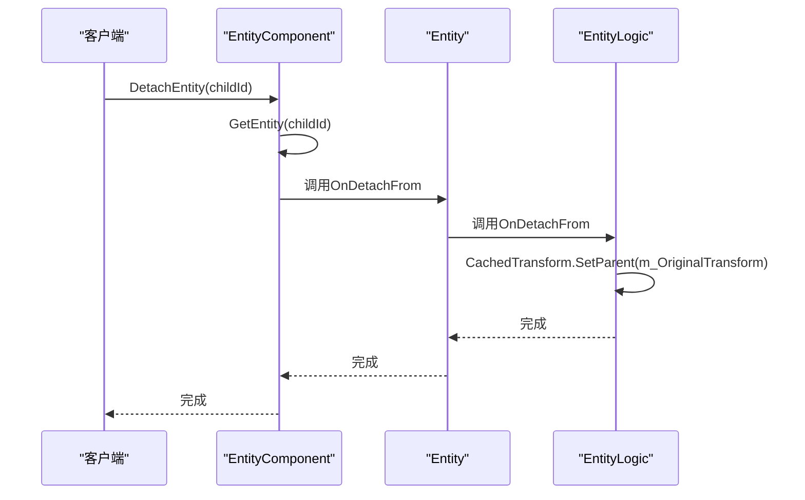

**Diagram sources**
- [EntityComponent.cs](file://Scripts/Runtime/Entity/EntityComponent.cs#L1001-L1004)
- [Entity.cs](file://Scripts/Runtime/Entity/Entity.cs#L256-L266)
- [EntityLogic.cs](file://Scripts/Runtime/Entity/EntityLogic.cs#L178-L181)

### 用户数据传递
解挂操作支持传递用户数据，这些数据会在回调方法中被传递，用于执行特定的业务逻辑。

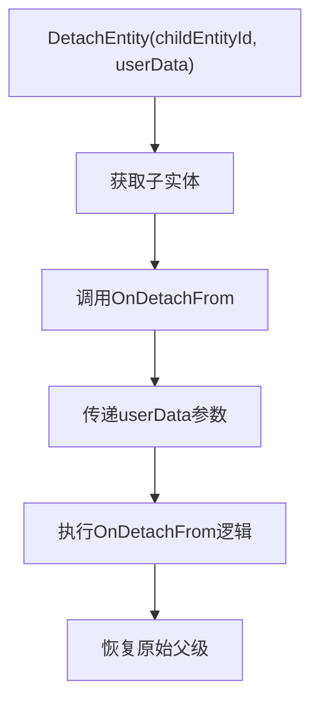

**Section sources**
- [EntityComponent.cs](file://Scripts/Runtime/Entity/EntityComponent.cs#L1011-L1014)