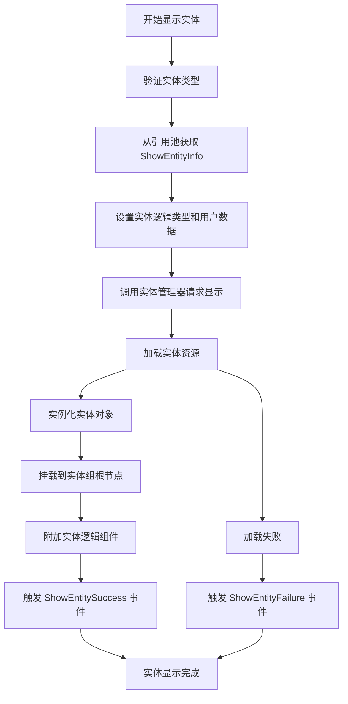
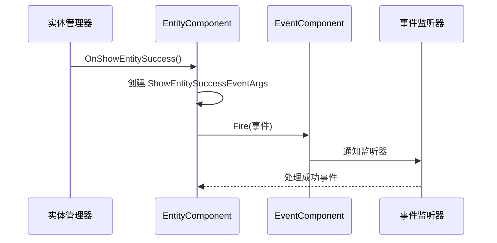
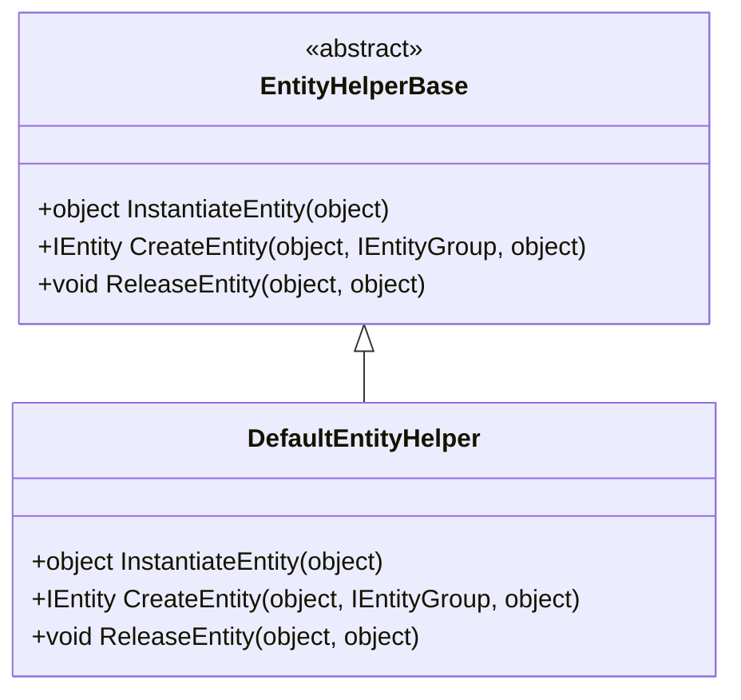

# 实体系统

<cite>
**本文档中引用的文件**  
- [EntityComponent.cs](file://Scripts/Runtime/Entity/EntityComponent.cs)
- [ShowEntityInfo.cs](file://Scripts/Runtime/Entity/ShowEntityInfo.cs)
- [AttachEntityInfo.cs](file://Scripts/Runtime/Entity/AttachEntityInfo.cs)
- [DefaultEntityHelper.cs](file://Scripts/Runtime/Entity/DefaultEntityHelper.cs)
- [ShowEntitySuccessEventArgs.cs](file://Scripts/Runtime/Entity/ShowEntitySuccessEventArgs.cs)
- [HideEntityCompleteEventArgs.cs](file://Scripts/Runtime/Entity/HideEntityCompleteEventArgs.cs)
- [ShowEntityFailureEventArgs.cs](file://Scripts/Runtime/Entity/ShowEntityFailureEventArgs.cs)
- [ShowEntityDependencyAssetEventArgs.cs](file://Scripts/Runtime/Entity/ShowEntityDependencyAssetEventArgs.cs)
- [EntityComponent.EntityGroup.cs](file://Scripts/Runtime/Entity/EntityComponent.EntityGroup.cs)
</cite>

## 目录
1. [简介](#简介)
2. [核心组件](#核心组件)
3. [实体操作流程](#实体操作流程)
4. [实体对象池与复用机制](#实体对象池与复用机制)
5. [实体组管理](#实体组管理)
6. [参数对象详解](#参数对象详解)
7. [事件系统](#事件系统)
8. [典型使用示例](#典型使用示例)
9. [扩展点：DefaultEntityHelper](#扩展点defaultentityhelper)

## 简介
实体系统是游戏框架中用于管理动态游戏对象的核心模块。它通过统一的接口实现对实体的创建、显示、隐藏、挂接等操作，并结合对象池技术实现高效的资源复用。本系统支持通过事件监听机制响应实体状态变化，适用于角色、NPC、道具等动态对象的生命周期管理。

## 核心组件

**Section sources**
- [EntityComponent.cs](file://Scripts/Runtime/Entity/EntityComponent.cs#L80-L163)
- [DefaultEntityHelper.cs](file://Scripts/Runtime/Entity/DefaultEntityHelper.cs#L15-L71)

## 实体操作流程



**Diagram sources**
- [EntityComponent.cs](file://Scripts/Runtime/Entity/EntityComponent.cs#L485-L494)
- [ShowEntityInfo.cs](file://Scripts/Runtime/Entity/ShowEntityInfo.cs#L39-L45)

## 实体对象池与复用机制

实体系统通过对象池技术管理实体实例的生命周期，避免频繁的内存分配与回收。当实体被隐藏时，系统不会立即销毁对象，而是将其返回到对应实体组的对象池中。当需要创建相同类型的实体时，系统优先从对象池中获取可用实例进行复用。

每个实体组可独立配置对象池参数：
- **容量限制**：最大可缓存的实例数量
- **过期时间**：实例在池中可保留的最长时间
- **自动释放间隔**：定期清理过期实例的时间间隔
- **优先级**：对象池的清理优先级

这种机制显著提升了频繁创建/销毁对象场景下的性能表现。

**Section sources**
- [EntityComponent.EntityGroup.cs](file://Scripts/Runtime/Entity/EntityComponent.EntityGroup.cs#L12-L72)
- [EntityComponent.cs](file://Scripts/Runtime/Entity/EntityComponent.cs#L212-L232)

## 实体组管理

实体组（EntityGroup）用于分类管理不同类型的实体，每个实体组拥有独立的对象池和生命周期管理策略。通过实体组可以实现：
- 按类型组织实体（如角色组、特效组、UI组）
- 独立配置各类型实体的资源管理策略
- 批量操作特定类型的实体（如隐藏所有特效）

系统在启动时根据配置自动创建预设的实体组，开发者也可通过 `AddEntityGroup` 方法动态添加新的实体组。

```mermaid
classDiagram
class EntityComponent {
+bool HasEntityGroup(string)
+IEntityGroup GetEntityGroup(string)
+bool AddEntityGroup(string, float, int, float, int)
+Entity GetEntity(int)
+void ShowEntity<T>(int, string, string, int, object)
+void HideEntity(int)
+void AttachEntity(Entity, Entity, string, object)
}
class EntityGroup {
+string Name
+float InstanceAutoReleaseInterval
+int InstanceCapacity
+float InstanceExpireTime
+int InstancePriority
}
EntityComponent --> EntityGroup : "包含多个"
EntityComponent --> "EntityHelper" : "使用"
```

**Diagram sources**
- [EntityComponent.cs](file://Scripts/Runtime/Entity/EntityComponent.cs#L170-L173)
- [EntityComponent.EntityGroup.cs](file://Scripts/Runtime/Entity/EntityComponent.EntityGroup.cs#L14-L71)

## 参数对象详解

### ShowEntityInfo
`ShowEntityInfo` 是一个可复用的引用对象，用于封装显示实体时所需的参数信息：
- **EntityLogicType**：实体关联的逻辑组件类型
- **UserData**：用户自定义数据，可在事件回调中获取

该对象继承自 `IReference` 接口，通过引用池（ReferencePool）进行管理，避免GC压力。

### AttachEntityInfo
`AttachEntityInfo` 用于封装挂接实体时的参数：
- **ParentTransform**：父实体的变换节点
- **UserData**：用户自定义数据

与 `ShowEntityInfo` 类似，也通过引用池进行高效管理。

**Section sources**
- [ShowEntityInfo.cs](file://Scripts/Runtime/Entity/ShowEntityInfo.cs#L12-L52)
- [AttachEntityInfo.cs](file://Scripts/Runtime/Entity/AttachEntityInfo.cs#L12-L52)

## 事件系统

实体系统通过事件机制通知外部操作结果，主要事件包括：

| 事件类型 | 触发时机 | 主要参数 |
|---------|--------|--------|
| ShowEntitySuccessEventArgs | 实体显示成功 | EntityLogicType, Entity, Duration, UserData |
| ShowEntityFailureEventArgs | 实体显示失败 | EntityId, ErrorMessage, UserData |
| ShowEntityDependencyAssetEventArgs | 加载依赖资源时 | DependencyAssetName, LoadedCount, TotalCount |
| HideEntityCompleteEventArgs | 实体隐藏完成 | EntityId, EntityAssetName, UserData |

这些事件通过 `EventComponent` 进行分发，开发者可通过事件订阅机制监听实体状态变化。



**Diagram sources**
- [ShowEntitySuccessEventArgs.cs](file://Scripts/Runtime/Entity/ShowEntitySuccessEventArgs.cs#L86-L96)
- [EntityComponent.cs](file://Scripts/Runtime/Entity/EntityComponent.cs#L1119-L1122)

## 典型使用示例

以下代码演示了从资源加载角色预制体并挂接到玩家角色的完整流程：

```csharp
// 1. 定义实体逻辑类
public class CharacterLogic : EntityLogic { /* ... */ }

// 2. 显示角色实体
int entityId = 1001;
string assetName = "Assets/Prefabs/PlayerCharacter.prefab";
string groupName = "CharacterGroup";
object userData = new { level = 5, name = "Hero" };

GameEntry.Entity.ShowEntity<CharacterLogic>(entityId, assetName, groupName, userData);

// 3. 监听显示成功事件
GameEntry.Event.Subscribe(ShowEntitySuccessEventArgs.EventId, OnCharacterShowed);

private void OnCharacterShowed(object sender, GameEventArgs e)
{
    ShowEntitySuccessEventArgs ne = (ShowEntitySuccessEventArgs)e;
    Entity character = ne.Entity;
    
    // 4. 挂接到玩家角色
    Entity player = GameEntry.Entity.GetEntity(playerId);
    GameEntry.Entity.AttachEntity(character, player, "BackPackSlot");
}
```

**Section sources**
- [EntityComponent.cs](file://Scripts/Runtime/Entity/EntityComponent.cs#L393-L396)
- [ShowEntitySuccessEventArgs.cs](file://Scripts/Runtime/Entity/ShowEntitySuccessEventArgs.cs#L16-L108)

## 扩展点：DefaultEntityHelper

`DefaultEntityHelper` 是实体系统的默认辅助实现，提供了三个核心方法的扩展点：
- **InstantiateEntity**：自定义实体实例化逻辑
- **CreateEntity**：自定义实体创建后的初始化逻辑
- **ReleaseEntity**：自定义实体释放逻辑

开发者可通过继承 `EntityHelperBase` 并重写这些方法来定制实体的创建和销毁行为。例如，可以在此处添加对象池、资源预加载、性能监控等自定义逻辑。



**Diagram sources**
- [DefaultEntityHelper.cs](file://Scripts/Runtime/Entity/DefaultEntityHelper.cs#L24-L27)
- [DefaultEntityHelper.cs](file://Scripts/Runtime/Entity/DefaultEntityHelper.cs#L56-L60)