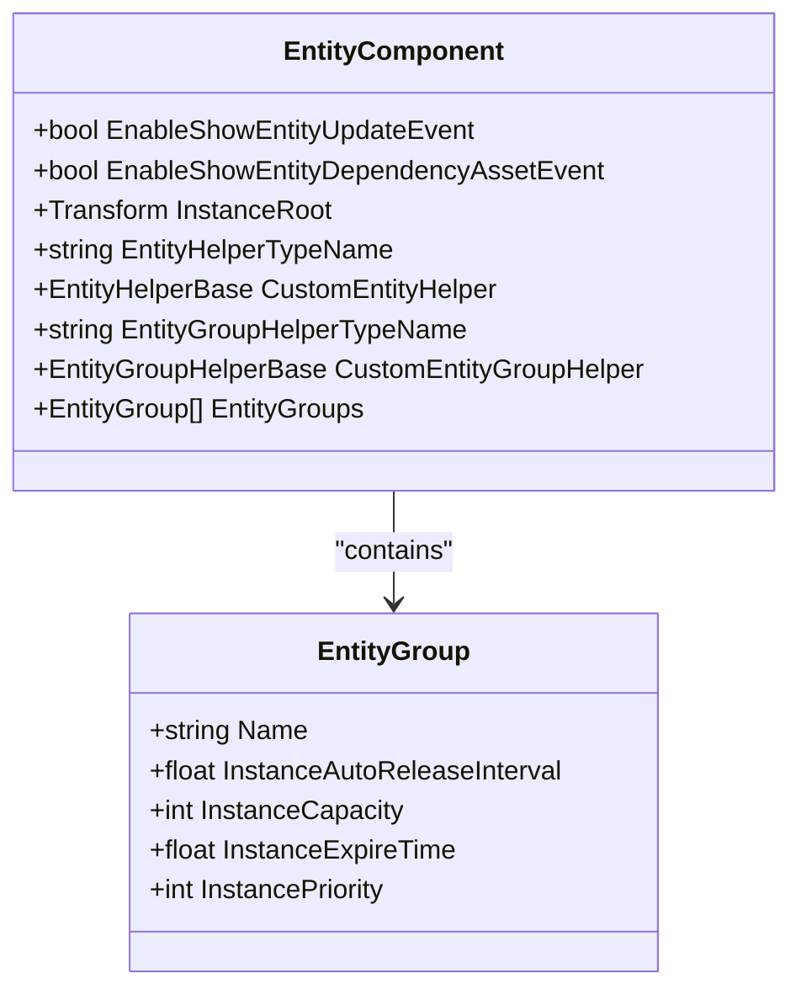
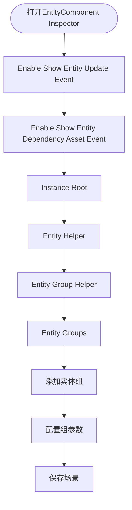
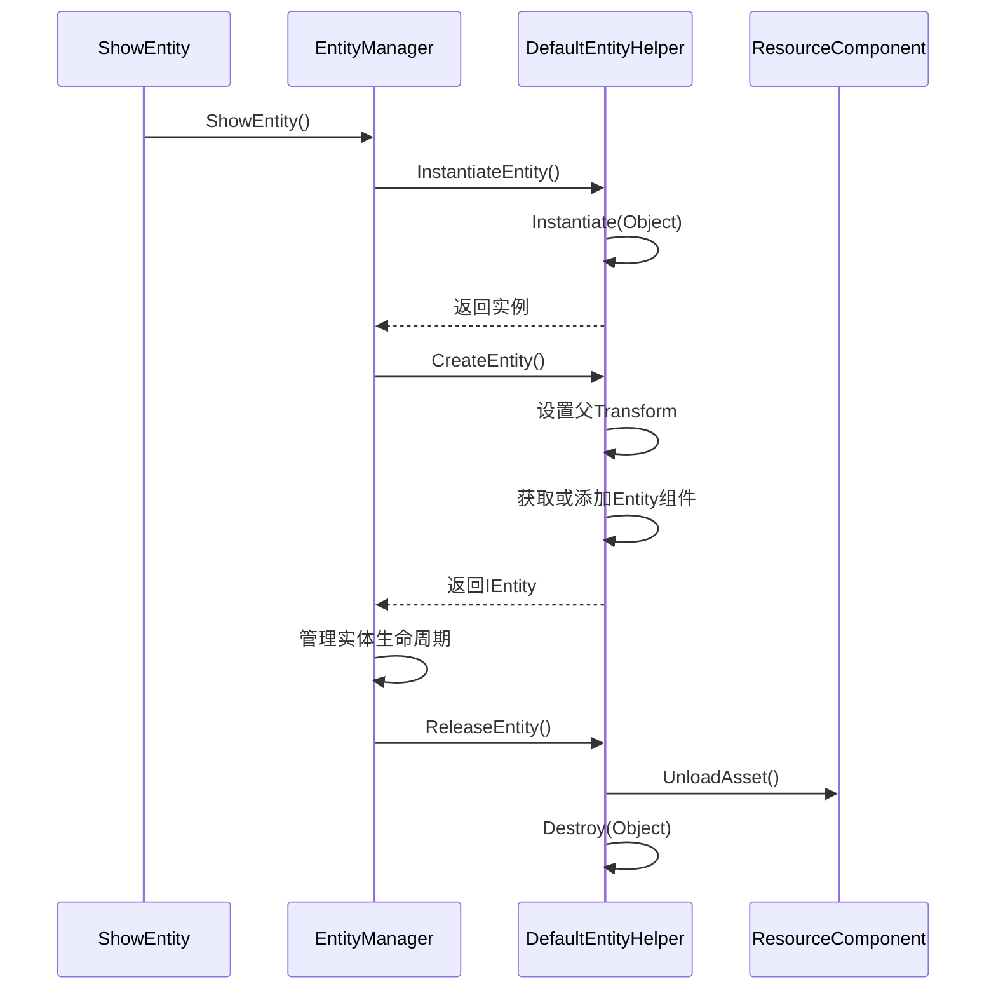

<cite>
**Referenced Files in This Document**   
- [EntityComponent.EntityGroup.cs](file://Scripts/Runtime/Entity/EntityComponent.EntityGroup.cs)
- [DefaultEntityHelper.cs](file://Scripts/Runtime/Entity/DefaultEntityHelper.cs)
- [EntityComponent.cs](file://Scripts/Runtime/Entity/EntityComponent.cs)
- [EntityComponentInspector.cs](file://Scripts/Editor/Inspector/EntityComponentInspector.cs)
</cite>

## 目录
1. [引言](#引言)
2. [实体组配置详解](#实体组配置详解)
3. [对象池行为控制](#对象池行为控制)
4. [编辑器中的实体组配置](#编辑器中的实体组配置)
5. [实体辅助器实现](#实体辅助器实现)
6. [自定义实体辅助器扩展](#自定义实体辅助器扩展)
7. [结论](#结论)

## 引言
本文档详细阐述了Unity游戏框架中实体组（EntityGroup）与对象池的配置机制。重点解析了实体组中各项配置参数的含义及其对对象池行为的影响，说明了如何在编辑器中配置不同类型的实体组以管理敌人、特效、NPC等游戏实体，并深入分析了默认实体辅助器的实现原理及如何通过继承进行自定义扩展。

## 实体组配置详解
实体组（EntityGroup）是用于分类管理不同类型实体的核心机制。通过为不同类型的实体创建独立的实体组，可以实现精细化的资源管理和性能优化。



**Diagram sources**
- [EntityComponent.EntityGroup.cs](file://Scripts/Runtime/Entity/EntityComponent.EntityGroup.cs#L14-L71)
- [EntityComponent.cs](file://Scripts/Runtime/Entity/EntityComponent.cs#L100-L120)

**Section sources**
- [EntityComponent.EntityGroup.cs](file://Scripts/Runtime/Entity/EntityComponent.EntityGroup.cs#L14-L71)

### 实体组字段说明
实体组包含以下关键配置字段：

- **Name**: 实体组的名称，用于标识和区分不同类型的实体组，如"Enemy"、"Effect"、"NPC"等。
- **InstanceAutoReleaseInterval**: 实体实例对象池自动释放可释放对象的间隔秒数。
- **InstanceCapacity**: 实体实例对象池的容量限制。
- **InstanceExpireTime**: 实体实例对象池中对象的过期时间（秒）。
- **InstancePriority**: 实体实例对象池的优先级，用于资源紧张时的释放顺序决策。

## 对象池行为控制
实体组中的配置参数直接决定了对象池的行为特征，对游戏性能和内存管理有重要影响。

### InstanceCapacity（实例容量）
该参数定义了对象池的最大容量。当池中对象数量达到此限制时，新创建的对象在释放后将被立即销毁而非归还到池中。

**Section sources**
- [EntityComponent.EntityGroup.cs](file://Scripts/Runtime/Entity/EntityComponent.EntityGroup.cs#L30-L34)

### InstanceExpireTime（实例过期时间）
此参数设置了对象池中对象的最长存活时间。超过此时间未被使用的对象将被视为可释放对象，在自动释放周期中被清理。

**Section sources**
- [EntityComponent.EntityGroup.cs](file://Scripts/Runtime/Entity/EntityComponent.EntityGroup.cs#L42-L46)

### InstanceAutoReleaseInterval（实例自动释放间隔）
该参数决定了对象池自动清理过期对象的频率。系统会按照此间隔周期性检查并释放超过过期时间的对象。

**Section sources**
- [EntityComponent.EntityGroup.cs](file://Scripts/Runtime/Entity/EntityComponent.EntityGroup.cs#L24-L28)

## 编辑器中的实体组配置
在Unity编辑器中，可以通过EntityComponent的Inspector界面直观地配置实体组。



**Diagram sources**
- [EntityComponentInspector.cs](file://Scripts/Editor/Inspector/EntityComponentInspector.cs#L25-L45)

**Section sources**
- [EntityComponentInspector.cs](file://Scripts/Editor/Inspector/EntityComponentInspector.cs#L20-L90)

### 配置步骤
1. 在Hierarchy中选择包含EntityComponent的游戏对象
2. 在Inspector面板中找到EntityComponent组件
3. 在EntityGroups数组中添加新的实体组条目
4. 为每个实体组设置名称和相应的容量、过期时间等参数
5. 运行游戏时，可通过Inspector实时查看各实体组的实体数量统计

## 实体辅助器实现
实体辅助器（EntityHelper）负责实体的创建、实例化和释放等底层操作。

### DefaultEntityHelper默认实现


**Diagram sources**
- [DefaultEntityHelper.cs](file://Scripts/Runtime/Entity/DefaultEntityHelper.cs#L15-L71)
- [EntityComponent.cs](file://Scripts/Runtime/Entity/EntityComponent.cs#L485-L494)

**Section sources**
- [DefaultEntityHelper.cs](file://Scripts/Runtime/Entity/DefaultEntityHelper.cs#L15-L71)

#### CreateEntity实现
`CreateEntity`方法负责将实例化的游戏对象转换为框架可管理的实体。其主要步骤包括：
1. 验证实例对象的有效性
2. 将实例对象的Transform设置为实体组辅助器的子对象
3. 为游戏对象添加或获取Entity组件

#### ReleaseEntity实现
`ReleaseEntity`方法实现了实体的释放逻辑：
1. 通过ResourceComponent卸载实体资源
2. 销毁实体实例对象

## 自定义实体辅助器扩展
通过继承EntityHelperBase类，可以实现自定义的实体管理逻辑，以满足特殊需求。

### 扩展示例：支持特殊资源卸载策略的实体辅助器
```csharp
public class CustomEntityHelper : EntityHelperBase
{
    private ResourceComponent m_ResourceComponent = null;
    
    public override object InstantiateEntity(object entityAsset)
    {
        // 自定义实例化逻辑
        return Instantiate((Object)entityAsset);
    }
    
    public override IEntity CreateEntity(object entityInstance, IEntityGroup entityGroup, object userData)
    {
        GameObject gameObject = entityInstance as GameObject;
        if (gameObject == null)
        {
            Log.Error("Entity instance is invalid.");
            return null;
        }
        
        Transform transform = gameObject.transform;
        transform.SetParent(((MonoBehaviour)entityGroup.Helper).transform);
        
        // 自定义实体创建逻辑
        Entity entity = gameObject.GetOrAddComponent<Entity>();
        // 可以在这里添加额外的初始化逻辑
        
        return entity;
    }
    
    public override void ReleaseEntity(object entityAsset, object entityInstance)
    {
        // 自定义资源卸载策略
        // 例如：延迟卸载、条件卸载等
        if (ShouldDelayUnload(entityAsset))
        {
            StartCoroutine(DelayedUnload(entityAsset, entityInstance));
        }
        else
        {
            m_ResourceComponent.UnloadAsset(entityAsset);
            Destroy((Object)entityInstance);
        }
    }
    
    private IEnumerator DelayedUnload(object entityAsset, object entityInstance)
    {
        yield return new WaitForSeconds(5f); // 延迟5秒
        m_ResourceComponent.UnloadAsset(entityAsset);
        Destroy((Object)entityInstance);
    }
    
    private bool ShouldDelayUnload(object entityAsset)
    {
        // 实现自定义的延迟卸载判断逻辑
        return false;
    }
    
    private void Start()
    {
        m_ResourceComponent = GameEntry.GetComponent<ResourceComponent>();
        if (m_ResourceComponent == null)
        {
            Log.Fatal("Resource component is invalid.");
            return;
        }
    }
}
```

**Section sources**
- [DefaultEntityHelper.cs](file://Scripts/Runtime/Entity/DefaultEntityHelper.cs#L15-L71)
- [EntityHelperBase.cs](file://Scripts/Runtime/Entity/EntityHelperBase.cs#L15-L39)

## 结论
实体组与对象池配置是Unity游戏框架中高效管理游戏实体的关键机制。通过合理配置实体组的容量、过期时间和自动释放间隔，可以有效平衡内存使用和性能表现。默认的实体辅助器提供了基础的实体管理功能，而通过继承EntityHelperBase类，开发者可以实现满足特定需求的自定义实体管理逻辑，如特殊的资源卸载策略等。在编辑器中配置实体组的方式使得这一机制既强大又易于使用，为不同类型的游戏实体提供了灵活的管理方案。