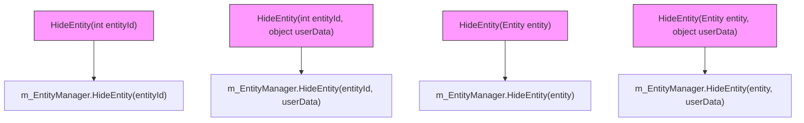
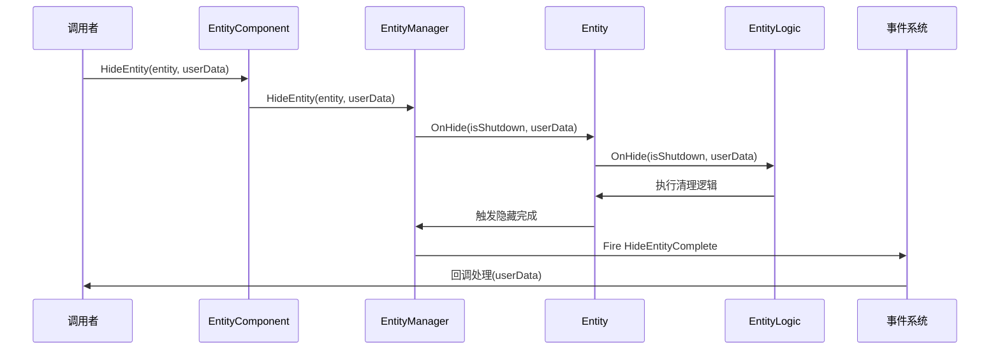
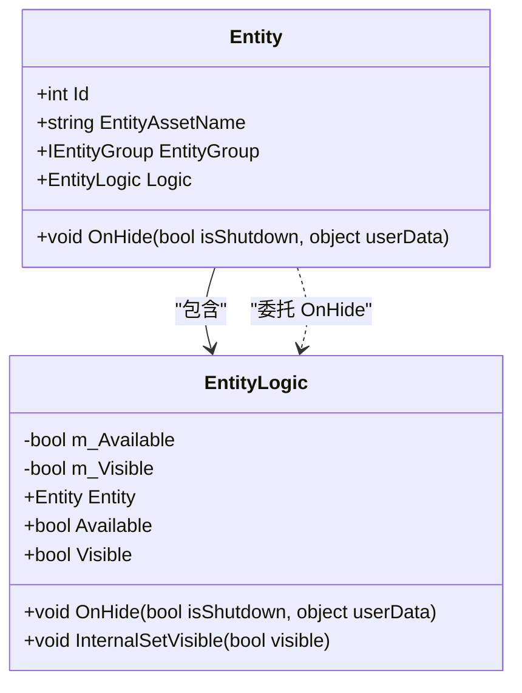
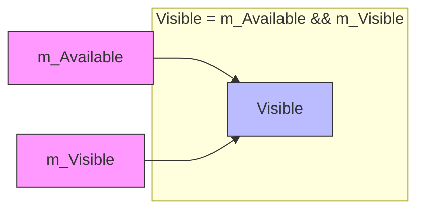

# 实体隐藏与回收

<cite>
**Referenced Files in This Document**   
- [Entity.cs](file://Scripts/Runtime/Entity/Entity.cs)
- [EntityLogic.cs](file://Scripts/Runtime/Entity/EntityLogic.cs)
- [EntityComponent.cs](file://Scripts/Runtime/Entity/EntityComponent.cs)
- [HideEntityCompleteEventArgs.cs](file://Scripts/Runtime/Entity/HideEntityCompleteEventArgs.cs)
</cite>

## 目录
1. [引言](#引言)
2. [核心组件](#核心组件)
3. [隐藏与回收机制详解](#隐藏与回收机制详解)
4. [状态管理机制](#状态管理机制)
5. [典型场景示例](#典型场景示例)
6. [对象池回收策略](#对象池回收策略)
7. [结论](#结论)

## 引言
本文档详细阐述了Unity游戏框架中实体隐藏与回收机制的实现原理。该机制是游戏资源管理的核心组成部分，通过对象池技术实现实体的高效复用，避免频繁的内存分配与垃圾回收。文档将深入分析`HideEntity`方法的多种重载形式、`Entity`与`EntityLogic`类的协作关系、状态管理机制以及对象池的回收策略。

## 核心组件

本文档涉及的核心组件包括实体管理器、实体基类和实体逻辑基类，它们共同构成了实体生命周期管理的基础架构。

**Section sources**
- [Entity.cs](file://Scripts/Runtime/Entity/Entity.cs#L1-L280)
- [EntityLogic.cs](file://Scripts/Runtime/Entity/EntityLogic.cs#L1-L202)
- [EntityComponent.cs](file://Scripts/Runtime/Entity/EntityComponent.cs#L1-L799)

## 隐藏与回收机制详解

### HideEntity方法重载

实体隐藏操作通过`EntityComponent`类提供了多种重载形式，支持通过实体ID或实体引用来触发隐藏。这些方法最终都委托给底层的实体管理器进行处理。



**Diagram sources**
- [EntityComponent.cs](file://Scripts/Runtime/Entity/EntityComponent.cs#L500-L532)

**Section sources**
- [EntityComponent.cs](file://Scripts/Runtime/Entity/EntityComponent.cs#L500-L532)

### 用户数据传递与回调

在调用`HideEntity`方法时，可以传递用户自定义数据（`userData`），这些数据将在整个隐藏流程中被保留，并最终传递给回调事件。这种机制允许调用者在隐藏操作完成后执行特定的业务逻辑。



**Diagram sources**
- [EntityComponent.cs](file://Scripts/Runtime/Entity/EntityComponent.cs#L529-L532)
- [Entity.cs](file://Scripts/Runtime/Entity/Entity.cs#L178-L188)
- [EntityLogic.cs](file://Scripts/Runtime/Entity/EntityLogic.cs#L136-L141)
- [HideEntityCompleteEventArgs.cs](file://Scripts/Runtime/Entity/HideEntityCompleteEventArgs.cs#L1-L108)

**Section sources**
- [EntityComponent.cs](file://Scripts/Runtime/Entity/EntityComponent.cs#L529-L532)
- [Entity.cs](file://Scripts/Runtime/Entity/Entity.cs#L178-L188)
- [EntityLogic.cs](file://Scripts/Runtime/Entity/EntityLogic.cs#L136-L141)
- [HideEntityCompleteEventArgs.cs](file://Scripts/Runtime/Entity/HideEntityCompleteEventArgs.cs#L1-L108)

### Entity与EntityLogic的协作

当实体被隐藏时，`Entity`类的`OnHide`方法会被调用，它会进一步调用其关联的`EntityLogic`实例的`OnHide`方法进行逻辑清理。这种分离设计实现了表现与逻辑的解耦。



**Diagram sources**
- [Entity.cs](file://Scripts/Runtime/Entity/Entity.cs#L178-L188)
- [EntityLogic.cs](file://Scripts/Runtime/Entity/EntityLogic.cs#L136-L141)

**Section sources**
- [Entity.cs](file://Scripts/Runtime/Entity/Entity.cs#L178-L188)
- [EntityLogic.cs](file://Scripts/Runtime/Entity/EntityLogic.cs#L136-L141)

## 状态管理机制

### m_Available与m_Visible状态

`EntityLogic`类通过两个关键状态变量来管理实体的可用性与可见性：

- `m_Available`：表示实体是否处于可用状态，即是否可以被正常操作
- `m_Visible`：表示实体的可见性状态

`Visible`属性的获取逻辑为`m_Available && m_Visible`，这意味着只有当实体可用且可见时，才被认为是真正可见的。



**Diagram sources**
- [EntityLogic.cs](file://Scripts/Runtime/Entity/EntityLogic.cs#L136-L141)

**Section sources**
- [EntityLogic.cs](file://Scripts/Runtime/Entity/EntityLogic.cs#L136-L141)

### InternalSetVisible方法

`InternalSetVisible`方法是控制实体GameObject激活状态的核心方法。它通过调用`gameObject.SetActive(visible)`来实现，是连接逻辑层与Unity引擎表现层的关键桥梁。

```mermaid
flowchart TD
A[Visible属性设置] --> B{m_Available?}
B --> |否| C[警告: 实体不可用]
B --> |是| D{状态改变?}
D --> |否| E[无操作]
D --> |是| F[调用InternalSetVisible]
F --> G[gameObject.SetActive(visible)]
style A fill:#f9f,stroke:#333
style G fill:#bbf,stroke:#333
```

**Diagram sources**
- [EntityLogic.cs](file://Scripts/Runtime/Entity/EntityLogic.cs#L136-L141)

**Section sources**
- [EntityLogic.cs](file://Scripts/Runtime/Entity/EntityLogic.cs#L136-L141)

## 典型场景示例

### 角色死亡后隐藏实体

以下是一个典型的应用场景：角色死亡后隐藏实体并触发资源清理流程。

```mermaid
sequenceDiagram
participant 角色系统
participant EntityComponent
partner Entity
partner EntityLogic
participant 对象池
角色系统->>EntityComponent : HideEntity(角色实体, 死亡数据)
EntityComponent->>Entity : OnHide(false, 死亡数据)
Entity->>EntityLogic : OnHide(false, 死亡数据)
EntityLogic->>EntityLogic : 恢复原始图层
EntityLogic->>EntityLogic : Visible = false
EntityLogic->>EntityLogic : m_Available = false
EntityLogic->>Entity : 隐藏完成
Entity->>EntityComponent : 触发隐藏完成事件
EntityComponent->>对象池 : 回收实体实例
Note over 对象池 : 实体进入对象池等待复用
```

**Diagram sources**
- [Entity.cs](file://Scripts/Runtime/Entity/Entity.cs#L178-L188)
- [EntityLogic.cs](file://Scripts/Runtime/Entity/EntityLogic.cs#L136-L141)
- [EntityComponent.cs](file://Scripts/Runtime/Entity/EntityComponent.cs#L1140-L1143)

**Section sources**
- [Entity.cs](file://Scripts/Runtime/Entity/Entity.cs#L178-L188)
- [EntityLogic.cs](file://Scripts/Runtime/Entity/EntityLogic.cs#L136-L141)
- [EntityComponent.cs](file://Scripts/Runtime/Entity/EntityComponent.cs#L1140-L1143)

## 对象池回收策略

实体隐藏操作与对象池回收策略紧密关联。在`EntityComponent`的初始化过程中，通过`AddEntityGroup`方法配置了对象池的各项参数：

- **自动释放间隔**（instanceAutoReleaseInterval）：对象池自动释放可释放对象的时间间隔
- **容量**（instanceCapacity）：对象池的最大容量
- **过期时间**（instanceExpireTime）：对象在池中可存活的最大时间
- **优先级**（instancePriority）：对象池的优先级

当实体被隐藏后，它会被返回到所属实体组的对象池中，等待后续的复用或根据上述策略被自动清理。

**Section sources**
- [EntityComponent.cs](file://Scripts/Runtime/Entity/EntityComponent.cs#L250-L280)

## 结论

实体隐藏与回收机制通过`HideEntity`方法的多种重载形式、用户数据传递、`Entity`与`EntityLogic`的协作、状态管理以及对象池策略的有机结合，实现了高效、灵活的实体生命周期管理。该机制不仅保证了资源的合理利用，还为上层业务逻辑提供了清晰的接口和回调机制，是游戏框架中不可或缺的核心功能。