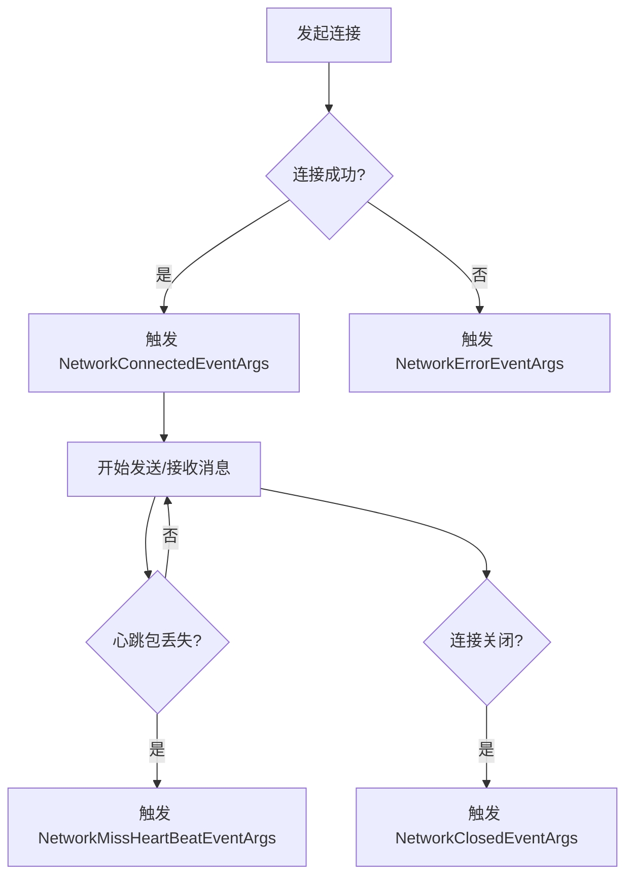

# 网络通信

<cite>
**本文档中引用的文件**  
- [NetworkComponent.cs](file://Scripts/Runtime/Network/NetworkComponent.cs)
- [NetworkConnectedEventArgs.cs](file://Scripts/Runtime/Network/NetworkConnectedEventArgs.cs)
- [NetworkErrorEventArgs.cs](file://Scripts/Runtime/Network/NetworkErrorEventArgs.cs)
- [NetworkMissHeartBeatEventArgs.cs](file://Scripts/Runtime/Network/NetworkMissHeartBeatEventArgs.cs)
- [NetworkClosedEventArgs.cs](file://Scripts/Runtime/Network/NetworkClosedEventArgs.cs)
</cite>

## 目录
1. [简介](#简介)
2. [核心组件](#核心组件)
3. [网络连接管理](#网络连接管理)
4. [事件监听机制](#事件监听机制)
5. [消息收发与心跳机制](#消息收发与心跳机制)
6. [典型使用示例](#典型使用示例)

## 简介
本模块旨在为Unity游戏框架提供稳定可靠的TCP长连接网络通信能力。通过`NetworkComponent`组件，开发者可以创建和管理一个或多个网络频道（`NetworkChannel`），实现与服务器的持续通信。该系统支持连接状态监听、消息收发、心跳检测等核心功能，适用于实时性要求高的游戏场景，如MMORPG、实时对战等。

## 核心组件

`NetworkComponent`是网络通信模块的核心，它作为`GameFrameworkComponent`的子类，负责与底层`INetworkManager`模块交互，提供高层API供游戏逻辑调用。其主要职责包括：
- 初始化并持有`INetworkManager`引用
- 注册底层网络事件的监听器
- 提供创建、获取、销毁网络频道的接口
- 将底层网络事件转发至事件系统

该组件在`Awake`阶段通过`GameFrameworkEntry.GetModule<INetworkManager>()`获取网络管理器实例，并在`Start`阶段获取事件系统组件，为事件分发做准备。

**Section sources**
- [NetworkComponent.cs](file://Scripts/Runtime/Network/NetworkComponent.cs#L17-L150)

## 网络连接管理

### 创建网络频道
通过`CreateNetworkChannel`方法可以创建一个新的网络频道。该方法需要三个参数：
- `name`: 网络频道的唯一名称，用于后续的查找和管理。
- `serviceType`: 网络服务类型，指定使用TCP或UDP等协议。
- `networkChannelHelper`: 网络频道辅助器，负责具体的消息编解码和数据处理。

创建成功后，可通过`GetNetworkChannel`或`GetAllNetworkChannels`方法获取已创建的频道实例。

### 连接与断开
创建频道后，调用其`Connect`方法（由`INetworkChannel`接口定义）即可发起TCP连接。连接成功后，系统会触发`NetworkConnectedEventArgs`事件。当需要断开连接时，可调用频道的`Close`方法。

**Section sources**
- [NetworkComponent.cs](file://Scripts/Runtime/Network/NetworkComponent.cs#L100-L114)

## 事件监听机制

网络通信模块采用事件驱动模型，通过`EventComponent`将底层网络状态变化通知给上层逻辑。以下是关键事件类型：

### 网络连接成功事件 (NetworkConnectedEventArgs)
当TCP连接成功建立时触发。事件包含：
- `NetworkChannel`: 触发事件的网络频道实例。
- `UserData`: 用户自定义数据，可用于关联连接上下文。

### 网络错误事件 (NetworkErrorEventArgs)
当发生网络错误时触发。事件包含：
- `NetworkChannel`: 出错的网络频道。
- `ErrorCode`: 错误码，标识错误类型（如连接超时、Socket错误等）。
- `ErrorMessage`: 错误信息字符串。

### 网络连接关闭事件 (NetworkClosedEventArgs)
当网络连接被关闭时触发。事件包含：
- `NetworkChannel`: 被关闭的网络频道。

### 心跳包丢失事件 (NetworkMissHeartBeatEventArgs)
当连续丢失心跳包达到阈值时触发。事件包含：
- `NetworkChannel`: 心跳丢失的网络频道。
- `MissCount`: 已丢失的心跳包次数。



**Diagram sources**
- [NetworkComponent.cs](file://Scripts/Runtime/Network/NetworkComponent.cs#L120-L150)
- [NetworkConnectedEventArgs.cs](file://Scripts/Runtime/Network/NetworkConnectedEventArgs.cs#L16-L82)
- [NetworkErrorEventArgs.cs](file://Scripts/Runtime/Network/NetworkErrorEventArgs.cs#L17-L105)
- [NetworkMissHeartBeatEventArgs.cs](file://Scripts/Runtime/Network/NetworkMissHeartBeatEventArgs.cs#L16-L82)
- [NetworkClosedEventArgs.cs](file://Scripts/Runtime/Network/NetworkClosedEventArgs.cs#L16-L70)

## 消息收发与心跳机制

### 消息发送
通过`INetworkChannel.Send`方法可以向服务器发送消息。消息通常需要经过`INetworkChannelHelper`进行序列化和封包。

### 消息接收
接收到的消息会由`INetworkChannelHelper`进行解包和反序列化，然后通过事件系统或回调函数传递给上层逻辑。

### 心跳机制
系统内置心跳检测机制，定期向服务器发送心跳包。若在指定时间内未收到服务器响应，则`MissHeartBeatCount`计数器递增。当计数器达到预设阈值时，会触发`NetworkMissHeartBeatEventArgs`事件，通常此时应主动断开连接并尝试重连。

**Section sources**
- [NetworkComponentInspector.cs](file://Scripts/Editor/Inspector/NetworkComponentInspector.cs#L48-L60)
- [NetworkComponent.cs](file://Scripts/Runtime/Network/NetworkComponent.cs#L130-L140)

## 典型使用示例

以下是一个连接游戏服务器并接收广播消息的完整流程：

1.  **获取NetworkComponent实例**:
    ```csharp
    NetworkComponent networkComponent = GameEntry.GetComponent<NetworkComponent>();
    ```

2.  **创建网络频道**:
    ```csharp
    INetworkChannel gameChannel = networkComponent.CreateNetworkChannel("GameServer", ServiceType.Tcp, new CustomNetworkHelper());
    ```

3.  **订阅连接成功事件**:
    ```csharp
    EventComponent eventComponent = GameEntry.GetComponent<EventComponent>();
    eventComponent.Subscribe(NetworkConnectedEventArgs.EventId, OnConnected);
    ```

4.  **发起连接**:
    ```csharp
    gameChannel.Connect("192.168.1.100", 8888);
    ```

5.  **处理连接成功**:
    ```csharp
    private void OnConnected(object sender, GameEventArgs e)
    {
        NetworkConnectedEventArgs ne = (NetworkConnectedEventArgs)e;
        if (ne.NetworkChannel.Name == "GameServer")
        {
            // 发送登录消息
            LoginMsg loginMsg = new LoginMsg { Username = "player1", Password = "123" };
            ne.NetworkChannel.Send(loginMsg);
        }
    }
    ```

6.  **订阅消息接收事件**:
    在`CustomNetworkHelper`的`OnPacketReceived`回调中处理服务器广播消息。

7.  **处理心跳丢失**:
    订阅`NetworkMissHeartBeatEventArgs.EventId`事件，在回调中执行重连逻辑。

8.  **断开连接**:
    当游戏退出或切换场景时，调用`networkComponent.DestroyNetworkChannel("GameServer")`清理资源。

**Section sources**
- [NetworkComponent.cs](file://Scripts/Runtime/Network/NetworkComponent.cs#L100-L150)
- [NetworkConnectedEventArgs.cs](file://Scripts/Runtime/Network/NetworkConnectedEventArgs.cs#L16-L82)