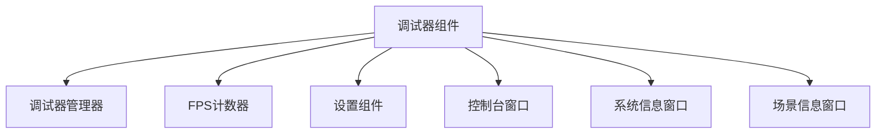
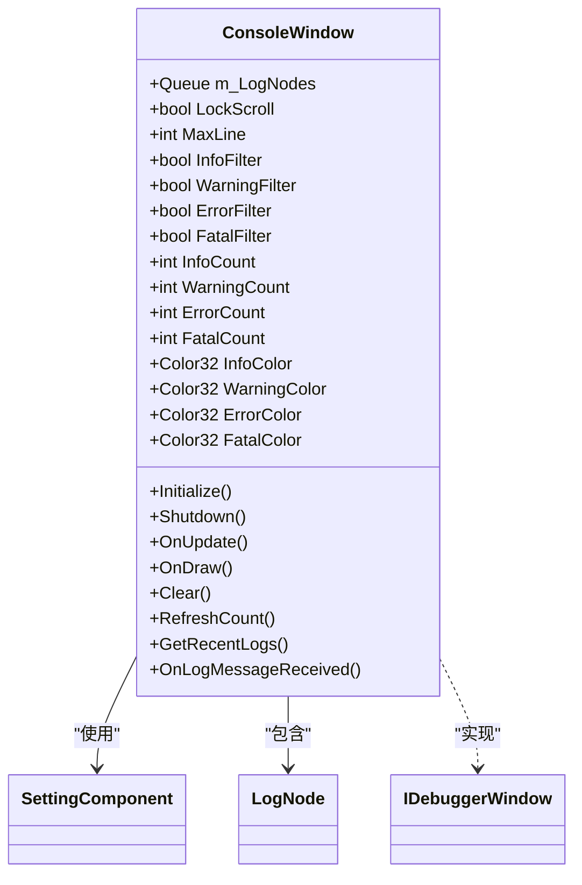
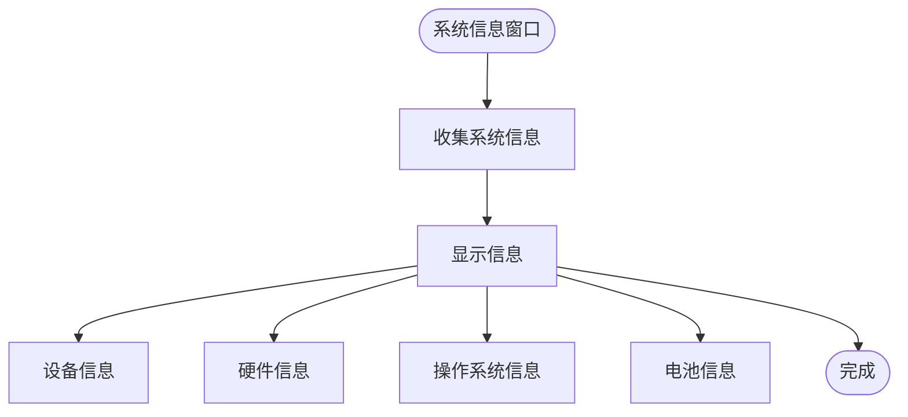
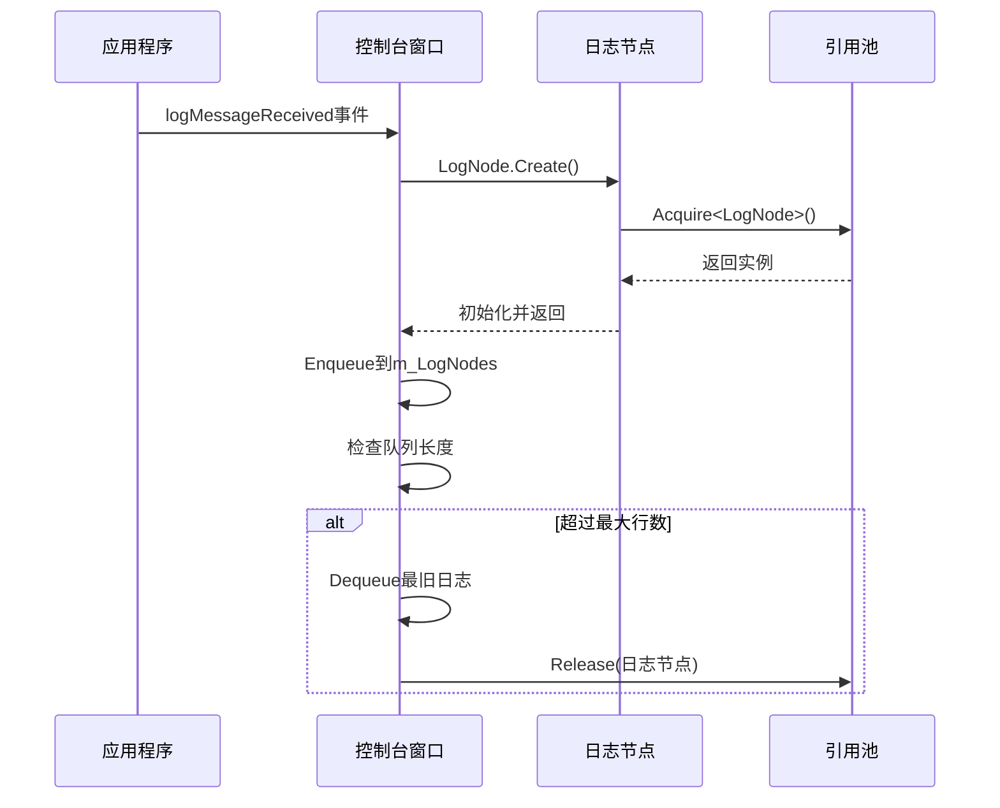

# 调试器

<cite>
**本文档中引用的文件**   
- [DebuggerComponent.cs](file://Scripts/Runtime/Debugger/DebuggerComponent.cs)
- [DebuggerComponent.ConsoleWindow.cs](file://Scripts/Runtime/Debugger/DebuggerComponent.ConsoleWindow.cs)
- [DebuggerComponent.LogNode.cs](file://Scripts/Runtime/Debugger/DebuggerComponent.LogNode.cs)
- [DebuggerComponent.SceneInformationWindow.cs](file://Scripts/Runtime/Debugger/DebuggerComponent.SceneInformationWindow.cs)
- [DebuggerComponent.SystemInformationWindow.cs](file://Scripts/Runtime/Debugger/DebuggerComponent.SystemInformationWindow.cs)
- [SettingComponent.cs](file://Scripts/Runtime/Setting/SettingComponent.cs)
</cite>

## 目录
1. [简介](#简介)
2. [调试器组件概述](#调试器组件概述)
3. [核心调试窗口](#核心调试窗口)
4. [日志节点机制](#日志节点机制)
5. [配置持久化](#配置持久化)
6. [集成示例](#集成示例)

## 简介
调试器组件为游戏运行时提供了一个强大的调试窗口系统，用于实时监控游戏状态、性能指标和系统信息。该系统包含多个内置的调试窗口，如日志查看、场景信息、系统信息等，并支持通过设置组件持久化用户配置。本文档详细说明了调试器的工作原理、核心功能和使用方法。

## 调试器组件概述

调试器组件（`DebuggerComponent`）是整个调试系统的核心，负责管理调试窗口的生命周期、用户界面渲染和系统集成。它通过`IDebuggerManager`模块实现功能，并在`Awake`方法中进行初始化。

调试器支持三种激活模式：
- **始终开启**：调试窗口始终可用
- **仅开发版本开启**：仅在`Debug.isDebugBuild`为真时开启
- **仅编辑器开启**：仅在`Application.isEditor`为真时开启

调试器提供两种显示模式：
- **漂浮框模式**：显示一个小型的漂浮图标，显示FPS和日志状态
- **完整窗口模式**：显示完整的调试界面，包含所有注册的调试窗口



**图源**
- [DebuggerComponent.cs](file://Scripts/Runtime/Debugger/DebuggerComponent.cs#L1-L428)

**本节来源**
- [DebuggerComponent.cs](file://Scripts/Runtime/Debugger/DebuggerComponent.cs#L1-L428)

## 核心调试窗口

### 控制台窗口

控制台窗口（`ConsoleWindow`）是调试器的核心组件之一，负责收集、过滤和显示运行时日志。它实现了`IDebuggerWindow`接口，并通过`Application.logMessageReceived`事件监听所有日志消息。

主要功能特性：
- **日志收集**：使用`Queue<LogNode>`存储日志节点，支持最大行数限制
- **日志过滤**：支持按信息、警告、错误、致命四种类型进行过滤
- **颜色编码**：不同类型的日志使用不同的颜色显示
- **堆栈跟踪**：点击日志条目可查看完整的堆栈跟踪信息
- **复制功能**：支持将日志和堆栈信息复制到剪贴板

控制台窗口的配置（如滚动锁定、过滤器状态）通过`SettingComponent`进行持久化存储。



**图源**
- [DebuggerComponent.ConsoleWindow.cs](file://Scripts/Runtime/Debugger/DebuggerComponent.ConsoleWindow.cs#L15-L517)

**本节来源**
- [DebuggerComponent.ConsoleWindow.cs](file://Scripts/Runtime/Debugger/DebuggerComponent.ConsoleWindow.cs#L15-L517)

### 系统信息窗口

系统信息窗口（`SystemInformationWindow`）显示设备的系统级信息，帮助开发者了解运行环境。它继承自`ScrollableDebuggerWindowBase`，提供可滚动的界面。

显示的信息包括：
- 设备唯一标识符
- 设备名称和型号
- 处理器类型和核心数
- 系统内存大小
- 操作系统信息
- 电池状态（如果可用）
- 硬件支持情况（位置服务、加速度计等）



**图源**
- [DebuggerComponent.SystemInformationWindow.cs](file://Scripts/Runtime/Debugger/DebuggerComponent.SystemInformationWindow.cs#L1-L62)

**本节来源**
- [DebuggerComponent.SystemInformationWindow.cs](file://Scripts/Runtime/Debugger/DebuggerComponent.SystemInformationWindow.cs#L1-L62)

### 场景信息窗口

场景信息窗口（`SceneInformationWindow`）提供当前场景的详细信息，对于场景管理和调试非常有用。

显示的信息包括：
- 场景总数
- 构建设置中的场景数量
- 活动场景名称和路径
- 构建索引
- 场景状态（是否脏、是否加载、是否有效）
- 根对象数量

**本节来源**
- [DebuggerComponent.SceneInformationWindow.cs](file://Scripts/Runtime/Debugger/DebuggerComponent.SceneInformationWindow.cs#L1-L38)

## 日志节点机制

日志节点（`LogNode`）是调试器中用于存储日志信息的基本数据结构。它实现了`IReference`接口，与引用池系统集成，以提高内存使用效率。

### 数据结构

`LogNode`包含以下关键属性：
- `LogTime`：日志记录的时间
- `LogFrameCount`：日志记录时的帧计数
- `LogType`：日志类型（信息、警告、错误、异常）
- `LogMessage`：日志内容
- `StackTrack`：堆栈跟踪信息

### 生命周期管理

日志节点使用引用池模式进行管理：
- **创建**：通过静态`Create`方法从引用池获取实例
- **初始化**：设置日志时间、帧计数、类型和内容
- **释放**：使用完毕后通过`ReferencePool.Release`方法返回引用池



**图源**
- [DebuggerComponent.LogNode.cs](file://Scripts/Runtime/Debugger/DebuggerComponent.LogNode.cs#L18-L122)

**本节来源**
- [DebuggerComponent.LogNode.cs](file://Scripts/Runtime/Debugger/DebuggerComponent.LogNode.cs#L18-L122)

## 配置持久化

调试器的配置通过`SettingComponent`进行持久化存储，确保用户设置在游戏重启后仍然有效。

### 设置组件集成

`ConsoleWindow`在`Initialize`方法中获取`SettingComponent`实例，并从持久化存储中读取配置：

```csharp
m_SettingComponent = GameEntry.GetComponent<SettingComponent>();
m_LockScroll = m_SettingComponent.GetBool("Debugger.Console.LockScroll", true);
m_InfoFilter = m_SettingComponent.GetBool("Debugger.Console.InfoFilter", true);
// ... 其他配置
```

### 配置同步

在`OnUpdate`方法中，当用户更改设置时，会立即同步到`SettingComponent`：

```csharp
public void OnUpdate(float elapseSeconds, float realElapseSeconds)
{
    if (m_LastLockScroll != m_LockScroll)
    {
        m_LastLockScroll = m_LockScroll;
        m_SettingComponent.SetBool("Debugger.Console.LockScroll", m_LockScroll);
    }
    // ... 其他配置同步
}
```

### 配置键命名

调试器使用层次化的配置键命名：
- `Debugger.Console.LockScroll`：控制台滚动锁定
- `Debugger.Console.InfoFilter`：信息日志过滤器
- `Debugger.Console.WarningFilter`：警告日志过滤器
- `Debugger.Console.ErrorFilter`：错误日志过滤器
- `Debugger.Console.FatalFilter`：致命日志过滤器

**本节来源**
- [DebuggerComponent.ConsoleWindow.cs](file://Scripts/Runtime/Debugger/DebuggerComponent.ConsoleWindow.cs#L15-L517)
- [SettingComponent.cs](file://Scripts/Runtime/Setting/SettingComponent.cs#L18-L321)

## 集成示例

以下是一个典型的调试器集成示例，展示如何在游戏中通过快捷键（如F1）开启/关闭调试窗口，并实时查看内存和帧率信息。

### 基础集成

1. **添加调试器组件**：在主游戏对象上添加`DebuggerComponent`
2. **配置激活模式**：在Inspector中设置`Active Window`为所需的模式
3. **自定义皮肤**：可选地为调试器界面指定自定义的`GUISkin`

### 快捷键控制

可以通过添加一个简单的脚本来实现F1快捷键控制：

```csharp
void Update()
{
    if (Input.GetKeyDown(KeyCode.F1))
    {
        DebuggerComponent debugger = GameEntry.GetComponent<DebuggerComponent>();
        if (debugger != null)
        {
            debugger.ShowFullWindow = !debugger.ShowFullWindow;
        }
    }
}
```

### 实时性能监控

调试器的漂浮框会实时显示FPS信息，颜色根据日志级别变化：
- **白色**：无日志或只有信息日志
- **黄色**：有警告日志
- **红色**：有错误日志
- **深红色**：有致命错误日志

点击漂浮框即可打开完整的调试窗口，查看内存使用情况、帧率统计等详细信息。

### 扩展自定义窗口

可以注册自定义的调试窗口来显示特定的游戏数据：

```csharp
public class CustomDebugWindow : IDebuggerWindow
{
    public void Initialize(params object[] args) { }
    public void Shutdown() { }
    public void OnEnter() { }
    public void OnLeave() { }
    public void OnUpdate(float elapseSeconds, float realElapseSeconds) { }
    public void OnDraw()
    {
        GUILayout.Label("<b>自定义调试信息</b>");
        GUILayout.BeginVertical("box");
        // 显示自定义数据
        DrawItem("玩家分数", playerScore.ToString());
        DrawItem("游戏状态", gameState.ToString());
        GUILayout.EndVertical();
    }
}

// 注册自定义窗口
debuggerComponent.RegisterDebuggerWindow("Game/Custom", new CustomDebugWindow());
```

**本节来源**
- [DebuggerComponent.cs](file://Scripts/Runtime/Debugger/DebuggerComponent.cs#L1-L428)
- [DebuggerComponent.ConsoleWindow.cs](file://Scripts/Runtime/Debugger/DebuggerComponent.ConsoleWindow.cs#L15-L517)