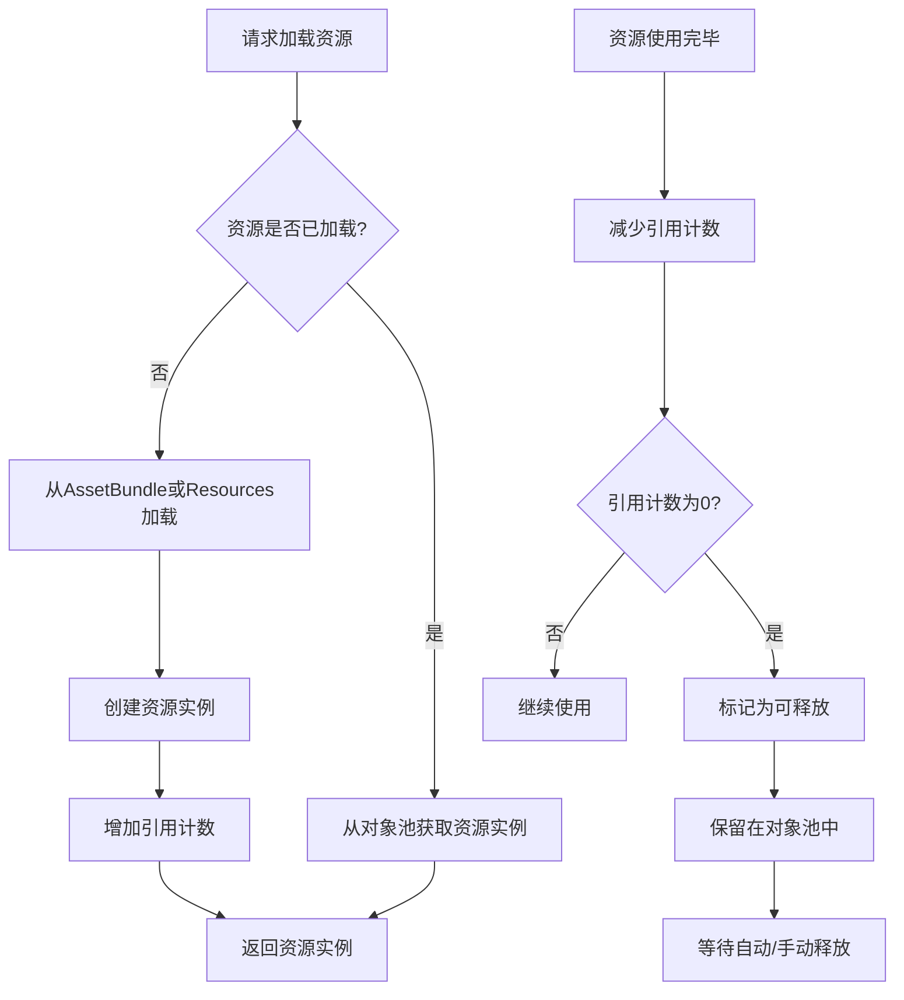

<cite>
**Referenced Files in This Document**   
- [ResourceComponent.cs](file://Scripts/Runtime/Resource/ResourceComponent.cs)
- [DefaultResourceHelper.cs](file://Scripts/Runtime/Resource/DefaultResourceHelper.cs)
- [ObjectPoolComponent.cs](file://Scripts/Runtime/ObjectPool/ObjectPoolComponent.cs)
</cite>

## 目录
1. [内存管理](#内存管理)
2. [资源对象池工作机制](#资源对象池工作机制)
3. [关键参数对资源生命周期的控制](#关键参数对资源生命周期的控制)
4. [资源释放方式](#资源释放方式)
5. [资源释放方法对比](#资源释放方法对比)
6. [内存敏感场景最佳实践](#内存敏感场景最佳实践)

## 内存管理

本专项文档旨在深入解析UnityGameFramework中的内存管理策略，重点阐述资源对象池（Asset/Resource Pool）的工作机制。文档将详细说明`AssetAutoReleaseInterval`、`AssetCapacity`、`AssetExpireTime`等核心参数如何协同控制资源的生命周期，并对比分析`UnloadUnusedAssets`、`ForceUnloadUnusedAssets`和`PreorderUnloadUnusedAssets`三种资源释放方式的触发条件与性能影响。同时，结合`DefaultResourceHelper`的`Release`方法，阐明`AssetBundle.Unload(true)`与`Resources.UnloadAsset`的区别及适用场景。最后，提供在场景切换等内存敏感场景下的最佳实践方案。

**Section sources**
- [ResourceComponent.cs](file://Scripts/Runtime/Resource/ResourceComponent.cs#L20-L1365)
- [DefaultResourceHelper.cs](file://Scripts/Runtime/Resource/DefaultResourceHelper.cs#L21-L181)
- [ObjectPoolComponent.cs](file://Scripts/Runtime/ObjectPool/ObjectPoolComponent.cs#L18-L1031)

## 资源对象池工作机制

资源对象池是UnityGameFramework中用于高效管理资源（如AssetBundle、场景、预制件等）的核心组件。其主要目标是通过复用已加载的资源实例，避免频繁的加载和卸载操作，从而减少内存碎片和CPU开销，提升运行时性能。

该机制主要由`ResourceComponent`和`ObjectPoolComponent`协同工作。`ResourceComponent`负责资源的加载、引用计数和生命周期管理，而`ObjectPoolComponent`则提供底层的对象池管理能力。当一个资源被加载后，它会被放入一个由`ResourceComponent`管理的资源对象池中。后续对该资源的请求，如果资源仍在池中且未过期，将直接从池中获取，避免了重复加载。当资源的引用计数降为零时，它不会被立即销毁，而是被标记为“可释放”状态并保留在池中，等待后续的自动或手动释放。



**Diagram sources **
- [ResourceComponent.cs](file://Scripts/Runtime/Resource/ResourceComponent.cs#L20-L1365)
- [ObjectPoolComponent.cs](file://Scripts/Runtime/ObjectPool/ObjectPoolComponent.cs#L18-L1031)

**Section sources**
- [ResourceComponent.cs](file://Scripts/Runtime/Resource/ResourceComponent.cs#L20-L1365)
- [ObjectPoolComponent.cs](file://Scripts/Runtime/ObjectPool/ObjectPoolComponent.cs#L18-L1031)

## 关键参数对资源生命周期的控制

`ResourceComponent`通过一系列可配置的参数来精细化控制资源对象池的行为，这些参数直接决定了资源在内存中的驻留时间和复用效率。

- **`AssetAutoReleaseInterval` (资源对象池自动释放间隔)**: 该参数定义了对象池自动检查并释放可释放资源的间隔时间（秒）。它是一个周期性任务，由`ResourceComponent`的`Update`方法驱动。当达到设定的间隔时间时，系统会触发一次资源清理。此参数的设置需要权衡内存占用和CPU性能，过短的间隔会增加CPU负担，过长的间隔则可能导致内存无法及时释放。
- **`AssetCapacity` (资源对象池容量)**: 此参数设定了对象池中可容纳的资源实例的最大数量。一旦池中资源数量达到此上限，当有新的资源需要被放入池中时，最旧的或最不常用的资源实例将被强制移除，以腾出空间。这有助于防止内存无限增长。
- **`AssetExpireTime` (资源对象池对象过期时间)**: 该参数规定了资源实例在引用计数归零后，可以在对象池中保留的最长时间（秒）。超过此时间后，即使该资源未被再次请求，它也会被视为过期并被自动释放。这个机制确保了长时间未使用的资源最终会被清理，避免了内存泄漏。

这些参数共同作用，形成了一个动态的资源管理策略：资源在被使用后，会根据`AssetExpireTime`在池中保留一段时间以备复用；池的大小由`AssetCapacity`限制，防止内存溢出；而`AssetAutoReleaseInterval`则像一个定时器，周期性地执行清理任务，将过期或超出容量的资源从内存中移除。

**Section sources**
- [ResourceComponent.cs](file://Scripts/Runtime/Resource/ResourceComponent.cs#L20-L1365)

## 资源释放方式

`ResourceComponent`提供了三种不同的方式来触发未使用资源的释放，它们在触发时机和强制性上有所不同。

- **`UnloadUnusedAssets` (预订释放)**: 此方法通过设置`m_PreorderUnloadUnusedAssets`标志位为`true`来“预订”一次资源释放操作。真正的释放操作并不会立即执行，而是等待`Update`方法中检查到`m_PreorderUnloadUnusedAssets`为`true`且自上次操作以来的时间超过了`UnloadUnusedAssetsInterval`（无用资源释放间隔时间）后，才会调用`Resources.UnloadUnusedAssets()`。这种方式允许开发者在合适的时机（如一帧的末尾）发起释放请求，但具体的执行时间由系统控制，有助于平滑性能。
- **`ForceUnloadUnusedAssets` (强制释放)**: 此方法通过设置`m_ForceUnloadUnusedAssets`标志位为`true`来“强制”立即执行资源释放。与预订释放不同，它不受`UnloadUnusedAssetsInterval`的限制。只要`Update`方法检测到`m_ForceUnloadUnusedAssets`为`true`，就会立刻触发`Resources.UnloadUnusedAssets()`。这种方式适用于需要立即回收内存的紧急情况，但可能会导致明显的性能卡顿。
- **`PreorderUnloadUnusedAssets`**: 这是一个内部状态标志，而非公开方法。它由`UnloadUnusedAssets`方法设置，用于标记系统需要在下一个合适的时机执行释放操作。

```mermaid
flowchart TD
A[调用 UnloadUnusedAssets] --> B[设置 m_PreorderUnloadUnusedAssets = true]
B --> C[等待 Update 循环]
C --> D{m_AsyncOperation == null?}
D --> |是| E{m_PreorderUnloadUnusedAssets && 超时?}
E --> |是| F[执行 Resources.UnloadUnusedAssets]
F --> G[设置 m_AsyncOperation]
D --> |否| H[等待异步操作完成]
H --> I{m_AsyncOperation.isDone?}
I --> |是| J[执行 GC.Collect (可选)]
J --> K[重置标志位]
A2[调用 ForceUnloadUnusedAssets] --> B2[设置 m_ForceUnloadUnusedAssets = true]
B2 --> C2[等待 Update 循环]
C2 --> D2{m_AsyncOperation == null?}
D2 --> |是| E2{m_ForceUnloadUnusedAssets?}
E2 --> |是| F[执行 Resources.UnloadUnusedAssets]
```

**Diagram sources **
- [ResourceComponent.cs](file://Scripts/Runtime/Resource/ResourceComponent.cs#L657-L679)
- [ResourceComponent.cs](file://Scripts/Runtime/Resource/ResourceComponent.cs#L746-L753)
- [ResourceComponent.cs](file://Scripts/Runtime/Resource/ResourceComponent.cs#L759-L766)

**Section sources**
- [ResourceComponent.cs](file://Scripts/Runtime/Resource/ResourceComponent.cs#L657-L679)
- [ResourceComponent.cs](file://Scripts/Runtime/Resource/ResourceComponent.cs#L746-L753)
- [ResourceComponent.cs](file://Scripts/Runtime/Resource/ResourceComponent.cs#L759-L766)

## 资源释放方法对比

`DefaultResourceHelper`的`Release`方法是资源管理的另一个关键环节，它直接处理特定资源的卸载。

- **`AssetBundle.Unload(true)`**: 当`Release`方法接收到一个`AssetBundle`对象时，它会调用`assetBundle.Unload(true)`。参数`true`表示在卸载AssetBundle的同时，也卸载所有由该AssetBundle加载并实例化的资源（如纹理、网格等）。这是一种彻底的卸载方式，会立即释放大量内存，但代价是如果后续需要再次使用这些资源，必须重新加载整个AssetBundle。
- **`Resources.UnloadAsset`**: 在代码注释中被禁用。注释指出，`Resources.UnloadAsset`在iOS设备上存在一些“诡异问题”，因此被暂时弃用。理论上，`Resources.UnloadAsset`用于卸载通过`Resources.Load`加载的单个资源。然而，它有一些限制：不能用于卸载GameObject或Component，且其行为在不同平台和Unity版本上可能不一致。相比之下，`AssetBundle.Unload(true)`提供了更可控和一致的卸载行为。

因此，在当前框架中，推荐使用AssetBundle系统来管理需要动态加载和卸载的资源，并通过`AssetBundle.Unload(true)`来确保资源被完全清理。

**Section sources**
- [DefaultResourceHelper.cs](file://Scripts/Runtime/Resource/DefaultResourceHelper.cs#L73-L104)

## 内存敏感场景最佳实践

在场景切换等内存敏感场景下，合理的资源管理策略至关重要。以下是一个推荐的最佳实践流程：

1.  **场景卸载前预处理**: 在即将切换场景前，调用`ResourceComponent.UnloadUnusedAssets(true)`。这会预订一次资源释放，并选择在释放后执行垃圾回收（GC.Collect），为新场景的加载腾出尽可能多的内存。
2.  **合理配置对象池参数**: 根据游戏的具体需求调整对象池参数。例如，对于频繁切换的UI资源，可以设置较短的`AssetExpireTime`（如30秒）和较小的`AssetCapacity`，以快速回收内存。对于大型、不常变的资源，可以适当增加`AssetCapacity`以提高复用率。
3.  **主动释放特定资源**: 对于已知在新场景中不再需要的大型资源（如上一个场景的背景音乐、特效），应主动调用`ResourceComponent.UnloadAsset(asset)`来立即卸载，而不是依赖自动清理。
4.  **场景加载后优化**: 新场景加载完成后，可以调用`ObjectPoolComponent.ReleaseAllUnused()`来强制释放所有对象池中当前未被使用的对象，进一步优化内存占用。

通过结合预订释放、参数调优和主动释放，可以在保证性能的同时，有效控制内存峰值，提升游戏的稳定性和用户体验。

**Section sources**
- [ResourceComponent.cs](file://Scripts/Runtime/Resource/ResourceComponent.cs#L746-L753)
- [ResourceComponent.cs](file://Scripts/Runtime/Resource/ResourceComponent.cs#L759-L766)
- [ObjectPoolComponent.cs](file://Scripts/Runtime/ObjectPool/ObjectPoolComponent.cs#L1026-L1030)