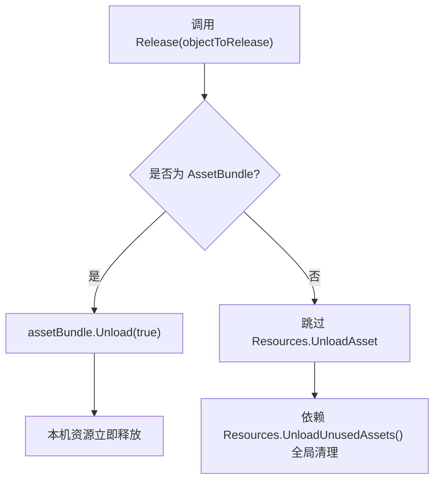
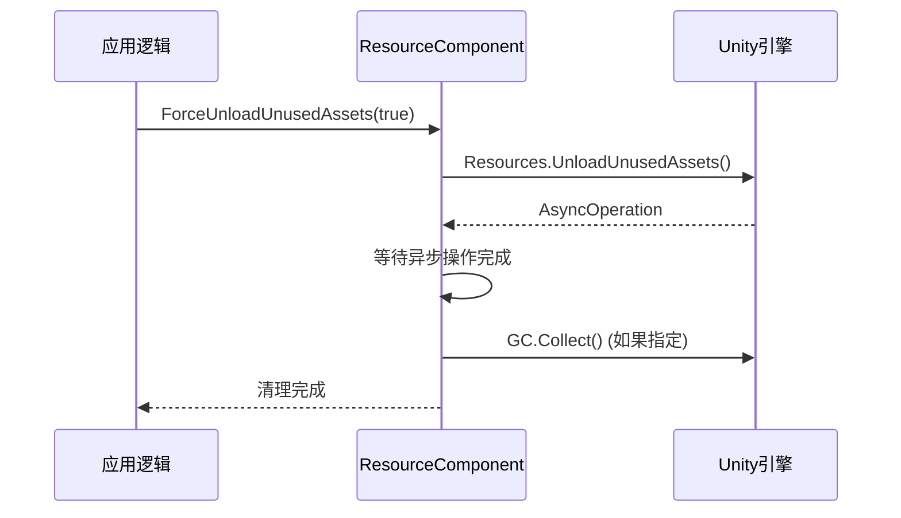

# 平台特定内存处理

<cite>
**本文档引用的文件**  
- [DefaultResourceHelper.cs](file://Scripts/Runtime/Resource/DefaultResourceHelper.cs)
- [ResourceComponent.cs](file://Scripts/Runtime/Resource/ResourceComponent.cs)
- [ResourceHelperBase.cs](file://Scripts/Runtime/Resource/ResourceHelperBase.cs)
</cite>

## 目录
1. [简介](#简介)
2. [核心内存处理机制](#核心内存处理机制)
3. [iOS平台上的Resources.UnloadAsset禁用原因](#ios平台上的resourcesunloadasset禁用原因)
4. [潜在风险与底层机制分析](#潜在风险与底层机制分析)
5. [替代资源管理方案](#替代资源管理方案)
6. [移动设备上的本机资源释放策略](#移动设备上的本机资源释放策略)
7. [结论与建议](#结论与建议)

## 简介
本文档详细分析UnityGameFramework中`DefaultResourceHelper`类在不同Unity版本和平台下的内存处理差异，重点探讨iOS平台上禁用`Resources.UnloadAsset`的原因及其潜在风险。通过分析源码中的注释和实现逻辑，揭示“诡异问题”可能涉及的底层机制，如引用计数异常或纹理内存未释放，并提供替代方案建议。

## 核心内存处理机制

`DefaultResourceHelper`继承自`ResourceHelperBase`，实现了资源加载、卸载和释放的核心逻辑。其`Release`方法负责释放指定资源对象，针对`AssetBundle`类型资源调用`assetBundle.Unload(true)`以确保本机资源被彻底释放。

对于非AssetBundle资源，原计划使用`Resources.UnloadAsset`进行释放，但在iOS平台上被注释禁用，原因在于Unity在该平台上的实现存在已知问题。

**Section sources**
- [DefaultResourceHelper.cs](file://Scripts/Runtime/Resource/DefaultResourceHelper.cs#L69-L108)

## iOS平台上的Resources.UnloadAsset禁用原因

在`DefaultResourceHelper.cs`的`Release`方法中，明确注释指出：“Unity 当前 Resources.UnloadAsset 在 iOS 设备上会导致一些诡异问题，先不用这部分”。这表明开发者在实践中发现，直接调用`Resources.UnloadAsset`在iOS设备上可能导致不可预测的行为。

禁用的具体代码段包括对`SceneAsset`和普通Unity对象（非GameObject或MonoBehaviour）的释放逻辑。该决策是基于实际测试和线上反馈做出的规避措施，以确保应用在iOS设备上的稳定性和内存安全性。

**Section sources**
- [DefaultResourceHelper.cs](file://Scripts/Runtime/Resource/DefaultResourceHelper.cs#L75-L105)

## 潜在风险与底层机制分析

### 可能的“诡异问题”

1. **引用计数异常**：Unity的资源管理系统依赖引用计数来决定何时真正释放资源。在iOS平台上，`Resources.UnloadAsset`可能未能正确递减内部引用计数，导致资源虽被标记为“卸载”，但其内存（尤其是纹理等本机资源）仍被保留，造成内存泄漏。

2. **纹理内存未释放**：即使托管对象被卸载，与其关联的本机GPU内存（如纹理数据）可能未被同步释放。这在内存受限的移动设备上尤为危险，可能导致`OutOfMemory`崩溃。

3. **资源状态不一致**：调用`UnloadAsset`后，资源可能处于一种中间状态，既不能被正常使用，也无法被垃圾回收器回收，形成“僵尸”资源。

4. **与AssetBundle加载的交互问题**：当Resources和AssetBundle混合使用时，`UnloadAsset`可能干扰AssetBundle的依赖管理，导致资源加载失败或重复加载。

### 相关系统调用

`ResourceComponent`中通过`Resources.UnloadUnusedAssets()`异步释放未使用的资源，这是一种更安全的全局清理方式，而非针对单个资源调用`UnloadAsset`。

**Diagram sources**
- [DefaultResourceHelper.cs](file://Scripts/Runtime/Resource/DefaultResourceHelper.cs#L80-L85)
- [ResourceComponent.cs](file://Scripts/Runtime/Resource/ResourceComponent.cs#L666)

**Section sources**
- [DefaultResourceHelper.cs](file://Scripts/Runtime/Resource/DefaultResourceHelper.cs#L69-L108)
- [ResourceComponent.cs](file://Scripts/Runtime/Resource/ResourceComponent.cs#L660-L666)

## 替代资源管理方案

鉴于`Resources.UnloadAsset`在iOS上的风险，推荐采用以下替代方案：

### 完全依赖AssetBundle管理资源

- **优势**：AssetBundle提供更精细的生命周期控制，`AssetBundle.Unload(true)`能可靠地释放所有相关资源，包括本机内存。
- **实现**：将所有需要动态加载/卸载的资源打包成AssetBundle，通过`ResourceComponent`的`LoadAsset`和`UnloadAsset`方法进行管理。

### 使用Addressables系统

- **优势**：Addressables是Unity官方推荐的现代化资源管理系统，提供更高级的依赖管理、缓存策略和内存控制。
- **迁移路径**：逐步将现有`ResourceComponent`的调用替换为Addressables API，利用其`Addressables.Release`方法安全释放资源。

## 移动设备上的本机资源释放策略

### 强制释放AssetBundle

在移动设备上，必须使用`AssetBundle.Unload(true)`而非`AssetBundle.Unload(false)`：
- `Unload(true)`：立即释放AssetBundle及其所有加载的资源。
- `Unload(false)`：仅释放AssetBundle本身，加载的资源保留在内存中，等待`Resources.UnloadUnusedAssets()`清理，这在iOS上不可靠。

### 主动触发全局清理

通过`ResourceComponent`提供的接口，主动触发未使用资源的清理：
- `ForceUnloadUnusedAssets(bool performGCCollect)`：立即执行`Resources.UnloadUnusedAssets()`。
- `UnloadUnusedAssets(bool performGCCollect)`：预订在间隔时间后执行清理。

**Diagram sources**
- [ResourceComponent.cs](file://Scripts/Runtime/Resource/ResourceComponent.cs#L759-L766)
- [ResourceComponent.cs](file://Scripts/Runtime/Resource/ResourceComponent.cs#L666)

**Section sources**
- [ResourceComponent.cs](file://Scripts/Runtime/Resource/ResourceComponent.cs#L746-L766)
- [ResourceComponent.cs](file://Scripts/Runtime/Resource/ResourceComponent.cs#L660-L666)

## 结论与建议

`DefaultResourceHelper`中禁用`Resources.UnloadAsset`是针对iOS平台特定缺陷的必要规避措施。开发者应避免直接使用该API，转而采用AssetBundle或Addressables等更可靠的资源管理方案。

在移动设备上，必须通过`AssetBundle.Unload(true)`强制释放本机资源，并结合`ForceUnloadUnusedAssets`进行全局内存清理，以最大限度地减少内存泄漏风险，确保应用的稳定运行。