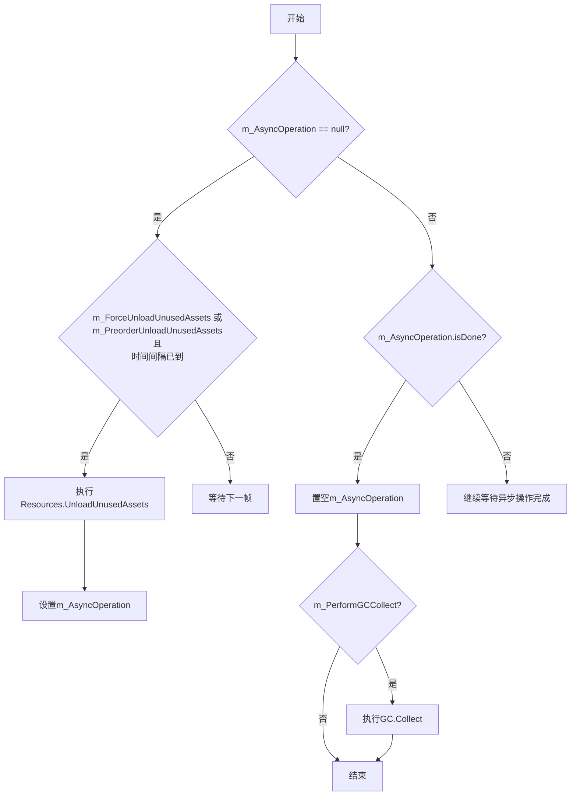

# 资源卸载策略

<cite>
**Referenced Files in This Document**  
- [ResourceComponent.cs](file://Scripts/Runtime/Resource/ResourceComponent.cs)
- [DefaultResourceHelper.cs](file://Scripts/Runtime/Resource/DefaultResourceHelper.cs)
</cite>

## 目录
1. [三种资源卸载机制](#三种资源卸载机制)
2. [异步卸载与GC协同机制](#异步卸载与gc协同机制)
3. [资源释放方法对比](#资源释放方法对比)
4. [平台限制说明](#平台限制说明)
5. [最佳实践](#最佳实践)

## 三种资源卸载机制

在 `ResourceComponent` 组件中，提供了三种不同的资源卸载机制，分别适用于不同的使用场景和触发条件。

### UnloadUnusedAssets（预卸载）

`UnloadUnusedAssets` 方法用于预订执行未使用资源的释放操作。该方法不会立即触发卸载流程，而是设置一个标志位 `m_PreorderUnloadUnusedAssets`，等待满足特定条件后由 `Update` 方法自动执行。

此机制的触发条件为：
- `m_PreorderUnloadUnusedAssets` 标志为 `true`
- 自上次操作以来经过的时间 `m_LastOperationElapse` 大于等于 `m_UnloadUnusedAssetsInterval`（默认60秒）

该机制适用于常规内存维护，避免频繁执行资源卸载影响性能。

**Section sources**
- [ResourceComponent.cs](file://Scripts/Runtime/Resource/ResourceComponent.cs#L746-L753)

### ForceUnloadUnusedAssets（强制卸载）

`ForceUnloadUnusedAssets` 方法用于立即强制执行未使用资源的释放操作。与预卸载不同，该方法设置 `m_ForceUnloadUnusedAssets` 标志后，会在下一帧的 `Update` 方法中立即执行卸载，不受时间间隔限制。

该机制适用于需要立即释放内存的场景，如场景切换前后或收到系统内存警告时。

**Section sources**
- [ResourceComponent.cs](file://Scripts/Runtime/Resource/ResourceComponent.cs#L759-L766)

### PreorderUnloadUnusedAssets（预订单卸载）

`PreorderUnloadUnusedAssets` 是一个内部布尔标志，用于标识是否已预订执行资源卸载操作。该标志由 `UnloadUnusedAssets` 方法设置，并在 `Update` 方法执行卸载后重置。

该机制与 `UnloadUnusedAssets` 方法紧密关联，共同实现延迟卸载的策略。

**Section sources**
- [ResourceComponent.cs](file://Scripts/Runtime/Resource/ResourceComponent.cs#L657-L679)

## 异步卸载与GC协同机制

`ResourceComponent` 的 `Update` 方法中实现了资源卸载与垃圾回收的协同机制，通过状态机方式管理整个流程。



**Diagram sources**
- [ResourceComponent.cs](file://Scripts/Runtime/Resource/ResourceComponent.cs#L657-L679)

### 协同流程分析

1. **触发阶段**：当满足强制卸载或预卸载时间间隔条件时，调用 `Resources.UnloadUnusedAssets()`，返回一个 `AsyncOperation` 对象并赋值给 `m_AsyncOperation`。
2. **等待阶段**：在后续帧中，持续检查 `m_AsyncOperation.isDone` 状态，直到异步操作完成。
3. **清理阶段**：异步操作完成后，根据 `m_PerformGCCollect` 标志决定是否执行 `GC.Collect()`。

这种分阶段的协同机制避免了在主线程上长时间阻塞，保证了游戏运行的流畅性。

**Section sources**
- [ResourceComponent.cs](file://Scripts/Runtime/Resource/ResourceComponent.cs#L657-L679)

## 资源释放方法对比

`DefaultResourceHelper.Release` 方法实现了资源释放的核心逻辑，对不同类型的资源采用不同的释放策略。

### AssetBundle.Unload(true)

对于 `AssetBundle` 类型的资源，直接调用 `assetBundle.Unload(true)` 方法。此方法会：
- 卸载 AssetBundle 文件本身
- 同时卸载通过该 AssetBundle 加载的所有资源对象
- 彻底释放内存

该方法适用于通过 AssetBundle 管理的资源，能够实现完整的资源清理。

### Resources.UnloadAsset

对于普通资源对象，理论上可以使用 `Resources.UnloadAsset` 方法。但在当前实现中，该代码段被注释掉，原因如下：

```csharp
/* Unity 当前 Resources.UnloadAsset 在 iOS 设备上会导致一些诡异问题，先不用这部分
...
Resources.UnloadAsset(unityObject);
*/
```

这表明 `Resources.UnloadAsset` 在 iOS 平台存在已知问题，因此被主动禁用。

**Section sources**
- [DefaultResourceHelper.cs](file://Scripts/Runtime/Resource/DefaultResourceHelper.cs#L73-L104)

## 平台限制说明

在 iOS 平台上禁用 `Resources.UnloadAsset` 的主要原因包括：

1. **稳定性问题**：Unity 引擎在 iOS 平台上的 `Resources.UnloadAsset` 实现存在缺陷，可能导致应用崩溃或资源状态不一致。
2. **内存管理差异**：iOS 系统对内存管理有特殊要求，`Resources.UnloadAsset` 的行为可能与预期不符。
3. **资源引用计数问题**：可能存在资源引用计数错误，导致资源被提前释放或无法正确释放。

因此，项目采用了保守策略，完全禁用该方法在 iOS 平台的使用，转而依赖 AssetBundle 系统进行资源管理。

**Section sources**
- [DefaultResourceHelper.cs](file://Scripts/Runtime/Resource/DefaultResourceHelper.cs#L73-L104)

## 最佳实践

### 场景切换时的资源管理

在场景切换时，推荐使用 `ForceUnloadUnusedAssets` 方法立即释放无用资源：

```csharp
// 场景切换前
GameEntry.Resource.ForceUnloadUnusedAssets(true);
```

这可以确保在加载新场景前释放尽可能多的内存，减少内存峰值。

### 内存警告处理

当收到系统内存警告时，应立即执行强制资源卸载：

```csharp
void OnApplicationPause(bool pauseStatus)
{
    if (!pauseStatus)
    {
        // 应用恢复时，可能收到内存警告
        GameEntry.Resource.ForceUnloadUnusedAssets(true);
    }
}
```

### performGCCollect 参数设置

`performGCCollect` 参数的设置需要平衡性能与内存回收效果：

- **设置为 true**：在执行 `Resources.UnloadUnusedAssets` 后立即执行 `GC.Collect()`，能快速回收内存，但可能造成短暂卡顿。
- **设置为 false**：仅卸载资源，延迟垃圾回收，避免性能波动，适合对流畅性要求高的场景。

推荐策略：
- **关键节点**（如场景切换）：设置为 `true`，确保内存及时回收
- **常规维护**：设置为 `false`，避免影响游戏体验
- **内存紧张时**：设置为 `true`，优先保证系统稳定性

**Section sources**
- [ResourceComponent.cs](file://Scripts/Runtime/Resource/ResourceComponent.cs#L746-L766)
- [ResourceComponent.cs](file://Scripts/Runtime/Resource/ResourceComponent.cs#L657-L679)