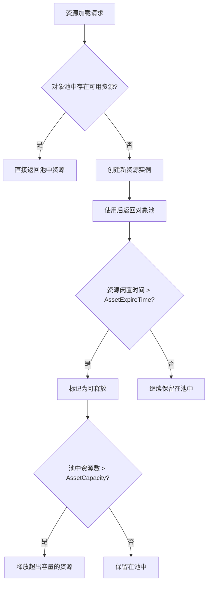
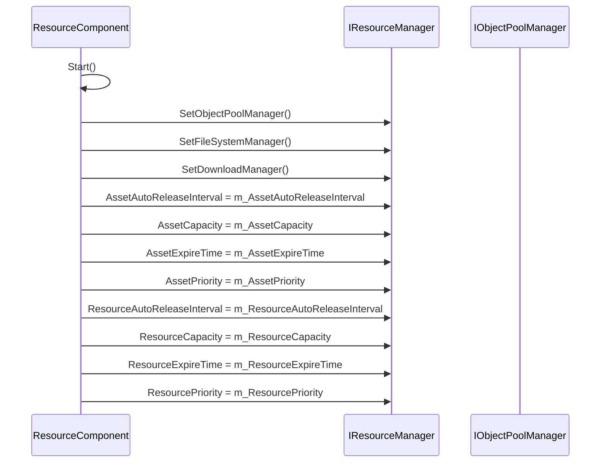
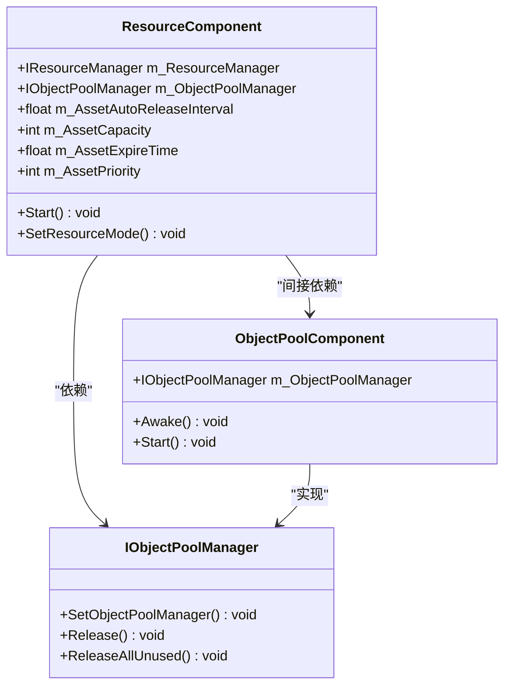

# 资源对象池管理

<cite>
**Referenced Files in This Document**   
- [ResourceComponent.cs](file://Scripts/Runtime/Resource/ResourceComponent.cs)
- [ObjectPoolComponent.cs](file://Scripts/Runtime/ObjectPool/ObjectPoolComponent.cs)
</cite>

## 目录
1. [引言](#引言)
2. [核心参数机制](#核心参数机制)
3. [对象池配置与集成](#对象池配置与集成)
4. [高频率资源加载调优](#高频率资源加载调优)
5. [ExpireTime性能影响分析](#expiretime性能影响分析)
6. [结论](#结论)

## 引言
资源对象池管理是Unity游戏框架中实现高效内存复用的核心机制。通过对象池技术，系统能够有效管理UI贴图、特效资源等高频加载的资产，避免频繁的内存分配与垃圾回收。本文档详细阐述AssetAutoReleaseInterval、AssetCapacity、AssetExpireTime等关键参数在资源生命周期管理中的作用，分析对象池如何通过优先级和容量限制实现内存优化，并说明ResourceComponent与IObjectPoolManager的集成方式。

**Section sources**
- [ResourceComponent.cs](file://Scripts/Runtime/Resource/ResourceComponent.cs#L20-L1365)

## 核心参数机制

### 资源生命周期管理参数
资源对象池通过一组核心参数精确控制资源的生命周期和内存占用：

- **AssetAutoReleaseInterval**: 控制对象池自动释放可释放对象的时间间隔（秒）。该参数决定了系统检查并释放闲置资源的频率。
- **AssetCapacity**: 定义对象池的最大容量，即池中可保留的资源实例数量上限。当池中资源超过此容量时，超出的资源将被释放。
- **AssetExpireTime**: 设置资源对象的过期时间（秒）。当资源在池中闲置时间超过此值时，将被视为可释放对象。
- **AssetPriority**: 指定对象池的优先级，用于在内存紧张时决定资源释放的顺序。

这些参数共同构成了资源生命周期管理的基础，通过合理配置可以实现内存使用与加载性能的平衡。

### 优先级与容量限制机制
对象池通过优先级和容量限制实现高效的内存复用：

**Diagram sources**
- [ResourceComponent.cs](file://Scripts/Runtime/Resource/ResourceComponent.cs#L435-L490)

当系统内存紧张时，优先级较低的对象池中的资源将优先被释放，确保高优先级资源的可用性。这种机制使得开发者可以根据资源的重要性进行分级管理。

**Section sources**
- [ResourceComponent.cs](file://Scripts/Runtime/Resource/ResourceComponent.cs#L435-L490)

## 对象池配置与集成

### ResourceComponent中的对象池配置
ResourceComponent在初始化时配置对象池参数，确保资源管理策略的一致性：

**Diagram sources**
- [ResourceComponent.cs](file://Scripts/Runtime/Resource/ResourceComponent.cs#L560-L655)

### 与IObjectPoolManager的集成方式
ResourceComponent通过IObjectPoolManager接口与对象池系统集成，实现资源的统一管理：

**Diagram sources**
- [ResourceComponent.cs](file://Scripts/Runtime/Resource/ResourceComponent.cs#L560-L655)
- [ObjectPoolComponent.cs](file://Scripts/Runtime/ObjectPool/ObjectPoolComponent.cs#L18-L1031)

在ResourceComponent的Start方法中，系统首先获取IObjectPoolManager实例，然后将其设置到IResourceManager中。随后，将配置的参数（如AssetAutoReleaseInterval、AssetCapacity等）传递给资源管理器，完成对象池的初始化配置。

**Section sources**
- [ResourceComponent.cs](file://Scripts/Runtime/Resource/ResourceComponent.cs#L560-L655)
- [ObjectPoolComponent.cs](file://Scripts/Runtime/ObjectPool/ObjectPoolComponent.cs#L18-L1031)

## 高频率资源加载调优

### UI贴图与特效资源池化策略
针对UI贴图和特效资源的高频率加载场景，建议采用以下调优策略：

1. **差异化配置**：为不同类型的资源设置不同的对象池参数。例如，UI贴图可以设置较短的AssetExpireTime（30秒）和适中的AssetCapacity（32），而特效资源可以设置较长的AssetExpireTime（60秒）和较大的AssetCapacity（64）。

2. **优先级分级**：将核心UI资源的优先级设置为高，确保在内存紧张时优先保留；将临时特效资源的优先级设置为低，便于及时释放。

3. **预加载机制**：在场景加载时预加载常用的UI贴图和基础特效，减少运行时的加载压力。

4. **容量监控**：定期监控对象池的使用情况，根据实际使用数据调整容量配置，避免过度分配内存。

这些策略能够有效提升高频率资源加载场景下的性能表现，减少卡顿和内存波动。

**Section sources**
- [ResourceComponent.cs](file://Scripts/Runtime/Resource/ResourceComponent.cs#L435-L490)

## ExpireTime性能影响分析

### 内存占用与加载性能对比
不同的ExpireTime设置对内存占用和加载性能有显著影响：

| ExpireTime设置 | 内存占用 | 加载性能 | 适用场景 |
|----------------|---------|---------|---------|
| 15秒 | 低 | 较低 | 内存受限设备，临时资源 |
| 30秒 | 中等 | 中等 | 普通UI元素，过渡动画 |
| 60秒 | 较高 | 较高 | 核心UI界面，常用特效 |
| 120秒 | 高 | 高 | 频繁切换的界面，重要资源 |

较短的ExpireTime可以快速释放内存，但可能导致资源频繁重新加载，影响性能；较长的ExpireTime可以提高加载性能，但会增加内存占用。开发者需要根据具体场景和设备性能进行权衡。

**Section sources**
- [ResourceComponent.cs](file://Scripts/Runtime/Resource/ResourceComponent.cs#L465-L475)

## 结论
资源对象池管理通过AssetAutoReleaseInterval、AssetCapacity、AssetExpireTime等参数的协同工作，实现了高效的内存复用机制。通过合理的优先级设置和容量限制，系统能够在保证性能的同时优化内存使用。在高频率资源加载场景下，建议根据资源类型和使用频率进行差异化配置，并结合预加载和容量监控策略进行调优。开发者应根据具体应用场景和设备性能，权衡ExpireTime设置对内存占用和加载性能的影响，找到最佳的配置方案。