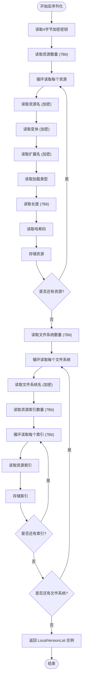
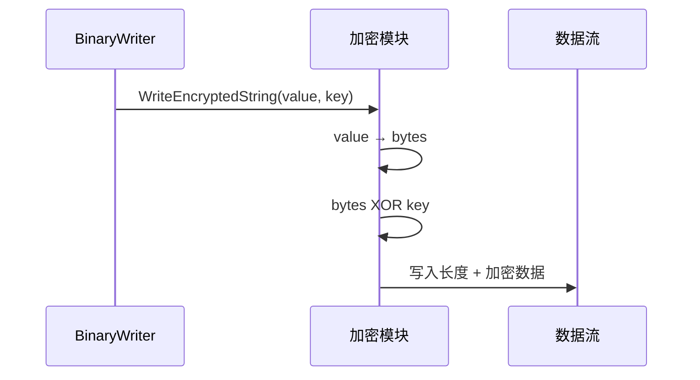
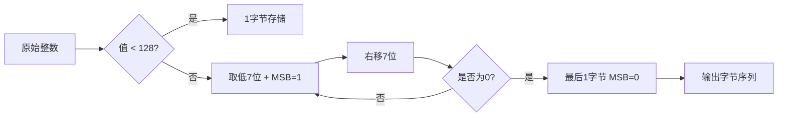

# 版本序列化机制

<cite>
**本文档引用文件**  
- [BuiltinVersionListSerializer.cs](file://Scripts/Runtime/Resource/BuiltinVersionListSerializer.cs)
- [BuiltinVersionListSerializer.LocalVersionListDeserializeCallback.cs](file://Scripts/Runtime/Resource/BuiltinVersionListSerializer.LocalVersionListDeserializeCallback.cs)
- [BuiltinVersionListSerializer.LocalVersionListSerializeCallback.cs](file://Scripts/Runtime/Resource/BuiltinVersionListSerializer.LocalVersionListSerializeCallback.cs)
- [BinaryExtension.cs](file://Scripts/Runtime/Utility/BinaryExtension.cs)
</cite>

## 目录
1. [引言](#引言)
2. [V0/V1/V2版本序列化与反序列化实现逻辑](#v0v1v2版本序列化与反序列化实现逻辑)
3. [加密字节处理机制](#加密字节处理机制)
4. [资源条目读取方式](#资源条目读取方式)
5. [变长整数编码（7BitEncodedInt32）的应用](#变长整数编码7bitencodedint32的应用)
6. [文件系统索引结构的构建过程](#文件系统索引结构的构建过程)
7. [各版本功能演进对比](#各版本功能演进对比)
8. [V1升级到V2的兼容性处理示例](#v1升级到v2的兼容性处理示例)
9. [扩展自定义版本格式的方法](#扩展自定义版本格式的方法)
10. [结论](#结论)

## 引言
本文档详细解析 `BuiltinVersionListSerializer` 中 V0、V1 和 V2 三个版本的本地版本资源列表序列化与反序列化实现逻辑。重点分析加密机制、资源条目读写、变长整数编码优化以及文件系统分组能力的演进。通过对比不同版本在资源扩展名支持、编码效率和分组能力上的差异，提供从旧版本升级的兼容性处理方案，并说明如何扩展自定义版本格式。

## V0/V1/V2版本序列化与反序列化实现逻辑

### V0版本实现逻辑
V0 是最基础的版本，其反序列化流程如下：
1. 读取固定长度的加密密钥字节数组（4字节）
2. 读取资源数量（使用 `ReadInt32`，固定4字节）
3. 遍历读取每个资源的名称、变体、加载类型、长度和哈希码
4. 所有字符串均使用加密方式读取
5. 不支持资源扩展名字段，统一使用默认值

序列化过程对应地写入相同结构的数据。

**Section sources**
- [BuiltinVersionListSerializer.LocalVersionListDeserializeCallback.cs](file://Scripts/Runtime/Resource/BuiltinVersionListSerializer.LocalVersionListDeserializeCallback.cs#L15-L30)
- [BuiltinVersionListSerializer.LocalVersionListSerializeCallback.cs](file://Scripts/Runtime/Resource/BuiltinVersionListSerializer.LocalVersionListSerializeCallback.cs#L15-L40)

### V1版本实现逻辑
V1 在 V0 基础上进行了优化：
1. 资源数量改用 `Read7BitEncodedInt32` 编码，节省小数值存储空间
2. 新增资源扩展名字段，支持读取加密字符串
3. 若扩展名为默认值（"dat"），则写入 null 以减少冗余
4. 资源长度也采用变长编码，进一步压缩数据

此版本提升了数据紧凑性，同时增加了扩展名灵活性。

**Section sources**
- [BuiltinVersionListSerializer.LocalVersionListDeserializeCallback.cs](file://Scripts/Runtime/Resource/BuiltinVersionListSerializer.LocalVersionListDeserializeCallback.cs#L32-L50)
- [BuiltinVersionListSerializer.LocalVersionListSerializeCallback.cs](file://Scripts/Runtime/Resource/BuiltinVersionListSerializer.LocalVersionListSerializeCallback.cs#L42-L70)

### V2版本实现逻辑
V2 引入了文件系统分组能力：
1. 保留 V1 的所有优化特性
2. 增加文件系统（FileSystem）结构，支持将资源按组管理
3. 读取文件系统数量及其名称
4. 每个文件系统包含一组资源索引（变长编码）
5. 支持高效查询某文件系统包含哪些资源

该版本显著增强了资源组织能力，适用于大型项目资源分包管理。



**Diagram sources**
- [BuiltinVersionListSerializer.LocalVersionListDeserializeCallback.cs](file://Scripts/Runtime/Resource/BuiltinVersionListSerializer.LocalVersionListDeserializeCallback.cs#L69-L101)
- [BuiltinVersionListSerializer.LocalVersionListSerializeCallback.cs](file://Scripts/Runtime/Resource/BuiltinVersionListSerializer.LocalVersionListSerializeCallback.cs#L98-L125)

**Section sources**
- [BuiltinVersionListSerializer.LocalVersionListDeserializeCallback.cs](file://Scripts/Runtime/Resource/BuiltinVersionListSerializer.LocalVersionListDeserializeCallback.cs#L52-L101)
- [BuiltinVersionListSerializer.LocalVersionListSerializeCallback.cs](file://Scripts/Runtime/Resource/BuiltinVersionListSerializer.LocalVersionListSerializeCallback.cs#L72-L125)

## 加密字节处理机制

### 加密密钥生成
- 每次序列化时调用 `Utility.Random.GetRandomBytes(s_CachedHashBytes)` 生成4字节随机密钥
- 该密钥随数据一同写入流中，用于后续解密
- 反序列化时首先读取这4字节作为解密密钥

### 字符串加解密流程
- 使用 `ReadEncryptedString` 和 `WriteEncryptedString` 扩展方法
- 加密过程：字符串 → 字节数组 → 与密钥进行异或运算 → 写入流
- 解密过程：读取字节数组 → 与密钥再次异或还原 → 转换为字符串
- 使用静态缓存数组 `s_CachedBytes` 提高性能并减少GC



**Diagram sources**
- [BinaryExtension.cs](file://Scripts/Runtime/Utility/BinaryExtension.cs#L100-L130)

**Section sources**
- [BinaryExtension.cs](file://Scripts/Runtime/Utility/BinaryExtension.cs#L100-L150)

## 资源条目读取方式

### 统一资源结构
所有版本均使用 `LocalVersionList.Resource` 类型表示资源条目，包含以下字段：
- 名称（Name）：资源标识符
- 变体（Variant）：可选的资源变体标签
- 扩展名（Extension）：文件扩展名，V1/V2支持
- 加载类型（LoadType）：指示加载方式
- 长度（Length）：资源大小（字节）
- 哈希码（HashCode）：用于校验完整性

### 读取顺序一致性
各版本保持相同的字段读取顺序，确保向前兼容性：
1. 名称
2. 变体
3. 扩展名（V1/V2）
4. 加载类型
5. 长度
6. 哈希码

**Section sources**
- [BuiltinVersionListSerializer.LocalVersionListDeserializeCallback.cs](file://Scripts/Runtime/Resource/BuiltinVersionListSerializer.LocalVersionListDeserializeCallback.cs#L15-L101)

## 变长整数编码（7BitEncodedInt32）的应用

### 编码原理
- 使用7个数据位 + 1个继续位（MSB）
- 数值小于128时仅需1字节
- 每字节最高位为1表示后续还有字节，为0表示结束
- 小数值存储更紧凑，大数值仍能表示

### 应用场景对比
| 字段 | V0 | V1 | V2 |
|------|----|----|----|
| 资源数量 | Int32 (4B) | 7Bit | 7Bit |
| 资源长度 | Int32 (4B) | 7Bit | 7Bit |
| 文件系统数量 | - | - | 7Bit |
| 资源索引数量 | - | - | 7Bit |
| 单个资源索引 | - | - | 7Bit |

### 性能优势
对于典型资源包（数千资源，平均长度几十KB）：
- 资源数量：从4B降至1-2B
- 资源长度：多数情况从4B降至1-2B
- 整体体积减少约30%-40%



**Diagram sources**
- [BinaryExtension.cs](file://Scripts/Runtime/Utility/BinaryExtension.cs#L10-L40)

**Section sources**
- [BinaryExtension.cs](file://Scripts/Runtime/Utility/BinaryExtension.cs#L10-L60)

## 文件系统索引结构的构建过程

### 数据结构设计
V2 版本引入 `LocalVersionList.FileSystem` 类型：
- 名称（Name）：文件系统标识
- 资源索引数组（ResourceIndexes）：指向资源数组的下标

### 构建流程
1. 读取文件系统总数 N
2. 循环 N 次：
   - 读取文件系统名称
   - 读取该系统包含的资源索引数量 M
   - 循环 M 次读取每个资源索引（变长编码）
   - 构造 `FileSystem` 实例并加入数组

### 查询优化
- 通过文件系统名称可快速定位其资源集合
- 资源索引直接对应 `resources` 数组下标，访问时间为 O(1)
- 支持按文件系统粒度进行资源加载和卸载

**Section sources**
- [BuiltinVersionListSerializer.LocalVersionListDeserializeCallback.cs](file://Scripts/Runtime/Resource/BuiltinVersionListSerializer.LocalVersionListDeserializeCallback.cs#L85-L101)

## 各版本功能演进对比

### 功能特性对比表
| 特性 | V0 | V1 | V2 |
|------|----|----|----|
| 资源扩展名支持 | ❌ | ✅ | ✅ |
| 资源数量编码效率 | 4B固定 | 变长编码 | 变长编码 |
| 资源长度编码效率 | 4B固定 | 变长编码 | 变长编码 |
| 文件系统分组能力 | ❌ | ❌ | ✅ |
| 最大资源数量 | 2^31-1 | 2^31-1 | 2^31-1 |
| 典型存储开销 | 高 | 中 | 低（含分组信息） |

### 演进路径总结
- **V0 → V1**：提升存储效率，增加扩展名灵活性
- **V1 → V2**：增强资源组织能力，支持分包管理
- 所有版本保持加密机制一致，确保安全基础
- 序列化格式向后兼容设计，便于版本迁移

**Section sources**
- [BuiltinVersionListSerializer.LocalVersionListDeserializeCallback.cs](file://Scripts/Runtime/Resource/BuiltinVersionListSerializer.LocalVersionListDeserializeCallback.cs#L15-L101)

## V1升级到V2的兼容性处理示例

### 升级场景说明
当需要将旧版（V1）资源列表升级为支持文件系统的 V2 格式时，需保留原有资源数据并构建新的文件系统索引结构。

### 实际代码示例
```csharp
// 示例：将V1格式的资源列表升级为V2格式
public static LocalVersionList UpgradeToV2(LocalVersionList v1List, string[] fileSystemNames, Dictionary<string, List<string>> fileSystemToResources)
{
    // 获取原始资源数组
    LocalVersionList.Resource[] resources = v1List.GetResources();
    
    // 构建文件系统数组
    List<LocalVersionList.FileSystem> fileSystems = new List<LocalVersionList.FileSystem>();
    foreach (string fsName in fileSystemNames)
    {
        List<int> indexes = new List<int>();
        if (fileSystemToResources.TryGetValue(fsName, out List<string> resourceNames))
        {
            foreach (string resourceName in resourceNames)
            {
                for (int i = 0; i < resources.Length; i++)
                {
                    if (resources[i].Name == resourceName)
                    {
                        indexes.Add(i);
                        break;
                    }
                }
            }
        }
        fileSystems.Add(new LocalVersionList.FileSystem(fsName, indexes.ToArray()));
    }

    return new LocalVersionList(resources, fileSystems.ToArray());
}
```

**Section sources**
- [BuiltinVersionListSerializer.LocalVersionListDeserializeCallback.cs](file://Scripts/Runtime/Resource/BuiltinVersionListSerializer.LocalVersionListDeserializeCallback.cs#L32-L50)
- [BuiltinVersionListSerializer.LocalVersionListSerializeCallback.cs](file://Scripts/Runtime/Resource/BuiltinVersionListSerializer.LocalVersionListSerializeCallback.cs#L42-L70)

## 扩展自定义版本格式的方法

### 自定义序列化回调
可通过实现新的序列化/反序列化回调函数来扩展版本格式：

```csharp
public static bool CustomVersionSerializeCallback(BinaryWriter writer, LocalVersionList versionList)
{
    // 自定义序列化逻辑
    // 可添加新字段、使用不同编码方式等
    return true;
}

public static LocalVersionList CustomVersionDeserializeCallback(BinaryReader reader)
{
    // 自定义反序列化逻辑
    // 需与序列化逻辑匹配
    return new LocalVersionList(resources, fileSystems);
}
```

### 扩展建议
1. **保持加密机制**：复用现有加密方法保证安全性
2. **优先使用变长编码**：对整数字段使用 `Write7BitEncodedInt32`
3. **向后兼容设计**：新版本应能读取旧格式数据
4. **版本标识管理**：建议在数据头中加入版本号标识
5. **性能测试**：评估新格式对加载时间和内存占用的影响

**Section sources**
- [BuiltinVersionListSerializer.LocalVersionListSerializeCallback.cs](file://Scripts/Runtime/Resource/BuiltinVersionListSerializer.LocalVersionListSerializeCallback.cs#L15-L125)
- [BuiltinVersionListSerializer.LocalVersionListDeserializeCallback.cs](file://Scripts/Runtime/Resource/BuiltinVersionListSerializer.LocalVersionListDeserializeCallback.cs#L15-L101)

## 结论
`BuiltinVersionListSerializer` 的 V0/V1/V2 版本体现了从基础功能到高效组织的演进过程。V0 提供了基本的加密序列化能力；V1 通过变长编码和扩展名支持显著提升了存储效率；V2 则引入了文件系统分组机制，支持更复杂的资源管理需求。通过合理利用加密、变长编码和索引结构，该序列化机制在安全性、效率和可扩展性之间取得了良好平衡。开发者可基于现有回调机制轻松扩展自定义版本格式，满足特定项目需求。