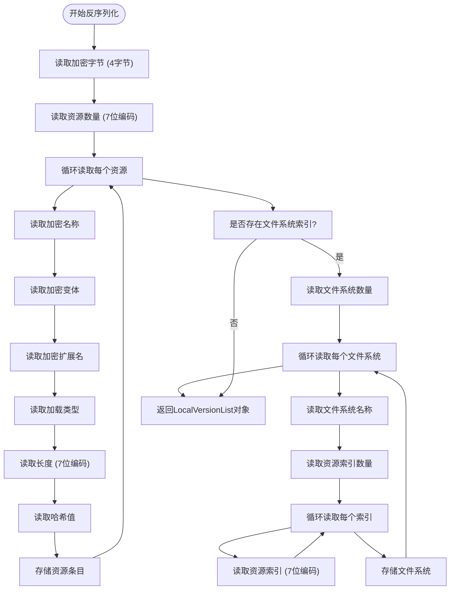
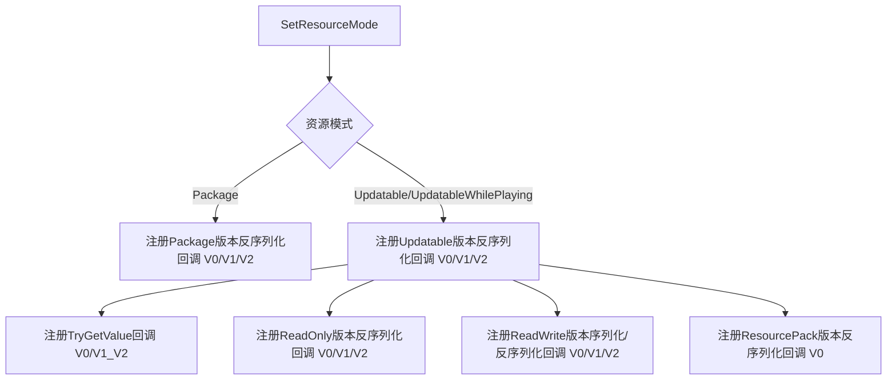

# 版本管理

<cite>
**本文档中引用的文件**  
- [BuiltinVersionListSerializer.cs](file://Scripts/Runtime/Resource/BuiltinVersionListSerializer.cs)
- [ResourceComponent.cs](file://Scripts/Runtime/Resource/ResourceComponent.cs)
- [ResourceBuilderController.cs](file://Scripts/Editor/ResourceBuilder/ResourceBuilderController.cs)
- [BuiltinVersionListSerializer.LocalVersionListDeserializeCallback.cs](file://Scripts/Runtime/Resource/BuiltinVersionListSerializer.LocalVersionListDeserializeCallback.cs)
- [BuiltinVersionListSerializer.UpdatableVersionListDeserializeCallback.cs](file://Scripts/Runtime/Resource/BuiltinVersionListSerializer.UpdatableVersionListDeserializeCallback.cs)
- [BuiltinVersionListSerializer.PackageVersionListDeserializeCallback.cs](file://Scripts/Runtime/Resource/BuiltinVersionListSerializer.PackageVersionListDeserializeCallback.cs)
</cite>

## 目录
1. [资源模式详解](#资源模式详解)  
2. [版本列表序列化与反序列化逻辑](#版本列表序列化与反序列化逻辑)  
3. [资源模式设置与序列化回调注册](#资源模式设置与序列化回调注册)  
4. [版本列表文件生成流程](#版本列表文件生成流程)  
5. [版本升级兼容性处理案例](#版本升级兼容性处理案例)

## 资源模式详解

在Unity游戏框架中，资源管理支持三种核心资源模式：Package、Updatable和UpdatableWhilePlaying。这些模式决定了资源的加载方式、更新机制和运行时行为。

**Package模式**：适用于单机或发布版本，所有资源打包在只读路径（如StreamingAssets）中，无法在运行时更新。该模式下资源版本列表（GameFrameworkVersion.dat）在构建时生成，用于初始化资源系统。

**Updatable模式**：允许在启动时检查并更新资源。资源初始位于只读区，更新内容下载至读写区，通过版本比对实现增量更新。适用于需要热更新但不支持运行时动态加载的场景。

**UpdatableWhilePlaying模式**：扩展自Updatable模式，支持在游戏运行过程中动态更新和加载资源。适用于需要实时内容更新的在线游戏，允许在不重启应用的情况下应用新资源。

这三种模式通过`ResourceComponent.SetResourceMode`方法进行切换，直接影响版本列表的序列化与反序列化行为。

**Section sources**  
- [ResourceComponent.cs](file://Scripts/Runtime/Resource/ResourceComponent.cs#L685-L721)

## 版本列表序列化与反序列化逻辑

版本列表的序列化与反序列化由`BuiltinVersionListSerializer`类实现，支持V0、V1、V2三个版本格式，逐步优化数据结构和压缩效率。

### 本地版本资源列表（LocalVersionList）

用于读写区和只读区的资源索引，其反序列化逻辑如下：

- **V0版本**：使用`ReadInt32`读取资源数量，资源条目包含名称、变体、加载类型、长度和哈希值。无扩展名字段，不支持文件系统索引。
- **V1版本**：改用`Read7BitEncodedInt32`压缩整数，节省空间。新增扩展名字段，支持更灵活的资源命名。
- **V2版本**：在V1基础上增加文件系统索引，通过`fileSystemCount`和`resourceIndexes`数组构建文件系统到资源的映射，提升资源定位效率。

**Diagram sources**  
- [BuiltinVersionListSerializer.LocalVersionListDeserializeCallback.cs](file://Scripts/Runtime/Resource/BuiltinVersionListSerializer.LocalVersionListDeserializeCallback.cs#L15-L102)

### 可更新版本资源列表（UpdatableVersionList）

用于管理可更新资源的完整元数据，其反序列化逻辑包括：

- **V0版本**：使用固定长度整数，包含资源到资产的映射、依赖关系和资源组信息。资产索引使用`UInt16`，限制资源数量。
- **V1版本**：全面采用7位编码压缩整数，提升序列化效率。优化依赖索引结构，移除冗余数据。
- **V2版本**：在V1基础上增加文件系统索引，与资源组并列，形成更完整的资源组织结构。

**Section sources**  
- [BuiltinVersionListSerializer.UpdatableVersionListDeserializeCallback.cs](file://Scripts/Runtime/Resource/BuiltinVersionListSerializer.UpdatableVersionListDeserializeCallback.cs#L15-L260)

### 单机模式版本资源列表（PackageVersionList）

结构与UpdatableVersionList相似，但专用于Package模式，其序列化格式保持向后兼容。

**Section sources**  
- [BuiltinVersionListSerializer.PackageVersionListDeserializeCallback.cs](file://Scripts/Runtime/Resource/BuiltinVersionListSerializer.PackageVersionListDeserializeCallback.cs#L15-L254)

## 资源模式设置与序列化回调注册

`ResourceComponent.SetResourceMode`方法根据指定模式注册相应的序列化回调，确保版本列表能被正确解析。

**Diagram sources**  
- [ResourceComponent.cs](file://Scripts/Runtime/Resource/ResourceComponent.cs#L685-L721)

当设置为Updatable或UpdatableWhilePlaying模式时，系统会同时配置可更新区、只读区和读写区的序列化器，以支持多区域资源管理。`TryGetValueCallback`用于快速读取关键字段（如InternalResourceVersion），避免完整反序列化开销。

**Section sources**  
- [ResourceComponent.cs](file://Scripts/Runtime/Resource/ResourceComponent.cs#L685-L721)

## 版本列表文件生成流程

`ResourceBuilderController`在资源构建过程中生成两个关键版本列表文件：

### GameFrameworkVersion.dat（远程版本列表）

- **生成时机**：构建Package模式资源时，由`ProcessPackageVersionList`方法生成。
- **作用**：存储在服务器或只读区，作为资源更新的基准版本。包含完整的资源、资产、文件系统和资源组信息。
- **生成流程**：
  1. 从`ResourceCollection`获取所有资产和资源
  2. 构建`PackageVersionList`对象
  3. 使用`PackageVersionListSerializer`序列化到输出目录
  4. 文件名：GameFrameworkVersion.dat

### GameFrameworkList.dat（本地版本列表）

- **生成时机**：构建Packed资源时，由`ProcessReadOnlyVersionList`方法生成。
- **作用**：存储在只读区，用于快速加载本地打包资源。包含资源条目和文件系统索引。
- **生成流程**：
  1. 获取所有标记为Packed的资源
  2. 构建`LocalVersionList`对象
  3. 使用`ReadOnlyVersionListSerializer`序列化到输出目录
  4. 文件名：GameFrameworkList.dat

此外，`ProcessUpdatableVersionList`还会生成可更新版本列表，压缩后以CRC32校验码重命名（如GameFrameworkVersion.1a2b3c4d.dat），用于更新验证。

**Section sources**  
- [ResourceBuilderController.cs](file://Scripts/Editor/ResourceBuilder/ResourceBuilderController.cs#L1067-L1211)

## 版本升级兼容性处理案例

当从旧版本（V0）升级到新版本（V2）时，系统通过版本号识别和回调注册实现兼容：

1. **构建阶段**：`ResourceBuilderController`始终生成最新版本（V2）的版本列表，包含文件系统索引。
2. **运行时**：`ResourceComponent`根据资源模式注册所有版本的反序列化回调（V0/V1/V2）。
3. **加载阶段**：当检测到旧版列表时，调用对应版本的反序列化回调（如`LocalVersionListDeserializeCallback_V0`）。
4. **数据转换**：旧版数据在内存中被转换为新版结构，确保后续操作一致性。
5. **更新策略**：首次启动时，系统会重新生成读写区的版本列表（GameFrameworkList.dat），升级到最新格式。

此机制确保了跨版本更新的平滑过渡，无需强制用户重新下载全部资源。

**Section sources**  
- [ResourceBuilderController.cs](file://Scripts/Editor/ResourceBuilder/ResourceBuilderController.cs#L1116-L1177)
- [BuiltinVersionListSerializer.cs](file://Scripts/Runtime/Resource/BuiltinVersionListSerializer.cs#L15-L54)