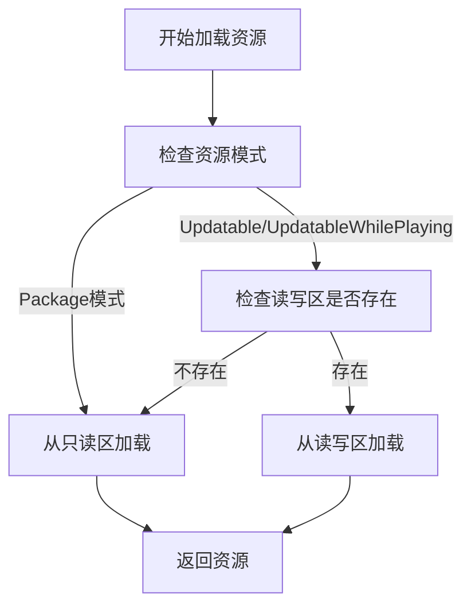
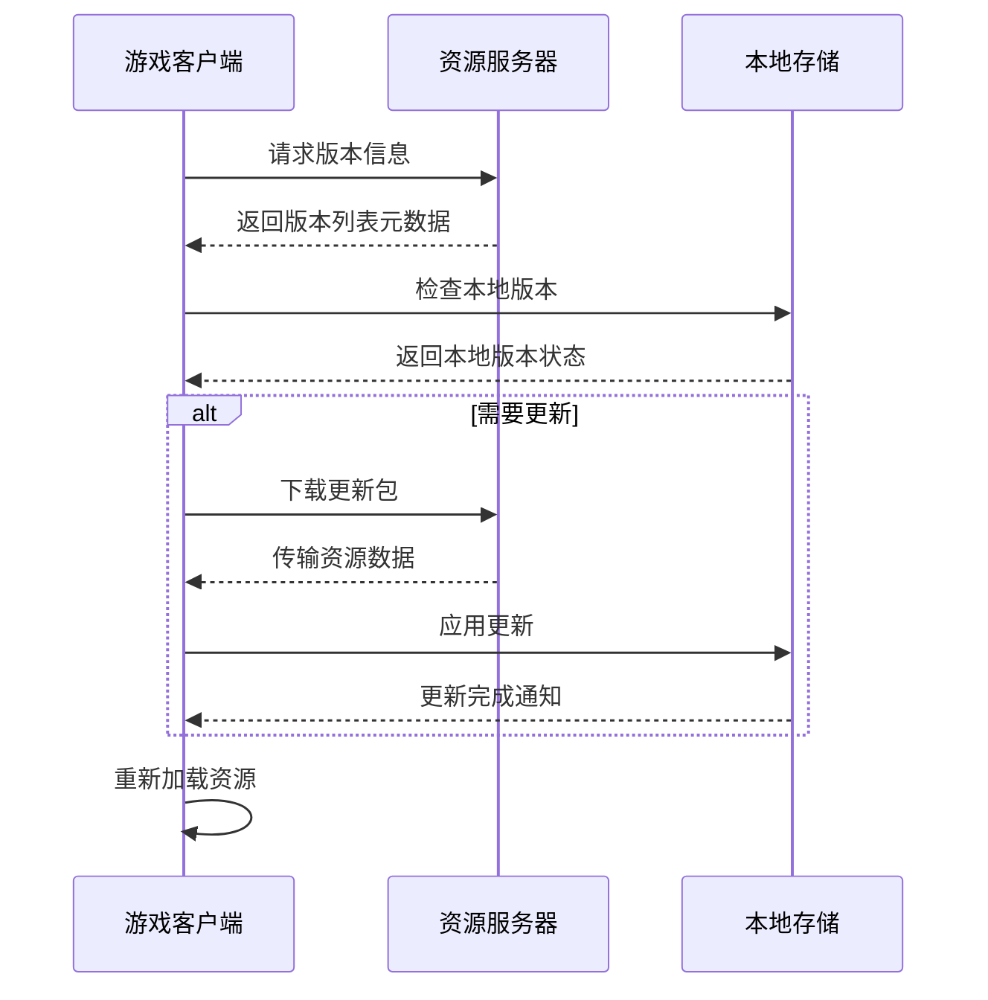
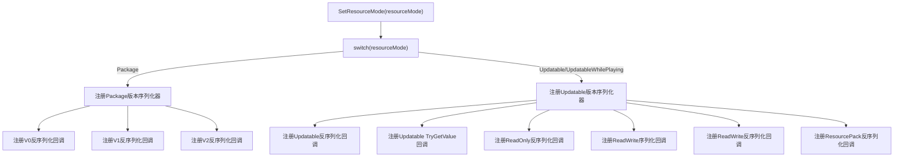
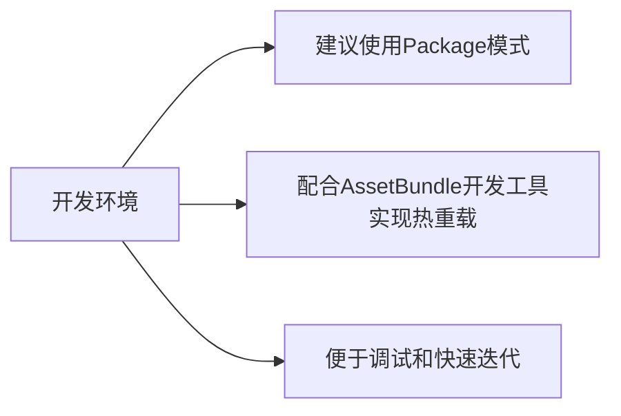
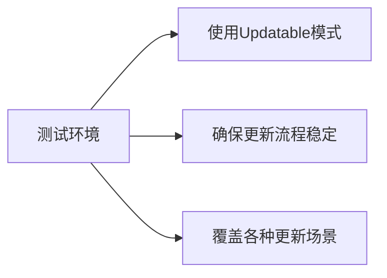
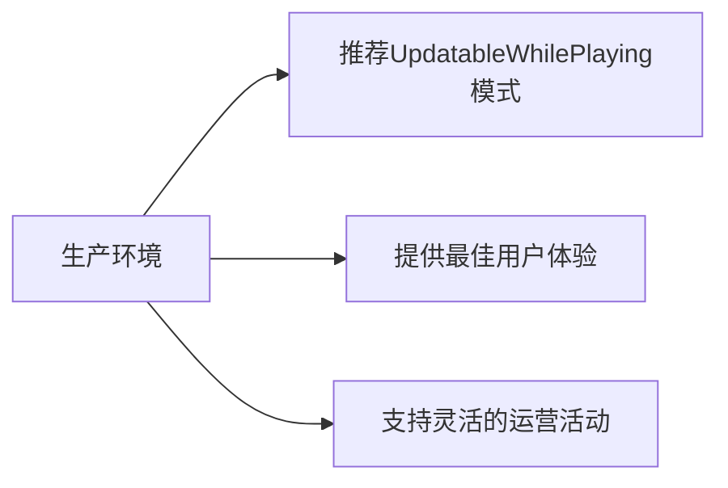

# 资源模式详解

<cite>
**本文档引用文件**  
- [ResourceComponent.cs](file://Scripts/Runtime/Resource/ResourceComponent.cs)
- [BuiltinVersionListSerializer.cs](file://Scripts/Runtime/Resource/BuiltinVersionListSerializer.cs)
- [BuiltinVersionListSerializer.PackageVersionListDeserializeCallback.cs](file://Scripts/Runtime/Resource/BuiltinVersionListSerializer.PackageVersionListDeserializeCallback.cs)
- [BuiltinVersionListSerializer.UpdatableVersionListDeserializeCallback.cs](file://Scripts/Runtime/Resource/BuiltinVersionListSerializer.UpdatableVersionListDeserializeCallback.cs)
- [BuiltinVersionListSerializer.UpdatableVersionListTryGetValueCallback.cs](file://Scripts/Runtime/Resource/BuiltinVersionListSerializer.UpdatableVersionListTryGetValueCallback.cs)
- [BuiltinVersionListSerializer.LocalVersionListDeserializeCallback.cs](file://Scripts/Runtime/Resource/BuiltinVersionListSerializer.LocalVersionListDeserializeCallback.cs)
- [BuiltinVersionListSerializer.LocalVersionListSerializeCallback.cs](file://Scripts/Runtime/Resource/BuiltinVersionListSerializer.LocalVersionListSerializeCallback.cs)
</cite>

## 目录
1. [引言](#引言)
2. [资源模式概述](#资源模式概述)
3. [技术差异分析](#技术差异分析)
4. [版本检查机制对比](#版本检查机制对比)
5. [更新策略实现](#更新策略实现)
6. [SetResourceMode方法分析](#setresourcemode方法分析)
7. [热更新场景下的性能权衡](#热更新场景下的性能权衡)
8. [多环境配置建议](#多环境配置建议)
9. [结论](#结论)

## 引言
在Unity游戏框架中，资源管理是核心功能之一。本文档深入解析Package、Updatable和UpdatableWhilePlaying三种资源模式的技术差异与适用场景，重点分析其加载路径、版本检查机制和更新策略的不同，并结合ResourceComponent中SetResourceMode方法的实现，探讨不同模式对版本列表序列化器注册逻辑的影响。

## 资源模式概述
UnityGameFramework提供了三种主要的资源管理模式：

- **Package模式**：适用于单机模式或无需热更新的场景，所有资源打包在安装包内。
- **Updatable模式**：支持启动时检查更新，适用于需要在游戏启动阶段完成资源更新的场景。
- **UpdatableWhilePlaying模式**：支持运行时热更新，允许在游戏运行过程中动态下载和应用新资源。

这三种模式通过ResourceComponent的m_ResourceMode字段进行配置，默认值为ResourceMode.Package。

**Section sources**
- [ResourceComponent.cs](file://Scripts/Runtime/Resource/ResourceComponent.cs#L38)

## 技术差异分析

### 资源加载路径差异
不同资源模式下，资源的加载路径存在显著差异：

| 资源模式 | 只读路径 | 读写路径 | 加载优先级 |
|---------|--------|--------|---------|
| Package | Application.streamingAssetsPath | Application.persistentDataPath | 只读区 |
| Updatable | Application.streamingAssetsPath | Application.persistentDataPath | 读写区优先 |
| UpdatableWhilePlaying | Application.streamingAssetsPath | Application.persistentDataPath | 读写区优先 |

在Updatable和UpdatableWhilePlaying模式下，系统会优先从读写区加载资源，若不存在则回退到只读区。这种设计支持了资源的覆盖更新机制。

**Diagram sources**
- [ResourceComponent.cs](file://Scripts/Runtime/Resource/ResourceComponent.cs#L560-L655)

### 版本检查机制对比
三种模式的版本检查机制有本质区别：

- **Package模式**：不进行版本检查，直接使用内置资源。
- **Updatable模式**：在游戏启动时进行完整版本检查，确定是否需要更新。
- **UpdatableWhilePlaying模式**：支持运行时动态版本检查，可随时触发更新流程。

Updatable和UpdatableWhilePlaying模式共享相同的版本检查逻辑，通过CheckVersionList方法实现版本比对。

**Section sources**
- [ResourceComponent.cs](file://Scripts/Runtime/Resource/ResourceComponent.cs#L560-L655)

## 更新策略实现

### 更新流程差异
不同模式的更新策略体现在更新时机和流程控制上：

**Diagram sources**
- [ResourceComponent.cs](file://Scripts/Runtime/Resource/ResourceComponent.cs#L685-L721)

### 更新重试机制
在Updatable和UpdatableWhilePlaying模式下，系统支持配置更新重试次数（m_UpdateRetryCount），默认值为3次。此配置通过ResourceManager.UpdateRetryCount属性进行传递。

**Section sources**
- [ResourceComponent.cs](file://Scripts/Runtime/Resource/ResourceComponent.cs#L560-L655)

## SetResourceMode方法分析
ResourceComponent的SetResourceMode方法是资源模式切换的核心实现，它根据不同的资源模式注册相应的版本列表序列化器回调函数。

### 模式切换逻辑

**Diagram sources**
- [ResourceComponent.cs](file://Scripts/Runtime/Resource/ResourceComponent.cs#L685-L721)

### 序列化器注册细节
当设置为Updatable或UpdatableWhilePlaying模式时，系统会注册多个版本列表序列化器的回调函数：

1. **UpdatableVersionListSerializer**：处理可更新模式的版本列表反序列化和TryGetValue操作
2. **ReadOnlyVersionListSerializer**：处理只读区版本列表的反序列化
3. **ReadWriteVersionListSerializer**：处理读写区版本列表的序列化和反序列化
4. **ResourcePackVersionListSerializer**：处理资源包版本列表的反序列化

这种多序列化器协同工作的设计，支持了复杂的资源更新场景。

**Section sources**
- [ResourceComponent.cs](file://Scripts/Runtime/Resource/ResourceComponent.cs#L685-L721)

## 热更新场景下的性能权衡

### UpdatableWhilePlaying的优势
选择UpdatableWhilePlaying模式进行热更新具有以下优势：

- **无缝更新体验**：玩家无需重启游戏即可获得最新资源
- **灵活的更新时机**：可在游戏空闲时段或特定场景加载时进行更新
- **减少启动时间**：避免了启动时集中更新导致的长时间等待

### 性能影响分析
然而，这种模式也带来了性能上的权衡：

| 影响维度 | 具体表现 | 优化建议 |
|---------|--------|--------|
| 内存占用 | 需要维护多个版本的资源元数据 | 合理设置资源对象池容量 |
| CPU开销 | 运行时需要进行版本检查和资源比对 | 使用高效的序列化格式 |
| 磁盘IO | 频繁的读写操作可能影响性能 | 优化文件系统访问模式 |
| 网络带宽 | 实时更新可能占用网络资源 | 在Wi-Fi环境下进行大更新 |

**Section sources**
- [ResourceComponent.cs](file://Scripts/Runtime/Resource/ResourceComponent.cs#L685-L721)

## 多环境配置建议

### 开发环境

**Diagram sources**
- [ResourceComponent.cs](file://Scripts/Runtime/Resource/ResourceComponent.cs#L38)

### 测试环境

**Diagram sources**
- [ResourceComponent.cs](file://Scripts/Runtime/Resource/ResourceComponent.cs#L560-L655)

### 生产环境

**Diagram sources**
- [ResourceComponent.cs](file://Scripts/Runtime/Resource/ResourceComponent.cs#L685-L721)

### 配置参数建议
| 参数 | 开发环境 | 测试环境 | 生产环境 |
|------|---------|---------|---------|
| m_UpdateRetryCount | 1 | 3 | 3 |
| m_UnloadUnusedAssetsInterval | 10f | 60f | 300f |
| m_AssetAutoReleaseInterval | 10f | 60f | 300f |
| m_ResourceAutoReleaseInterval | 10f | 60f | 300f |
| m_GenerateReadWriteVersionListLength | 1MB | 10MB | 50MB |

**Section sources**
- [ResourceComponent.cs](file://Scripts/Runtime/Resource/ResourceComponent.cs#L560-L655)

## 结论
Package、Updatable和UpdatableWhilePlaying三种资源模式各有适用场景。Package模式适合简单的单机应用，Updatable模式适合启动时更新的场景，而UpdatableWhilePlaying模式则为需要热更新的游戏提供了最佳解决方案。通过合理配置SetResourceMode方法和相关参数，可以在不同环境下实现最优的资源管理策略。在选择模式时，需要权衡更新灵活性、性能影响和用户体验，根据具体项目需求做出最佳选择。