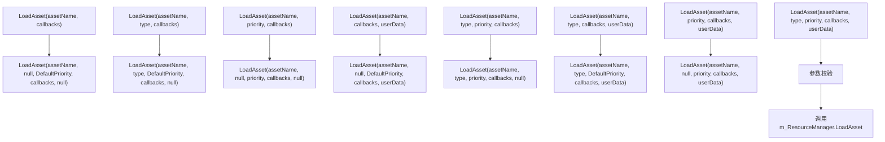
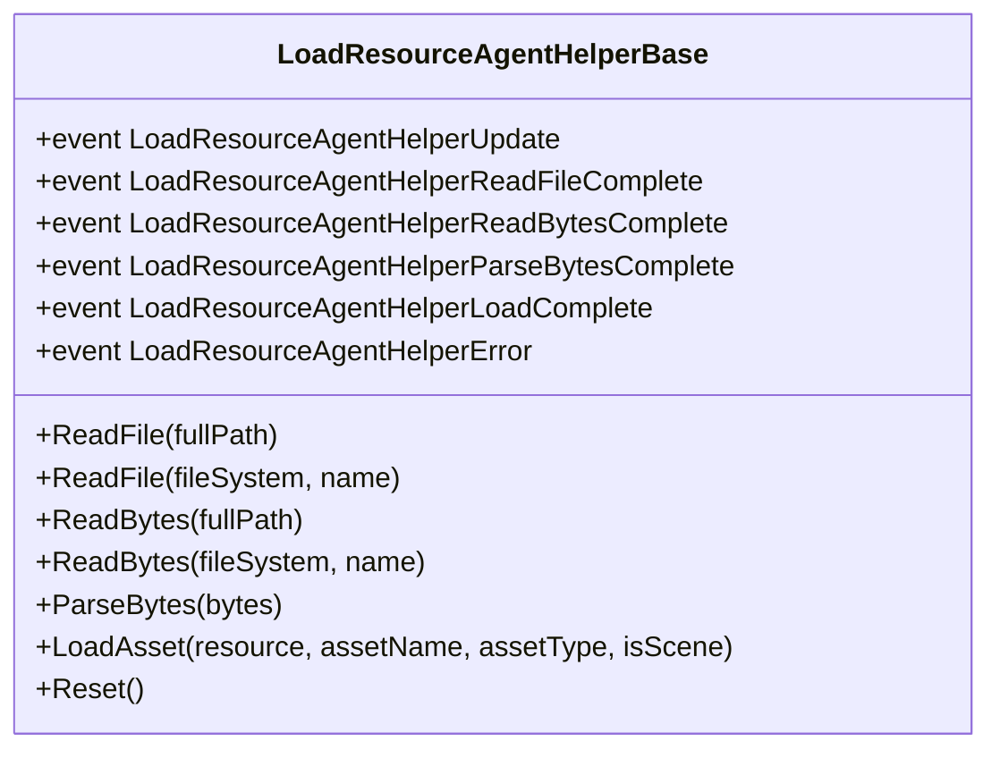
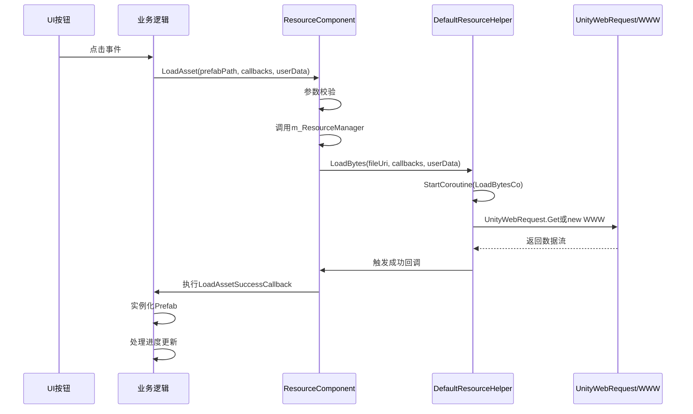

# 资源加载

<cite>
**本文档中引用的文件**  
- [ResourceComponent.cs](file://Scripts/Runtime/Resource/ResourceComponent.cs)
- [LoadResourceAgentHelperBase.cs](file://Scripts/Runtime/Resource/LoadResourceAgentHelperBase.cs)
- [DefaultResourceHelper.cs](file://Scripts/Runtime/Resource/DefaultResourceHelper.cs)
</cite>

## 目录
1. [简介](#简介)
2. [核心组件](#核心组件)
3. [异步加载机制实现](#异步加载机制实现)
4. [资源加载生命周期](#资源加载生命周期)
5. [回调机制与上下文传递](#回调机制与上下文传递)
6. [完整代码示例](#完整代码示例)
7. [结论](#结论)

## 简介
本文档详细阐述UnityGameFramework中资源加载子系统的实现机制，重点分析异步加载流程、资源加载代理辅助器的生命周期管理以及网络资源加载的具体实现方式。文档将深入解析从UI触发到资源实例化的完整过程，并提供实际应用示例。

## 核心组件

该资源加载系统由三个核心组件构成：`ResourceComponent`作为外部调用接口，`LoadResourceAgentHelperBase`定义加载代理的生命周期，`DefaultResourceHelper`提供默认的资源操作实现。

**本节来源**  
- [ResourceComponent.cs](file://Scripts/Runtime/Resource/ResourceComponent.cs#L873-L970)
- [LoadResourceAgentHelperBase.cs](file://Scripts/Runtime/Resource/LoadResourceAgentHelperBase.cs#L17-L94)
- [DefaultResourceHelper.cs](file://Scripts/Runtime/Resource/DefaultResourceHelper.cs#L21-L181)

## 异步加载机制实现

### LoadAsset系列方法调用流程

`ResourceComponent`提供了多个重载的`LoadAsset`方法，形成了一套完整的调用链。所有方法最终都会汇聚到具有完整参数列表的主方法上。



**图示来源**  
- [ResourceComponent.cs](file://Scripts/Runtime/Resource/ResourceComponent.cs#L873-L970)

### 参数校验与任务分发

最终的`LoadAsset`方法执行严格的参数校验：
1. 检查资源名称是否为空
2. 验证资源名称是否以"Assets/"开头
3. 通过`m_ResourceManager`进行任务分发

优先级设置通过`priority`参数实现，系统默认优先级为0。高优先级的任务会被优先处理。任务分发由`m_ResourceManager`完成，确保加载请求被正确路由到相应的加载代理。

**本节来源**  
- [ResourceComponent.cs](file://Scripts/Runtime/Resource/ResourceComponent.cs#L955-L970)

## 资源加载生命周期

### LoadResourceAgentHelperBase抽象类

`LoadResourceAgentHelperBase`定义了资源加载的完整生命周期，通过一系列抽象事件和方法实现：



**图示来源**  
- [LoadResourceAgentHelperBase.cs](file://Scripts/Runtime/Resource/LoadResourceAgentHelperBase.cs#L17-L94)

### 生命周期阶段

1. **ReadFile**: 异步读取资源文件
2. **ReadBytes**: 异步读取资源二进制流
3. **ParseBytes**: 将二进制流解析为加载对象
4. **LoadAsset**: 加载资源到内存
5. **事件通知**: 各阶段完成或出错时触发相应事件

每个阶段都有对应的完成事件，允许外部监听加载进度和状态变化。

## 回调机制与上下文传递

### 加载事件回调

系统提供了完整的回调机制来处理加载结果：

- **成功回调**: `LoadResourceAgentHelperLoadComplete`事件
- **失败回调**: `LoadResourceAgentHelperError`事件
- **更新回调**: `LoadResourceAgentHelperUpdate`事件用于报告加载进度

### userData参数的作用

`userData`参数在异步加载过程中起到关键的上下文传递作用。它贯穿整个加载流程，从最初的`LoadAsset`调用到最后的回调函数，确保调用者能够识别和处理特定的加载请求。这在同时处理多个加载任务时尤为重要，可以准确区分不同任务的回调。

**本节来源**  
- [ResourceComponent.cs](file://Scripts/Runtime/Resource/ResourceComponent.cs#L955-L970)
- [LoadResourceAgentHelperBase.cs](file://Scripts/Runtime/Resource/LoadResourceAgentHelperBase.cs#L17-L94)

## 完整代码示例

### UI按钮触发Prefab加载

以下示例展示了如何从UI按钮触发加载Prefab资源并实例化：



**图示来源**  
- [ResourceComponent.cs](file://Scripts/Runtime/Resource/ResourceComponent.cs#L955-L970)
- [DefaultResourceHelper.cs](file://Scripts/Runtime/Resource/DefaultResourceHelper.cs#L29-L32)

### DefaultResourceHelper网络加载实现

`DefaultResourceHelper`通过条件编译实现了UnityWebRequest和WWW的双重支持：

```csharp
#if UNITY_5_4_OR_NEWER
// 使用UnityWebRequest
UnityWebRequest unityWebRequest = UnityWebRequest.Get(fileUri);
yield return unityWebRequest.SendWebRequest();
#else
// 使用WWW
WWW www = new WWW(fileUri);
yield return www;
#endif
```

根据Unity版本选择合适的网络请求方式，确保兼容性。加载完成后，通过回调函数将结果返回给调用者。

**本节来源**  
- [DefaultResourceHelper.cs](file://Scripts/Runtime/Resource/DefaultResourceHelper.cs#L29-L32)

## 结论
UnityGameFramework的资源加载系统通过清晰的分层设计和完整的生命周期管理，实现了高效可靠的异步资源加载。系统支持多种加载方式和回调机制，`userData`参数的使用确保了上下文的正确传递。开发者可以基于这套机制实现复杂的资源管理逻辑，满足不同类型项目的需求。