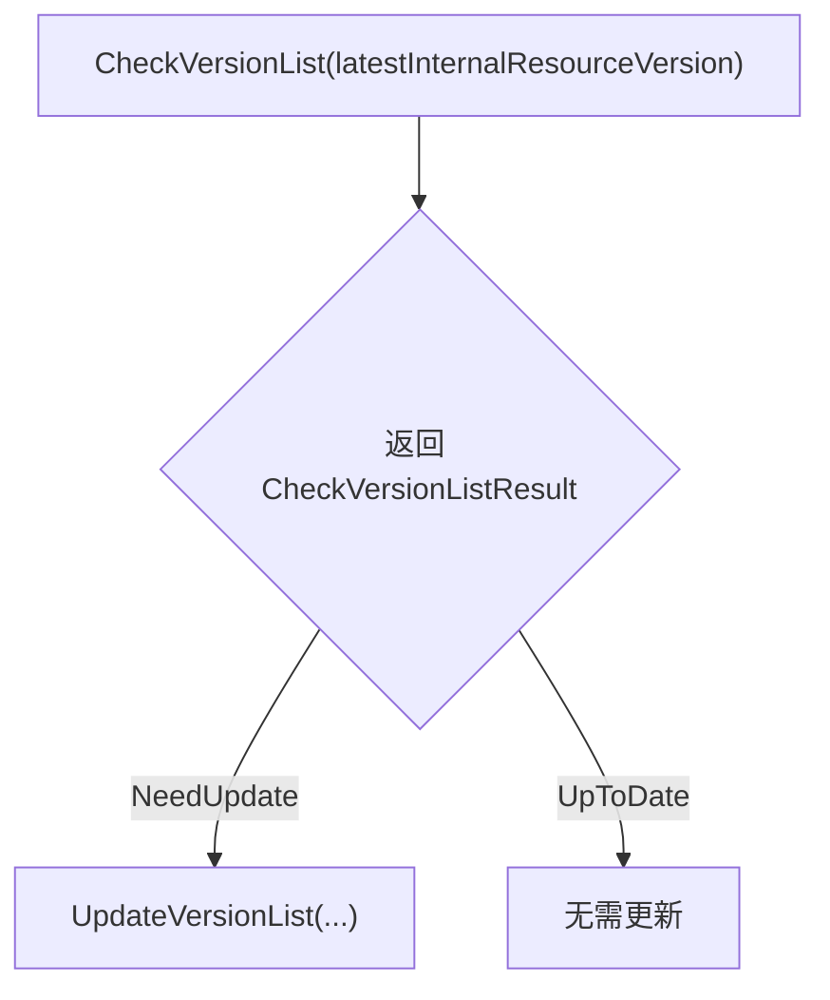
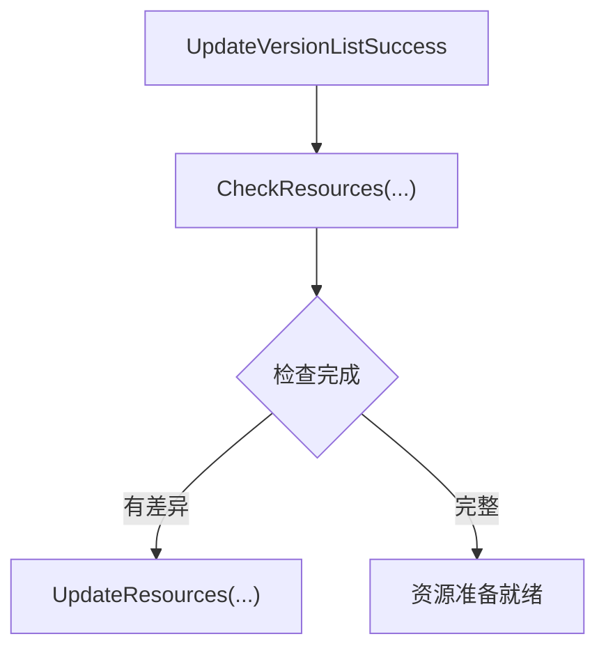
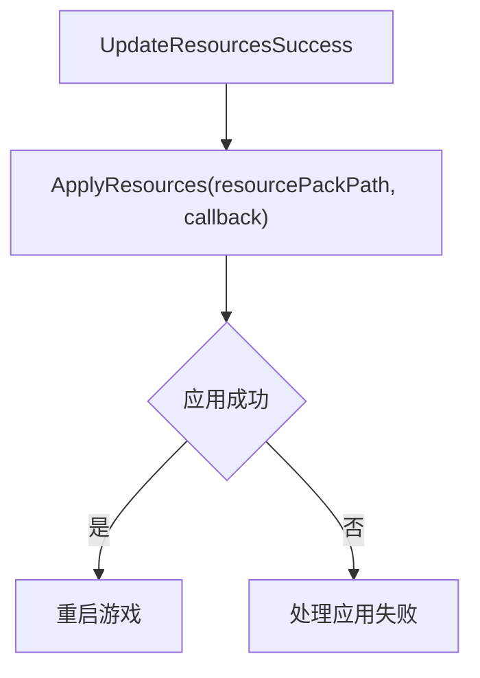
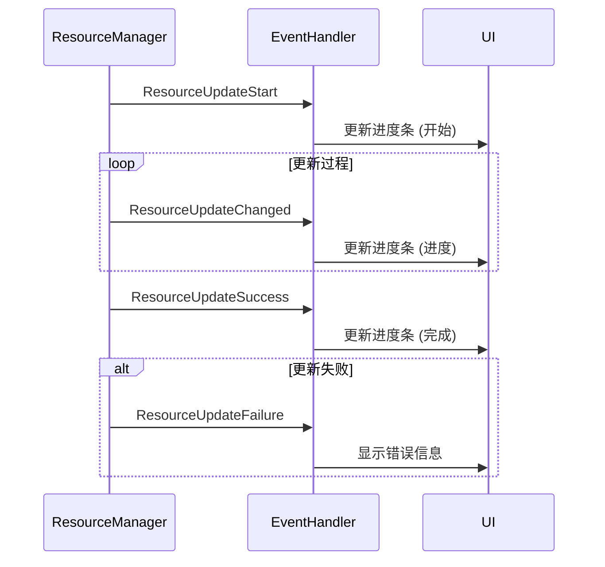
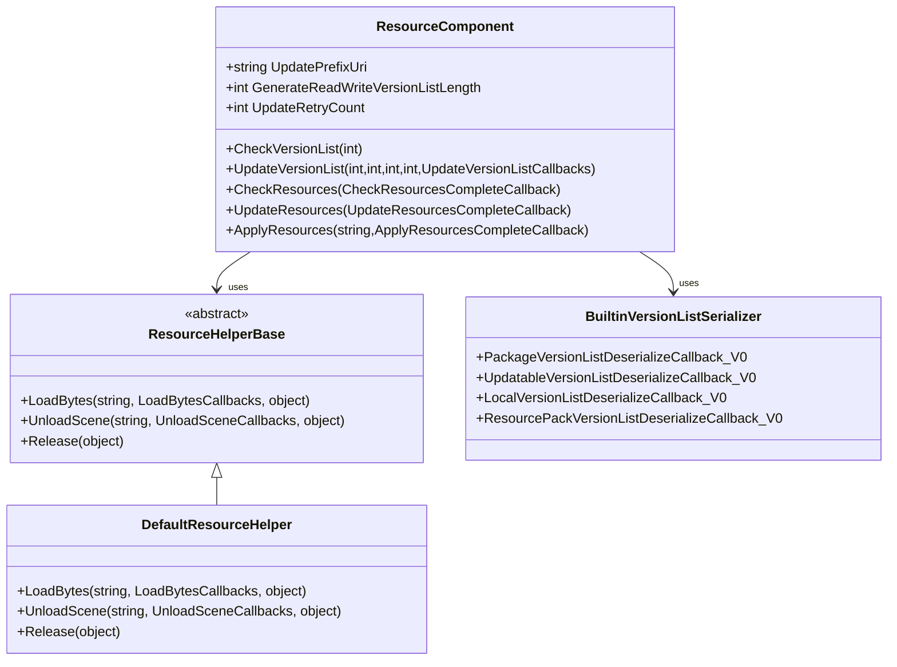

<cite>
**Referenced Files in This Document**   
- [ResourceComponent.cs](file://Scripts/Runtime/Resource/ResourceComponent.cs)
- [BuiltinVersionListSerializer.cs](file://Scripts/Runtime/Resource/BuiltinVersionListSerializer.cs)
- [ResourceHelperBase.cs](file://Scripts/Runtime/Resource/ResourceHelperBase.cs)
- [DefaultResourceHelper.cs](file://Scripts/Runtime/Resource/DefaultResourceHelper.cs)
- [GameEntry.cs](file://Scripts/Runtime/Base/GameEntry.cs)
</cite>

# 资源更新

## 目录
1. [简介](#简介)
2. [核心方法调用流程](#核心方法调用流程)
3. [资源更新事件流](#资源更新事件流)
4. [关键配置项说明](#关键配置项说明)
5. [热更新场景实现](#热更新场景实现)
6. [架构与依赖](#架构与依赖)

## 简介

本文档详细阐述了Unity游戏框架中的资源更新流程，涵盖从版本检查到资源应用的完整端到端过程。文档重点解析了关键方法的调用顺序、参数含义以及事件流在UI更新中的应用。同时，详细说明了影响更新行为的关键配置项，并提供了一个完整的热更新场景代码实现。

**Section sources**
- [ResourceComponent.cs](file://Scripts/Runtime/Resource/ResourceComponent.cs#L1-L100)

## 核心方法调用流程

资源更新流程遵循严格的调用顺序，确保资源版本的正确性和完整性。

### 版本检查与更新

资源更新的第一步是检查远程版本列表。`CheckVersionList`方法用于比较本地与远程的内部资源版本号，确定是否需要更新。



**Diagram sources**
- [ResourceComponent.cs](file://Scripts/Runtime/Resource/ResourceComponent.cs#L732-L770)

### 资源检查与更新

在成功更新版本列表后，系统会检查本地资源的完整性。`CheckResources`方法用于验证所有资源是否与版本列表匹配。



**Diagram sources**
- [ResourceComponent.cs](file://Scripts/Runtime/Resource/ResourceComponent.cs#L804-L817)

### 资源应用

当资源更新完成后，可以调用`ApplyResources`方法将新资源包应用到游戏中。此操作通常在游戏重启后执行。



**Diagram sources**
- [ResourceComponent.cs](file://Scripts/Runtime/Resource/ResourceComponent.cs#L824-L827)

**Section sources**
- [ResourceComponent.cs](file://Scripts/Runtime/Resource/ResourceComponent.cs#L795-L846)

## 资源更新事件流

资源更新过程通过一系列事件通知系统状态变化，这些事件可用于更新UI进度条。

### 事件类型

| 事件类型 | 触发时机 | 主要参数 |
|---------|---------|---------|
| ResourceUpdateStartEventArgs | 开始更新单个资源时 | Name, DownloadPath, DownloadUri, CurrentLength, ZipLength, RetryCount |
| ResourceUpdateChangedEventArgs | 资源更新进度改变时 | Name, DownloadPath, DownloadUri, CurrentLength, ZipLength |
| ResourceUpdateSuccessEventArgs | 单个资源更新成功时 | Name, DownloadPath, DownloadUri, Length, ZipLength |
| ResourceUpdateFailureEventArgs | 单个资源更新失败时 | Name, DownloadUri, RetryCount, TotalRetryCount, ErrorMessage |



**Diagram sources**
- [ResourceUpdateStartEventArgs.cs](file://Scripts/Runtime/Resource/ResourceUpdateStartEventArgs.cs#L15-L129)
- [ResourceUpdateChangedEventArgs.cs](file://Scripts/Runtime/Resource/ResourceUpdateChangedEventArgs.cs#L15-L117)
- [ResourceUpdateSuccessEventArgs.cs](file://Scripts/Runtime/Resource/ResourceUpdateSuccessEventArgs.cs#L15-L117)
- [ResourceUpdateFailureEventArgs.cs](file://Scripts/Runtime/Resource/ResourceUpdateFailureEventArgs.cs#L15-L117)

**Section sources**
- [ResourceUpdateStartEventArgs.cs](file://Scripts/Runtime/Resource/ResourceUpdateStartEventArgs.cs#L15-L129)
- [ResourceUpdateChangedEventArgs.cs](file://Scripts/Runtime/Resource/ResourceUpdateChangedEventArgs.cs#L15-L117)
- [ResourceUpdateSuccessEventArgs.cs](file://Scripts/Runtime/Resource/ResourceUpdateSuccessEventArgs.cs#L15-L117)
- [ResourceUpdateFailureEventArgs.cs](file://Scripts/Runtime/Resource/ResourceUpdateFailureEventArgs.cs#L15-L117)

## 关键配置项说明

以下配置项直接影响资源更新的行为。

### UpdatePrefixUri

`UpdatePrefixUri`属性设置资源更新的下载地址前缀。所有更新请求的URL都将以此为基础构建。

```csharp
// 示例：设置更新服务器地址
ResourceComponent.Instance.UpdatePrefixUri = "https://example.com/game/update/";
```

**Section sources**
- [ResourceComponent.cs](file://Scripts/Runtime/Resource/ResourceComponent.cs#L280-L290)

### GenerateReadWriteVersionListLength

`GenerateReadWriteVersionListLength`属性定义了在读写区累积多少字节的更新后，重新生成版本资源列表。这有助于控制版本列表文件的大小和更新频率。

**Section sources**
- [ResourceComponent.cs](file://Scripts/Runtime/Resource/ResourceComponent.cs#L295-L305)

### UpdateRetryCount

`UpdateRetryCount`属性设置资源更新失败时的最大重试次数。当网络不稳定时，此配置可提高更新成功率。

**Section sources**
- [ResourceComponent.cs](file://Scripts/Runtime/Resource/ResourceComponent.cs#L332-L342)

## 热更新场景实现

以下是一个完整的热更新场景实现，展示了从检查远程版本到重启游戏的完整流程。

```csharp
public class HotUpdateManager : MonoBehaviour
{
    private void Start()
    {
        StartCoroutine(HotUpdateProcess());
    }

    private IEnumerator HotUpdateProcess()
    {
        // 1. 设置资源模式为可更新模式
        ResourceComponent.Instance.SetResourceMode(ResourceMode.UpdatableWhilePlaying);
        
        // 2. 设置更新服务器地址
        ResourceComponent.Instance.UpdatePrefixUri = "https://yourserver.com/update/";
        
        // 3. 检查远程版本
        int remoteVersion = GetRemoteVersionFromServer(); // 从服务器获取最新版本号
        CheckVersionListResult result = ResourceComponent.Instance.CheckVersionList(remoteVersion);
        
        if (result == CheckVersionListResult.NeedUpdate)
        {
            // 4. 更新版本列表
            yield return UpdateVersionList();
            
            // 5. 检查需要更新的资源
            yield return CheckResources();
            
            if (ResourceComponent.Instance.UpdateCandidateCount > 0)
            {
                // 6. 开始更新资源
                yield return UpdateResources();
                
                // 7. 应用更新（通常在重启后）
                string resourcePackPath = GetLatestResourcePackPath();
                ResourceComponent.Instance.ApplyResources(resourcePackPath, OnApplyResourcesComplete);
            }
        }
        else
        {
            Debug.Log("资源已是最新版本");
            OnUpdateComplete();
        }
    }

    private IEnumerator UpdateVersionList()
    {
        // 从服务器获取版本列表信息
        var versionInfo = GetVersionListInfo();
        
        var updateCallbacks = new UpdateVersionListCallbacks(
            OnUpdateVersionListSuccess,
            OnUpdateVersionListFailure,
            OnUpdateVersionListUpdate
        );
        
        ResourceComponent.Instance.UpdateVersionList(
            versionInfo.Length,
            versionInfo.HashCode,
            versionInfo.ZipLength,
            versionInfo.ZipHashCode,
            updateCallbacks
        );
        
        // 等待版本列表更新完成
        while (ResourceComponent.Instance.ApplicableGameVersion == null)
        {
            yield return null;
        }
    }

    private IEnumerator CheckResources()
    {
        var checkComplete = false;
        ResourceComponent.Instance.CheckResources((checkResult) =>
        {
            checkComplete = true;
        });
        
        while (!checkComplete)
        {
            yield return null;
        }
    }

    private IEnumerator UpdateResources()
    {
        var updateComplete = false;
        ResourceComponent.Instance.UpdateResources((result) =>
        {
            updateComplete = true;
        });
        
        while (!updateComplete)
        {
            yield return null;
        }
    }

    private void OnUpdateVersionListSuccess()
    {
        Debug.Log("版本列表更新成功");
    }

    private void OnUpdateVersionListFailure(string errorMessage)
    {
        Debug.LogError($"版本列表更新失败: {errorMessage}");
    }

    private void OnUpdateVersionListUpdate(float progress)
    {
        Debug.Log($"版本列表更新进度: {progress:P}");
    }

    private void OnApplyResourcesComplete(bool result)
    {
        if (result)
        {
            Debug.Log("资源应用成功，准备重启");
            // 重启游戏以应用新资源
            GameEntry.Shutdown(ShutdownType.Restart);
        }
        else
        {
            Debug.LogError("资源应用失败");
        }
    }

    private void OnUpdateComplete()
    {
        // 启动游戏主流程
        Debug.Log("启动游戏");
    }

    private int GetRemoteVersionFromServer()
    {
        // 实现从服务器获取最新版本号的逻辑
        return 100; // 示例版本号
    }

    private VersionListInfo GetVersionListInfo()
    {
        // 实现从服务器获取版本列表信息的逻辑
        return new VersionListInfo();
    }

    private string GetLatestResourcePackPath()
    {
        // 获取最新资源包路径
        return "path/to/latest/resource.pack";
    }
}

public class VersionListInfo
{
    public int Length { get; set; }
    public int HashCode { get; set; }
    public int ZipLength { get; set; }
    public int ZipHashCode { get; set; }
}
```

**Section sources**
- [ResourceComponent.cs](file://Scripts/Runtime/Resource/ResourceComponent.cs#L732-L846)
- [GameEntry.cs](file://Scripts/Runtime/Base/GameEntry.cs#L120-L140)

## 架构与依赖

资源更新系统依赖于多个核心组件和辅助类。



**Diagram sources**
- [ResourceComponent.cs](file://Scripts/Runtime/Resource/ResourceComponent.cs#L1-L1368)
- [BuiltinVersionListSerializer.cs](file://Scripts/Runtime/Resource/BuiltinVersionListSerializer.cs#L1-L55)
- [ResourceHelperBase.cs](file://Scripts/Runtime/Resource/ResourceHelperBase.cs#L1-L41)
- [DefaultResourceHelper.cs](file://Scripts/Runtime/Resource/DefaultResourceHelper.cs#L1-L184)