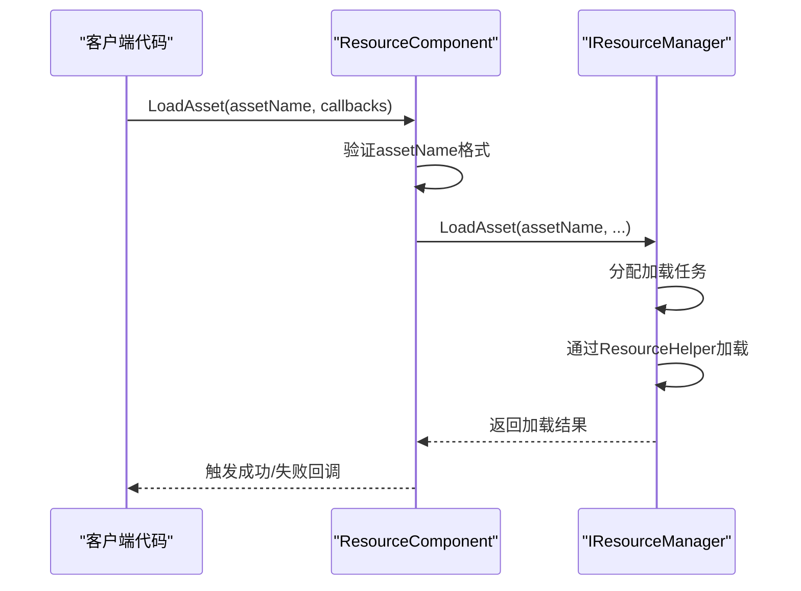
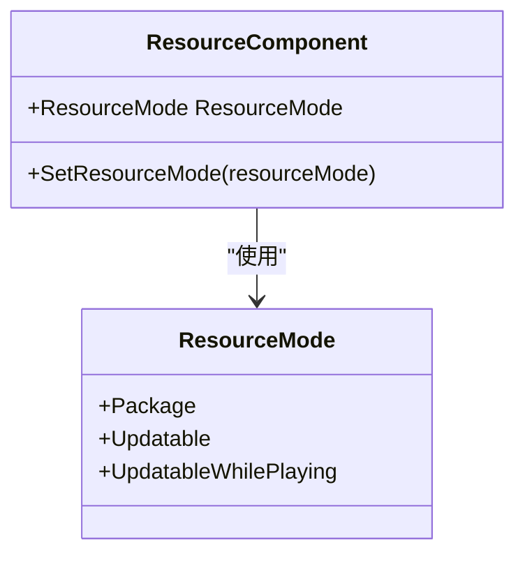
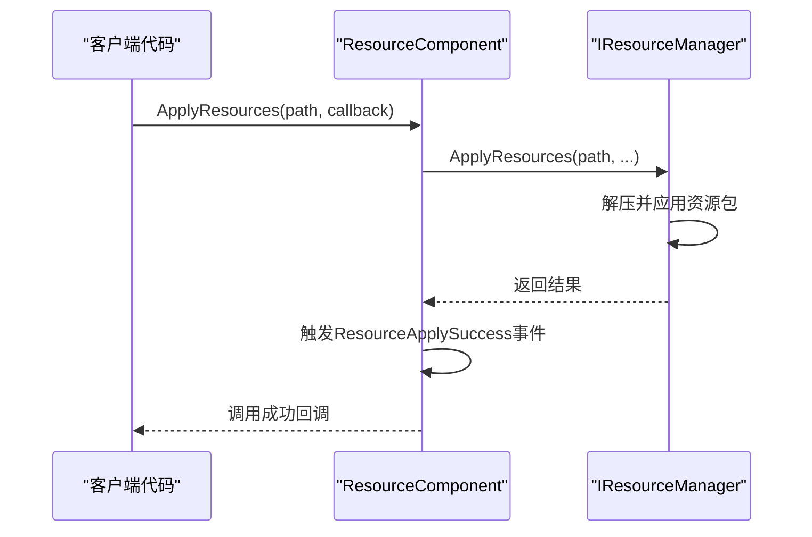
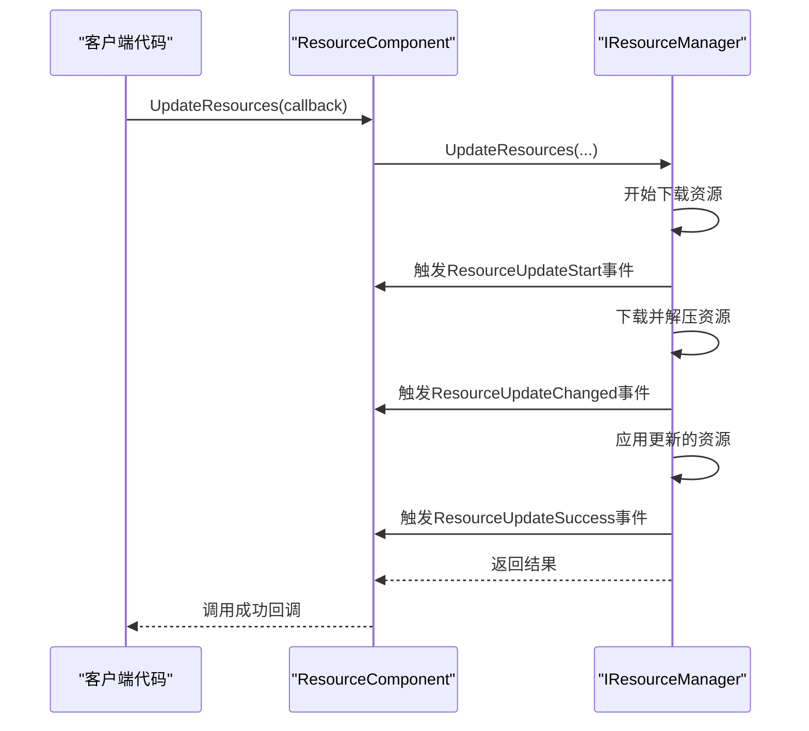
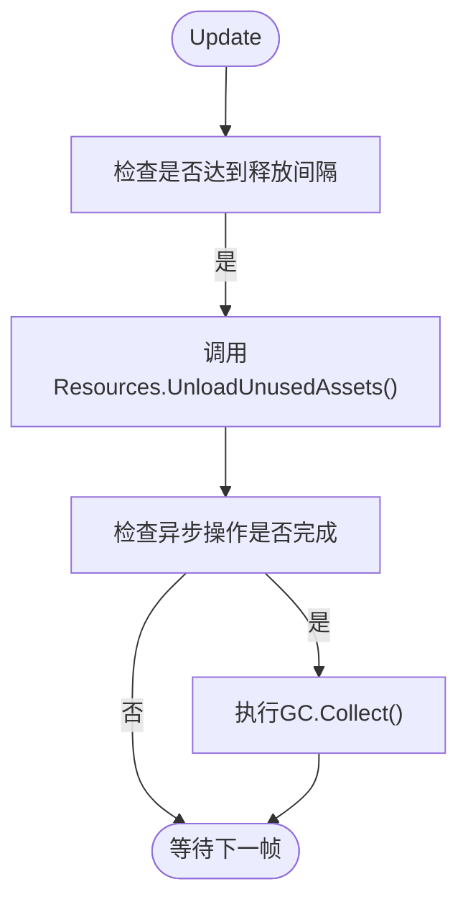
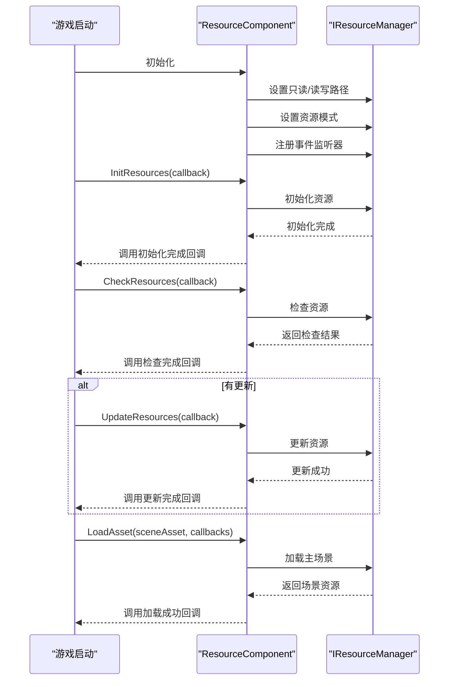
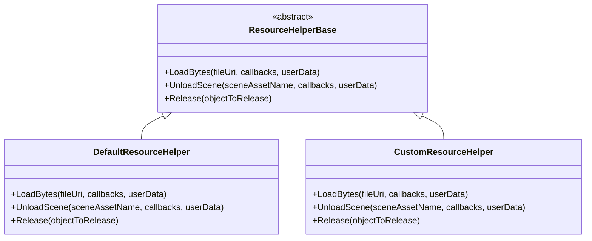

# 资源管理

<cite>
**Referenced Files in This Document**   
- [ResourceComponent.cs](file://Scripts/Runtime/Resource/ResourceComponent.cs)
- [ResourceHelperBase.cs](file://Scripts/Runtime/Resource/ResourceHelperBase.cs)
- [DefaultResourceHelper.cs](file://Scripts/Runtime/Resource/DefaultResourceHelper.cs)
- [BuiltinVersionListSerializer.cs](file://Scripts/Runtime/Resource/BuiltinVersionListSerializer.cs)
- [ResourceUpdateStartEventArgs.cs](file://Scripts/Runtime/Resource/ResourceUpdateStartEventArgs.cs)
- [ResourceApplySuccessEventArgs.cs](file://Scripts/Runtime/Resource/ResourceApplySuccessEventArgs.cs)
- [ResourceUpdateSuccessEventArgs.cs](file://Scripts/Runtime/Resource/ResourceUpdateSuccessEventArgs.cs)
</cite>

## 目录
1. [简介](#简介)
2. [核心功能概述](#核心功能概述)
3. [资源加载机制](#资源加载机制)
4. [资源版本管理](#资源版本管理)
5. [资源更新流程](#资源更新流程)
6. [内存管理策略](#内存管理策略)
7. [典型使用流程](#典型使用流程)
8. [扩展点：ResourceHelperBase](#扩展点resourcehelperbase)

## 简介
资源管理模块是Unity游戏框架的核心组件之一，负责游戏资源的加载、更新、版本管理和内存优化。`ResourceComponent`作为该模块的入口，提供了统一的API来处理各种资源操作，确保游戏在不同平台和模式下都能高效、稳定地运行。

**Section sources**
- [ResourceComponent.cs](file://Scripts/Runtime/Resource/ResourceComponent.cs#L20-L1365)

## 核心功能概述
`ResourceComponent`类封装了资源管理的所有核心功能，包括异步资源加载、多模式版本管理、资源更新和内存优化。它通过`IResourceManager`接口与底层资源管理系统交互，并提供了事件机制来通知资源操作的状态变化。

该组件支持多种资源模式，包括单机模式（Package）、可更新模式（Updatable）和可更新模式（UpdatableWhilePlaying），以适应不同的发布和更新需求。同时，它还提供了灵活的配置选项，允许开发者根据项目需求调整资源路径、对象池容量和自动释放策略。

**Section sources**
- [ResourceComponent.cs](file://Scripts/Runtime/Resource/ResourceComponent.cs#L20-L1365)

## 资源加载机制
资源加载是游戏运行时最频繁的操作之一。`ResourceComponent`提供了强制异步加载机制，确保资源加载不会阻塞主线程，从而保持游戏的流畅性。

### 异步加载API
`ResourceComponent`提供了多个重载的`LoadAsset`方法，允许开发者以不同的参数组合异步加载资源。这些方法最终都会调用底层的`m_ResourceManager.LoadAsset`方法。

**Diagram sources**
- [ResourceComponent.cs](file://Scripts/Runtime/Resource/ResourceComponent.cs#L955-L970)

### 加载成功与失败处理
资源加载的结果通过`LoadAssetCallbacks`回调函数集来处理。虽然具体的`LoadAssetCallbacks`定义未在代码中直接找到，但根据`LoadAsset`方法的调用方式，可以推断它包含成功和失败的回调函数。当资源加载成功时，`ResourceComponent`会将加载到的资源传递给成功回调；当加载失败时，则会调用失败回调并传递错误信息。

**Section sources**
- [ResourceComponent.cs](file://Scripts/Runtime/Resource/ResourceComponent.cs#L955-L970)

## 资源版本管理
资源版本管理是确保游戏资源一致性和可更新性的关键。`ResourceComponent`支持多种资源模式，每种模式都有其特定的版本管理策略。

### 资源模式
`ResourceComponent`通过`SetResourceMode`方法设置资源模式，支持以下几种模式：
- **Package模式**：适用于单机游戏，所有资源都打包在应用内。
- **Updatable模式**：适用于需要在线更新资源的游戏，支持从远程服务器下载更新。
- **UpdatableWhilePlaying模式**：类似于Updatable模式，但允许在游戏运行时进行更新。

**Diagram sources**
- [ResourceComponent.cs](file://Scripts/Runtime/Resource/ResourceComponent.cs#L685-L721)

### 版本列表序列化器
不同资源模式使用不同的版本列表序列化器来处理版本信息的序列化和反序列化。例如，在`Updatable`模式下，会注册`UpdatableVersionListSerializer`的反序列化回调，以处理不同版本的版本列表数据。

**Section sources**
- [ResourceComponent.cs](file://Scripts/Runtime/Resource/ResourceComponent.cs#L685-L721)
- [BuiltinVersionListSerializer.cs](file://Scripts/Runtime/Resource/BuiltinVersionListSerializer.cs#L0-L54)

## 资源更新流程
资源更新流程是`ResourceComponent`的核心功能之一，特别是在可更新模式下。该流程包括版本列表检查、资源包应用和资源更新三个主要步骤。

### 版本列表检查
在更新资源之前，首先需要检查远程的版本列表，以确定是否有新版本的资源需要下载。`CheckVersionList`方法用于执行此操作，它会比较本地和远程的内部资源版本号，返回检查结果。

### 资源包应用
当需要应用新的资源包时，可以使用`ApplyResources`方法。该方法会将指定路径的资源包应用到游戏中，替换旧的资源。应用成功后，会触发`ResourceApplySuccessEventArgs`事件。

**Diagram sources**
- [ResourceComponent.cs](file://Scripts/Runtime/Resource/ResourceComponent.cs#L824-L827)
- [ResourceApplySuccessEventArgs.cs](file://Scripts/Runtime/Resource/ResourceApplySuccessEventArgs.cs#L15-L117)

### 资源更新
资源更新通过`UpdateResources`方法实现。该方法会启动资源更新流程，下载并应用新的资源。更新过程中会触发一系列事件，如`ResourceUpdateStartEventArgs`、`ResourceUpdateChangedEventArgs`和`ResourceUpdateSuccessEventArgs`，以通知更新进度和结果。

**Diagram sources**
- [ResourceComponent.cs](file://Scripts/Runtime/Resource/ResourceComponent.cs#L833-L836)
- [ResourceUpdateStartEventArgs.cs](file://Scripts/Runtime/Resource/ResourceUpdateStartEventArgs.cs#L15-L129)
- [ResourceUpdateSuccessEventArgs.cs](file://Scripts/Runtime/Resource/ResourceUpdateSuccessEventArgs.cs#L0-L119)

**Section sources**
- [ResourceComponent.cs](file://Scripts/Runtime/Resource/ResourceComponent.cs#L772-L846)

## 内存管理策略
为了优化内存使用，`ResourceComponent`实现了基于对象池的内存管理策略，并提供了自动释放机制。

### 对象池配置
`ResourceComponent`允许配置资源对象池的容量、过期时间和优先级。这些配置通过`AssetCapacity`、`AssetExpireTime`和`AssetPriority`等属性进行设置，并在`Start`方法中传递给`IResourceManager`。

### 自动释放
`ResourceComponent`在`Update`方法中实现了自动释放未使用资源的机制。当达到`UnloadUnusedAssetsInterval`指定的间隔时间时，会调用`Resources.UnloadUnusedAssets()`来释放未被引用的资源。如果设置了`performGCCollect`，还会执行垃圾回收。

**Diagram sources**
- [ResourceComponent.cs](file://Scripts/Runtime/Resource/ResourceComponent.cs#L737-L753)

### 手动释放
除了自动释放，开发者还可以通过`UnloadUnusedAssets`和`ForceUnloadUnusedAssets`方法手动触发资源释放。前者会预订在下一个释放间隔执行释放，后者会立即执行释放。

**Section sources**
- [ResourceComponent.cs](file://Scripts/Runtime/Resource/ResourceComponent.cs#L737-L753)

## 典型使用流程
以下是一个典型的游戏启动流程，展示了如何使用`ResourceComponent`进行资源初始化、更新和加载。

**Section sources**
- [ResourceComponent.cs](file://Scripts/Runtime/Resource/ResourceComponent.cs#L772-L846)

## 扩展点：ResourceHelperBase
`ResourceHelperBase`是资源管理模块的扩展点，允许开发者自定义资源加载和释放的逻辑。通过继承`ResourceHelperBase`并实现其抽象方法，可以替换默认的资源加载行为。

### 默认实现
`DefaultResourceHelper`是`ResourceHelperBase`的默认实现，使用`UnityWebRequest`或`WWW`来加载资源，并通过`AssetBundle.Unload`来释放资源。

### 自定义实现
开发者可以创建自己的`ResourceHelper`类，例如使用特定的网络库或缓存策略。然后通过`ResourceComponent`的`m_CustomResourceHelper`字段或`m_ResourceHelperTypeName`来指定自定义的辅助器。

**Diagram sources**
- [ResourceHelperBase.cs](file://Scripts/Runtime/Resource/ResourceHelperBase.cs#L15-L38)
- [DefaultResourceHelper.cs](file://Scripts/Runtime/Resource/DefaultResourceHelper.cs#L0-L183)

**Section sources**
- [ResourceHelperBase.cs](file://Scripts/Runtime/Resource/ResourceHelperBase.cs#L15-L38)
- [DefaultResourceHelper.cs](file://Scripts/Runtime/Resource/DefaultResourceHelper.cs#L0-L183)