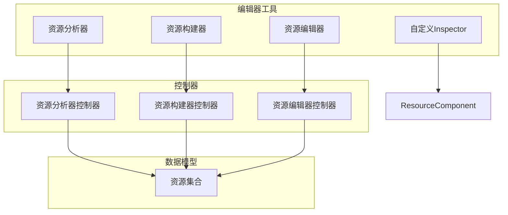
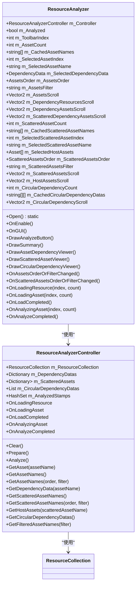
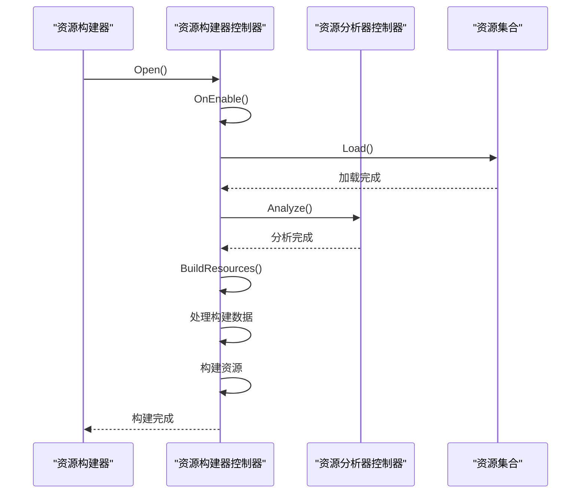
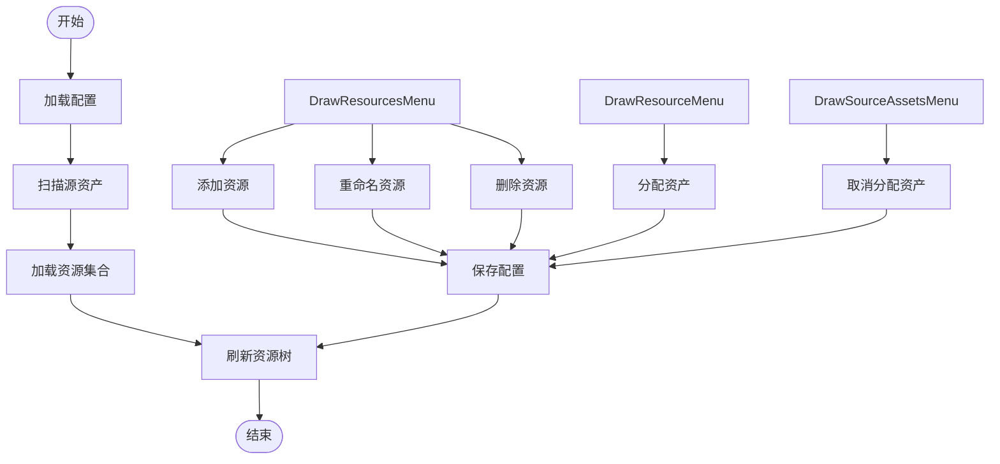

# 编辑器工具

<cite>
**本文档引用的文件**   
- [ResourceAnalyzer.cs](file://Scripts/Editor/ResourceAnalyzer/ResourceAnalyzer.cs)
- [ResourceBuilder.cs](file://Scripts/Editor/ResourceBuilder/ResourceBuilder.cs)
- [ResourceEditor.cs](file://Scripts/Editor/ResourceEditor/ResourceEditor.cs)
- [ResourceComponentInspector.cs](file://Scripts/Editor/Inspector/ResourceComponentInspector.cs)
- [ResourceAnalyzerController.cs](file://Scripts/Editor/ResourceAnalyzer/ResourceAnalyzerController.cs)
- [ResourceBuilderController.cs](file://Scripts/Editor/ResourceBuilder/ResourceBuilderController.cs)
- [ResourceEditorController.cs](file://Scripts/Editor/ResourceEditor/ResourceEditorController.cs)
- [ResourceCollection.cs](file://Scripts/Editor/ResourceCollection/ResourceCollection.cs)
- [ResourceComponent.cs](file://Scripts/Runtime/Resource/ResourceComponent.cs)
</cite>

## 目录
1. [简介](#简介)
2. [项目结构](#项目结构)
3. [核心组件](#核心组件)
4. [架构概述](#架构概述)
5. [详细组件分析](#详细组件分析)
6. [依赖分析](#依赖分析)
7. [性能考虑](#性能考虑)
8. [故障排除指南](#故障排除指南)
9. [结论](#结论)

## 简介
本文档详细介绍了为提升Unity开发效率而设计的四大编辑器工具：资源分析器（ResourceAnalyzer）、资源构建器（ResourceBuilder）、资源编辑器（ResourceEditor）和自定义Inspector。这些工具通过利用Unity的[CustomEditor]、[MenuItem]等特性，为开发者提供了从资源准备、分析优化、构建打包到最终发布的完整工作流支持。

## 项目结构
项目结构清晰地组织了编辑器工具和运行时组件。核心编辑器工具位于`Scripts/Editor`目录下，分为`Inspector`、`Misc`、`ResourceAnalyzer`、`ResourceBuilder`、`ResourceCollection`、`ResourceEditor`、`ResourcePackBuilder`和`ResourceSyncTools`等子目录。运行时组件则位于`Scripts/Runtime`目录下，包括`Base`、`Config`、`DataNode`、`DataTable`、`Debugger`、`Download`、`Entity`、`Event`、`FileSystem`、`Fsm`、`Localization`、`Network`、`ObjectPool`、`Procedure`、`ReferencePool`、`Resource`、`Scene`、`Setting`、`Sound`、`UI`、`Utility`和`Variable`等模块。

**Section sources**
- [ResourceAnalyzer.cs](file://Scripts/Editor/ResourceAnalyzer/ResourceAnalyzer.cs#L17-L531)
- [ResourceBuilder.cs](file://Scripts/Editor/ResourceBuilder/ResourceBuilder.cs#L17-L531)
- [ResourceEditor.cs](file://Scripts/Editor/ResourceEditor/ResourceEditor.cs#L17-L799)
- [ResourceComponentInspector.cs](file://Scripts/Editor/Inspector/ResourceComponentInspector.cs#L18-L378)

## 核心组件
本文档的核心组件包括资源分析器、资源构建器、资源编辑器和自定义Inspector。这些组件共同构成了一个完整的资源管理解决方案，帮助开发者优化资源结构、自动化构建流程、提供直观的资源管理界面，并增强Unity的Inspector面板。

**Section sources**
- [ResourceAnalyzer.cs](file://Scripts/Editor/ResourceAnalyzer/ResourceAnalyzer.cs#L17-L531)
- [ResourceBuilder.cs](file://Scripts/Editor/ResourceBuilder/ResourceBuilder.cs#L17-L531)
- [ResourceEditor.cs](file://Scripts/Editor/ResourceEditor/ResourceEditor.cs#L17-L799)
- [ResourceComponentInspector.cs](file://Scripts/Editor/Inspector/ResourceComponentInspector.cs#L18-L378)

## 架构概述
这些编辑器工具的架构设计遵循了模块化和职责分离的原则。资源分析器负责分析资源依赖和检测循环引用，资源构建器负责自动化打包AssetBundle，资源编辑器提供直观的资源管理界面，而自定义Inspector则增强Unity的Inspector面板。这些工具通过`ResourceCollection`类共享资源数据，并通过`ResourceAnalyzerController`、`ResourceBuilderController`和`ResourceEditorController`等控制器类实现具体功能。



**Diagram sources **
- [ResourceAnalyzer.cs](file://Scripts/Editor/ResourceAnalyzer/ResourceAnalyzer.cs#L17-L531)
- [ResourceBuilder.cs](file://Scripts/Editor/ResourceBuilder/ResourceBuilder.cs#L17-L531)
- [ResourceEditor.cs](file://Scripts/Editor/ResourceEditor/ResourceEditor.cs#L17-L799)
- [ResourceComponentInspector.cs](file://Scripts/Editor/Inspector/ResourceComponentInspector.cs#L18-L378)
- [ResourceAnalyzerController.cs](file://Scripts/Editor/ResourceAnalyzer/ResourceAnalyzerController.cs#L25-L62)
- [ResourceBuilderController.cs](file://Scripts/Editor/ResourceBuilder/ResourceBuilderController.cs#L40-L110)
- [ResourceEditorController.cs](file://Scripts/Editor/ResourceEditor/ResourceEditorController.cs#L34-L74)
- [ResourceCollection.cs](file://Scripts/Editor/ResourceCollection/ResourceCollection.cs#L32-L37)

## 详细组件分析

### 资源分析器分析
资源分析器是一个强大的工具，用于分析资源依赖、检测循环引用，帮助开发者优化资源结构。它通过`ResourceAnalyzerController`类实现核心功能，能够分析资源的依赖关系、散列依赖资产和循环依赖。

#### 对象导向组件：


**Diagram sources **
- [ResourceAnalyzer.cs](file://Scripts/Editor/ResourceAnalyzer/ResourceAnalyzer.cs#L17-L531)
- [ResourceAnalyzerController.cs](file://Scripts/Editor/ResourceAnalyzer/ResourceAnalyzerController.cs#L25-L62)
- [ResourceCollection.cs](file://Scripts/Editor/ResourceCollection/ResourceCollection.cs#L32-L37)

### 资源构建器分析
资源构建器是一个自动化工具，用于打包AssetBundle，处理不同平台的构建配置。它通过`ResourceBuilderController`类实现核心功能，能够处理资源的加载、分析和构建。

#### API/服务组件：


**Diagram sources **
- [ResourceBuilder.cs](file://Scripts/Editor/ResourceBuilder/ResourceBuilder.cs#L17-L531)
- [ResourceBuilderController.cs](file://Scripts/Editor/ResourceBuilder/ResourceBuilderController.cs#L40-L110)
- [ResourceAnalyzerController.cs](file://Scripts/Editor/ResourceAnalyzer/ResourceAnalyzerController.cs#L25-L62)
- [ResourceCollection.cs](file://Scripts/Editor/ResourceCollection/ResourceCollection.cs#L32-L37)

### 资源编辑器分析
资源编辑器提供了一个直观的界面，方便开发者在Unity编辑器内组织和查看资源。它通过`ResourceEditorController`类实现核心功能，能够管理资源的添加、重命名、删除和分配。

#### 复杂逻辑组件：


**Diagram sources **
- [ResourceEditor.cs](file://Scripts/Editor/ResourceEditor/ResourceEditor.cs#L17-L799)
- [ResourceEditorController.cs](file://Scripts/Editor/ResourceEditor/ResourceEditorController.cs#L34-L74)
- [ResourceCollection.cs](file://Scripts/Editor/ResourceCollection/ResourceCollection.cs#L32-L37)

### 自定义Inspector分析
自定义Inspector系列脚本（如ResourceComponentInspector）增强了Unity的Inspector面板，为各个GameFrameworkComponent提供更友好的可视化配置界面。`ResourceComponentInspector`特别为`ResourceComponent`提供了详细的配置选项。

#### 对象导向组件：
```mermaid
classDiagram
    class ResourceComponentInspector {
        +string[] ResourceModeNames
        +SerializedProperty m_ResourceMode
        +SerializedProperty m_ReadWritePathType
        +SerializedProperty m_UnloadUnusedAssetsInterval
        +SerializedProperty m_AssetAutoReleaseInterval
        +SerializedProperty m_AssetCapacity
        +SerializedProperty m_AssetExpireTime
        +SerializedProperty m_AssetPriority
        +SerializedProperty m_ResourceAutoReleaseInterval
        +SerializedProperty m_ResourceCapacity
        +SerializedProperty m_ResourceExpireTime
        +SerializedProperty m_ResourcePriority
        +SerializedProperty m_UpdatePrefixUri
        +SerializedProperty m_GenerateReadWriteVersionListLength
        +SerializedProperty m_UpdateRetryCount
        +SerializedProperty m_InstanceRoot
        +SerializedProperty m_LoadResourceAgentHelperCount
        +FieldInfo m_EditorResourceModeFieldInfo
        +int m_ResourceModeIndex
        +HelperInfo<ResourceHelperBase> m_ResourceHelperInfo
        +HelperInfo<LoadResourceAgentHelperBase> m_LoadResourceAgentHelperInfo
        +OnInspectorGUI()
        +OnCompileComplete()
        +OnEnable()
        +DrawLoadAssetInfo(loadAssetInfo)
        +RefreshModes()
        +RefreshTypeNames()
    }
    
    class ResourceComponent {
        +ResourceMode m_ResourceMode
        +ReadWritePathType m_ReadWritePathType
        +float m_UnloadUnusedAssetsInterval
        +float m_AssetAutoReleaseInterval
        +int m_AssetCapacity
        +float m_AssetExpireTime
        +int m_AssetPriority
        +float m_ResourceAutoReleaseInterval
        +int m_ResourceCapacity
        +float m_ResourceExpireTime
        +int m_ResourcePriority
        +string m_UpdatePrefixUri
        +int m_GenerateReadWriteVersionListLength
        +int m_UpdateRetryCount
        +Transform m_InstanceRoot
        +string m_ResourceHelperTypeName
        +ResourceHelperBase m_CustomResourceHelper
        +string m_LoadResourceAgentHelperTypeName
        +LoadResourceAgentHelperBase m_CustomLoadResourceAgentHelper
        +int m_LoadResourceAgentHelperCount
        +ReadOnlyPath
        +ReadWritePath
        +ResourceMode
        +ReadWritePathType
        +CurrentVariant
        +PackageVersionListSerializer
        +UpdatableVersionListSerializer
        +ReadOnlyVersionListSerializer
        +ReadWriteVersionListSerializer
        +ResourcePackVersionListSerializer
        +UnloadUnusedAssetsInterval
        +ApplicableGameVersion
        +InternalResourceVersion
        +AssetCount
        +ResourceCount
        +ResourceGroupCount
        +UpdatePrefixUri
        +GenerateReadWriteVersionListLength
        +ApplyingResourcePackPath
        +ApplyWaitingCount
        +UpdateRetryCount
        +UpdatingResourceGroup
        +UpdateWaitingCount
        +UpdateCandidateCount
        +UpdatingCount
        +LoadTotalAgentCount
        +LoadFreeAgentCount
        +LoadWorkingAgentCount
        +LoadWaitingTaskCount
        +AssetAutoReleaseInterval
        +AssetCapacity
        +AssetExpireTime
        +AssetPriority
        +ResourceAutoReleaseInterval
        +ResourceCapacity
        +ResourceExpireTime
        +ResourcePriority
        +Awake()
        +Start()
        +Update()
        +SetResourceMode(resourceMode)
        +SetCurrentVariant(currentVariant)
        +SetDecryptResourceCallback(decryptResourceCallback)
        +UnloadUnusedAssets(performGCCollect)
        +ForceUnloadUnusedAssets(performGCCollect)
        +InitResources(initResourcesCompleteCallback)
        +CheckVersionList(latestInternalResourceVersion)
        +UpdateVersionList(versionListLength, versionListHashCode, versionListZipLength, versionListZipHashCode, updateVersionListCallbacks)
        +CheckResources(checkResourcesCompleteCallback)
        +CheckResources(ignoreOtherVariant, checkResourcesCompleteCallback)
        +ApplyResources(resourcePackPath, applyResourcesCompleteCallback)
        +UpdateResources(updateResourcesCompleteCallback)
        +UpdateResources(resourceGroupName, updateResourcesCompleteCallback)
        +VerifyResourcePack(resourcePackPath)
        +HasAsset(assetName)
        +LoadAsset(assetName, loadAssetCallbacks)
        +LoadAsset(assetName, assetType, loadAssetCallbacks)
        +LoadAsset(assetName, priority, loadAssetCallbacks)
        +LoadAsset(assetName, loadAssetCallbacks, userData)
        +LoadAsset(assetName, assetType, priority, loadAssetCallbacks)
        +LoadAsset(assetName, assetType, loadAssetCallbacks, userData)
        +LoadAsset(assetName, priority, loadAssetCallbacks, userData)
        +LoadAsset(assetName, assetType, priority, loadAssetCallbacks, userData)
        +UnloadAsset(asset)
        +GetBinaryPath(binaryAssetName)
        +GetBinaryPath(binaryAssetName, storageInReadOnly, storageInFileSystem, relativePath, fileName)
        +GetBinaryLength(binaryAssetName)
        +LoadBinary(binaryAssetName, loadBinaryCallbacks)
        +LoadBinary(binaryAssetName, loadBinaryCallbacks, userData)
        +LoadBinaryFromFileSystem(binaryAssetName)
        +LoadBinaryFromFileSystem(binaryAssetName, buffer)
        +LoadBinaryFromFileSystem(binaryAssetName, buffer, startIndex)
        +LoadBinaryFromFileSystem(binaryAssetName, buffer, startIndex, length)
        +LoadBinarySegmentFromFileSystem(binaryAssetName, length)
        +LoadBinarySegmentFromFileSystem(binaryAssetName, offset, length)
        +LoadBinarySegmentFromFileSystem(binaryAssetName, buffer)
        +LoadBinarySegmentFromFileSystem(binaryAssetName, buffer, length)
        +LoadBinarySegmentFromFileSystem(binaryAssetName, buffer, startIndex, length)
        +LoadBinarySegmentFromFileSystem(binaryAssetName, offset,