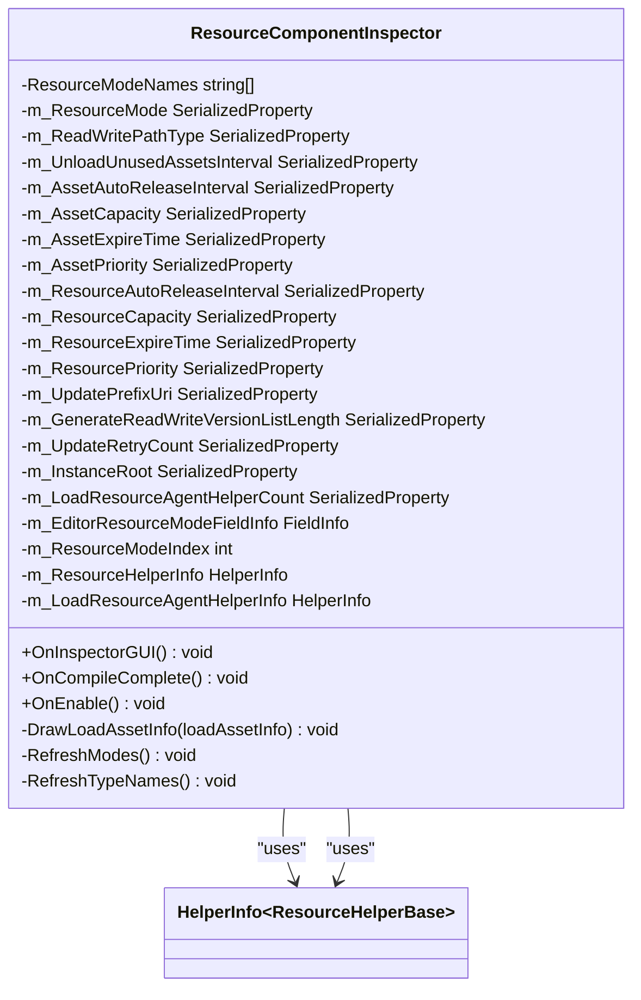

# 自定义Inspector

<cite>
**Referenced Files in This Document**   
- [ResourceComponentInspector.cs](file://Scripts/Editor/Inspector/ResourceComponentInspector.cs)
- [GameFrameworkInspector.cs](file://Scripts/Editor/Inspector/GameFrameworkInspector.cs)
- [ResourceComponent.cs](file://Scripts/Runtime/Resource/ResourceComponent.cs)
- [HelperInfo.cs](file://Scripts/Editor/Misc/HelperInfo.cs)
</cite>

## 目录
1. [简介](#简介)
2. [核心组件](#核心组件)
3. [架构概述](#架构概述)
4. [详细组件分析](#详细组件分析)
5. [依赖分析](#依赖分析)
6. [性能考虑](#性能考虑)
7. [故障排除指南](#故障排除指南)
8. [结论](#结论)

## 简介
自定义Inspector是Unity编辑器扩展的重要组成部分，它允许开发者为GameFramework中的各个组件（如ResourceComponent）提供增强的可视化配置界面。通过使用[CustomEditor]属性，开发者可以创建专门的Inspector类来定制特定组件在Unity编辑器中的显示和交互方式。本文档以ResourceComponentInspector为例，详细说明了如何通过继承GameFrameworkInspector基类并重写OnInspectorGUI方法来实现自定义的Inspector面板。文档涵盖了UI元素的设计、SerializedProperty的使用、FieldInfo反射的应用以及在不同模式下的行为差异，为开发者提供了完整的扩展指南。

## 核心组件
自定义Inspector的核心在于ResourceComponentInspector类，它通过继承GameFrameworkInspector基类并重写OnInspectorGUI方法来实现对ResourceComponent的可视化配置。该组件利用SerializedProperty安全地访问和修改组件的序列化字段，并通过FieldInfo反射获取私有字段的状态。在编辑模式和运行模式下，该组件表现出不同的行为，例如某些配置项在Play Mode下被禁用。此外，该组件还支持热重载，通过OnCompileComplete方法在编译完成后刷新类型名称。

**Section sources**
- [ResourceComponentInspector.cs](file://Scripts/Editor/Inspector/ResourceComponentInspector.cs#L18-L378)
- [GameFrameworkInspector.cs](file://Scripts/Editor/Inspector/GameFrameworkInspector.cs#L14-L62)
- [ResourceComponent.cs](file://Scripts/Runtime/Resource/ResourceComponent.cs#L20-L1365)

## 架构概述
自定义Inspector的架构基于Unity的编辑器扩展机制，通过[CustomEditor]属性将特定的Inspector类与组件关联。ResourceComponentInspector继承自GameFrameworkInspector基类，后者提供了基本的绘制事件处理和编译事件监听功能。ResourceComponentInspector通过重写OnInspectorGUI方法来定制Inspector面板的布局和控件，利用SerializedProperty来安全地访问和修改组件的序列化字段，并通过FieldInfo反射获取私有字段的状态。

```mermaid
classDiagram
class GameFrameworkInspector {
+m_IsCompiling bool
+OnInspectorGUI() void
+OnCompileStart() void
+OnCompileComplete() void
+IsPrefabInHierarchy(obj) bool
}
class ResourceComponentInspector {
-ResourceModeNames string[]
-m_ResourceMode SerializedProperty
-m_ReadWritePathType SerializedProperty
-m_UnloadUnusedAssetsInterval SerializedProperty
-m_AssetAutoReleaseInterval SerializedProperty
-m_AssetCapacity SerializedProperty
-m_AssetExpireTime SerializedProperty
-m_AssetPriority SerializedProperty
-m_ResourceAutoReleaseInterval SerializedProperty
-m_ResourceCapacity SerializedProperty
-m_ResourceExpireTime SerializedProperty
-m_ResourcePriority SerializedProperty
-m_UpdatePrefixUri SerializedProperty
-m_GenerateReadWriteVersionListLength SerializedProperty
-m_UpdateRetryCount SerializedProperty
-m_InstanceRoot SerializedProperty
-m_LoadResourceAgentHelperCount SerializedProperty
-m_EditorResourceModeFieldInfo FieldInfo
-m_ResourceModeIndex int
-m_ResourceHelperInfo HelperInfo<ResourceHelperBase>
-m_LoadResourceAgentHelperInfo HelperInfo<LoadResourceAgentHelperBase>
+OnInspectorGUI() void
+OnCompileComplete() void
+OnEnable() void
-DrawLoadAssetInfo(loadAssetInfo) void
-RefreshModes() void
-RefreshTypeNames() void
}
class ResourceComponent {
-m_ResourceMode ResourceMode
-m_ReadWritePathType ReadWritePathType
-m_UnloadUnusedAssetsInterval float
-m_AssetAutoReleaseInterval float
-m_AssetCapacity int
-m_AssetExpireTime float
-m_AssetPriority int
-m_ResourceAutoReleaseInterval float
-m_ResourceCapacity int
-m_ResourceExpireTime float
-m_ResourcePriority int
-m_UpdatePrefixUri string
-m_GenerateReadWriteVersionListLength int
-m_UpdateRetryCount int
-m_InstanceRoot Transform
-m_ResourceHelperTypeName string
-m_CustomResourceHelper ResourceHelperBase
-m_LoadResourceAgentHelperTypeName string
-m_CustomLoadResourceAgentHelper LoadResourceAgentHelperBase
-m_LoadResourceAgentHelperCount int
+ReadOnlyPath string
+ReadWritePath string
+ResourceMode ResourceMode
+ReadWritePathType ReadWritePathType
+CurrentVariant string
+PackageVersionListSerializer PackageVersionListSerializer
+UpdatableVersionListSerializer UpdatableVersionListSerializer
+ReadOnlyVersionListSerializer ReadOnlyVersionListSerializer
+ReadWriteVersionListSerializer ReadWriteVersionListSerializer
+ResourcePackVersionListSerializer ResourcePackVersionListSerializer
+UnloadUnusedAssetsInterval float
+ApplicableGameVersion string
+InternalResourceVersion int
+AssetCount int
+ResourceCount int
+ResourceGroupCount int
+UpdatePrefixUri string
+GenerateReadWriteVersionListLength int
+ApplyingResourcePackPath string
+ApplyWaitingCount int
+UpdateRetryCount int
+UpdatingResourceGroup IResourceGroup
+UpdateWaitingCount int
+UpdateCandidateCount int
+UpdatingCount int
+LoadTotalAgentCount int
+LoadFreeAgentCount int
+LoadWorkingAgentCount int
+LoadWaitingTaskCount int
+AssetAutoReleaseInterval float
+AssetCapacity int
+AssetExpireTime float
+AssetPriority int
+ResourceAutoReleaseInterval float
+ResourceCapacity int
+ResourceExpireTime float
+ResourcePriority int
+Awake() void
+Start() void
+SetResourceMode(resourceMode) void
+SetCurrentVariant(currentVariant) void
+SetDecryptResourceCallback(decryptResourceCallback) void
+UnloadUnusedAssets(performGCCollect) void
+ForceUnloadUnusedAssets(performGCCollect) void
+InitResources(initResourcesCompleteCallback) void
+CheckVersionList(latestInternalResourceVersion) CheckVersionListResult
+UpdateVersionList(versionListLength, versionListHashCode, versionListZipLength, versionListZipHashCode, updateVersionListCallbacks) void
+CheckResources(checkResourcesCompleteCallback) void
+CheckResources(ignoreOtherVariant, checkResourcesCompleteCallback) void
+ApplyResources(resourcePackPath, applyResourcesCompleteCallback) void
+UpdateResources(updateResourcesCompleteCallback) void
+UpdateResources(resourceGroupName, updateResourcesCompleteCallback) void
+VerifyResourcePack(resourcePackPath) bool
+HasAsset(assetName) HasAssetResult
+LoadAsset(assetName, loadAssetCallbacks) void
+LoadAsset(assetName, assetType, loadAssetCallbacks) void
+LoadAsset(assetName, priority, loadAssetCallbacks) void
+LoadAsset(assetName, loadAssetCallbacks, userData) void
+LoadAsset(assetName, assetType, priority, loadAssetCallbacks) void
+LoadAsset(assetName, assetType, loadAssetCallbacks, userData) void
+LoadAsset(assetName, priority, loadAssetCallbacks, userData) void
+LoadAsset(assetName, assetType, priority, loadAssetCallbacks, userData) void
+UnloadAsset(asset) void
+GetBinaryPath(binaryAssetName) string
+GetBinaryPath(binaryAssetName, storageInReadOnly, storageInFileSystem, relativePath, fileName) bool
+GetBinaryLength(binaryAssetName) int
+LoadBinary(binaryAssetName, loadBinaryCallbacks) void
+LoadBinary(binaryAssetName, loadBinaryCallbacks, userData) void
+LoadBinaryFromFileSystem(binaryAssetName) byte[]
+LoadBinaryFromFileSystem(binaryAssetName, buffer) int
+LoadBinaryFromFileSystem(binaryAssetName, buffer, startIndex) int
+LoadBinaryFromFileSystem(binaryAssetName, buffer, startIndex, length) int
+LoadBinarySegmentFromFileSystem(binaryAssetName, length) byte[]
+LoadBinarySegmentFromFileSystem(binaryAssetName, offset, length) byte[]
+LoadBinarySegmentFromFileSystem(binaryAssetName, buffer) int
+LoadBinarySegmentFromFileSystem(binaryAssetName, buffer, length) int
+LoadBinarySegmentFromFileSystem(binaryAssetName, buffer, startIndex, length) int
+LoadBinarySegmentFromFileSystem(binaryAssetName, offset, buffer) int
+LoadBinarySegmentFromFileSystem(binaryAssetName, offset, buffer, length) int
+LoadBinarySegmentFromFileSystem(binaryAssetName, offset, buffer, startIndex, length) int
+HasResourceGroup(resourceGroupName) bool
+GetResourceGroup() IResourceGroup
+GetResourceGroup(resourceGroupName) IResourceGroup
+GetAllLoadAssetInfos() TaskInfo[]
+AddLoadResourceAgentHelper(index) void
+OnResourceApplySuccess(sender, e) void
+OnResourceApplyFailure(sender, e) void
+OnResourceUpdateStart(sender, e) void
+OnResourceUpdateChanged(sender, e) void
+OnResourceUpdateSuccess(sender, e) void
+OnResourceUpdateFailure(sender, e) void
}
class HelperInfo~T~ {
-CustomOptionName string
-m_Name string
-m_HelperTypeName SerializedProperty
-m_CustomHelper SerializedProperty
-m_HelperTypeNames string[]
-m_HelperTypeNameIndex int
+HelperInfo(name) HelperInfo~T~
+Init(serializedObject) void
+Draw() void
+Refresh() void
+FieldNameForDisplay(fieldName) string
}
GameFrameworkInspector <|-- ResourceComponentInspector
ResourceComponentInspector --> HelperInfo~ResourceHelperBase~ : "uses"
ResourceComponentInspector --> HelperInfo~LoadResourceAgentHelperBase~ : "uses"
ResourceComponentInspector --> ResourceComponent : "configures"
```



**Diagram sources **
- [ResourceComponentInspector.cs](file://Scripts/Editor/Inspector/ResourceComponentInspector.cs#L18-L378)
- [GameFrameworkInspector.cs](file://Scripts/Editor/Inspector/GameFrameworkInspector.cs#L14-L62)
- [ResourceComponent.cs](file://Scripts/Runtime/Resource/ResourceComponent.cs#L20-L1365)
- [HelperInfo.cs](file://Scripts/Editor/Misc/HelperInfo.cs#L15-L95)

## 详细组件分析

### ResourceComponentInspector 分析
ResourceComponentInspector是为ResourceComponent提供自定义Inspector界面的核心类。它通过继承GameFrameworkInspector基类并重写OnInspectorGUI方法来实现对ResourceComponent的可视化配置。该类利用SerializedProperty来安全地访问和修改组件的序列化字段，并通过FieldInfo反射获取私有字段的状态。在编辑模式和运行模式下，该类表现出不同的行为，例如某些配置项在Play Mode下被禁用。此外，该类还支持热重载，通过OnCompileComplete方法在编译完成后刷新类型名称。

#### 类结构分析


**Diagram sources **
- [ResourceComponentInspector.cs](file://Scripts/Editor/Inspector/ResourceComponentInspector.cs#L18-L378)
- [HelperInfo.cs](file://Scripts/Editor/Misc/HelperInfo.cs#L15-L95)

#### UI元素分析
ResourceComponentInspector的UI元素包括资源模式（Resource Mode）的下拉选择、各种间隔和容量参数的滑动条与输入框、帮助类（Helper）的动态选择器（HelperInfo）以及运行时状态的只读显示。这些UI元素通过SerializedProperty来安全地访问和修改组件的序列化字段，并通过FieldInfo反射获取私有字段的状态。

```mermaid
flowchart TD
Start([OnInspectorGUI Entry]) --> UpdateSerializedObject["serializedObject.Update()"]
UpdateSerializedObject --> GetTarget["ResourceComponent t = (ResourceComponent)target"]
GetTarget --> GetEditorResourceMode["bool isEditorResourceMode = (bool)m_EditorResourceModeFieldInfo.GetValue(target)"]
GetEditorResourceMode --> CheckEditorResourceMode{"isEditorResourceMode?"}
CheckEditorResourceMode --> |Yes| ShowWarning["EditorGUILayout.HelpBox(\"Editor resource mode is enabled. Some options are disabled.\", MessageType.Warning)"]
CheckEditorResourceMode --> |No| BeginDisabledGroup1["EditorGUI.BeginDisabledGroup(EditorApplication.isPlayingOrWillChangePlaymode)"]
BeginDisabledGroup1 --> CheckPlaying{"EditorApplication.isPlaying?"}
CheckPlaying --> |Yes| CheckPrefabInHierarchy{"IsPrefabInHierarchy(t.gameObject)?"}
CheckPlaying --> |No| ShowResourceModePopup["int selectedIndex = EditorGUILayout.Popup(\"Resource Mode\", m_ResourceModeIndex, ResourceModeNames)"]
CheckPrefabInHierarchy --> |Yes| ShowResourceModeEnum["EditorGUILayout.EnumPopup(\"Resource Mode\", t.ResourceMode)"]
CheckPrefabInHierarchy --> |No| ShowResourceModePopup
ShowResourceModePopup --> CheckSelectionChange{"selectedIndex != m_ResourceModeIndex?"}
CheckSelectionChange --> |Yes| UpdateResourceModeIndex["m_ResourceModeIndex = selectedIndex"]
CheckSelectionChange --> |No| ShowReadWritePathType["m_ReadWritePathType.enumValueIndex = (int)(ReadWritePathType)EditorGUILayout.EnumPopup(\"Read Write Path Type\", t.ReadWritePathType)"]
UpdateResourceModeIndex --> UpdateResourceModeEnum["m_ResourceMode.enumValueIndex = selectedIndex + 1"]
UpdateResourceModeEnum --> ShowReadWritePathType
ShowReadWritePathType --> EndDisabledGroup1["EditorGUI.EndDisabledGroup()"]
EndDisabledGroup1 --> ShowUnloadUnusedAssetsInterval["float unloadUnusedAssetsInterval = EditorGUILayout.Slider(\"Unload Unused Assets Interval\", m_UnloadUnusedAssetsInterval.floatValue, 0f, 3600f)"]
ShowUnloadUnusedAssetsInterval --> CheckIntervalChange{"unloadUnusedAssetsInterval != m_UnloadUnusedAssetsInterval.floatValue?"}
CheckIntervalChange --> |Yes| UpdateIntervalValue["if (EditorApplication.isPlaying) { t.UnloadUnusedAssetsInterval = unloadUnusedAssetsInterval; } else { m_UnloadUnusedAssetsInterval.floatValue = unloadUnusedAssetsInterval; }"]
CheckIntervalChange --> |No| BeginDisabledGroup2["EditorGUI.BeginDisabledGroup(EditorApplication.isPlaying && isEditorResourceMode)"]
UpdateIntervalValue --> BeginDisabledGroup2
BeginDisabledGroup2 --> ShowAssetAutoReleaseInterval["float assetAutoReleaseInterval = EditorGUILayout.DelayedFloatField(\"Asset Auto Release Interval\", m_AssetAutoReleaseInterval.floatValue)"]
ShowAssetAutoReleaseInterval --> CheckAssetAutoReleaseIntervalChange{"assetAutoReleaseInterval != m_AssetAutoReleaseInterval.floatValue?"}
CheckAssetAutoReleaseIntervalChange --> |Yes| UpdateAssetAutoReleaseIntervalValue["if (EditorApplication.isPlaying) { t.AssetAutoReleaseInterval = assetAutoReleaseInterval; } else { m_AssetAutoReleaseInterval.floatValue = assetAutoReleaseInterval; }"]
CheckAssetAutoReleaseIntervalChange --> |No| ShowAssetCapacity["int assetCapacity = EditorGUILayout.DelayedIntField(\"Asset Capacity\", m_AssetCapacity.intValue)"]
UpdateAssetAutoReleaseIntervalValue --> ShowAssetCapacity
ShowAssetCapacity --> CheckAssetCapacityChange{"assetCapacity != m_AssetCapacity.intValue?"}
CheckAssetCapacityChange --> |Yes| UpdateAssetCapacityValue["if (EditorApplication.isPlaying) { t.AssetCapacity = assetCapacity; } else { m_AssetCapacity.intValue = assetCapacity; }"]
CheckAssetCapacityChange --> |No| ShowAssetExpireTime["float assetExpireTime = EditorGUILayout.DelayedFloatField(\"Asset Expire Time\", m_AssetExpireTime.floatValue)"]
UpdateAssetCapacityValue --> ShowAssetExpireTime
ShowAssetExpireTime --> CheckAssetExpireTimeChange{"assetExpireTime != m_AssetExpireTime.floatValue?"}
CheckAssetExpireTimeChange --> |Yes| UpdateAssetExpireTimeValue["if (EditorApplication.isPlaying) { t.AssetExpireTime = assetExpireTime; } else { m_AssetExpireTime.floatValue = assetExpireTime; }"]
CheckAssetExpireTimeChange --> |No| ShowAssetPriority["int assetPriority = EditorGUILayout.DelayedIntField(\"Asset Priority\", m_AssetPriority.intValue)"]
UpdateAssetExpireTimeValue --> ShowAssetPriority
ShowAssetPriority --> CheckAssetPriorityChange{"assetPriority != m_AssetPriority.intValue?"}
CheckAssetPriorityChange --> |Yes| UpdateAssetPriorityValue["if (EditorApplication.isPlaying) { t.AssetPriority = assetPriority; } else { m_AssetPriority.intValue = assetPriority; }"]
CheckAssetPriorityChange --> |No| ShowResourceAutoReleaseInterval["float resourceAutoReleaseInterval = EditorGUILayout.DelayedFloatField(\"Resource Auto Release Interval\", m_ResourceAutoReleaseInterval.floatValue)"]
UpdateAssetPriorityValue --> ShowResourceAutoReleaseInterval
ShowResourceAutoReleaseInterval --> CheckResourceAutoReleaseIntervalChange{"resourceAutoReleaseInterval != m_ResourceAutoReleaseInterval.floatValue?"}
CheckResourceAutoReleaseIntervalChange --> |Yes| UpdateResourceAutoReleaseIntervalValue["if (EditorApplication.isPlaying) { t.ResourceAutoReleaseInterval = resourceAutoReleaseInterval; } else { m_ResourceAutoReleaseInterval.floatValue = resourceAutoReleaseInterval; }"]
CheckResourceAutoReleaseIntervalChange --> |No| ShowResourceCapacity["int resourceCapacity = EditorGUILayout.DelayedIntField(\"Resource Capacity\", m_ResourceCapacity.intValue)"]
UpdateResourceAutoReleaseIntervalValue --> ShowResourceCapacity
ShowResourceCapacity --> CheckResourceCapacityChange{"resourceCapacity != m_ResourceCapacity.intValue?"}
CheckResourceCapacityChange --> |Yes| UpdateResourceCapacityValue["if (EditorApplication.isPlaying) { t.ResourceCapacity = resourceCapacity; } else { m_ResourceCapacity.intValue = resourceCapacity; }"]
CheckResourceCapacityChange --> |No| ShowResourceExpireTime["float resourceExpireTime = EditorGUILayout.DelayedFloatField(\"Resource Expire Time\", m_ResourceExpireTime.floatValue)"]
UpdateResourceCapacityValue --> ShowResourceExpireTime
ShowResourceExpireTime --> CheckResourceExpireTimeChange{"resourceExpireTime != m_ResourceExpireTime.floatValue?"}
CheckResourceExpireTimeChange --> |Yes| UpdateResourceExpireTimeValue["if (EditorApplication.isPlaying) { t.ResourceExpireTime = resourceExpireTime; } else { m_ResourceExpireTime.floatValue = resourceExpireTime; }"]
CheckResourceExpireTimeChange --> |No| ShowResourcePriority["int resourcePriority = EditorGUILayout.DelayedIntField(\"Resource Priority\", m_ResourcePriority.intValue)"]
UpdateResourceExpireTimeValue --> ShowResourcePriority
ShowResourcePriority --> CheckResourcePriorityChange{"resourcePriority != m_ResourcePriority.intValue?"}
CheckResourcePriorityChange --> |Yes| UpdateResourcePriorityValue["if (EditorApplication.isPlaying) { t.ResourcePriority = resourcePriority; } else { m_ResourcePriority.intValue = resourcePriority; }"]
CheckResourcePriorityChange --> |No| CheckResourceModeIndex{"m_ResourceModeIndex > 0?"}
UpdateResourcePriorityValue --> CheckResourceModeIndex
CheckResourceModeIndex --> |Yes| ShowUpdatePrefixUri["string updatePrefixUri = EditorGUILayout.DelayedTextField(\"Update Prefix Uri\", m_UpdatePrefixUri.stringValue)"]
CheckResourceModeIndex --> |No| BeginDisabledGroup3["EditorGUI.BeginDisabledGroup(EditorApplication.isPlayingOrWillChangePlaymode)"]
ShowUpdatePrefixUri --> CheckUpdatePrefixUriChange{"updatePrefixUri != m_UpdatePrefixUri.stringValue?"}
CheckUpdatePrefixUriChange --> |Yes| UpdateUpdatePrefixUriValue["if (EditorApplication.isPlaying) { t.UpdatePrefixUri = updatePrefixUri; } else { m_UpdatePrefixUri.stringValue = updatePrefixUri; }"]
CheckUpdatePrefixUriChange --> |No| ShowGenerateReadWriteVersionListLength["int generateReadWriteVersionListLength = EditorGUILayout.DelayedIntField(\"Generate Read Write Version List Length\", m_GenerateReadWriteVersionListLength.intValue)"]
UpdateUpdatePrefixUriValue --> ShowGenerateReadWriteVersionListLength
ShowGenerateReadWriteVersionListLength --> CheckGenerateReadWriteVersionListLengthChange{"generateReadWriteVersionListLength != m_GenerateReadWriteVersionListLength.intValue?"}
CheckGenerateReadWriteVersionListLengthChange --> |Yes| UpdateGenerateReadWriteVersionListLengthValue["if (EditorApplication.isPlaying) { t.GenerateReadWriteVersionListLength = generateReadWriteVersionListLength; } else { m_GenerateReadWriteVersionListLength.intValue = generateReadWriteVersionListLength; }"]
CheckGenerateReadWriteVersionListLengthChange --> |No| ShowUpdateRetryCount["int updateRetryCount = EditorGUILayout.DelayedIntField(\"Update Retry Count\", m_UpdateRetryCount.intValue)"]
UpdateGenerateReadWriteVersionListLengthValue --> ShowUpdateRetryCount
ShowUpdateRetryCount --> CheckUpdateRetryCountChange{"updateRetryCount != m_UpdateRetryCount.intValue?"}
CheckUpdateRetryCountChange --> |Yes| UpdateUpdateRetryCountValue["if (EditorApplication.isPlaying) { t.UpdateRetryCount = updateRetryCount; } else { m_UpdateRetryCount.intValue = updateRetryCount; }"]
CheckUpdateRetryCountChange --> |No| BeginDisabledGroup3
UpdateUpdateRetryCountValue --> BeginDisabledGroup3
BeginDisabledGroup3 --> ShowInstanceRoot["EditorGUILayout.PropertyField(m_InstanceRoot)"]
ShowInstanceRoot --> ShowResourceHelperInfo["m_ResourceHelperInfo.Draw()"]
ShowResourceHelperInfo --> ShowLoadResourceAgentHelperInfo["m_LoadResourceAgentHelperInfo.Draw()"]
ShowLoadResourceAgentHelperInfo --> ShowLoadResourceAgentHelperCount["m_LoadResourceAgentHelperCount.intValue = EditorGUILayout.IntSlider(\"Load Resource Agent Helper Count\", m_LoadResourceAgentHelperCount.intValue, 1, 128)"]
ShowLoadResourceAgentHelperCount --> EndDisabledGroup3["EditorGUI.EndDisabledGroup()"]
EndDisabledGroup3 --> CheckPlayingAndPrefab{"EditorApplication.isPlaying && IsPrefabInHierarchy(t.gameObject)?"}
CheckPlayingAndPrefab --> |Yes| ShowReadOnlyPath["EditorGUILayout.LabelField(\"Read Only Path\", t.ReadOnlyPath.ToString())"]
CheckPlayingAndPrefab --> |No| ApplyModifiedProperties["serializedObject.ApplyModifiedProperties()"]
ShowReadOnlyPath --> ShowReadWritePath["EditorGUILayout.LabelField(\"Read Write Path\", t.ReadWritePath.ToString())"]
ShowReadWritePath --> ShowCurrentVariant["EditorGUILayout.LabelField(\"Current Variant\", t.CurrentVariant ?? \"<Unknwon>\")"]
ShowCurrentVariant --> ShowApplicableGameVersion["EditorGUILayout.LabelField(\"Applicable Game Version\", isEditorResourceMode ? \"N/A\" : t.ApplicableGameVersion ?? \"<Unknwon>\")"]
ShowApplicableGameVersion --> ShowInternalResourceVersion["EditorGUILayout.LabelField(\"Internal Resource Version\", isEditorResourceMode ? \"N/A\" : t.InternalResourceVersion.ToString())"]
ShowInternalResourceVersion --> ShowAssetCount["EditorGUILayout.LabelField(\"Asset Count\", isEditorResourceMode ? \"N/A\" : t.AssetCount.ToString())"]
ShowAssetCount --> ShowResourceCount["EditorGUILayout.LabelField(\"Resource Count\", isEditorResourceMode ? \"N/A\" : t.ResourceCount.ToString())"]
ShowResourceCount --> ShowResourceGroupCount["EditorGUILayout.LabelField(\"Resource Group Count\", isEditorResourceMode ? \"N/A\" : t.ResourceGroupCount.ToString())"]
ShowResourceGroupCount --> CheckResourceModeIndex2{"m_ResourceModeIndex > 0?"}
CheckResourceModeIndex2 --> |Yes| ShowApplyingResourcePackPath["EditorGUILayout.LabelField(\"Applying Resource Pack Path\", isEditorResourceMode ? \"N/A\" : t.ApplyingResourcePackPath ?? \"<Unknwon>\")"]
CheckResourceModeIndex2 --> |No| ShowLoadTotalAgentCount["EditorGUILayout.LabelField(\"Load Total Agent Count\", isEditorResourceMode ? \"N/A\" : t.LoadTotalAgentCount.ToString())"]
ShowApplyingResourcePackPath --> ShowApplyWaitingCount["EditorGUILayout.LabelField(\"Apply Waiting Count\", isEditorResourceMode ? \"N/A\" : t.ApplyWaitingCount.ToString())"]
ShowApplyWaitingCount --> ShowUpdatingResourceGroup["EditorGUILayout.LabelField(\"Updating Resource Group\", isEditorResourceMode ? \"N/A\" : t.UpdatingResourceGroup != null ? t.UpdatingResourceGroup.Name : \"<Unknwon>\")"]
ShowUpdatingResourceGroup --> ShowUpdateWaitingCount["EditorGUILayout.LabelField(\"Update Waiting Count\", isEditorResourceMode ? \"N/A\" : t.UpdateWaitingCount.ToString())"]
ShowUpdateWaitingCount --> ShowUpdateCandidateCount["EditorGUILayout.LabelField(\"Update Candidate Count\", isEditorResourceMode ? \"N/A\" : t.UpdateCandidateCount.ToString())"]
ShowUpdateCandidateCount --> ShowUpdatingCount["EditorGUILayout.LabelField(\"Updating Count\", isEditorResourceMode ? \"N/A\" : t.UpdatingCount.ToString())"]
ShowUpdatingCount --> ShowLoadTotalAgentCount
ShowLoadTotalAgentCount --> ShowLoadFreeAgentCount["EditorGUILayout.LabelField(\"Load Free Agent Count\", isEditorResourceMode ? \"N/A\" : t.LoadFreeAgentCount.ToString())"]
ShowLoadFreeAgentCount --> ShowLoadWorkingAgentCount["EditorGUILayout.LabelField(\"Load Working Agent Count\", isEditorResourceMode ? \"N/A\" : t.LoadWorkingAgentCount.ToString())"]
ShowLoadWorkingAgentCount --> ShowLoadWaitingTaskCount["EditorGUILayout.LabelField(\"Load Waiting Task Count\", isEditorResourceMode ? \"N/A\" : t.LoadWaitingTaskCount.ToString())"]
ShowLoadWaitingTaskCount --> CheckNotEditorResourceMode{"!isEditorResourceMode?"}
CheckNotEditorResourceMode --> |Yes| BeginVertical["EditorGUILayout.BeginVertical(\"box\")"]
CheckNotEditorResourceMode --> |No| ApplyModifiedProperties
BeginVertical --> GetLoadAssetInfos["TaskInfo[] loadAssetInfos = t.GetAllLoadAssetInfos()"]
GetLoadAssetInfos --> CheckLoadAssetInfosEmpty{"loadAssetInfos.Length > 0?"}
CheckLoadAssetInfosEmpty --> |Yes| ForEachLoadAssetInfo["foreach (TaskInfo loadAssetInfo in loadAssetInfos)"]
CheckLoadAssetInfosEmpty --> |No| ShowEmptyLabel["GUILayout.Label(\"Load Asset Task is Empty ...\")"]
ForEachLoadAssetInfo --> DrawLoadAssetInfo["DrawLoadAssetInfo(loadAssetInfo)"]
DrawLoadAssetInfo --> ForEachLoadAssetInfo
ForEachLoadAssetInfo --> ShowExportButton["if (GUILayout.Button(\"Export CSV Data\"))"]
ShowExportButton --> |Yes| SaveFilePanel["string exportFileName = EditorUtility.SaveFilePanel(\"Export CSV Data\", string.Empty, \"Load Asset Task Data.csv\", string.Empty)"]
SaveFilePanel --> CheckExportFileName{"!string.IsNullOrEmpty(exportFileName)?"}
CheckExportFileName --> |Yes| TryExport["try"]
CheckExportFileName --> |No| EndVertical["EditorGUILayout.EndVertical()"]
TryExport --> CreateDataArray["int index = 0; string[] data = new string[loadAssetInfos.Length + 1];"]
CreateDataArray --> SetHeader["data[index++] = \"Load Asset Name,Serial Id,Priority,Status\";"]
SetHeader --> ForEachLoadAssetInfoForExport["foreach (TaskInfo loadAssetInfo in loadAssetInfos)"]
ForEachLoadAssetInfoForExport --> AddData["data[index++] = Utility.Text.Format(\"{0},{1},{2},{3}\", loadAssetInfo.Description, loadAssetInfo.SerialId.ToString(), loadAssetInfo.Priority.ToString(), loadAssetInfo.Status.ToString());"]
AddData --> ForEachLoadAssetInfoForExport
ForEachLoadAssetInfoForExport --> WriteFile["File.WriteAllLines(exportFileName, data, Encoding.UTF8);"]
WriteFile --> LogSuccess["Debug.Log(Utility.Text.Format(\"Export load asset task CSV data to '{0}' success.\", exportFileName));"]
LogSuccess --> EndVertical
TryExport --> |Exception| CatchException["catch (Exception exception)"]
CatchException --> LogError["Debug.LogError(Utility.Text.Format(\"Export load asset task CSV data to '{0}' failure, exception is '{1}'.\", exportFileName, exception.ToString()));"]
LogError --> EndVertical
ShowEmptyLabel --> EndVertical
EndVertical --> ApplyModifiedProperties
ApplyModifiedProperties --> Repaint["Repaint()"]
Repaint --> End([OnInspectorGUI Exit])
```

**Diagram sources **
- [ResourceComponentInspector.cs](file://Scripts/Editor/Inspector/ResourceComponentInspector.cs#L46-L325)

#### OnEnable 方法分析
OnEnable方法在Inspector启用时被调用，负责初始化SerializedProperty和FieldInfo对象。该方法通过serializedObject.FindProperty方法查找并初始化各个序列化属性，并通过反射获取私有字段m_EditorResourceMode的状态。此外，该方法还初始化了HelperInfo对象，并调用RefreshModes和RefreshTypeNames方法刷新模式和类型名称。

```mermaid
sequenceDiagram
    participant Inspector as ResourceComponentInspector
    participant SerializedObject as SerializedObject
    participant Target as ResourceComponent
    participant FieldInfo as FieldInfo
    participant HelperInfo as HelperInfo
    
    Inspector->>SerializedObject: FindProperty("m_ResourceMode")
    SerializedObject-->>Inspector: m_ResourceMode
    Inspector->>SerializedObject: FindProperty("m_ReadWritePathType")
    SerializedObject-->>Inspector: m_ReadWritePathType
    Inspector->>SerializedObject: FindProperty("m_UnloadUnusedAssetsInterval")
    SerializedObject-->>Inspector: m_UnloadUnusedAssetsInterval
    Inspector->>SerializedObject: FindProperty("m_AssetAutoReleaseInterval")
    SerializedObject-->>Inspector: m_AssetAutoReleaseInterval
    Inspector->>SerializedObject: FindProperty("m_AssetCapacity")
    SerializedObject-->>Inspector: m_AssetCapacity
    Inspector->>SerializedObject: FindProperty("m_AssetExpireTime")
    SerializedObject-->>Inspector: m_AssetExpireTime
    Inspector->>SerializedObject: FindProperty("m_AssetPriority")
    SerializedObject-->>Inspector: m_AssetPriority
    Inspector->>SerializedObject: FindProperty("m_ResourceAutoReleaseInterval")
    SerializedObject-->>Inspector: m_ResourceAutoReleaseInterval
    Inspector->>SerializedObject: FindProperty("m_ResourceCapacity")
    SerializedObject-->>Inspector: m_ResourceCapacity
    Inspector->>SerializedObject: FindProperty("m_ResourceExpireTime")
    SerializedObject-->>Inspector: m_ResourceExpireTime
    Inspector->>SerializedObject: FindProperty("m_ResourcePriority")
    SerializedObject-->>Inspector: m_ResourcePriority
    Inspector->>SerializedObject: Find