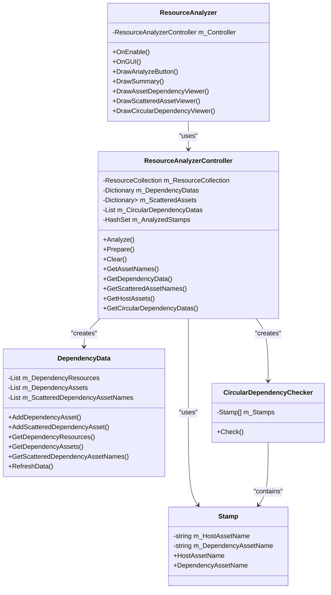
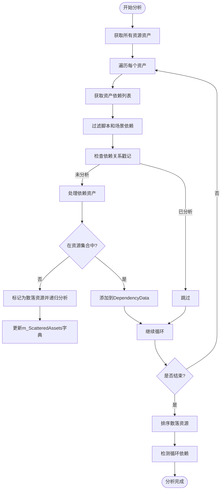
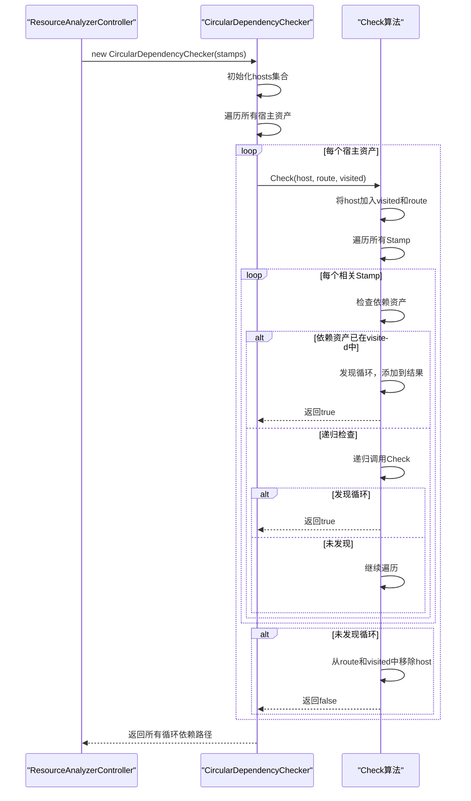
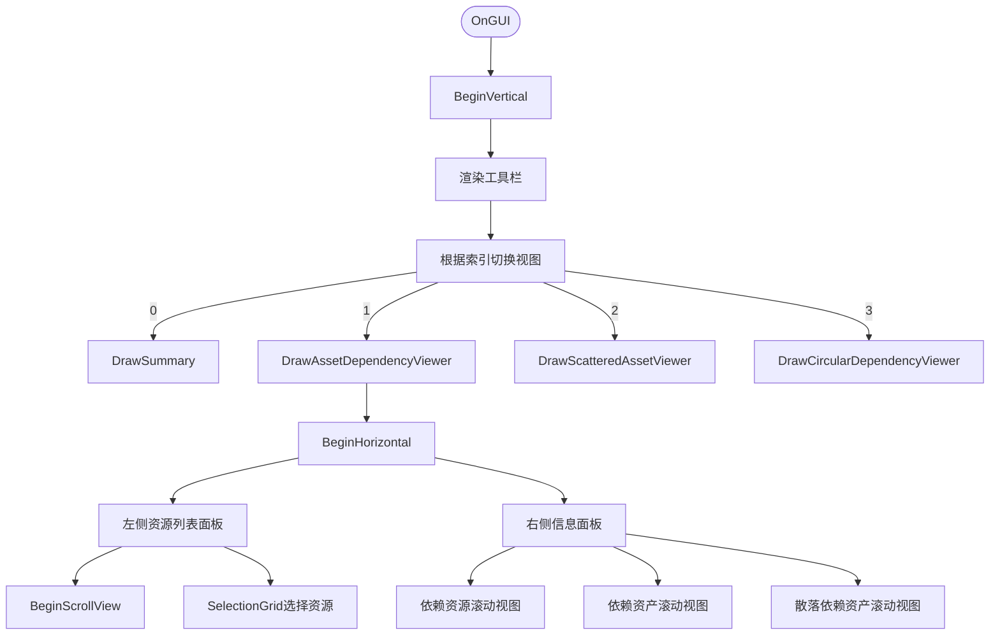

# 资源分析器

<cite>
**Referenced Files in This Document**   
- [ResourceAnalyzer.cs](file://Scripts/Editor/ResourceAnalyzer/ResourceAnalyzer.cs)
- [ResourceAnalyzerController.cs](file://Scripts/Editor/ResourceAnalyzer/ResourceAnalyzerController.cs)
- [DependencyData.cs](file://Scripts/Editor/ResourceAnalyzer/DependencyData.cs)
- [ResourceAnalyzerController.Stamp.cs](file://Scripts/Editor/ResourceAnalyzer/ResourceAnalyzerController.Stamp.cs)
- [ResourceAnalyzerController.CircularDependencyChecker.cs](file://Scripts/Editor/ResourceAnalyzer/ResourceAnalyzerController.CircularDependencyChecker.cs)
</cite>

## 目录
1. [简介](#简介)
2. [核心功能与视图](#核心功能与视图)
3. [架构与组件关系](#架构与组件关系)
4. [工作流程与用户指南](#工作流程与用户指南)
5. [依赖分析机制](#依赖分析机制)
6. [循环依赖检测](#循环依赖检测)
7. [UI实现与布局](#ui实现与布局)
8. [进度条机制](#进度条机制)

## 简介

资源分析器（ResourceAnalyzer）是Unity编辑器中的一个工具窗口，旨在帮助开发者分析项目中资源的依赖关系。它通过`[MenuItem]`属性在编辑器菜单的"Game Framework/Resource Tools/Resource Analyzer"路径下注册，使开发者能够轻松访问。该工具的核心功能是加载和分析项目中的资源数据，识别资源间的依赖关系，并检测潜在的循环引用问题。通过提供多个视图，资源分析器为开发者提供了全面的资源管理视角，有助于优化资源结构、减少冗余和解决复杂的依赖问题。

**Section sources**
- [ResourceAnalyzer.cs](file://Scripts/Editor/ResourceAnalyzer/ResourceAnalyzer.cs#L17-L531)

## 核心功能与视图

资源分析器提供了四个核心视图，每个视图专注于不同的分析维度。**概览（Summary）**视图是默认视图，主要包含一个"Analyze"按钮，用于启动整个分析流程。**资源依赖查看器（Asset Dependency Viewer）**允许开发者选择一个资源，查看其直接依赖的资源、依赖的资产以及散落的依赖资产。**分散资源查看器（Scattered Asset Viewer）**专门用于识别被多个资源引用的散落资源，帮助开发者发现潜在的资源复用机会。**循环依赖查看器（Circular Dependency Viewer）**则专注于检测和展示项目中存在的循环依赖关系，这对于避免运行时错误至关重要。这些视图通过工具栏进行切换，为开发者提供了直观且高效的工作界面。

**Section sources**
- [ResourceAnalyzer.cs](file://Scripts/Editor/ResourceAnalyzer/ResourceAnalyzer.cs#L171-L487)

## 架构与组件关系

资源分析器采用清晰的MVC（Model-View-Controller）架构模式，将用户界面与业务逻辑分离。`ResourceAnalyzer`类作为视图组件，负责UI的渲染和用户交互，而`ResourceAnalyzerController`类作为控制器，处理所有数据加载、分析和业务逻辑。这种分离使得代码结构更加清晰，易于维护和扩展。

**Diagram sources**
- [ResourceAnalyzer.cs](file://Scripts/Editor/ResourceAnalyzer/ResourceAnalyzer.cs#L17-L531)
- [ResourceAnalyzerController.cs](file://Scripts/Editor/ResourceAnalyzer/ResourceAnalyzerController.cs#L25-L324)
- [DependencyData.cs](file://Scripts/Editor/ResourceAnalyzer/DependencyData.cs#L1-L96)
- [ResourceAnalyzerController.Stamp.cs](file://Scripts/Editor/ResourceAnalyzer/ResourceAnalyzerController.Stamp.cs#L1-L40)
- [ResourceAnalyzerController.CircularDependencyChecker.cs](file://Scripts/Editor/ResourceAnalyzer/ResourceAnalyzerController.CircularDependencyChecker.cs#L1-L76)

**Section sources**
- [ResourceAnalyzer.cs](file://Scripts/Editor/ResourceAnalyzer/ResourceAnalyzer.cs#L17-L531)
- [ResourceAnalyzerController.cs](file://Scripts/Editor/ResourceAnalyzer/ResourceAnalyzerController.cs#L25-L324)

## 工作流程与用户指南

开发者使用资源分析器的工作流程始于点击菜单项打开工具窗口。首次打开时，界面会显示"Analyze"按钮，提示用户进行分析。点击该按钮后，`ResourceAnalyzerController`会首先调用`Prepare()`方法加载`ResourceCollection.xml`文件中的资源数据。如果加载成功，系统会调用`Analyze()`方法开始分析流程。

在**资源依赖查看器**中，开发者可以从左侧资源列表中选择一个资源，右侧将显示该资源的详细依赖信息，包括直接依赖的资源、依赖的资产以及散落的依赖资产。通过点击"GO"按钮，可以快速跳转到相关资源进行进一步检查。

在**分散资源查看器**中，开发者可以查看所有被多个资源引用的散落资源。选择一个散落资源后，下方会列出所有引用它的宿主资源，帮助开发者评估资源的复用情况。

在**循环依赖查看器**中，所有检测到的循环依赖关系会以列表形式展示。每个循环依赖路径都可以展开查看，开发者可以通过"GO"按钮快速定位到循环中的任意资源。

**Section sources**
- [ResourceAnalyzer.cs](file://Scripts/Editor/ResourceAnalyzer/ResourceAnalyzer.cs#L171-L487)
- [ResourceAnalyzerController.cs](file://Scripts/Editor/ResourceAnalyzer/ResourceAnalyzerController.cs#L89-L130)

## 依赖分析机制

资源分析器的依赖分析机制基于`ResourceAnalyzerController`的`Analyze()`方法。该方法首先清空所有缓存数据，然后遍历`ResourceCollection`中的所有资产。对于每个资产，系统使用`AssetDatabase.GetDependencies()`API获取其直接依赖的资产列表。

**Diagram sources**
- [ResourceAnalyzerController.cs](file://Scripts/Editor/ResourceAnalyzer/ResourceAnalyzerController.cs#L89-L130)
- [ResourceAnalyzerController.CircularDependencyChecker.cs](file://Scripts/Editor/ResourceAnalyzer/ResourceAnalyzerController.CircularDependencyChecker.cs#L12-L74)

**Section sources**
- [ResourceAnalyzerController.cs](file://Scripts/Editor/ResourceAnalyzer/ResourceAnalyzerController.cs#L89-L130)

## 循环依赖检测

循环依赖检测是资源分析器的关键功能之一，由`CircularDependencyChecker`类实现。该类接收一个`Stamp`数组作为输入，每个`Stamp`记录了一个宿主资产到其依赖资产的关系。检测算法采用深度优先搜索（DFS）策略，通过维护一个访问路径（route）和一个已访问集合（visited）来追踪依赖链。

**Diagram sources**
- [ResourceAnalyzerController.CircularDependencyChecker.cs](file://Scripts/Editor/ResourceAnalyzer/ResourceAnalyzerController.CircularDependencyChecker.cs#L12-L74)

**Section sources**
- [ResourceAnalyzerController.CircularDependencyChecker.cs](file://Scripts/Editor/ResourceAnalyzer/ResourceAnalyzerController.CircularDependencyChecker.cs#L12-L74)

## UI实现与布局

资源分析器的用户界面完全使用Unity的`OnGUI`系统实现。`OnGUI()`方法首先创建一个垂直布局，然后在顶部渲染一个工具栏，允许用户在四个视图之间切换。每个视图都有其独特的布局结构。

在**资源依赖查看器**中，界面被分为左右两部分。左侧是资源列表，使用`SelectionGrid`控件实现可选择的网格布局。右侧则分为三个区域，分别显示依赖资源、依赖资产和散落依赖资产，每个区域都有独立的滚动视图。

**Diagram sources**
- [ResourceAnalyzer.cs](file://Scripts/Editor/ResourceAnalyzer/ResourceAnalyzer.cs#L171-L325)

**Section sources**
- [ResourceAnalyzer.cs](file://Scripts/Editor/ResourceAnalyzer/ResourceAnalyzer.cs#L171-L325)

## 进度条机制

资源分析器在加载和分析过程中使用`EditorUtility.DisplayProgressBar`来显示进度条，为用户提供实时反馈。该机制通过事件驱动的方式实现，`ResourceAnalyzerController`定义了多个事件（如`OnLoadingResource`、`OnLoadingAsset`、`OnAnalyzingAsset`），而`ResourceAnalyzer`类在`OnEnable()`方法中订阅这些事件。

当资源加载或分析进度发生变化时，相应的事件会被触发，`ResourceAnalyzer`中的事件处理方法（如`OnLoadingResource`、`OnAnalyzingAsset`）会调用`EditorUtility.DisplayProgressBar`更新进度条。进度条的标题和消息会根据当前阶段动态变化，例如在加载资源时显示"Loading Resources"，在分析资产时显示"Analyzing Assets"。分析完成后，`OnLoadCompleted`和`OnAnalyzeCompleted`事件会触发`EditorUtility.ClearProgressBar`来清除进度条。这种机制确保了长时间操作的可视化反馈，提升了用户体验。

**Section sources**
- [ResourceAnalyzer.cs](file://Scripts/Editor/ResourceAnalyzer/ResourceAnalyzer.cs#L489-L531)
- [ResourceAnalyzerController.cs](file://Scripts/Editor/ResourceAnalyzer/ResourceAnalyzerController.cs#L50-L87)