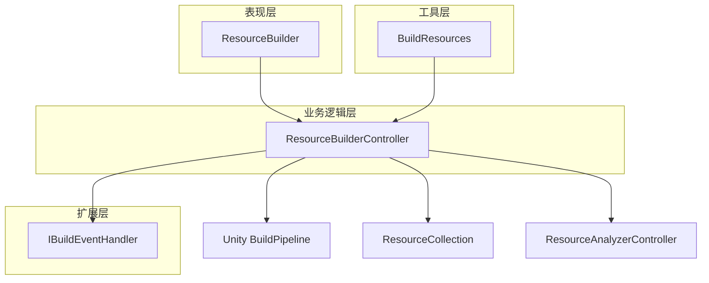
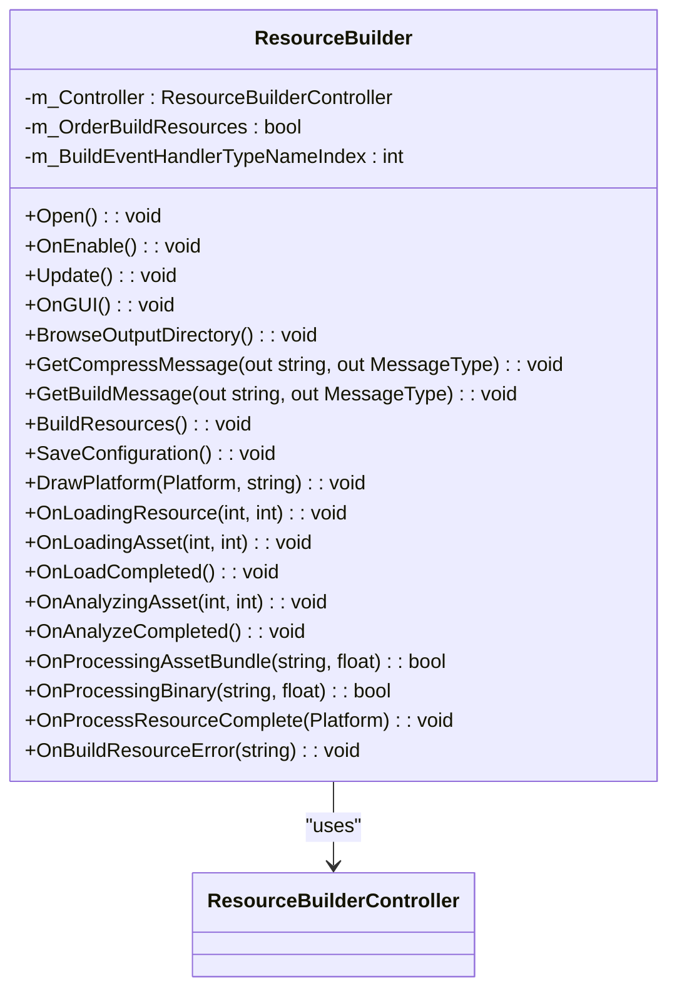
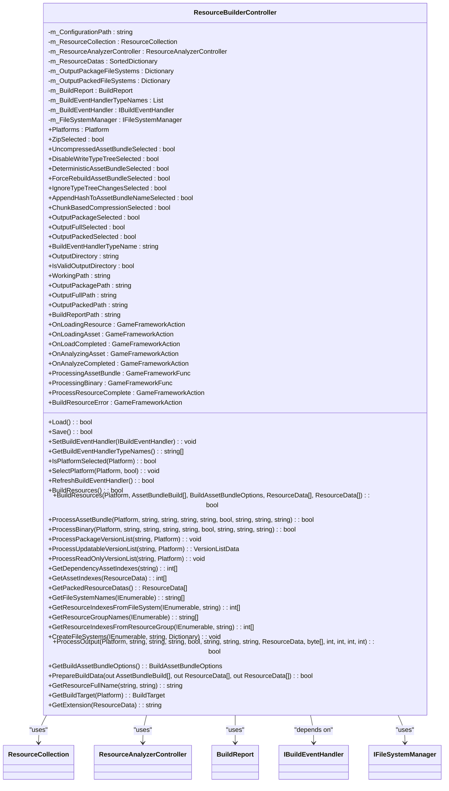
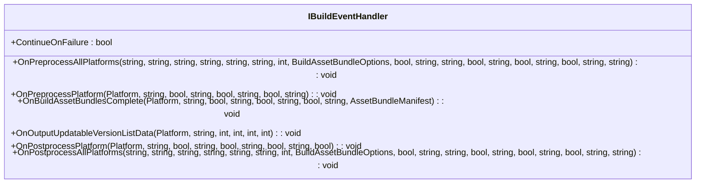
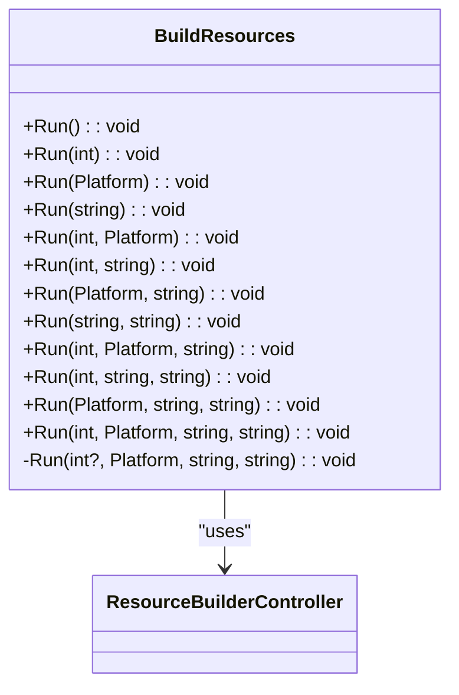
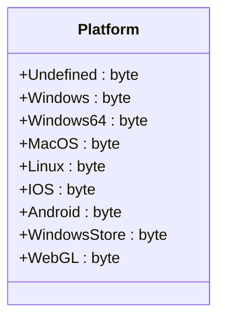
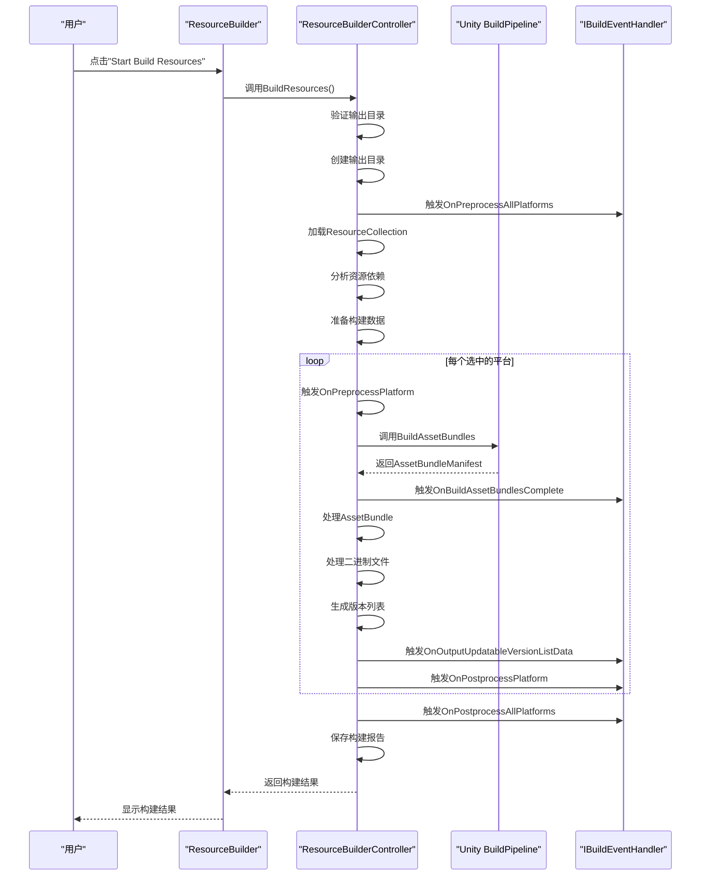
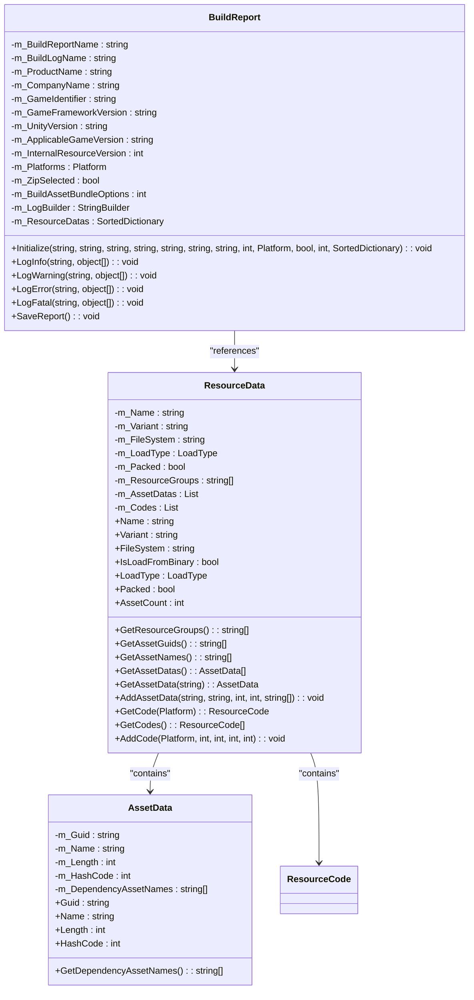
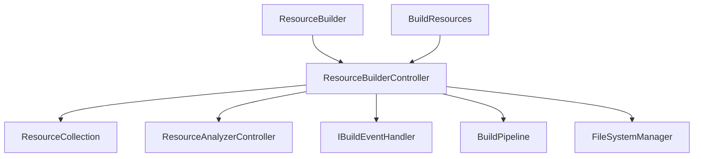

# 资源构建器

<cite>
**Referenced Files in This Document**   
- [ResourceBuilder.cs](file://Scripts/Editor/ResourceBuilder/ResourceBuilder.cs)
- [ResourceBuilderController.cs](file://Scripts/Editor/ResourceBuilder/ResourceBuilderController.cs)
- [IBuildEventHandler.cs](file://Scripts/Editor/ResourceBuilder/IBuildEventHandler.cs)
- [BuildResources.cs](file://Scripts/Editor/ResourceBuilder/BuildResources.cs)
- [Platform.cs](file://Scripts/Editor/ResourceBuilder/Platform.cs)
- [ResourceBuilderController.BuildReport.cs](file://Scripts/Editor/ResourceBuilder/ResourceBuilderController.BuildReport.cs)
- [ResourceBuilderController.ResourceData.cs](file://Scripts/Editor/ResourceBuilder/ResourceBuilderController.ResourceData.cs)
- [ResourceBuilderController.VersionListData.cs](file://Scripts/Editor/ResourceBuilder/ResourceBuilderController.VersionListData.cs)
- [ResourceBuilderController.FileSystemHelper.cs](file://Scripts/Editor/ResourceBuilder/ResourceBuilderController.FileSystemHelper.cs)
- [ResourceBuilderController.AssetData.cs](file://Scripts/Editor/ResourceBuilder/ResourceBuilderController.AssetData.cs)
</cite>

## 目录
1. [简介](#简介)
2. [项目结构](#项目结构)
3. [核心组件](#核心组件)
4. [架构概述](#架构概述)
5. [详细组件分析](#详细组件分析)
6. [依赖分析](#依赖分析)
7. [性能考虑](#性能考虑)
8. [故障排除指南](#故障排除指南)
9. [结论](#结论)

## 简介

资源构建器是Unity游戏框架中的一个核心工具，用于自动化AssetBundle打包系统。它通过在Unity编辑器中注册菜单项"Game Framework/Resource Tools/Resource Builder"来提供用户界面，使开发者能够配置和执行资源构建流程。该工具支持多平台构建，包括Windows、macOS、Android等，并提供多种AssetBundle压缩选项，如LZMA和基于块的压缩。资源构建器还实现了资源版本管理功能，包括内部资源版本和适用游戏版本的设置。其构建流程包括资源加载、分析、打包和输出，并通过构建报告提供详细的构建信息。此外，它还支持构建事件处理器扩展机制，允许开发者在构建前后插入自定义逻辑。

## 项目结构

资源构建器位于项目的`Scripts/Editor/ResourceBuilder`目录下，包含多个核心文件，每个文件负责不同的功能模块。

```mermaid
graph TB
subgraph "ResourceBuilder"
ResourceBuilder[ResourceBuilder.cs]
ResourceBuilderController[ResourceBuilderController.cs]
IBuildEventHandler[IBuildEventHandler.cs]
BuildResources[BuildResources.cs]
Platform[Platform.cs]
BuildReport[ResourceBuilderController.BuildReport.cs]
ResourceData[ResourceBuilderController.ResourceData.cs]
VersionListData[ResourceBuilderController.VersionListData.cs]
FileSystemHelper[ResourceBuilderController.FileSystemHelper.cs]
AssetData[ResourceBuilderController.AssetData.cs]
end
ResourceBuilder --> ResourceBuilderController
ResourceBuilderController --> IBuildEventHandler
ResourceBuilderController --> BuildReport
ResourceBuilderController --> ResourceData
ResourceBuilderController --> VersionListData
ResourceBuilderController --> FileSystemHelper
ResourceBuilderController --> AssetData
ResourceBuilderController --> Platform
BuildResources --> ResourceBuilderController
```

**Diagram sources**
- [ResourceBuilder.cs](file://Scripts/Editor/ResourceBuilder/ResourceBuilder.cs)
- [ResourceBuilderController.cs](file://Scripts/Editor/ResourceBuilder/ResourceBuilderController.cs)
- [IBuildEventHandler.cs](file://Scripts/Editor/ResourceBuilder/IBuildEventHandler.cs)
- [BuildResources.cs](file://Scripts/Editor/ResourceBuilder/BuildResources.cs)
- [Platform.cs](file://Scripts/Editor/ResourceBuilder/Platform.cs)
- [ResourceBuilderController.BuildReport.cs](file://Scripts/Editor/ResourceBuilder/ResourceBuilderController.BuildReport.cs)
- [ResourceBuilderController.ResourceData.cs](file://Scripts/Editor/ResourceBuilder/ResourceBuilderController.ResourceData.cs)
- [ResourceBuilderController.VersionListData.cs](file://Scripts/Editor/ResourceBuilder/ResourceBuilderController.VersionListData.cs)
- [ResourceBuilderController.FileSystemHelper.cs](file://Scripts/Editor/ResourceBuilder/ResourceBuilderController.FileSystemHelper.cs)
- [ResourceBuilderController.AssetData.cs](file://Scripts/Editor/ResourceBuilder/ResourceBuilderController.AssetData.cs)

**Section sources**
- [ResourceBuilder.cs](file://Scripts/Editor/ResourceBuilder/ResourceBuilder.cs)
- [ResourceBuilderController.cs](file://Scripts/Editor/ResourceBuilder/ResourceBuilderController.cs)

## 核心组件

资源构建器的核心组件包括`ResourceBuilder`、`ResourceBuilderController`、`IBuildEventHandler`、`BuildResources`和`Platform`。`ResourceBuilder`是编辑器窗口类，负责提供用户界面和菜单项注册。`ResourceBuilderController`是核心控制器，处理资源加载、分析、打包和输出的完整流程。`IBuildEventHandler`是构建事件处理器接口，允许开发者扩展构建流程。`BuildResources`是静态工具类，提供程序化构建资源的入口。`Platform`是枚举类型，定义了支持的构建平台。

**Section sources**
- [ResourceBuilder.cs](file://Scripts/Editor/ResourceBuilder/ResourceBuilder.cs#L17-L531)
- [ResourceBuilderController.cs](file://Scripts/Editor/ResourceBuilder/ResourceBuilderController.cs#L40-L110)
- [IBuildEventHandler.cs](file://Scripts/Editor/ResourceBuilder/IBuildEventHandler.cs#L15-L126)
- [BuildResources.cs](file://Scripts/Editor/ResourceBuilder/BuildResources.cs#L16-L129)
- [Platform.cs](file://Scripts/Editor/ResourceBuilder/Platform.cs#L11-L55)

## 架构概述

资源构建器采用分层架构设计，将用户界面、业务逻辑和数据处理分离。`ResourceBuilder`作为表现层，提供直观的UI界面，包括环境信息展示、平台选择、AssetBundle选项配置、构建参数设置和构建报告生成。`ResourceBuilderController`作为业务逻辑层，协调资源加载、分析、打包和输出的完整流程。`IBuildEventHandler`作为扩展层，允许开发者通过实现接口来插入自定义逻辑。`BuildResources`作为工具层，提供程序化构建的入口。整个架构通过事件驱动的方式进行通信，确保各组件之间的松耦合。



**Diagram sources**
- [ResourceBuilder.cs](file://Scripts/Editor/ResourceBuilder/ResourceBuilder.cs#L17-L531)
- [ResourceBuilderController.cs](file://Scripts/Editor/ResourceBuilder/ResourceBuilderController.cs#L40-L110)
- [IBuildEventHandler.cs](file://Scripts/Editor/ResourceBuilder/IBuildEventHandler.cs#L15-L126)
- [BuildResources.cs](file://Scripts/Editor/ResourceBuilder/BuildResources.cs#L16-L129)

## 详细组件分析

### ResourceBuilder分析

`ResourceBuilder`是编辑器窗口类，继承自`EditorWindow`，负责提供用户界面和菜单项注册。它通过`[MenuItem]`属性在"Game Framework/Resource Tools/Resource Builder"路径下注册菜单项，使开发者能够通过Unity编辑器菜单打开资源构建器窗口。



**Diagram sources**
- [ResourceBuilder.cs](file://Scripts/Editor/ResourceBuilder/ResourceBuilder.cs#L17-L531)

**Section sources**
- [ResourceBuilder.cs](file://Scripts/Editor/ResourceBuilder/ResourceBuilder.cs#L17-L531)

### ResourceBuilderController分析

`ResourceBuilderController`是资源构建器的核心控制器，负责处理资源加载、分析、打包和输出的完整流程。它通过事件与`ResourceBuilder`进行通信，包括资源加载、资产加载、加载完成、资产分析、分析完成、处理AssetBundle、处理二进制文件、资源处理完成和构建资源错误等事件。



**Diagram sources**
- [ResourceBuilderController.cs](file://Scripts/Editor/ResourceBuilder/ResourceBuilderController.cs#L40-L110)

**Section sources**
- [ResourceBuilderController.cs](file://Scripts/Editor/ResourceBuilder/ResourceBuilderController.cs#L40-L110)

### IBuildEventHandler分析

`IBuildEventHandler`是构建事件处理器接口，允许开发者在构建流程中插入自定义逻辑。它定义了多个事件处理方法，包括所有平台生成开始前的预处理、某个平台生成开始前的预处理、某个平台生成AssetBundle完成、某个平台可更新模式版本列表文件输出、某个平台生成结束后的后处理以及所有平台生成结束后的后处理。



**Diagram sources**
- [IBuildEventHandler.cs](file://Scripts/Editor/ResourceBuilder/IBuildEventHandler.cs#L15-L126)

**Section sources**
- [IBuildEventHandler.cs](file://Scripts/Editor/ResourceBuilder/IBuildEventHandler.cs#L15-L126)

### BuildResources分析

`BuildResources`是静态工具类，提供程序化构建资源的入口。它通过`[MenuItem]`属性在"Game Framework/Resource Tools/Build Resources"路径下注册菜单项，使开发者能够通过Unity编辑器菜单直接启动构建流程。该类提供了多个重载的`Run`方法，允许开发者通过不同的参数组合来启动构建。



**Diagram sources**
- [BuildResources.cs](file://Scripts/Editor/ResourceBuilder/BuildResources.cs#L16-L129)

**Section sources**
- [BuildResources.cs](file://Scripts/Editor/ResourceBuilder/BuildResources.cs#L16-L129)

### Platform分析

`Platform`是枚举类型，定义了支持的构建平台。它使用`[Flags]`属性，允许通过位运算组合多个平台。支持的平台包括Windows、Windows64、macOS、Linux、iOS、Android、Windows Store和WebGL。



**Diagram sources**
- [Platform.cs](file://Scripts/Editor/ResourceBuilder/Platform.cs#L11-L55)

**Section sources**
- [Platform.cs](file://Scripts/Editor/ResourceBuilder/Platform.cs#L11-L55)

### 构建流程分析

资源构建器的构建流程是一个复杂的多阶段过程，从用户触发构建开始，到生成最终的构建报告结束。整个流程通过事件驱动的方式进行，确保各阶段之间的松耦合和可扩展性。



**Diagram sources**
- [ResourceBuilder.cs](file://Scripts/Editor/ResourceBuilder/ResourceBuilder.cs#L437-L448)
- [ResourceBuilderController.cs](file://Scripts/Editor/ResourceBuilder/ResourceBuilderController.cs#L605-L783)
- [ResourceBuilderController.cs](file://Scripts/Editor/ResourceBuilder/ResourceBuilderController.cs#L785-L1014)

**Section sources**
- [ResourceBuilder.cs](file://Scripts/Editor/ResourceBuilder/ResourceBuilder.cs#L437-L448)
- [ResourceBuilderController.cs](file://Scripts/Editor/ResourceBuilder/ResourceBuilderController.cs#L605-L783)
- [ResourceBuilderController.cs](file://Scripts/Editor/ResourceBuilder/ResourceBuilderController.cs#L785-L1014)

### 数据结构分析

资源构建器使用了多个复杂的数据结构来管理资源信息。`ResourceData`类用于存储单个资源的详细信息，包括名称、变体、文件系统、加载类型、打包状态、资源组、资产数据和代码数据。`AssetData`类用于存储单个资产的详细信息，包括GUID、名称、长度、哈希码和依赖资产名称。`BuildReport`类用于生成构建报告，包括XML格式的详细报告和文本格式的日志文件。



**Diagram sources**
- [ResourceBuilderController.ResourceData.cs](file://Scripts/Editor/ResourceBuilder/ResourceBuilderController.ResourceData.cs#L9-L167)
- [ResourceBuilderController.AssetData.cs](file://Scripts/Editor/ResourceBuilder/ResourceBuilderController.AssetData.cs#L9-L65)
- [ResourceBuilderController.BuildReport.cs](file://Scripts/Editor/ResourceBuilder/ResourceBuilderController.BuildReport.cs#L9-L254)

**Section sources**
- [ResourceBuilderController.ResourceData.cs](file://Scripts/Editor/ResourceBuilder/ResourceBuilderController.ResourceData.cs#L9-L167)
- [ResourceBuilderController.AssetData.cs](file://Scripts/Editor/ResourceBuilder/ResourceBuilderController.AssetData.cs#L9-L65)
- [ResourceBuilderController.BuildReport.cs](file://Scripts/Editor/ResourceBuilder/ResourceBuilderController.BuildReport.cs#L9-L254)

## 依赖分析

资源构建器与其他组件之间存在复杂的依赖关系。`ResourceBuilder`依赖于`ResourceBuilderController`来处理业务逻辑，`ResourceBuilderController`依赖于`ResourceCollection`和`ResourceAnalyzerController`来管理资源和分析依赖，同时依赖于`IBuildEventHandler`来扩展构建流程。`BuildResources`依赖于`ResourceBuilderController`来执行构建流程。整个系统通过事件和接口进行通信，确保各组件之间的松耦合。



**Diagram sources**
- [ResourceBuilder.cs](file://Scripts/Editor/ResourceBuilder/ResourceBuilder.cs#L17-L531)
- [ResourceBuilderController.cs](file://Scripts/Editor/ResourceBuilder/ResourceBuilderController.cs#L40-L110)
- [IBuildEventHandler.cs](file://Scripts/Editor/ResourceBuilder/IBuildEventHandler.cs#L15-L126)
- [BuildResources.cs](file://Scripts/Editor/ResourceBuilder/BuildResources.cs#L16-L129)

**Section sources**
- [ResourceBuilder.cs](file://Scripts/Editor/ResourceBuilder/ResourceBuilder.cs#L17-L531)
- [ResourceBuilderController.cs](file://Scripts/Editor/ResourceBuilder/ResourceBuilderController.cs#L40-L110)
- [IBuildEventHandler.cs](file://Scripts/Editor/ResourceBuilder/IBuildEventHandler.cs#L15-L126)
- [BuildResources.cs](file://Scripts/Editor/ResourceBuilder/BuildResources.cs#L16-L129)

## 性能考虑

资源构建器在设计时考虑了多个性能因素。首先，它使用`SortedDictionary<string, ResourceData>`