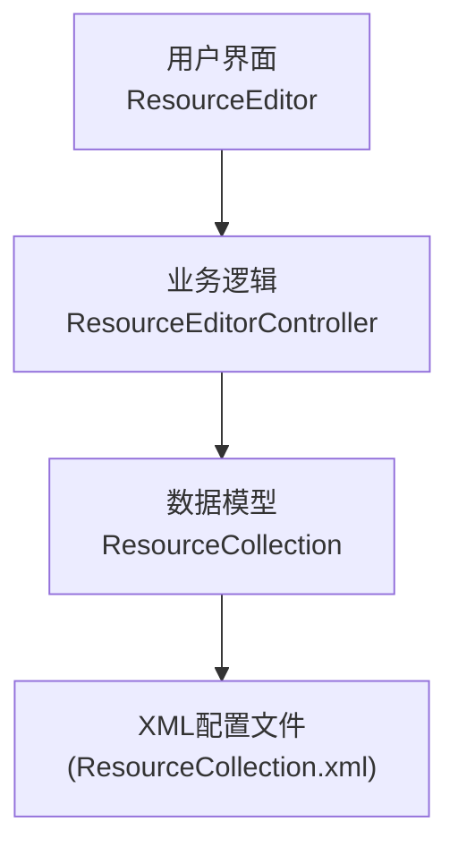
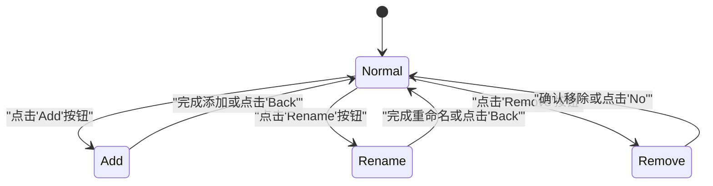
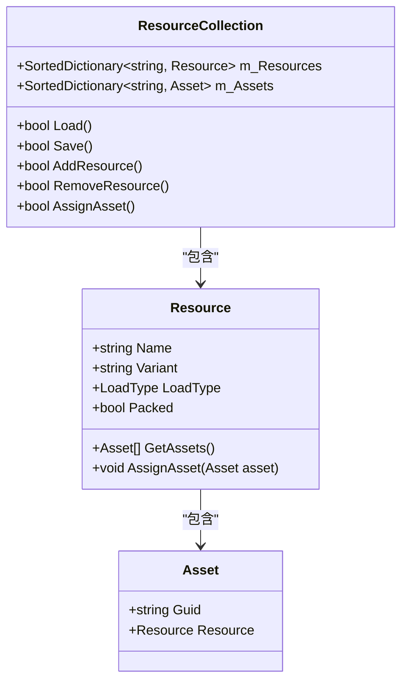
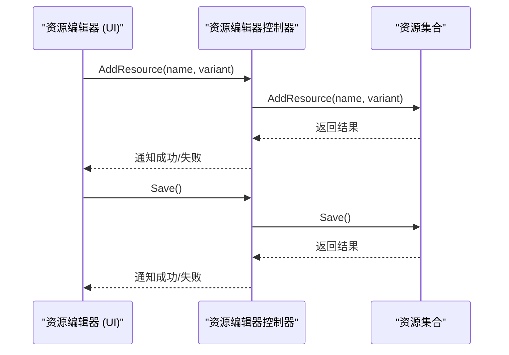
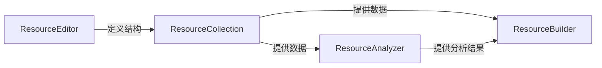

# 资源编辑器

<cite>
**本文档中引用的文件**  
- [ResourceEditor.cs](file://Scripts/Editor/ResourceEditor/ResourceEditor.cs)
- [ResourceEditor.MenuState.cs](file://Scripts/Editor/ResourceEditor/ResourceEditor.MenuState.cs)
- [ResourceEditorController.cs](file://Scripts/Editor/ResourceEditor/ResourceEditorController.cs)
- [ResourceCollection.cs](file://Scripts/Editor/ResourceCollection/ResourceCollection.cs)
- [ResourceAnalyzer.cs](file://Scripts/Editor/ResourceAnalyzer/ResourceAnalyzer.cs)
- [ResourceBuilder.cs](file://Scripts/Editor/ResourceBuilder/ResourceBuilder.cs)
</cite>

## 目录
1. [简介](#简介)
2. [项目结构](#项目结构)
3. [核心组件](#核心组件)
4. [架构概述](#架构概述)
5. [详细组件分析](#详细组件分析)
6. [依赖关系分析](#依赖关系分析)
7. [性能考虑](#性能考虑)
8. [故障排除指南](#故障排除指南)
9. [结论](#结论)

## 简介
资源编辑器是Unity游戏框架中的核心资源管理工具，作为资源管理的中枢，为开发者提供直观的资源组织界面。它通过Unity编辑器菜单项集成，允许开发者对游戏资源进行集中管理。资源编辑器的核心功能包括资源的添加、重命名、移除操作，以及资源分组和依赖关系的可视化管理。其内部状态机（MenuState）控制UI的交互模式，确保用户操作的清晰与高效。资源编辑器与ResourceAnalyzer和ResourceBuilder协同工作，形成从资源定义、依赖分析到最终打包构建的完整工作流。

## 项目结构
资源编辑器位于项目的`Scripts/Editor/ResourceEditor`目录下，是Unity编辑器工具集的一部分。它与`ResourceCollection`、`ResourceAnalyzer`和`ResourceBuilder`等模块紧密协作，共同构成资源管理与构建系统。

```mermaid
graph TB
subgraph "资源管理工具"
ResourceEditor["资源编辑器 (ResourceEditor)"]
ResourceCollection["资源集合 (ResourceCollection)"]
ResourceAnalyzer["资源分析器 (ResourceAnalyzer)"]
ResourceBuilder["资源构建器 (ResourceBuilder)"]
end
ResourceEditor --> ResourceCollection : "定义资源结构"
ResourceCollection --> ResourceAnalyzer : "提供数据"
ResourceAnalyzer --> ResourceBuilder : "提供分析结果"
ResourceBuilder --> "构建输出"
```

**Diagram sources**
- [ResourceEditor.cs](file://Scripts/Editor/ResourceEditor/ResourceEditor.cs)
- [ResourceCollection.cs](file://Scripts/Editor/ResourceCollection/ResourceCollection.cs)
- [ResourceAnalyzer.cs](file://Scripts/Editor/ResourceAnalyzer/ResourceAnalyzer.cs)
- [ResourceBuilder.cs](file://Scripts/Editor/ResourceBuilder/ResourceBuilder.cs)

**Section sources**
- [ResourceEditor.cs](file://Scripts/Editor/ResourceEditor/ResourceEditor.cs)

## 核心组件
资源编辑器的核心由`ResourceEditor`、`ResourceEditorController`和`ResourceCollection`三个主要组件构成。`ResourceEditor`负责提供用户界面，`ResourceEditorController`作为中间层处理业务逻辑，而`ResourceCollection`则作为底层数据模型，持久化存储所有资源信息。

**Section sources**
- [ResourceEditor.cs](file://Scripts/Editor/ResourceEditor/ResourceEditor.cs)
- [ResourceEditorController.cs](file://Scripts/Editor/ResourceEditor/ResourceEditorController.cs)
- [ResourceCollection.cs](file://Scripts/Editor/ResourceCollection/ResourceCollection.cs)

## 架构概述
资源编辑器采用分层架构，清晰地分离了用户界面、业务逻辑和数据模型。用户通过`ResourceEditor`的UI进行操作，这些操作被`ResourceEditorController`接收并处理，最终调用`ResourceCollection`的方法来修改和持久化数据。这种设计模式确保了代码的可维护性和可扩展性。



**Diagram sources**
- [ResourceEditor.cs](file://Scripts/Editor/ResourceEditor/ResourceEditor.cs)
- [ResourceEditorController.cs](file://Scripts/Editor/ResourceEditor/ResourceEditorController.cs)
- [ResourceCollection.cs](file://Scripts/Editor/ResourceCollection/ResourceCollection.cs)

## 详细组件分析

### 资源编辑器界面分析
`ResourceEditor`类继承自`EditorWindow`，是用户与工具交互的窗口。它通过`[MenuItem]`属性在Unity编辑器菜单中注册，路径为"Game Framework/Resource Tools/Resource Editor"。其UI布局分为三个主要面板：资源列表、资源内容和资源源文件列表，分别用于展示资源树、所选资源包含的资产以及项目中的所有源文件。

#### 状态机控制UI交互


**Diagram sources**
- [ResourceEditor.MenuState.cs](file://Scripts/Editor/ResourceEditor/ResourceEditor.MenuState.cs)

**Section sources**
- [ResourceEditor.cs](file://Scripts/Editor/ResourceEditor/ResourceEditor.cs#L11-L20)

### 资源集合数据模型分析
`ResourceCollection`是资源管理的核心数据模型，它使用`SortedDictionary`来存储`Resource`和`Asset`对象，确保了高效的查找和排序能力。`Resource`代表一个资源包，可以包含一个或多个`Asset`（资产），每个`Asset`通过其GUID与项目中的具体文件关联。

#### 资源与资产关系


**Diagram sources**
- [ResourceCollection.cs](file://Scripts/Editor/ResourceCollection/ResourceCollection.cs)

**Section sources**
- [ResourceCollection.cs](file://Scripts/Editor/ResourceCollection/ResourceCollection.cs)

### 资源编辑器控制器分析
`ResourceEditorController`是连接UI和数据模型的桥梁。它持有`ResourceCollection`的实例，并提供一系列方法供`ResourceEditor`调用。当用户执行操作时，`ResourceEditorController`会调用`ResourceCollection`的相应方法，并在操作完成后通过事件通知UI进行刷新。

#### 核心功能调用流程


**Diagram sources**
- [ResourceEditorController.cs](file://Scripts/Editor/ResourceEditor/ResourceEditorController.cs)
- [ResourceCollection.cs](file://Scripts/Editor/ResourceCollection/ResourceCollection.cs)

**Section sources**
- [ResourceEditorController.cs](file://Scripts/Editor/ResourceEditor/ResourceEditorController.cs)

## 依赖关系分析
资源编辑器、资源分析器和资源构建器构成了一个紧密耦合的工作流。资源编辑器定义的资源结构是整个流程的起点。`ResourceAnalyzer`依赖`ResourceCollection`中的数据来分析资产间的依赖关系，而`ResourceBuilder`在构建时，同样需要加载`ResourceCollection`来获取资源定义。



**Diagram sources**
- [ResourceEditorController.cs](file://Scripts/Editor/ResourceEditor/ResourceEditorController.cs)
- [ResourceAnalyzerController.cs](file://Scripts/Editor/ResourceAnalyzer/ResourceAnalyzerController.cs)
- [ResourceBuilderController.cs](file://Scripts/Editor/ResourceBuilder/ResourceBuilderController.cs)

**Section sources**
- [ResourceEditorController.cs](file://Scripts/Editor/ResourceEditor/ResourceEditorController.cs)
- [ResourceAnalyzerController.cs](file://Scripts/Editor/ResourceAnalyzer/ResourceAnalyzerController.cs)
- [ResourceBuilderController.cs](file://Scripts/Editor/ResourceBuilder/ResourceBuilderController.cs)

## 性能考虑
资源编辑器在加载和保存时会进行大量的文件I/O操作，特别是当项目包含大量资源时。`ResourceCollection`的`Load()`和`Save()`方法直接操作XML文件，这可能会成为性能瓶颈。建议在资源定义完成后进行批量保存，避免频繁的磁盘写入。此外，`ResourceAnalyzer`在分析依赖时会遍历所有资产，对于大型项目，此过程可能耗时较长，应合理安排分析时机。

## 故障排除指南
开发者在使用资源编辑器时可能遇到以下常见问题：
- **资源定义不正确导致构建失败**：确保在`ResourceEditor`中定义的资源名称符合正则表达式`^([A-Za-z0-9\._-]+/)*[A-Za-z0-9\._-]+$`，变体名称符合`^[a-z0-9_-]+$`。避免资源名称的路径冲突。
- **资产未正确分配**：检查`ResourceCollection.xml`文件是否被意外修改或损坏。使用`ResourceEditor`中的"Clean"功能可以移除未使用的资源和未知资产。
- **依赖分析错误**：确保在运行`ResourceAnalyzer`之前，已经通过`ResourceEditor`保存了最新的资源定义。`ResourceAnalyzer`依赖`ResourceCollection.xml`的准确性。

**Section sources**
- [ResourceEditorController.cs](file://Scripts/Editor/ResourceEditor/ResourceEditorController.cs#L501-L511)
- [ResourceCollection.cs](file://Scripts/Editor/ResourceCollection/ResourceCollection.cs#L55-L59)

## 结论
资源编辑器是一个功能强大且设计精良的资源管理工具，它为Unity项目提供了一个结构化的资源定义和组织方式。通过理解其内部状态机、数据模型以及与其他工具的协同工作流程，开发者可以更高效地管理项目资源，确保构建过程的顺利进行。遵循最佳实践，如及时保存、定期清理和正确命名，可以最大化地发挥该工具的优势。