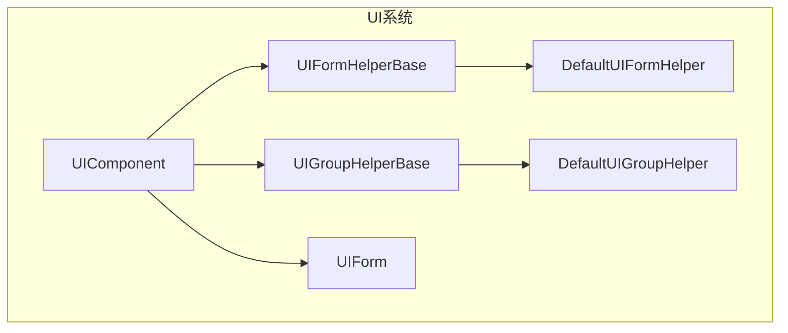
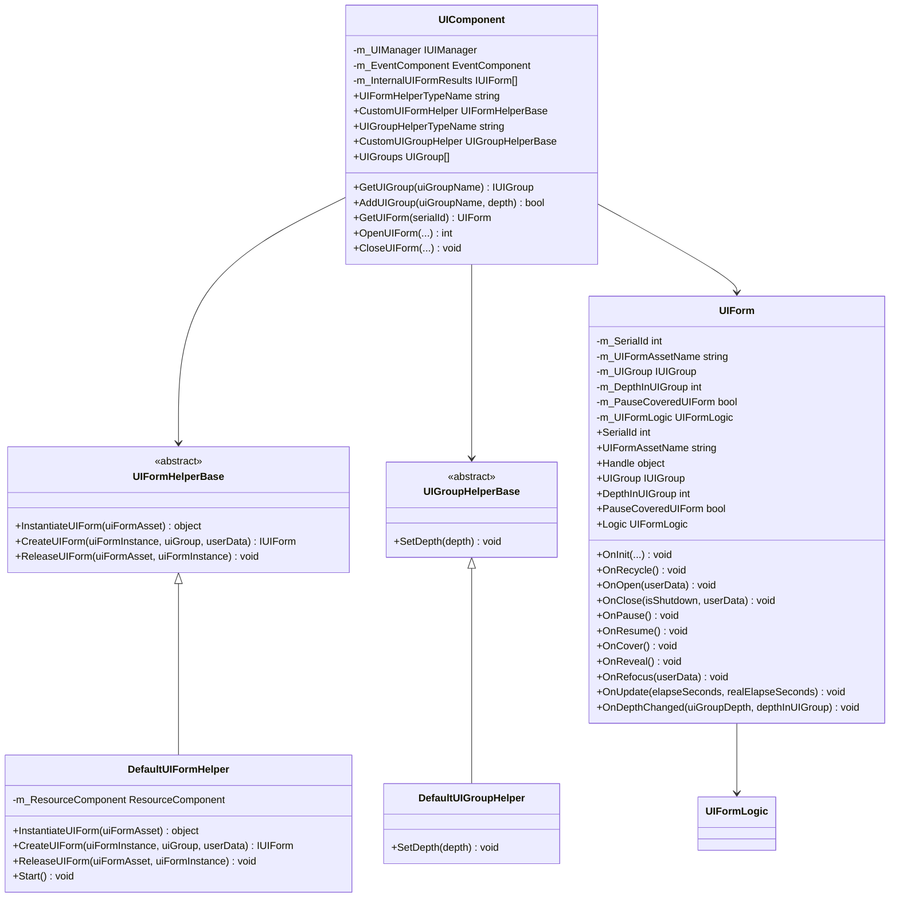
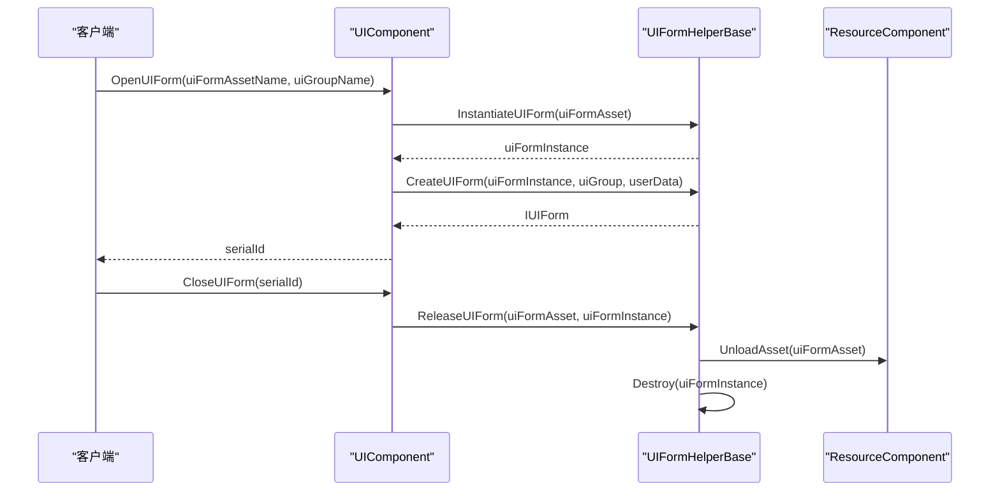
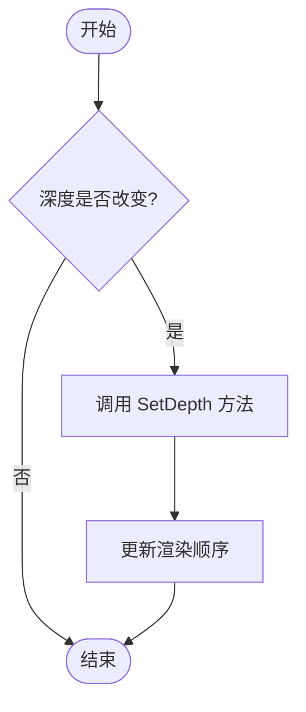
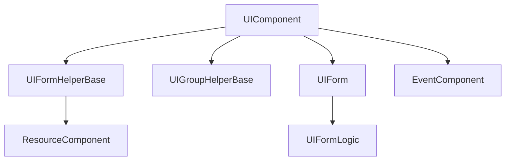

# UI系统扩展

<cite>
**本文档引用的文件**
- [UIFormHelperBase.cs](file://Scripts/Runtime/UI/UIFormHelperBase.cs)
- [DefaultUIFormHelper.cs](file://Scripts/Runtime/UI/DefaultUIFormHelper.cs)
- [UIGroupHelperBase.cs](file://Scripts/Runtime/UI/UIGroupHelperBase.cs)
- [DefaultUIGroupHelper.cs](file://Scripts/Runtime/UI/DefaultUIGroupHelper.cs)
- [UIComponent.cs](file://Scripts/Runtime/UI/UIComponent.cs)
- [UIForm.cs](file://Scripts/Runtime/UI/UIForm.cs)
</cite>

## 目录
1. [简介](#简介)
2. [项目结构](#项目结构)
3. [核心组件](#核心组件)
4. [架构概述](#架构概述)
5. [详细组件分析](#详细组件分析)
6. [依赖分析](#依赖分析)
7. [性能考虑](#性能考虑)
8. [故障排除指南](#故障排除指南)
9. [结论](#结论)

## 简介
本文档旨在全面介绍如何通过继承 `UIFormHelperBase` 和 `UIGroupHelperBase` 来扩展 Unity 游戏框架中的 UI 系统。重点讲解如何控制 UI 界面的实例化、创建和释放过程，并以 `DefaultUIFormHelper` 为范例，分析其如何设置 UI 的父节点、缩放和组件绑定。同时，指导开发者实现自定义的 UI 加载规则，如自动适配分辨率、注入依赖或实现 UI 动画。此外，还介绍 `UIGroupHelperBase` 的扩展方法，用于定制 UI 组的渲染层级、排序逻辑或资源管理策略。

## 项目结构
UI 系统的核心功能位于 `Scripts/Runtime/UI/` 目录下，主要包含以下组件：
- `UIFormHelperBase.cs`：定义了 UI 界面辅助器的基类，提供实例化、创建和释放界面的抽象方法。
- `DefaultUIFormHelper.cs`：默认的 UI 界面辅助器实现，继承自 `UIFormHelperBase`。
- `UIGroupHelperBase.cs`：定义了 UI 组辅助器的基类，提供设置界面组深度的抽象方法。
- `DefaultUIGroupHelper.cs`：默认的 UI 组辅助器实现，继承自 `UIGroupHelperBase`。
- `UIComponent.cs`：UI 系统的主组件，负责管理界面和界面组。
- `UIForm.cs`：表示一个具体的 UI 界面，包含界面的逻辑和状态。

**图示来源**
- [UIFormHelperBase.cs](file://Scripts/Runtime/UI/UIFormHelperBase.cs#L15-L39)
- [DefaultUIFormHelper.cs](file://Scripts/Runtime/UI/DefaultUIFormHelper.cs#L15-L72)
- [UIGroupHelperBase.cs](file://Scripts/Runtime/UI/UIGroupHelperBase.cs#L15-L22)
- [DefaultUIGroupHelper.cs](file://Scripts/Runtime/UI/DefaultUIGroupHelper.cs#L12-L21)
- [UIComponent.cs](file://Scripts/Runtime/UI/UIComponent.cs#L0-L730)
- [UIForm.cs](file://Scripts/Runtime/UI/UIForm.cs#L16-L303)

**本节来源**
- [UIFormHelperBase.cs](file://Scripts/Runtime/UI/UIFormHelperBase.cs#L1-L41)
- [DefaultUIFormHelper.cs](file://Scripts/Runtime/UI/DefaultUIFormHelper.cs#L1-L74)
- [UIGroupHelperBase.cs](file://Scripts/Runtime/UI/UIGroupHelperBase.cs#L1-L24)
- [DefaultUIGroupHelper.cs](file://Scripts/Runtime/UI/DefaultUIGroupHelper.cs#L1-L23)
- [UIComponent.cs](file://Scripts/Runtime/UI/UIComponent.cs#L1-L730)
- [UIForm.cs](file://Scripts/Runtime/UI/UIForm.cs#L1-L303)

## 核心组件

### UIFormHelperBase
`UIFormHelperBase` 是所有 UI 界面辅助器的基类，定义了三个核心方法：
- `InstantiateUIForm`：用于实例化 UI 界面资源。
- `CreateUIForm`：用于创建 UI 界面实例，并将其添加到指定的 UI 组中。
- `ReleaseUIForm`：用于释放 UI 界面资源和实例。

### DefaultUIFormHelper
`DefaultUIFormHelper` 是 `UIFormHelperBase` 的默认实现，提供了基本的 UI 界面管理功能。它通过 `Instantiate` 方法实例化 UI 界面，并将其父节点设置为 UI 组的辅助器对象，同时将缩放设置为 `(1, 1, 1)`。在释放 UI 界面时，它会调用 `ResourceComponent` 的 `UnloadAsset` 方法来卸载资源，并使用 `Destroy` 方法销毁游戏对象。

### UIGroupHelperBase
`UIGroupHelperBase` 是所有 UI 组辅助器的基类，定义了一个核心方法：
- `SetDepth`：用于设置 UI 组的深度，影响其渲染顺序。

### DefaultUIGroupHelper
`DefaultUIGroupHelper` 是 `UIGroupHelperBase` 的默认实现，目前为空实现，表示不进行任何深度设置操作。

**本节来源**
- [UIFormHelperBase.cs](file://Scripts/Runtime/UI/UIFormHelperBase.cs#L15-L39)
- [DefaultUIFormHelper.cs](file://Scripts/Runtime/UI/DefaultUIFormHelper.cs#L15-L72)
- [UIGroupHelperBase.cs](file://Scripts/Runtime/UI/UIGroupHelperBase.cs#L15-L22)
- [DefaultUIGroupHelper.cs](file://Scripts/Runtime/UI/DefaultUIGroupHelper.cs#L12-L21)

## 架构概述

**图示来源**
- [UIFormHelperBase.cs](file://Scripts/Runtime/UI/UIFormHelperBase.cs#L15-L39)
- [DefaultUIFormHelper.cs](file://Scripts/Runtime/UI/DefaultUIFormHelper.cs#L15-L72)
- [UIGroupHelperBase.cs](file://Scripts/Runtime/UI/UIGroupHelperBase.cs#L15-L22)
- [DefaultUIGroupHelper.cs](file://Scripts/Runtime/UI/DefaultUIGroupHelper.cs#L12-L21)
- [UIComponent.cs](file://Scripts/Runtime/UI/UIComponent.cs#L0-L730)
- [UIForm.cs](file://Scripts/Runtime/UI/UIForm.cs#L16-L303)

## 详细组件分析

### UIFormHelperBase 分析
`UIFormHelperBase` 作为抽象基类，为所有 UI 界面辅助器提供了统一的接口。开发者可以通过继承该类并重写其方法来实现自定义的 UI 管理逻辑。

#### 实例化界面
`InstantiateUIForm` 方法负责将 UI 资源实例化为游戏对象。默认实现使用 Unity 的 `Instantiate` 方法。

#### 创建界面
`CreateUIForm` 方法负责将实例化的游戏对象转换为 `IUIForm` 接口，并将其添加到指定的 UI 组中。`DefaultUIFormHelper` 的实现将游戏对象的父节点设置为 UI 组辅助器的变换，并重置缩放。

#### 释放界面
`ReleaseUIForm` 方法负责释放 UI 界面资源和实例。`DefaultUIFormHelper` 的实现会先卸载资源，再销毁游戏对象。

**图示来源**
- [UIFormHelperBase.cs](file://Scripts/Runtime/UI/UIFormHelperBase.cs#L15-L39)
- [DefaultUIFormHelper.cs](file://Scripts/Runtime/UI/DefaultUIFormHelper.cs#L15-L72)
- [UIComponent.cs](file://Scripts/Runtime/UI/UIComponent.cs#L0-L730)

**本节来源**
- [UIFormHelperBase.cs](file://Scripts/Runtime/UI/UIFormHelperBase.cs#L15-L39)
- [DefaultUIFormHelper.cs](file://Scripts/Runtime/UI/DefaultUIFormHelper.cs#L15-L72)
- [UIComponent.cs](file://Scripts/Runtime/UI/UIComponent.cs#L257-L332)

### UIGroupHelperBase 分析
`UIGroupHelperBase` 作为抽象基类，为所有 UI 组辅助器提供了统一的接口。开发者可以通过继承该类并重写 `SetDepth` 方法来实现自定义的 UI 组深度管理逻辑。

#### 设置界面组深度
`SetDepth` 方法用于设置 UI 组的深度，从而影响其渲染顺序。`DefaultUIGroupHelper` 的实现为空，表示不进行任何操作。

**图示来源**
- [UIGroupHelperBase.cs](file://Scripts/Runtime/UI/UIGroupHelperBase.cs#L15-L22)
- [DefaultUIGroupHelper.cs](file://Scripts/Runtime/UI/DefaultUIGroupHelper.cs#L12-L21)

**本节来源**
- [UIGroupHelperBase.cs](file://Scripts/Runtime/UI/UIGroupHelperBase.cs#L15-L22)
- [DefaultUIGroupHelper.cs](file://Scripts/Runtime/UI/DefaultUIGroupHelper.cs#L12-L21)

## 依赖分析

**图示来源**
- [UIComponent.cs](file://Scripts/Runtime/UI/UIComponent.cs#L0-L730)
- [DefaultUIFormHelper.cs](file://Scripts/Runtime/UI/DefaultUIFormHelper.cs#L15-L72)
- [UIForm.cs](file://Scripts/Runtime/UI/UIForm.cs#L16-L303)

**本节来源**
- [UIComponent.cs](file://Scripts/Runtime/UI/UIComponent.cs#L0-L730)
- [DefaultUIFormHelper.cs](file://Scripts/Runtime/UI/DefaultUIFormHelper.cs#L15-L72)
- [UIForm.cs](file://Scripts/Runtime/UI/UIForm.cs#L16-L303)

## 性能考虑
- 在 `DefaultUIFormHelper` 中，`Instantiate` 和 `Destroy` 操作可能会导致性能开销，建议结合对象池技术来优化频繁的 UI 界面创建和销毁。
- `SetDepth` 方法的空实现可能会影响 UI 组的渲染顺序管理，建议根据实际需求实现具体的深度设置逻辑。
- `UIForm` 的生命周期方法中使用了异常捕获，虽然提高了稳定性，但也可能带来额外的性能开销，建议在发布版本中谨慎使用。

## 故障排除指南
- 如果 UI 界面无法正确显示，请检查 `UIFormHelperBase` 的 `CreateUIForm` 方法是否正确设置了父节点和缩放。
- 如果 UI 界面资源无法释放，请检查 `ReleaseUIForm` 方法是否正确调用了 `UnloadAsset` 和 `Destroy`。
- 如果 UI 组的渲染顺序不正确，请检查 `UIGroupHelperBase` 的 `SetDepth` 方法是否正确实现了深度设置逻辑。
- 如果出现内存泄漏，请检查 `UIForm` 的 `OnRecycle` 方法是否正确清理了引用。

**本节来源**
- [DefaultUIFormHelper.cs](file://Scripts/Runtime/UI/DefaultUIFormHelper.cs#L15-L72)
- [UIForm.cs](file://Scripts/Runtime/UI/UIForm.cs#L16-L303)
- [UIGroupHelperBase.cs](file://Scripts/Runtime/UI/UIGroupHelperBase.cs#L15-L22)

## 结论
通过继承 `UIFormHelperBase` 和 `UIGroupHelperBase`，开发者可以灵活地扩展 Unity 游戏框架的 UI 系统，实现自定义的 UI 管理逻辑。`DefaultUIFormHelper` 提供了基本的 UI 界面管理功能，而 `DefaultUIGroupHelper` 则为空实现，允许开发者根据需要进行扩展。在实际开发中，建议结合对象池技术、异常处理和性能优化策略，以确保 UI 系统的稳定性和高效性。