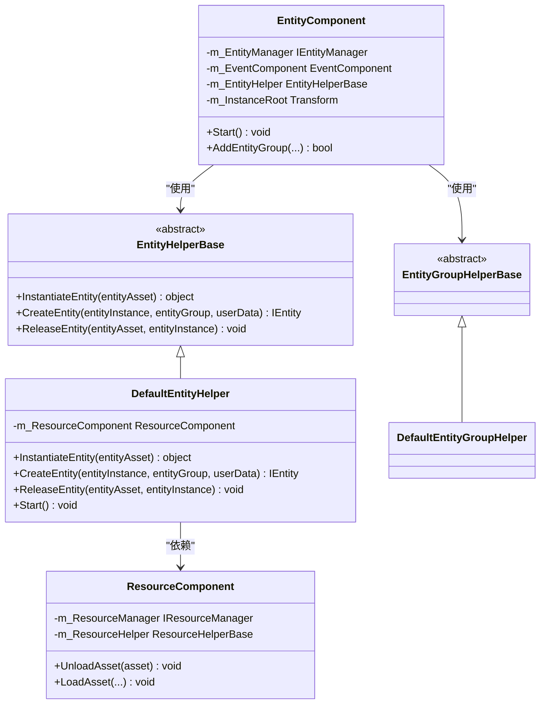
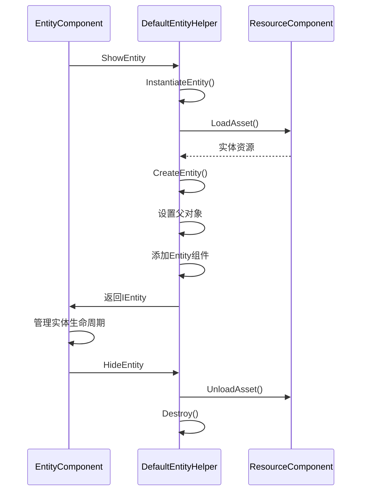
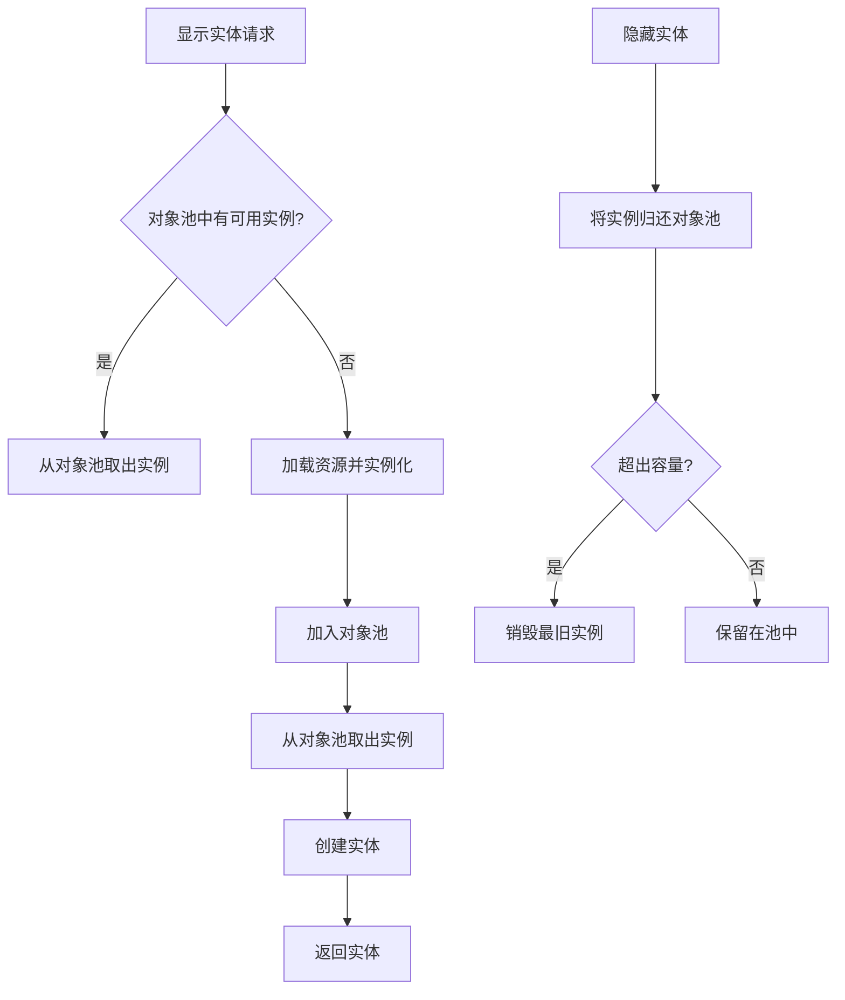

# 实体系统扩展

<cite>
**本文档中引用的文件**  
- [EntityHelperBase.cs](file://Scripts/Runtime/Entity/EntityHelperBase.cs)
- [DefaultEntityHelper.cs](file://Scripts/Runtime/Entity/DefaultEntityHelper.cs)
- [ResourceComponent.cs](file://Scripts/Runtime/Resource/ResourceComponent.cs)
- [EntityComponent.cs](file://Scripts/Runtime/Entity/EntityComponent.cs)
- [DefaultEntityGroupHelper.cs](file://Scripts/Runtime/Entity/DefaultEntityGroupHelper.cs)
</cite>

## 目录
1. [简介](#简介)
2. [核心组件](#核心组件)
3. [实体辅助器扩展](#实体辅助器扩展)
4. [默认实体辅助器分析](#默认实体辅助器分析)
5. [实体组辅助器扩展](#实体组辅助器扩展)
6. [高级实体辅助器实现示例](#高级实体辅助器实现示例)
7. [与框架组件的交互](#与框架组件的交互)
8. [结论](#结论)

## 简介
实体系统是游戏框架中的核心模块之一，负责管理游戏世界中所有可交互对象的生命周期。本指南深入探讨如何通过继承 `EntityHelperBase` 和 `EntityGroupHelperBase` 来扩展实体系统的功能，实现对实体实例化、创建和释放流程的完全控制。通过自定义实体辅助器，开发者可以精确管理实体的挂载层级、初始化逻辑和销毁策略，同时与资源系统紧密协作，确保资源的高效加载和释放。

## 核心组件

本节介绍实体系统扩展所涉及的核心组件及其关系。

**图示来源**
- [EntityHelperBase.cs](file://Scripts/Runtime/Entity/EntityHelperBase.cs#L15-L39)
- [DefaultEntityHelper.cs](file://Scripts/Runtime/Entity/DefaultEntityHelper.cs#L15-L71)
- [EntityComponent.cs](file://Scripts/Runtime/Entity/EntityComponent.cs#L107-L163)
- [ResourceComponent.cs](file://Scripts/Runtime/Resource/ResourceComponent.cs#L20-L1365)

**本节来源**
- [EntityHelperBase.cs](file://Scripts/Runtime/Entity/EntityHelperBase.cs#L15-L39)
- [DefaultEntityHelper.cs](file://Scripts/Runtime/Entity/DefaultEntityHelper.cs#L15-L71)
- [EntityComponent.cs](file://Scripts/Runtime/Entity/EntityComponent.cs#L107-L163)
- [ResourceComponent.cs](file://Scripts/Runtime/Resource/ResourceComponent.cs#L20-L1365)

## 实体辅助器扩展
实体辅助器（Entity Helper）是控制实体生命周期的关键组件。通过继承 `EntityHelperBase` 抽象类，开发者可以完全自定义实体的实例化、创建和释放行为。

`EntityHelperBase` 定义了三个核心抽象方法：
- `InstantiateEntity`: 负责将实体资源（如预制体）实例化为游戏对象。
- `CreateEntity`: 在实例化后，将游戏对象包装为框架可管理的实体，并进行初始化。
- `ReleaseEntity`: 在实体销毁时，执行资源释放和清理工作。

通过重写这些方法，可以实现如对象池管理、预加载、异步加载、自定义挂载逻辑等高级功能。

**本节来源**
- [EntityHelperBase.cs](file://Scripts/Runtime/Entity/EntityHelperBase.cs#L15-L39)

## 默认实体辅助器分析
`DefaultEntityHelper` 是 `EntityHelperBase` 的默认实现，展示了如何与 `ResourceComponent` 协作完成资源管理。

**图示来源**
- [DefaultEntityHelper.cs](file://Scripts/Runtime/Entity/DefaultEntityHelper.cs#L24-L70)
- [ResourceComponent.cs](file://Scripts/Runtime/Resource/ResourceComponent.cs#L955-L970)

**本节来源**
- [DefaultEntityHelper.cs](file://Scripts/Runtime/Entity/DefaultEntityHelper.cs#L15-L71)

### 实例化流程
`InstantiateEntity` 方法直接调用 Unity 的 `Instantiate` 函数，将传入的实体资源（`Object` 类型）克隆为新的游戏对象实例。这是最基础的实例化方式，开发者可以在此处替换为对象池的 `Spawn` 操作以提高性能。

### 创建流程
`CreateEntity` 方法负责将实例化的游戏对象整合到实体系统中。它首先验证实例的有效性，然后将其父对象设置为所属实体组的辅助器对象，确保实体在场景层级中的正确位置。最后，通过 `GetOrAddComponent<Entity>()` 方法为游戏对象添加或获取 `Entity` 组件，使其成为框架可识别的实体。

### 释放流程
`ReleaseEntity` 方法在实体销毁时被调用。它通过 `ResourceComponent` 的 `UnloadAsset` 方法卸载实体资源，释放内存，并调用 `Destroy` 销毁游戏对象实例。`Start` 方法在组件初始化时获取 `ResourceComponent` 的引用，建立与资源系统的连接。

## 实体组辅助器扩展
`EntityGroupHelperBase` 是实体组辅助器的基类，目前为空的抽象类。虽然默认实现 `DefaultEntityGroupHelper` 没有提供额外功能，但该基类为扩展实体组行为提供了接口。

通过继承 `EntityGroupHelperBase`，开发者可以自定义实体组的加载策略、资源管理方式或行为逻辑。例如，可以实现一个 `PreloadEntityGroupHelper`，在实体组创建时预加载所有相关资源，减少后续实体显示时的加载延迟。

**本节来源**
- [EntityGroupHelperBase.cs](file://Scripts/Runtime/Entity/EntityGroupHelperBase.cs#L15-L17)
- [DefaultEntityGroupHelper.cs](file://Scripts/Runtime/Entity/DefaultEntityGroupHelper.cs#L12-L14)

## 高级实体辅助器实现示例
以下是一个实现了预加载和对象池管理的高级实体辅助器示例。

**图示来源**
- [DefaultEntityHelper.cs](file://Scripts/Runtime/Entity/DefaultEntityHelper.cs#L24-L70)
- [EntityComponent.cs](file://Scripts/Runtime/Entity/EntityComponent.cs#L212-L232)

**本节来源**
- [DefaultEntityHelper.cs](file://Scripts/Runtime/Entity/DefaultEntityHelper.cs#L15-L71)
- [EntityComponent.cs](file://Scripts/Runtime/Entity/EntityComponent.cs#L212-L232)

### 预加载实现
在 `Start` 或 `Awake` 方法中，可以主动调用 `ResourceComponent.LoadAsset` 加载常用实体资源，并保留在内存中。这可以显著减少首次显示实体时的加载时间。

### 对象池集成
在 `InstantiateEntity` 中，优先从对象池获取实例，而不是每次都调用 `Instantiate`。在 `ReleaseEntity` 中，不立即销毁实例，而是将其归还到对象池，供后续复用。这能有效减少内存分配和垃圾回收的压力。

## 与框架组件的交互
自定义实体辅助器必须与框架的其他核心组件正确交互，以确保系统的稳定运行。

### 与资源组件的交互
`DefaultEntityHelper` 通过 `GameEntry.GetComponent<ResourceComponent>()` 在 `Start` 时获取 `ResourceComponent` 的引用。这是与资源系统交互的标准方式。在扩展时，应确保在资源加载完成后再进行实体实例化，并在释放时正确调用 `UnloadAsset`。

### 与实体组件的交互
`EntityComponent` 在 `Start` 时通过 `Helper.CreateHelper` 创建 `EntityHelperBase` 的实例，并通过 `SetEntityHelper` 注册到 `IEntityManager`。这确保了实体操作的统一入口。自定义辅助器应遵循此模式，确保被正确初始化和管理。

### 与场景和事件系统的交互
实体的创建和销毁通常会触发相应的事件。`EntityComponent` 会监听 `ShowEntitySuccess`、`HideEntityComplete` 等事件，并通过 `EventComponent` 进行广播。自定义逻辑应考虑这些事件，以便其他系统能及时响应实体状态的变化。

**本节来源**
- [EntityComponent.cs](file://Scripts/Runtime/Entity/EntityComponent.cs#L107-L163)
- [DefaultEntityHelper.cs](file://Scripts/Runtime/Entity/DefaultEntityHelper.cs#L62-L70)
- [ResourceComponent.cs](file://Scripts/Runtime/Resource/ResourceComponent.cs#L873-L970)

## 结论
通过继承 `EntityHelperBase` 和 `EntityGroupHelperBase`，开发者可以深度定制实体系统的各个方面。`DefaultEntityHelper` 提供了一个与 `ResourceComponent` 协作的优秀范例，展示了如何管理资源的加载和释放。通过实现预加载和对象池管理，可以显著提升游戏性能和用户体验。在扩展时，务必注意与 `EntityComponent`、`ResourceComponent` 等核心组件的正确交互，确保整个框架的稳定性和一致性。