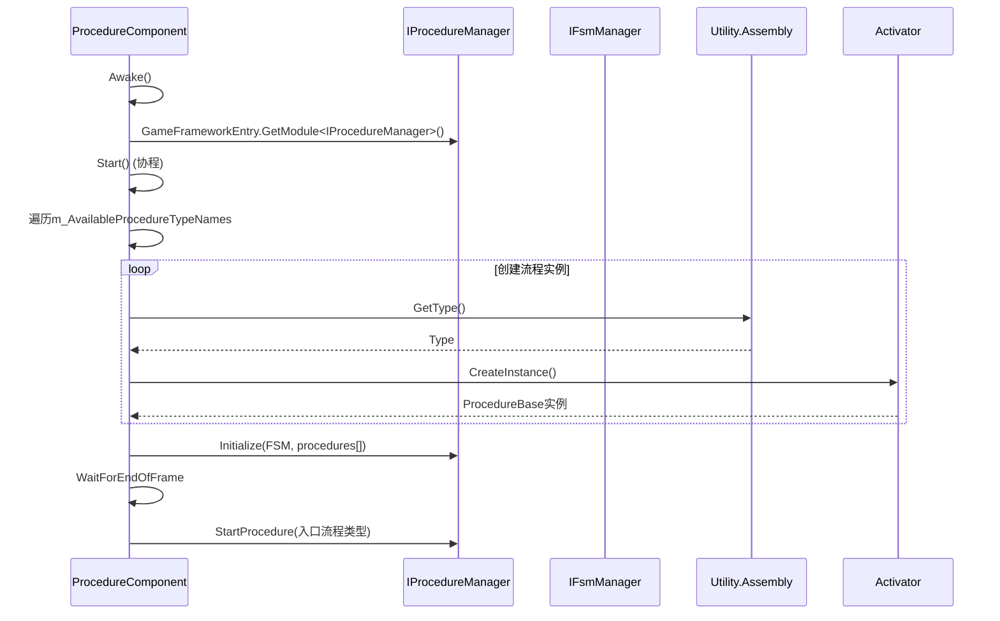
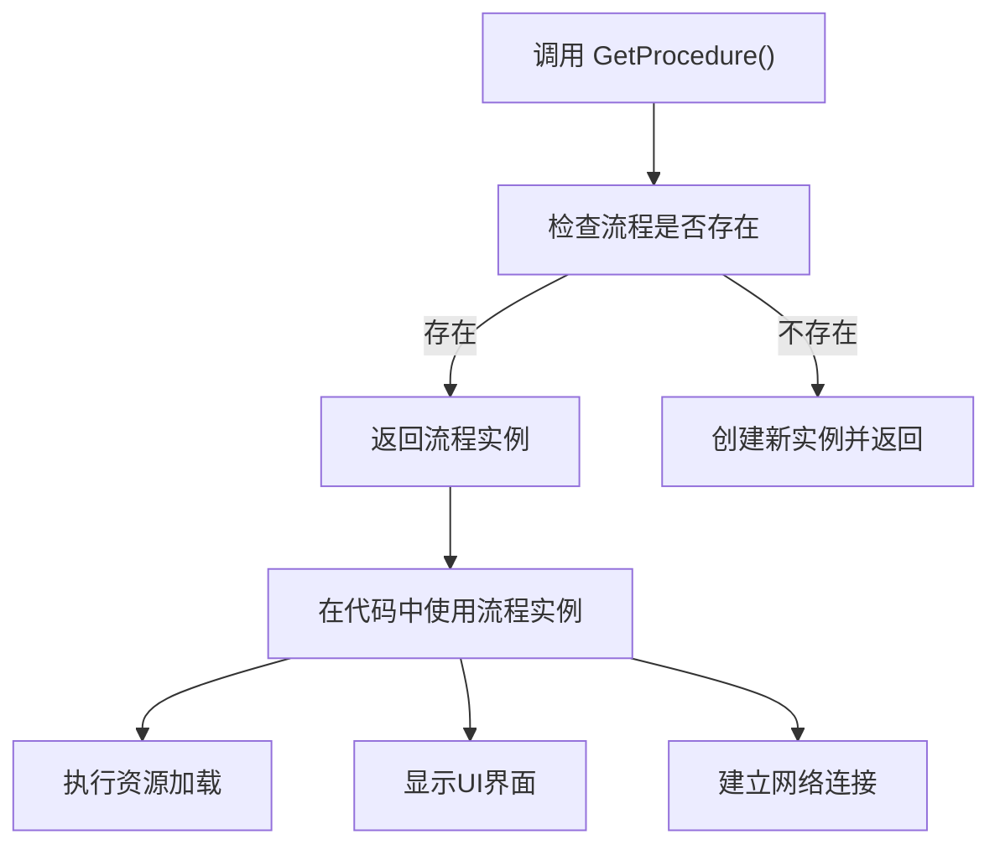

# 游戏流程扩展

<cite>
**本文档中引用的文件**  
- [ProcedureComponent.cs](file://Scripts/Runtime/Procedure/ProcedureComponent.cs)
- [ProcedureComponentInspector.cs](file://Scripts/Editor/Inspector/ProcedureComponentInspector.cs)
</cite>

## 目录
1. [简介](#简介)
2. [流程系统架构](#流程系统架构)
3. [定义自定义流程](#定义自定义流程)
4. [流程组件管理机制](#流程组件管理机制)
5. [流程注册与切换](#流程注册与切换)
6. [流程实例获取与操作](#流程实例获取与操作)
7. [最佳实践与设计建议](#最佳实践与设计建议)

## 简介
游戏流程扩展系统是UnityGameFramework中的核心状态管理机制，用于组织和控制游戏运行时的不同阶段，如启动、登录、主城等。该系统基于有限状态机（FSM）实现，通过继承`ProcedureBase`基类来定义具体的流程节点，并由`ProcedureComponent`统一管理流程的初始化、切换和生命周期。本指导文档详细说明如何扩展和使用该流程系统。

## 流程系统架构

```mermaid
graph TB
subgraph "核心组件"
PC[ProcedureComponent]
PM[IProcedureManager]
FSM[IFsmManager]
end
subgraph "流程定义"
PB[ProcedureBase]
P1[ProcedureLaunch]
P2[ProcedureLogin]
P3[ProcedureMainCity]
end
PC --> PM : "获取模块"
PC --> FSM : "提供管理器"
PM --> FSM : "初始化FSM"
PB --> P1
PB --> P2
PB --> P3
PC --> P1 : "创建实例"
PC --> P2 : "创建实例"
PC --> P3 : "创建实例"
PM --> P1 : "状态管理"
PM --> P2 : "状态管理"
PM --> P3 : "状态管理"
```

**图示来源**  
- [ProcedureComponent.cs](file://Scripts/Runtime/Procedure/ProcedureComponent.cs#L19-L146)

**本节来源**  
- [ProcedureComponent.cs](file://Scripts/Runtime/Procedure/ProcedureComponent.cs#L19-L146)

## 定义自定义流程
要创建新的游戏流程，需继承`ProcedureBase`抽象类并实现其生命周期方法。每个流程代表游戏中的一个特定状态，例如启动流程、登录流程或主城流程。通过重写`OnInit`、`OnEnter`、`OnUpdate`和`OnLeave`等方法，可定义流程的初始化逻辑、进入行为、每帧更新和退出清理操作。

在自定义流程中，可以集成资源加载、UI界面显示、网络连接建立等具体业务逻辑。流程类的设计应遵循单一职责原则，确保每个流程只负责特定功能的管理。

## 流程组件管理机制
`ProcedureComponent`是流程系统的运行时管理组件，负责初始化流程管理器、创建流程实例并启动入口流程。该组件通过序列化字段`m_AvailableProcedureTypeNames`和`m_EntranceProcedureTypeName`在Unity编辑器中配置可用流程类型及初始流程。



**图示来源**  
- [ProcedureComponent.cs](file://Scripts/Runtime/Procedure/ProcedureComponent.cs#L54-L92)
- [ProcedureComponent.cs](file://Scripts/Runtime/Procedure/ProcedureComponent.cs#L94-L147)

**本节来源**  
- [ProcedureComponent.cs](file://Scripts/Runtime/Procedure/ProcedureComponent.cs#L19-L146)

## 流程注册与切换
流程的注册通过在`ProcedureComponent`的Inspector面板中配置完成。开发者可在编辑器中选择可用的流程类型，并指定入口流程。系统在运行时通过反射机制创建这些流程的实例，并将其注册到内部的`IProcedureManager`中。

流程间的切换由`IProcedureManager`控制，通常在当前流程的`OnUpdate`方法中根据条件判断调用`ChangeState<T>()`来跳转到下一个流程。例如，启动流程完成资源预加载后可切换至登录流程，登录成功后再进入主城流程。

## 流程实例获取与操作
开发者可通过`GetProcedure<T>()`泛型方法获取特定流程的实例，从而访问其公共属性和方法。此功能适用于需要跨流程通信或查询特定流程状态的场景。



**图示来源**  
- [ProcedureComponent.cs](file://Scripts/Runtime/Procedure/ProcedureComponent.cs#L132-L135)
- [ProcedureComponent.cs](file://Scripts/Runtime/Procedure/ProcedureComponent.cs#L142-L145)

**本节来源**  
- [ProcedureComponent.cs](file://Scripts/Runtime/Procedure/ProcedureComponent.cs#L132-L145)

## 最佳实践与设计建议
设计健壮的流程系统时，应确保流程边界清晰、职责明确。避免在单个流程中堆积过多逻辑，可通过拆分细粒度流程来提高可维护性。建议为每个流程添加明确的进入和退出条件，并在`OnUpdate`中合理使用时间间隔控制更新频率，防止性能问题。

利用`HasProcedure<T>()`方法检查流程存在性后再进行操作，可增强代码安全性。同时，应在流程切换时妥善处理资源释放和事件注销，防止内存泄漏。通过合理规划流程依赖关系，可构建稳定、可扩展的游戏状态管理系统。