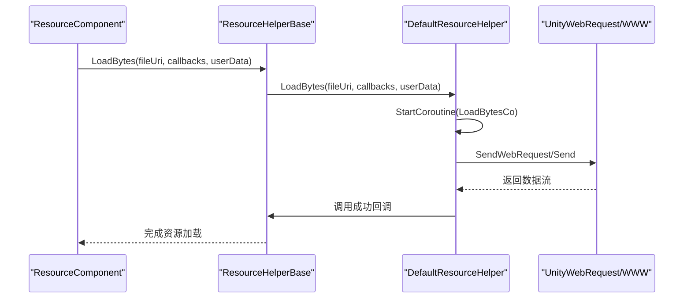
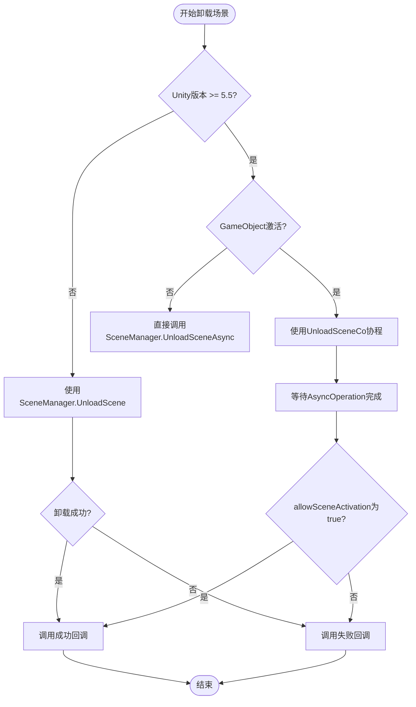
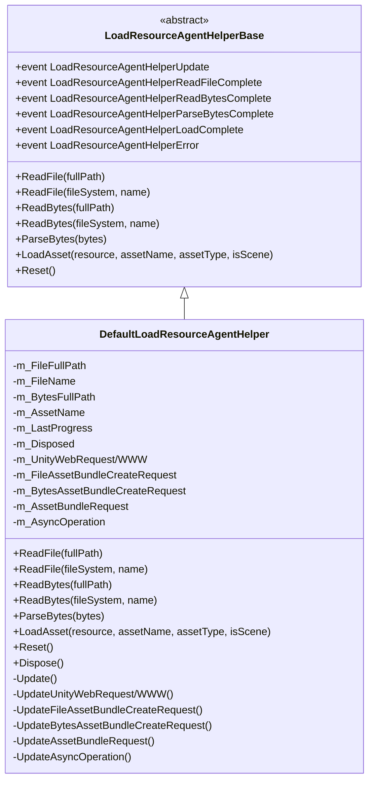
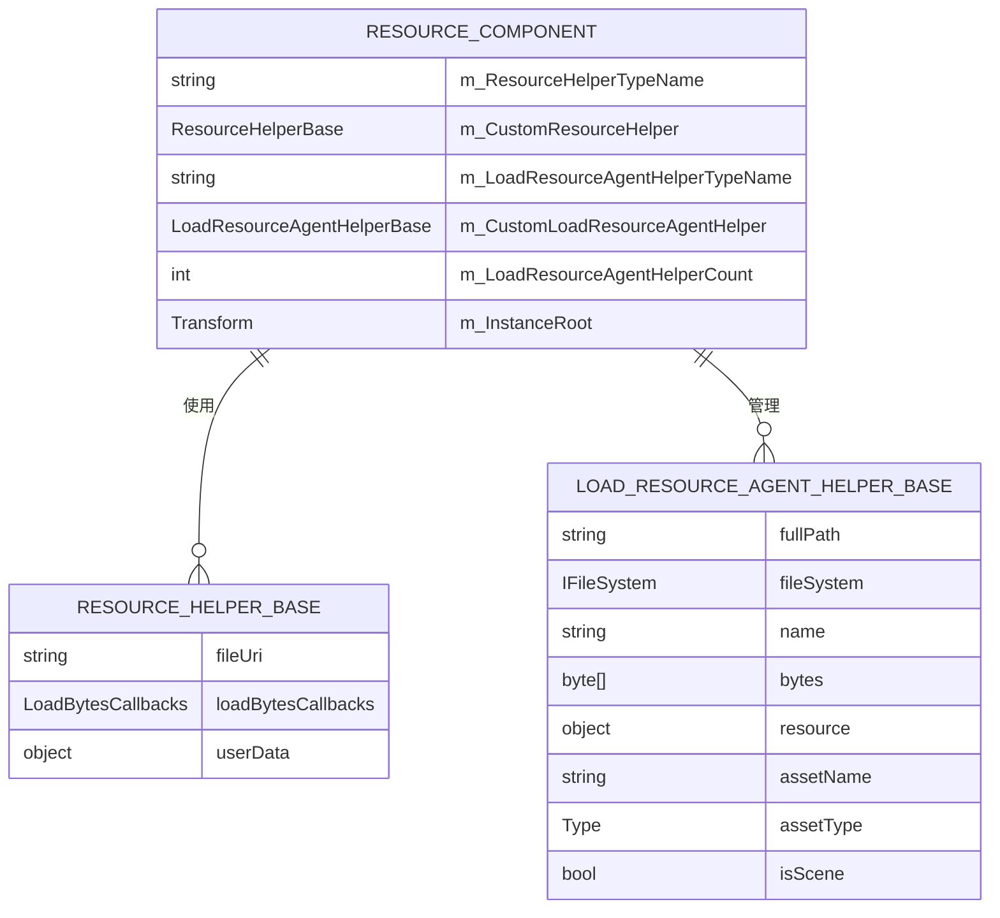

<cite>
**Referenced Files in This Document**   
- [ResourceHelperBase.cs](file://Scripts/Runtime/Resource/ResourceHelperBase.cs)
- [DefaultResourceHelper.cs](file://Scripts/Runtime/Resource/DefaultResourceHelper.cs)
- [LoadResourceAgentHelperBase.cs](file://Scripts/Runtime/Resource/LoadResourceAgentHelperBase.cs)
- [DefaultLoadResourceAgentHelper.cs](file://Scripts/Runtime/Resource/DefaultLoadResourceAgentHelper.cs)
- [ResourceComponent.cs](file://Scripts/Runtime/Resource/ResourceComponent.cs)
</cite>

# 资源系统扩展

## Table of Contents
1. [资源辅助器扩展机制](#资源辅助器扩展机制)
2. [自定义资源加载逻辑](#自定义资源加载逻辑)
3. [资源卸载与释放](#资源卸载与释放)
4. [加载资源代理辅助器](#加载资源代理辅助器)
5. [资源组件配置](#资源组件配置)
6. [扩展实践与最佳实践](#扩展实践与最佳实践)

## 资源辅助器扩展机制

资源系统通过继承 `ResourceHelperBase` 基类来实现自定义的资源加载、卸载和释放逻辑。`ResourceHelperBase` 是一个抽象类，定义了三个核心方法：`LoadBytes`、`UnloadScene` 和 `Release`，开发者需要重写这些方法以实现特定的资源处理逻辑。

`ResourceHelperBase` 作为资源辅助器的基类，提供了与资源管理器交互的接口。通过继承该类，开发者可以完全控制资源的加载方式，包括从本地文件系统、网络CDN或自定义存储中加载资源。这种设计模式允许开发者根据项目需求灵活地集成不同的网络请求库，如 `UnityWebRequest` 或 `WWW`。

在资源组件初始化时，会根据配置创建相应的资源辅助器实例，并将其注册到资源管理器中。这种基于配置的实例化机制使得在不同环境下使用不同的资源加载策略成为可能，例如在编辑器模式下使用直接文件访问，在发布版本中使用网络CDN。

**Section sources**
- [ResourceHelperBase.cs](file://Scripts/Runtime/Resource/ResourceHelperBase.cs#L15-L38)
- [ResourceComponent.cs](file://Scripts/Runtime/Resource/ResourceComponent.cs#L80-L100)

## 自定义资源加载逻辑

以 `DefaultResourceHelper` 为例，该类实现了 `ResourceHelperBase` 的 `LoadBytes` 方法，展示了如何通过协程异步加载资源数据流。`LoadBytes` 方法根据 Unity 版本的不同，选择使用 `UnityWebRequest` 或 `WWW` 进行网络请求，体现了对不同 Unity 版本 API 差异的处理。

**Diagram sources**
- [DefaultResourceHelper.cs](file://Scripts/Runtime/Resource/DefaultResourceHelper.cs#L29-L32)
- [ResourceComponent.cs](file://Scripts/Runtime/Resource/ResourceComponent.cs#L120-L150)

`LoadBytesCo` 协程方法封装了具体的网络请求逻辑，包括错误处理、性能监控和回调函数的调用。通过 `DateTime.Now` 记录请求开始时间，可以计算资源加载的耗时，这对于性能优化和用户体验监控非常重要。在请求完成后，根据结果调用相应的成功或失败回调函数，实现了异步加载的完整流程。

开发者在扩展时，可以重写 `LoadBytes` 方法来集成第三方 CDN 服务，实现特殊的缓存策略，或使用不同的网络请求库。例如，可以集成 `HttpClient` 或 `Curl` 库来实现更高级的网络功能，如断点续传、多线程下载等。

**Section sources**
- [DefaultResourceHelper.cs](file://Scripts/Runtime/Resource/DefaultResourceHelper.cs#L29-L80)
- [ResourceComponent.cs](file://Scripts/Runtime/Resource/ResourceComponent.cs#L120-L150)

## 资源卸载与释放

`UnloadScene` 和 `Release` 方法分别负责场景的卸载和资源的释放。`UnloadScene` 方法根据 Unity 版本的不同，采用不同的场景卸载策略。在 Unity 5.5 及以上版本中，使用 `SceneManager.UnloadSceneAsync` 异步卸载场景，并通过协程等待卸载完成；在较早版本中，则使用同步的 `SceneManager.UnloadScene` 方法。

**Diagram sources**
- [DefaultResourceHelper.cs](file://Scripts/Runtime/Resource/DefaultResourceHelper.cs#L40-L60)
- [ResourceComponent.cs](file://Scripts/Runtime/Resource/ResourceComponent.cs#L150-L180)

`Release` 方法负责释放资源对象，目前主要处理 `AssetBundle` 的释放。通过 `assetBundle.Unload(true)` 方法，可以完全卸载 AssetBundle 及其包含的所有资源。注释中提到的 `Resources.UnloadAsset` 在 iOS 设备上的问题，提醒开发者在处理特定平台时需要注意潜在的兼容性问题。

在扩展时，开发者需要考虑线程安全问题，确保资源释放操作在主线程中执行。同时，异常处理也非常重要，应该捕获并处理可能的异常，避免程序崩溃。性能优化方面，可以考虑延迟释放、批量释放等策略，以减少对主线程的阻塞。

**Section sources**
- [DefaultResourceHelper.cs](file://Scripts/Runtime/Resource/DefaultResourceHelper.cs#L65-L85)
- [ResourceComponent.cs](file://Scripts/Runtime/Resource/ResourceComponent.cs#L150-L180)

## 加载资源代理辅助器

`LoadResourceAgentHelperBase` 是加载资源代理辅助器的基类，定义了资源加载过程中的各个阶段事件和方法。与 `ResourceHelperBase` 不同，`LoadResourceAgentHelperBase` 更关注资源加载的中间过程，如读取文件、解析字节流、加载资源等。

`DefaultLoadResourceAgentHelper` 实现了 `LoadResourceAgentHelperBase`，提供了完整的资源加载代理功能。它通过 `Update` 方法定期检查各个异步操作的进度，并触发相应的事件。这种基于事件的架构使得资源加载过程可以被精确监控和控制。

**Diagram sources**
- [LoadResourceAgentHelperBase.cs](file://Scripts/Runtime/Resource/LoadResourceAgentHelperBase.cs#L17-L94)
- [DefaultLoadResourceAgentHelper.cs](file://Scripts/Runtime/Resource/DefaultLoadResourceAgentHelper.cs#L25-L594)

`DefaultLoadResourceAgentHelper` 的设计体现了分层处理的思想，将资源加载过程分解为多个独立的阶段，每个阶段都有相应的处理方法和事件。这种设计不仅提高了代码的可维护性，也为定制化提供了便利。开发者可以根据需要重写特定阶段的方法，实现自定义的加载行为。

**Section sources**
- [LoadResourceAgentHelperBase.cs](file://Scripts/Runtime/Resource/LoadResourceAgentHelperBase.cs#L17-L94)
- [DefaultLoadResourceAgentHelper.cs](file://Scripts/Runtime/Resource/DefaultLoadResourceAgentHelper.cs#L25-L594)

## 资源组件配置

`ResourceComponent` 是资源系统的入口点，负责管理资源辅助器和加载资源代理辅助器的生命周期。通过 `m_ResourceHelperTypeName` 和 `m_CustomResourceHelper` 字段，可以在运行时配置使用的资源辅助器类型。

**Diagram sources**
- [ResourceComponent.cs](file://Scripts/Runtime/Resource/ResourceComponent.cs#L85-L95)
- [ResourceHelperBase.cs](file://Scripts/Runtime/Resource/ResourceHelperBase.cs#L15-L38)
- [LoadResourceAgentHelperBase.cs](file://Scripts/Runtime/Resource/LoadResourceAgentHelperBase.cs#L17-L94)

在 `Start` 方法中，`ResourceComponent` 通过 `Helper.CreateHelper` 工厂方法创建资源辅助器实例，并将其添加到资源管理器中。同时，根据 `m_LoadResourceAgentHelperCount` 的配置，创建相应数量的加载资源代理辅助器，实现了资源加载的并发处理。

这种配置机制使得资源系统具有很高的灵活性，开发者可以通过修改配置来切换不同的资源加载策略，而无需修改代码。例如，可以在开发环境中使用 `DefaultResourceHelper`，在生产环境中使用自定义的 `CDNResourceHelper`。

**Section sources**
- [ResourceComponent.cs](file://Scripts/Runtime/Resource/ResourceComponent.cs#L80-L100)
- [ResourceComponent.cs](file://Scripts/Runtime/Resource/ResourceComponent.cs#L200-L250)

## 扩展实践与最佳实践

在扩展资源系统时，需要注意以下几个关键问题：

1. **线程安全**：所有资源加载和释放操作都应在主线程中执行，避免多线程访问导致的竞态条件。
2. **异常处理**：应捕获并处理可能的异常，提供有意义的错误信息，避免程序崩溃。
3. **性能优化**：考虑使用对象池、缓存等技术减少内存分配和GC压力。
4. **版本兼容性**：注意不同 Unity 版本的 API 差异，使用预处理器指令进行条件编译。
5. **资源管理**：正确管理资源的生命周期，避免内存泄漏。

创建自定义资源辅助器的步骤如下：
1. 创建继承 `ResourceHelperBase` 的新类
2. 重写 `LoadBytes`、`UnloadScene` 和 `Release` 方法
3. 在 `ResourceComponent` 中配置新的资源辅助器类型
4. 测试并优化性能

通过遵循这些最佳实践，可以创建高效、稳定且易于维护的资源扩展，满足项目的特定需求。

**Section sources**
- [ResourceHelperBase.cs](file://Scripts/Runtime/Resource/ResourceHelperBase.cs#L15-L38)
- [DefaultResourceHelper.cs](file://Scripts/Runtime/Resource/DefaultResourceHelper.cs#L21-L181)
- [LoadResourceAgentHelperBase.cs](file://Scripts/Runtime/Resource/LoadResourceAgentHelperBase.cs#L17-L94)
- [ResourceComponent.cs](file://Scripts/Runtime/Resource/ResourceComponent.cs#L80-L250)